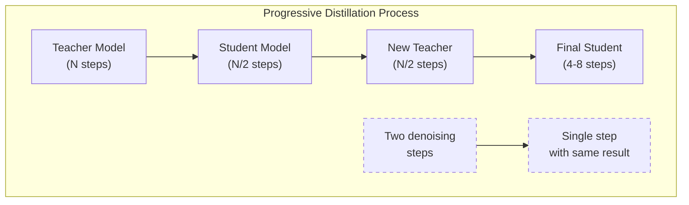
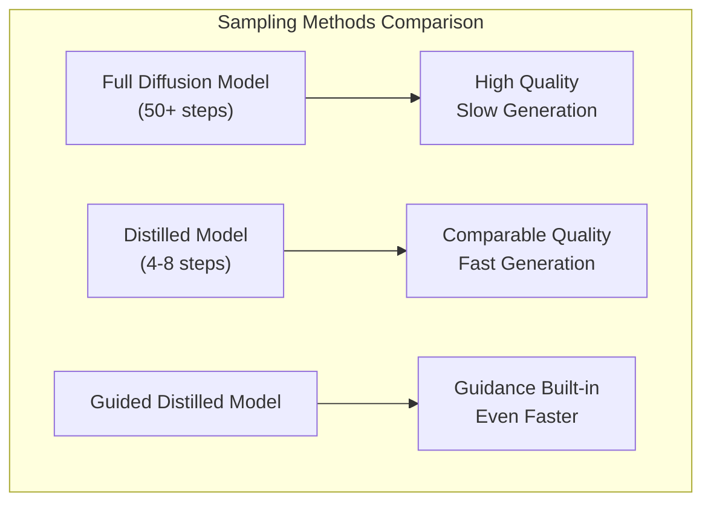
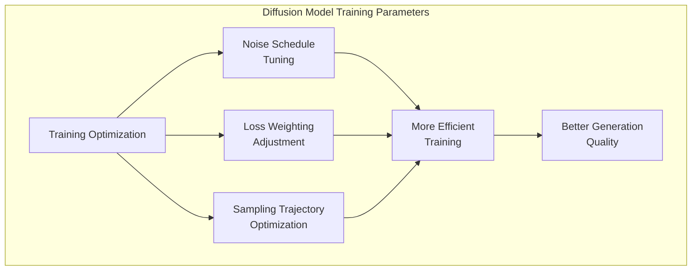
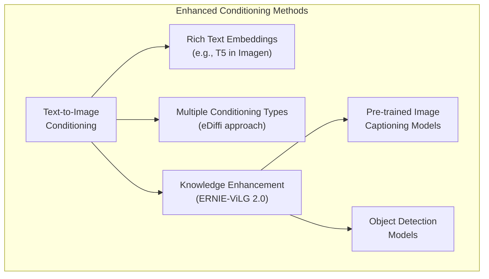
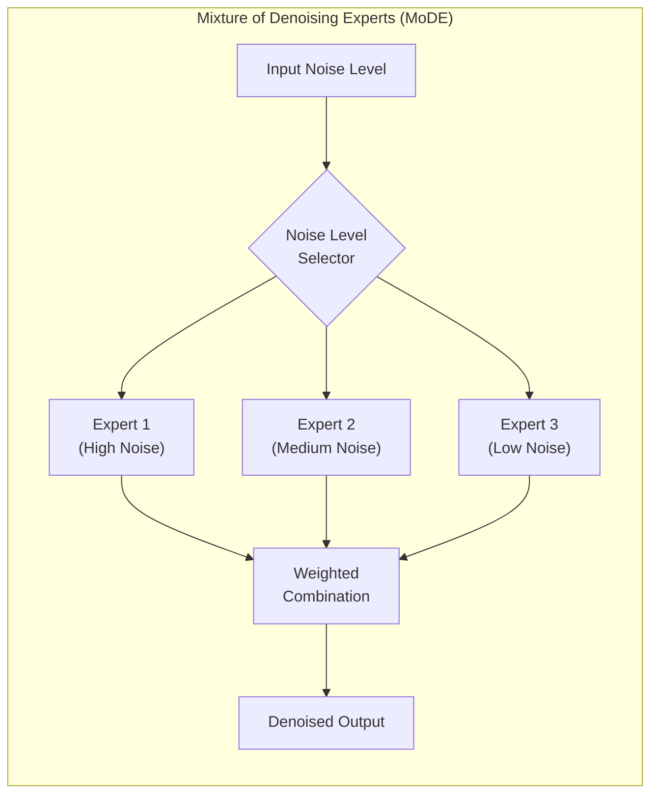

<!-- source: DeepWiki mcp.deepwiki.com · repo huggingface/diffusion-models-class · page 6.1 Faster Sampling and Training Improvements · fetched 2026-10-26 -->

# Faster Sampling and Training Improvements

Relevant source files

The following files were used as context for generating this wiki page:

- [unit4/02_diffusion_for_audio.ipynb](unit4/02_diffusion_for_audio.ipynb)
- [unit4/README.md](unit4/README.md)

## Purpose and Scope

This page documents advanced techniques for accelerating the sampling process in diffusion models and enhancing their training procedures. These methods represent recent research developments that enable faster inference and improved generation quality. For information about basic diffusion model concepts, see [Introduction to Diffusion Models](#3). For control techniques and editing capabilities, see [Enhanced Control for Generation and Editing](#6.2).

## Faster Sampling via Distillation

Diffusion models typically require dozens or hundreds of sequential steps to generate high-quality images, making inference slow. Progressive distillation addresses this performance bottleneck by training more efficient models that require fewer steps.

### Progressive Distillation

Progressive distillation is a technique where a "student" model is trained to match the outputs of a "teacher" model while using fewer denoising steps. The process works as follows:

The key principles of progressive distillation:

1. Initialize a student model with the teacher model's weights
2. During training, the teacher performs two sampling steps while the student attempts to match the result in a single step
3. The student model becomes the teacher for the next distillation stage
4. This process is repeated until reaching models that can produce good results in just 4-8 steps

Guided distillation extends this concept to create models that can incorporate classifier-free guidance in a single step, further reducing the number of model evaluations needed.

Sources: [unit4/README.md:31-46]()

### Distilled Models in Practice

Distilled models make a tradeoff between speed and quality, but can achieve near-equivalent results with drastically reduced computation:

A distilled version of Stable Diffusion is available in the Diffusers library, allowing for much faster image generation with minimal quality loss.

Sources: [unit4/README.md:40-41]()

## Training Improvements

Recent research has introduced numerous techniques to enhance diffusion model training, leading to better generation quality and capabilities.

### Noise Schedule and Trajectory Optimization

Careful tuning of noise schedules, loss weighting, and sampling trajectories significantly impacts model performance. The design space for these parameters has been systematically explored in recent research.

Sources: [unit4/README.md:54-56]()

### Aspect Ratio and Resolution Strategies

Training on diverse aspect ratios allows models to generate images of varying dimensions, expanding their practical applications. This technique is crucial for models like Stable Diffusion that need to handle different output formats.

For high-resolution image generation, cascaded diffusion models have proven effective. This approach uses:
- An initial model that generates low-resolution images
- One or more super-resolution models that progressively enhance resolution

This cascade architecture is employed in systems like DALLE-2 and Imagen.

Sources: [unit4/README.md:57-58]()

### Enhanced Conditioning Techniques

Advanced conditioning methods improve a model's ability to follow prompts and generate appropriate content:

These advanced conditioning approaches provide more precise control over the generation process and lead to better alignment between prompts and generated images.

Sources: [unit4/README.md:59-60]()

### Mixture of Denoising Experts (MoDE)

The MoDE approach trains specialized model variants ("experts") for different noise levels in the diffusion process, then combines them during inference:

This technique allows each expert to specialize in a particular noise regime, improving overall performance compared to a single model that must handle all noise levels.

Sources: [unit4/README.md:60-61]()

## Implementation Examples

### DDIM Inversion

DDIM inversion is a technique that "reverses" the sampling trajectory rather than adding random noise, providing more control over the generation process. The Unit 4 materials include a notebook demonstrating this technique for image editing.

Sources: [unit4/README.md:153-161]()

## Key References

The field of faster sampling and training improvements is rapidly evolving, with significant contributions from the following papers:

1. **Progressive Distillation:**
   - "Progressive Distillation For Fast Sampling Of Diffusion Models" (Salimans & Ho, 2022)
   - "On Distillation Of Guided Diffusion Models" (Meng et al., 2022)

2. **Training Improvements:**
   - "Elucidating the Design Space of Diffusion-Based Generative Models" (Karras et al., 2022)
   - "eDiffi: Text-to-Image Diffusion Models with an Ensemble of Expert Denoisers"
   - "ERNIE-ViLG 2.0: Improving Text-to-Image Diffusion Model with Knowledge-Enhanced Mixture-of-Denoising-Experts"
   - "Imagen - Photorealistic Text-to-Image Diffusion Models with Deep Language Understanding"

Sources: [unit4/README.md:43-66]()

## Practical Applications

These techniques have practical benefits for diffusion model deployment:

| Technique | Performance Improvement | Common Applications |
|-----------|-------------------------|---------------------|
| Progressive Distillation | 5-10x faster inference | Mobile applications, real-time generation |
| Guided Distillation | Combines guidance and speed | Text-to-image generation with prompts |
| Noise Schedule Optimization | More efficient training | Reducing computational requirements |
| Cascaded Models | High-resolution generation | Creating detailed, large images |
| MoDE | Better handling of different noise levels | Improving overall image quality |

For hands-on exploration of these techniques, refer to the DDIM Inversion notebook that demonstrates advanced sampling control.

Sources: [unit4/README.md:152-161]()

---

