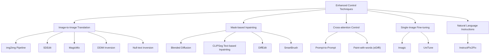
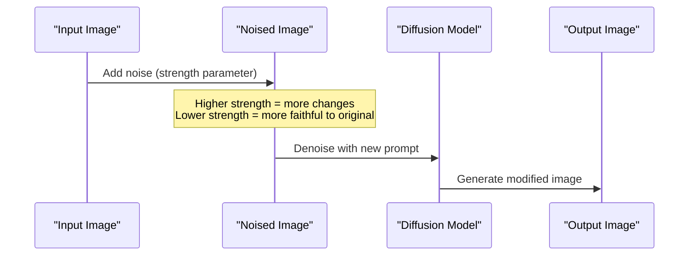
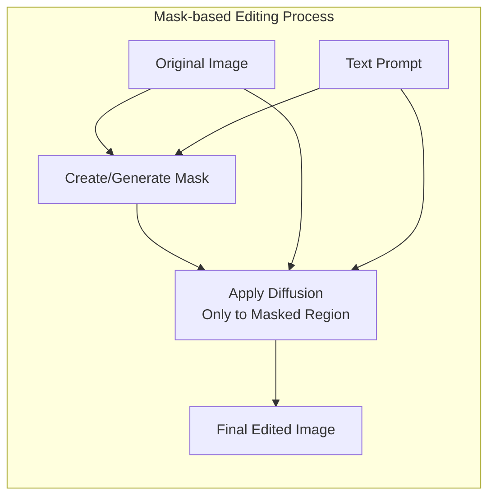
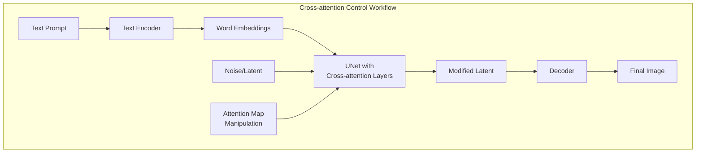
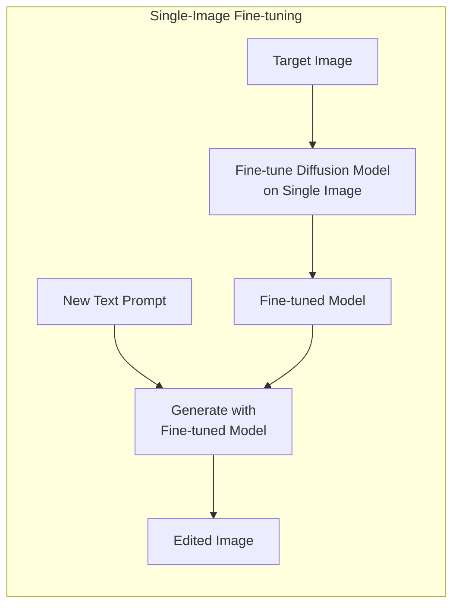
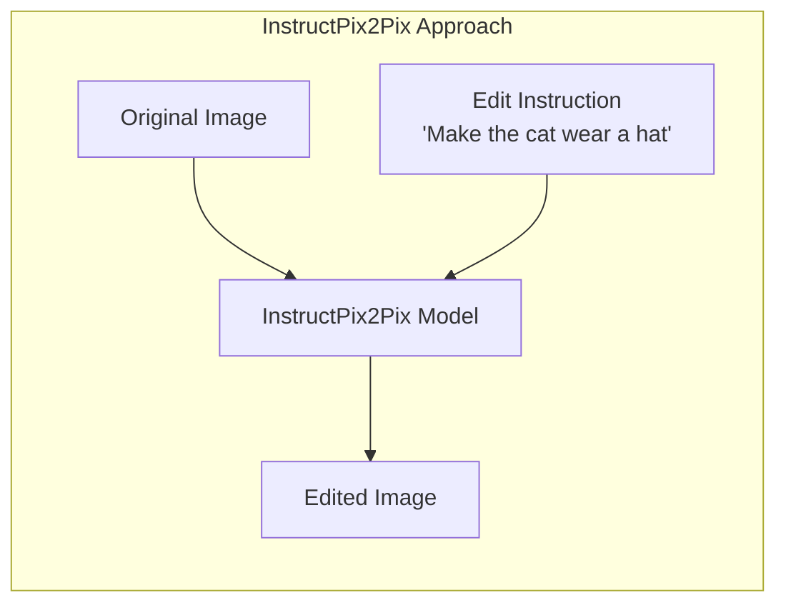
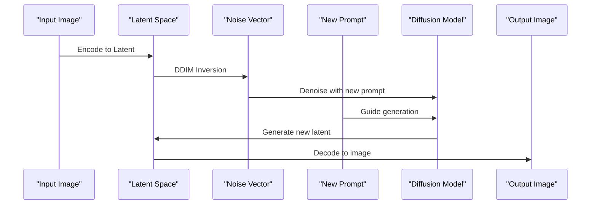

<!-- source: DeepWiki mcp.deepwiki.com · repo huggingface/diffusion-models-class · page 6.2 Enhanced Control for Generation and Editing · fetched 2026-10-26 -->

# Enhanced Control for Generation and Editing

Relevant source files

The following files were used as context for generating this wiki page:

- [unit4/02_diffusion_for_audio.ipynb](unit4/02_diffusion_for_audio.ipynb)
- [unit4/README.md](unit4/README.md)

## Purpose and Scope

This document explains advanced techniques for controlling diffusion models during generation and editing processes. We cover methods that provide fine-grained control over image editing, enabling precise modifications to generated outputs. These techniques represent recent innovations in the field, extending beyond standard text-to-image generation by allowing for detailed manipulation of images with diffusion models.

For information about basic diffusion model concepts, see [Unit 1: Introduction to Diffusion Models](#3). For guidance on conditioning methods, see [Guidance and Conditioning Methods](#4.2).

## Taxonomy of Image Generation and Editing Techniques

Below is a taxonomy of the major techniques for enhancing control in diffusion-based image generation and editing:

Sources: [unit4/README.md:68-94]()

## Image-to-Image Translation

Image-to-Image (img2img) translation techniques allow for transforming existing images using diffusion models, rather than generating completely new ones from random noise. These approaches generally work by:

1. Starting with an existing image
2. Adding a controlled amount of noise to destroy some of the original details
3. Denoising using a new prompt to guide the generation

Key techniques in this category include:

| Technique | Description | Key Innovation |
|-----------|------------|----------------|
| img2img | Basic approach for transforming images with new prompts | Controllable noise level |
| SDEdit | Adds noise to specific parts of an image | Region-specific editing |
| MagicMix | Progressive mixing of content and style | Better preservation of structure |
| DDIM Inversion | Uses deterministic sampling to "reverse" the diffusion process | More precise control than random noise |
| Null-text Inversion | Optimizes unconditional embeddings during the process | Significantly improved text-based editing |

The DDIM Inversion technique is demonstrated in the provided notebook. This approach enables more precise reconstructions by leveraging DDIM's deterministic sampling properties.

Sources: [unit4/README.md:77-81]()

## Mask-based Editing and Inpainting

Mask-based editing extends img2img techniques by applying modifications only to specific regions of an image, defined by a mask. The unmasked regions remain unchanged, allowing for targeted edits.

Key approaches:

1. **Blended Diffusion**: Pioneered the concept of localized editing with diffusion models
2. **Text-based Inpainting with CLIPSeg**: Uses a pretrained model to automatically generate masks from text descriptions
3. **DiffEdit**: Leverages the diffusion model itself to identify which regions should be modified based on text prompt changes
4. **SmartBrush**: Fine-tunes models specifically for the inpainting task, allowing for more accurate and coherent results

These techniques are particularly valuable for practical applications where users want to modify specific elements of an image without changing everything else.

Sources: [unit4/README.md:82-86]()

## Cross-attention Control

Cross-attention control represents one of the most powerful approaches for fine-grained control of generation. It leverages the internal attention mechanisms of diffusion models to control where specific concepts appear in the generated image.

Key implementations:

1. **Prompt-to-Prompt Image Editing**:
   - Controls cross-attention maps to maintain spatial layout while changing content
   - Allows for word swapping, addition, and removal with spatial consistency

2. **Paint-with-words (eDiffi)**:
   - Allows users to associate text prompts with specific regions of the image
   - Creates a more intuitive interface for spatial control

Cross-attention control works by manipulating the internal attention maps of the model during the sampling process, directly controlling how and where text concepts influence the generated image.

Sources: [unit4/README.md:87-89]()

## Single-Image Fine-tuning

Another powerful approach involves fine-tuning a pretrained diffusion model on a specific image, effectively "overfitting" the model to that image. This enables high-quality edits that maintain the key characteristics of the original image.

Two notable implementations of this approach:

1. **Imagic**: Fine-tunes both the text embedding and the diffusion model to enable text-driven edits of real images
2. **UniTune**: Focuses on efficient fine-tuning strategies for single-image adaptation

This approach produces high-fidelity edits that maintain the identity and key features of the original image, though at the cost of requiring a separate fine-tuning process for each source image.

Sources: [unit4/README.md:90-92]()

## Natural Language Instruction-based Editing

Recent advances have moved toward more intuitive interfaces where users can simply describe the edits they want in natural language.

The most prominent example is **InstructPix2Pix**, which was trained on a synthetic dataset of image pairs and corresponding edit instructions (generated with GPT-3.5). This enables the model to follow natural language instructions for image editing, making the technology more accessible to non-technical users.

This approach represents a significant step toward more intuitive human-AI collaboration in creative processes.

Sources: [unit4/README.md:94-94]()

## Practical Implementation: DDIM Inversion

A practical implementation of enhanced control techniques is DDIM inversion, which is demonstrated in the notebook [01_ddim_inversion.ipynb](). 

DDIM inversion works by:
1. Using a deterministic sampling process (DDIM) to reverse-engineer the noise that would produce a given image
2. Modifying the prompt or other parameters
3. Generating a new image that preserves key aspects of the original

This technique provides more precise control than random noise addition, making it particularly effective for subtle edits.

The notebook demonstrates how this technique can be applied using the diffusers library, providing a practical example of enhanced control for image editing.

Sources: [unit4/README.md:155-161]()

## Conclusion

The techniques described in this document represent significant advances in controlling diffusion models for image generation and editing. Each approach offers different trade-offs between control precision, ease of use, and computational requirements.

As research in this area continues to evolve rapidly, these techniques are being combined and refined to create even more powerful and intuitive tools for creative expression and image manipulation.

Sources: [unit4/README.md:68-94]()

---

