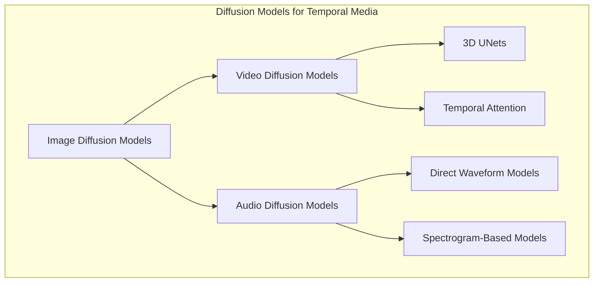
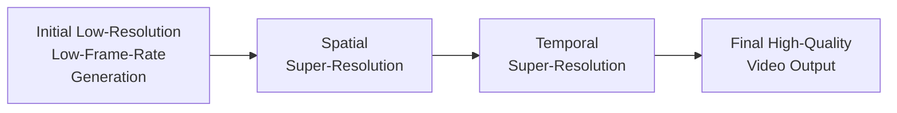
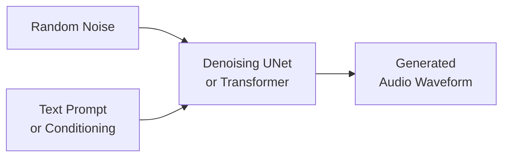
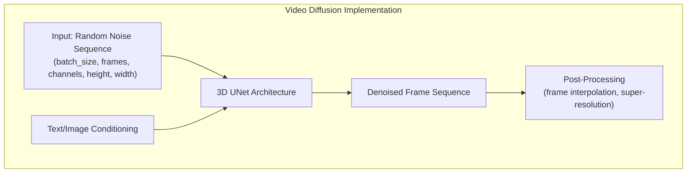
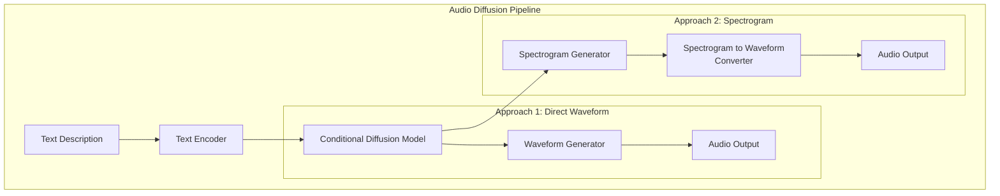

<!-- source: DeepWiki mcp.deepwiki.com · repo huggingface/diffusion-models-class · page 6.3 Diffusion Models for Audio and Video · fetched 2026-10-26 -->

# Diffusion Models for Audio and Video

Relevant source files

The following files were used as context for generating this wiki page:

- [unit4/02_diffusion_for_audio.ipynb](unit4/02_diffusion_for_audio.ipynb)
- [unit4/README.md](unit4/README.md)

## Purpose and Scope

This document explains how diffusion models are extended beyond image generation to create audio and video content. We cover the architectural approaches, data representations, and key implementations in both domains. For information about other advanced diffusion techniques, see [Advanced Diffusion Techniques](#6) and for specific information about new architectures emerging in the field, see [New Architectures and Approaches](#6.4).

## Overview

Diffusion models have been successfully adapted to generate both audio and video by applying the core denoising principles to different data representations. This extension requires specialized approaches to handle the temporal dimension present in both modalities.

Sources: [unit4/README.md:97-126]()

## Video Diffusion Models

Video diffusion models extend image generation techniques to create coherent sequences of frames that maintain temporal consistency. Unlike static images, videos present unique challenges due to their temporal dimension and significantly larger data volume.

### Architecture Adaptations

Video diffusion models typically employ one of two approaches:

1. **3D UNets**: Extended from 2D UNets used in image diffusion, these architectures process entire video clips as 3D volumes, where the third dimension represents time.

2. **Frame-by-frame with temporal attention**: Some models generate frames sequentially while using attention mechanisms to maintain consistency across frames.

### Resolution Strategy

Due to the computational demands of video generation, many approaches employ a cascaded generation strategy:

Sources: [unit4/README.md:98-102]()

### Key Implementations

Major video diffusion implementations include:

- **Video Diffusion Models**: One of the first approaches to adapt diffusion models specifically for video generation.
- **Imagen Video**: Google's high-definition video generation system using cascaded diffusion models.

Sources: [unit4/README.md:103-107]()

## Audio Diffusion Models

Audio diffusion models generate sound using either direct waveform modeling or spectrogram-based approaches. The latter has gained more traction due to its ability to leverage existing image diffusion architectures.

### Direct Waveform Approach

Some models like DiffWave directly generate audio waveforms through iterative denoising of random signals:

Sources: [unit4/README.md:119]()

### Spectrogram-Based Approach

The most successful audio generation approach converts audio into visual representations called spectrograms, which can be processed using existing image diffusion techniques:

Spectrograms represent audio frequencies over time as a 2D "image," making them compatible with image diffusion models.

Sources: [unit4/README.md:112-114]()

### Notable Implementations

Several significant implementations demonstrate the capabilities of audio diffusion:

- **Riffusion**: Fine-tuned Stable Diffusion to generate music spectrograms from text prompts
- **MusicLM**: Google's system that generates consistent audio from text and can be conditioned with hummed melodies
- **Noise2Music**: Produces high-quality 30-second audio clips from text descriptions
- **Make-An-Audio**: Generates diverse sounds based on text input
- **Moûsai**: Text-to-music generation using long-context latent diffusion

Sources: [unit4/README.md:116-126]()

## Technical Implementation Details

### Video Implementation

The technical implementation of video diffusion models requires addressing both spatial and temporal dimensions:

Key challenges in video diffusion implementation:

1. Memory constraints when processing multiple frames
2. Maintaining temporal coherence between frames
3. Balancing quality and generation speed

Sources: [unit4/README.md:98-102]()

### Audio Implementation

Audio diffusion implementation depends on the chosen representation method:

In the spectrogram approach, the audio is represented as a time-frequency visualization where:
- X-axis represents time
- Y-axis represents frequency
- Color/intensity represents amplitude

This makes audio generation similar to image generation, allowing the reuse of image diffusion architectures.

Sources: [unit4/README.md:112-114]()

## Practical Application

### Fine-tuning for Audio Generation

Fine-tuning existing diffusion models for audio generation requires:

1. Converting audio data to spectrograms
2. Training or fine-tuning a diffusion model on these spectrograms
3. Implementing a conversion pipeline from generated spectrograms back to audio

The provided notebook "Diffusion for Audio" demonstrates fine-tuning a model on a specific music genre.

Sources: [unit4/README.md:157-162]()

## Future Directions

The field of audio and video diffusion is rapidly evolving, with new approaches emerging frequently. Recent advances suggest several promising directions:

1. **Multimodal conditioning**: Generating audio/video from multiple input modalities (text, images, audio samples)
2. **Improved temporal coherence**: Enhancing consistency across longer video sequences
3. **Efficiency improvements**: Reducing computational requirements for high-quality generation
4. **Real-time applications**: Moving toward interactive generation speeds
5. **Fine-grained control**: Providing more precise control over generated content

Sources: [unit4/README.md:116-126]()

## Conclusion

Diffusion models for audio and video represent a significant extension of the core diffusion techniques developed for images. While they face unique challenges due to the temporal nature and higher data volume of these media types, current implementations demonstrate impressive capabilities in generating coherent audio and video content from text prompts or other conditions.

As research continues to advance, we can expect both improved quality and more efficient generation processes, opening new possibilities for creative applications and content generation.

---

