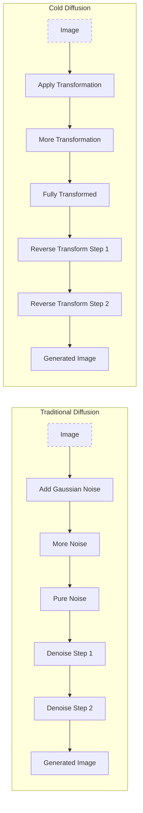
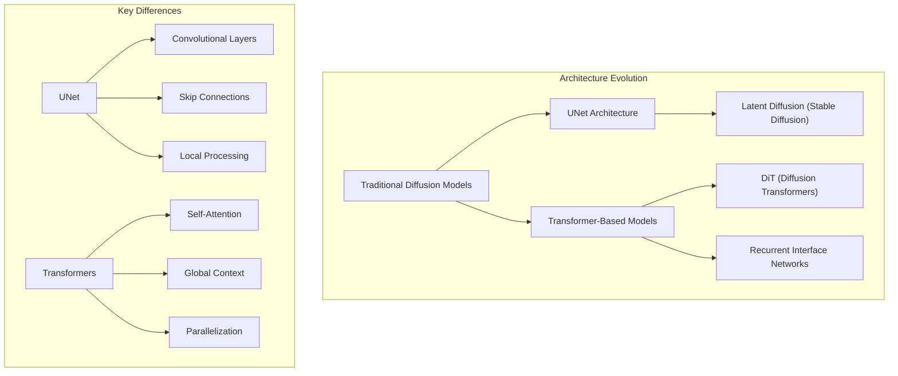
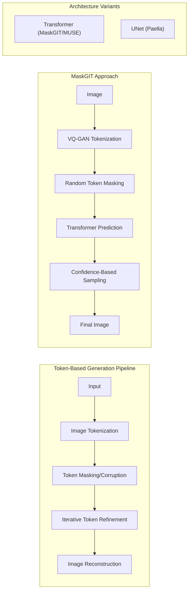
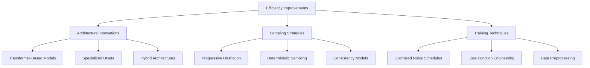

<!-- source: DeepWiki mcp.deepwiki.com · repo huggingface/diffusion-models-class · page 6.4 New Architectures and Approaches · fetched 2026-10-26 -->

# New Architectures and Approaches

Relevant source files

The following files were used as context for generating this wiki page:

- [unit4/02_diffusion_for_audio.ipynb](unit4/02_diffusion_for_audio.ipynb)
- [unit4/README.md](unit4/README.md)

This document explores the evolution of diffusion models beyond their original definition towards more general "iterative refinement" approaches. We examine alternative corruption processes, new model architectures, and token-based approaches that are pushing the boundaries of generative models. For information about diffusion models for specific media types, see [Diffusion Models for Audio and Video](#6.3).

## The Emergence of Iterative Refinement Models

Traditional diffusion models operate by gradually adding noise to images and then learning to reverse this process. However, recent research has expanded this concept into a broader framework of iterative refinement, where various types of corruption (not just Gaussian noise) can be gradually reversed to generate high-quality samples.

### Cold Diffusion: Beyond Gaussian Noise

Cold Diffusion demonstrates that many other types of corruption beyond Gaussian noise can be iteratively "undone" to generate images. This includes blurring, masking, downsampling, and other image transformations.

Sources: [unit4/README.md:128-133]()

## Transformer-Based Architectures

The UNet architecture that forms the backbone of many diffusion models is now being replaced with alternative structures, most notably transformer-based architectures which offer different capabilities and efficiency trade-offs.

### Diffusion Transformers (DiT)

Scalable Diffusion Models with Transformers (DiT) replaces the UNet with a transformer architecture while maintaining the standard diffusion model approach, achieving excellent results in image generation tasks.

### Recurrent Interface Networks

This novel transformer-based architecture implements specialized training strategies to improve efficiency, particularly for generating high-resolution images without relying on latent diffusion or super-resolution techniques.

Sources: [unit4/README.md:139-140]()

## Token-Based Approaches

A significant development in generative models is the use of tokenized representations of images, where images are broken down into discrete tokens that can be predicted or refined sequentially or in parallel.

### MaskGIT and MUSE

These approaches use transformer models to work with tokenized representations of images, applying techniques inspired by masked language modeling to the visual domain. The process typically involves:

1. Tokenizing images into discrete representations
2. Masking and predicting tokens in an iterative process
3. Converting the final token predictions back to an image

### Paella: UNet for Token-Based Generation

The Paella model demonstrates that a UNet architecture can also be successfully applied to token-based regimes, showing the versatility of both approaches.

Sources: [unit4/README.md:136-139]()

## Ongoing Developments and Efficiency Improvements

With each new paper published, more efficient approaches are being developed for iterative refinement tasks. The field is rapidly evolving with substantial room for exploration and improvement.

### Efficiency Innovations

Some recent improvements focus on:

1. **Higher resolution generation**: Techniques like Recurrent Interface Networks and Simple Diffusion enable end-to-end high-resolution image generation without cascaded approaches
2. **Faster sampling**: Various architectural innovations reduce the number of steps needed for quality generation
3. **Novel noise schedules**: Specialized noise scheduling improves training stability and generation quality

Sources: [unit4/README.md:141-150]()

## Comparison of Approaches

The following table compares key characteristics of different architectural approaches for diffusion and iterative refinement models:

| Approach | Base Architecture | Corruption Type | Key Innovation | Notable Models |
|----------|-------------------|----------------|----------------|----------------|
| Traditional Diffusion | UNet | Gaussian Noise | Noise prediction | DDPM, DDIM |
| Latent Diffusion | UNet | Gaussian Noise in Latent Space | Efficiency via compressed latent space | Stable Diffusion |
| Cold Diffusion | UNet | Various transformations | Generalizing beyond noise | - |
| Transformer Diffusion | Transformer | Gaussian Noise | Global context modeling | DiT |
| Token-Based (Transformer) | Transformer | Token masking | Discrete token prediction | MaskGIT, MUSE |
| Token-Based (UNet) | UNet | Token masking | UNet for discrete tokens | Paella |
| Recurrent Models | Specialized Transformer | Gaussian Noise | Recurrent processing | Recurrent Interface Networks |

Sources: [unit4/README.md:139-149]()

## Paper References

The following key papers provide additional details on the architectures and approaches discussed in this document:

1. [Cold Diffusion: Inverting Arbitrary Image Transforms Without Noise](http://arxiv.org/abs/2208.09392)
2. [Scalable Diffusion Models with Transformers (DiT)](https://www.wpeebles.com/DiT)
3. [MaskGIT: Masked Generative Image Transformer](http://arxiv.org/abs/2202.04200)
4. [Muse: Text-To-Image Generation via Masked Generative Transformers](http://arxiv.org/abs/2301.00704)
5. [Fast Text-Conditional Discrete Denoising on Vector-Quantized Latent Spaces (Paella)](https://arxiv.org/abs/2211.07292v1)
6. [Recurrent Interface Networks](https://arxiv.org/pdf/2212.11972.pdf)
7. [Simple Diffusion: End-to-end diffusion for high-resolution images](https://arxiv.org/abs/2301.11093)

Sources: [unit4/README.md:143-150]()

---

