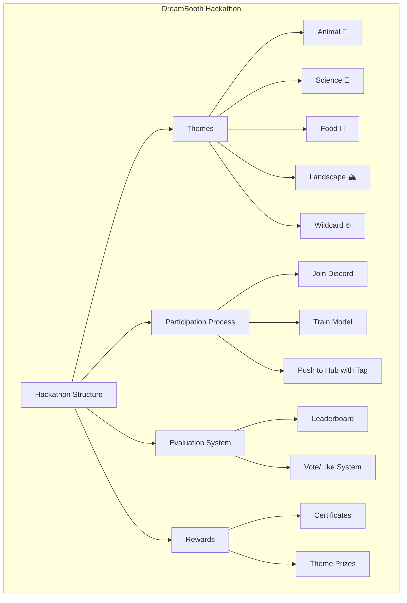
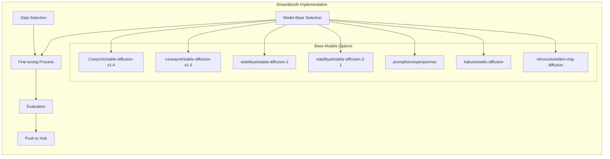
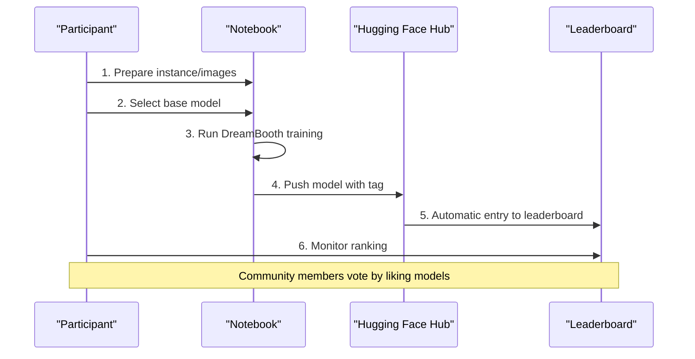

<!-- source: DeepWiki mcp.deepwiki.com · repo huggingface/diffusion-models-class · page 7 DreamBooth Hackathon · fetched 2026-10-26 -->

# DreamBooth Hackathon

Relevant source files

The following files were used as context for generating this wiki page:

- [hackathon/README.md](hackathon/README.md)
- [hackathon/dreambooth.ipynb](hackathon/dreambooth.ipynb)

## Purpose and Scope

This document details the DreamBooth Hackathon, a community event where participants personalized Stable Diffusion models by fine-tuning them on their own images using the DreamBooth technique. The hackathon was designed to encourage experimentation with model fine-tuning techniques, particularly DreamBooth, which allows users to implant subjects into a model's output domain using a unique identifier in the prompt. 

For information about the general structure of the Diffusion Models course, see [Overview](#1). For specific information about Stable Diffusion, refer to [Unit 3: Stable Diffusion](#5).

## Hackathon Overview

The DreamBooth Hackathon was structured around five thematic categories, with prizes awarded to the top three most-liked models in each theme. The event ran from December 21, 2022, to January 22, 2023, with winners announced between January 23-27, 2023.

### Hackathon Structure

Sources: [hackathon/README.md:8-16](), [hackathon/README.md:18-28](), [hackathon/README.md:38-44](), [hackathon/README.md:55-71]()

## Hackathon Themes

The hackathon was organized around five distinct themes, each focusing on different subjects for model fine-tuning:

| Theme | Description |
|-------|-------------|
| Animal 🐨 | Models fine-tuned on pets or favorite animals, enabling generation of these animals in various contexts |
| Science 🔬 | Models for generating synthetic images of scientific subjects like galaxies, proteins, or other natural/medical science domains |
| Food 🍔 | Models specialized in generating images of specific dishes or cuisines |
| Landscape 🏔 | Models fine-tuned on specific landscapes like mountains, lakes, or gardens |
| Wildcard 🔥 | Open category for any other creative use of DreamBooth fine-tuning |

Sources: [hackathon/README.md:8-16]()

## Technical Implementation

Participants could use a provided DreamBooth notebook or develop their own implementation. The official notebook was available on multiple platforms including Colab, Kaggle, Gradient, and SageMaker Studio Lab.

### Implementation Workflow

Sources: [hackathon/README.md:28-37]()

### Platform Options

The primary implementation notebook was accessible through multiple platforms:

| Platform | Access Method |
|----------|---------------|
| Google Colab | Via Colab badge link |
| Kaggle | Via Kaggle badge link |
| Gradient | Via Gradient badge link |
| SageMaker Studio Lab | Via Studio Lab badge link |

Sources: [hackathon/README.md:24-27]()

## Participation Process

The hackathon participation workflow followed these key steps:

1. Join the Hugging Face Discord server's `#dreambooth-hackathon` channel
2. Select and prepare personal images for fine-tuning
3. Use the provided notebook or custom implementation to train a DreamBooth model
4. Push the trained model to the Hugging Face Hub with the `dreambooth-hackathon` tag
5. Monitor the leaderboard for model ranking based on likes

Sources: [hackathon/README.md:18-28](), [hackathon/README.md:38-44]()

## Evaluation System

Models were evaluated based on community engagement through a simple but effective mechanism:

1. Each model submitted with the `dreambooth-hackathon` tag was automatically added to the leaderboard
2. Community members could like models on the Hugging Face Hub
3. The number of likes determined the model's ranking on the leaderboard
4. The top three most-liked models in each theme received prizes

The leaderboard was hosted as a Hugging Face Space: `dreambooth-hackathon/leaderboard`.

Sources: [hackathon/README.md:38-44](), [hackathon/README.md:55-71]()

## Timeline and Prizes

### Timeline

The hackathon followed this schedule:

| Date | Milestone |
|------|-----------|
| December 21, 2022 | Hackathon start date |
| December 31, 2022 | Deadline for Colab Pro registration |
| January 22, 2023 | Final submissions deadline |
| January 23-27, 2023 | Winner announcements |

Sources: [hackathon/README.md:46-53]()

### Prizes

Prizes were awarded to the top three models in each theme category:

| Placement | Prize |
|-----------|-------|
| 1st place | Hugging Face Pro subscription for 1 year or $100 merch store voucher |
| 2nd place | Copy of "NLP with Transformers" book or $50 merch store voucher |
| 3rd place | Hugging Face Pro subscription for 1 month or $15 merch store voucher |

Additionally, all participants who submitted at least one model received a certificate of completion.

Sources: [hackathon/README.md:55-71]()

## Compute Resources

Google Colab sponsored the event by providing Colab Pro credits to 100 randomly selected participants who registered by December 31, 2022. Participants could register for these credits through a Google form.

Sources: [hackathon/README.md:74-78]()

## Technical Guidelines and FAQ

### Data Usage Guidelines

- Participants were encouraged to use their own images or images with permissive licenses
- For face models, participants were recommended to use their own likeness
- Personal data was encouraged as it created more unique and engaging models

### Technical Flexibility

While the hackathon focused on DreamBooth, participants were allowed to experiment with other fine-tuning techniques such as Textual Inversion. Participants could use any frameworks, code, or services that helped them create their models.

Sources: [hackathon/README.md:80-89]()

## Current Status

The hackathon has concluded, with winners announced via Discord. While new models can still be submitted to the leaderboard with the appropriate tag, prizes and certificates are no longer being offered.

Sources: [hackathon/README.md:3-4]()

---

