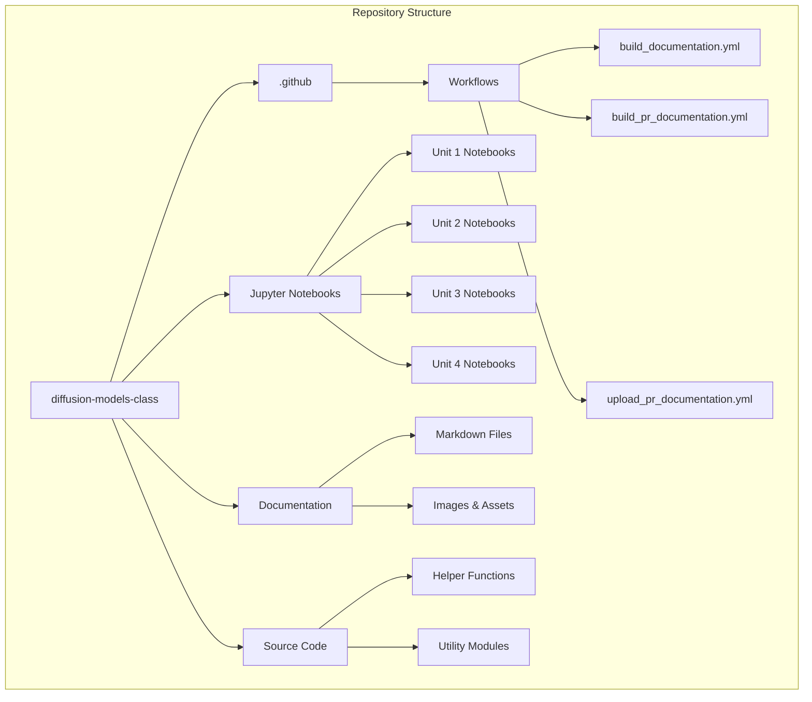
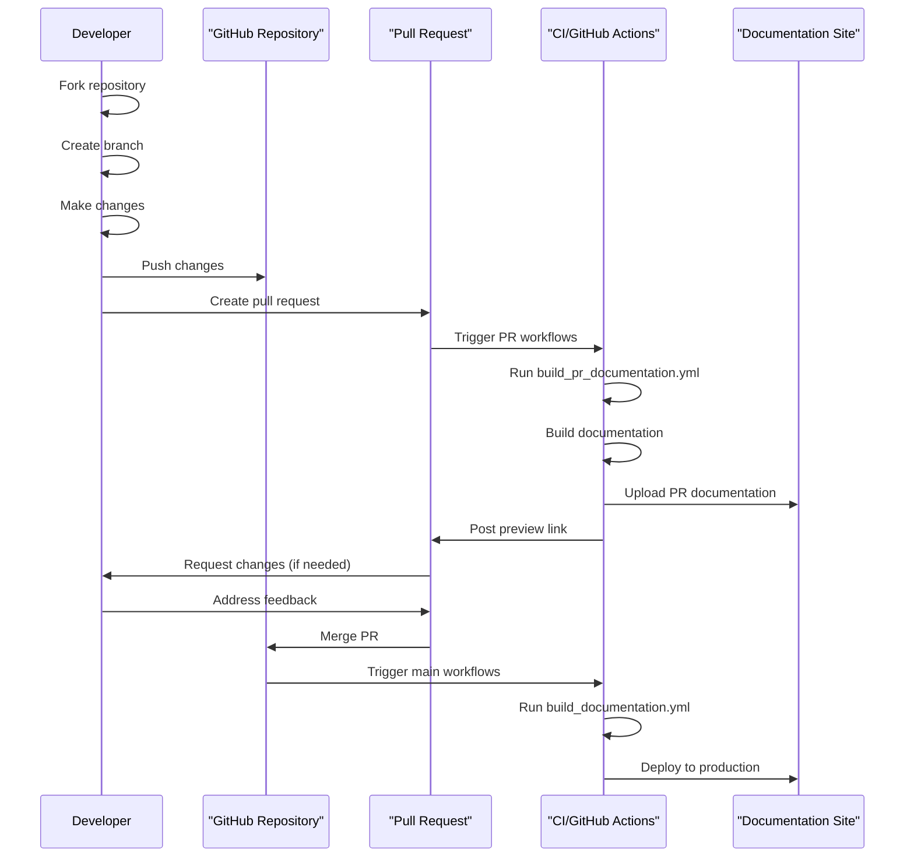
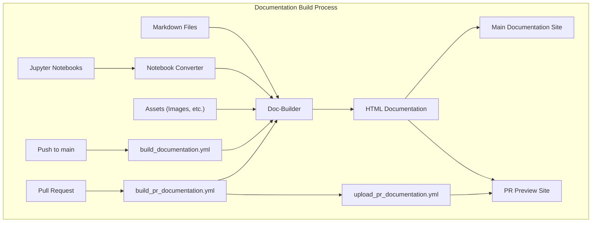

<!-- source: DeepWiki mcp.deepwiki.com · repo huggingface/diffusion-models-class · page 8 Development and Documentation · fetched 2026-10-26 -->

# Development and Documentation

Relevant source files

The following files were used as context for generating this wiki page:

- [.github/workflows/build_documentation.yml](.github/workflows/build_documentation.yml)
- [.github/workflows/build_pr_documentation.yml](.github/workflows/build_pr_documentation.yml)
- [.github/workflows/upload_pr_documentation.yml](.github/workflows/upload_pr_documentation.yml)
- [.gitignore](.gitignore)
- [LICENSE](LICENSE)

## Purpose and Scope

This document outlines the development processes and documentation standards for the Hugging Face Diffusion Models Course repository. It covers the repository structure, contribution workflow, documentation building process, and best practices for developers who wish to contribute to the codebase. For information about the course content itself, please refer to the [Overview](#1) page.

## Repository Structure

The Diffusion Models Course repository is structured to support educational content, code examples, and documentation. Below is a high-level overview of the repository organization.

Sources: [.github/workflows/build_documentation.yml](), [.github/workflows/build_pr_documentation.yml](), [.github/workflows/upload_pr_documentation.yml]()

## Development Workflow

The development workflow leverages GitHub's pull request system and automated workflows to ensure code quality and continuous documentation updates.

Sources: [.github/workflows/build_documentation.yml](), [.github/workflows/build_pr_documentation.yml](), [.github/workflows/upload_pr_documentation.yml]()

### Setting Up Development Environment

To contribute to the repository, you should:

1. Fork the repository on GitHub
2. Clone your fork locally
3. Set up Python environment with required dependencies
4. Make changes and test locally
5. Create a pull request with your changes

## Documentation System

The repository uses Hugging Face's Doc-Builder system for generating and publishing documentation. This system automatically converts Jupyter notebooks to documentation pages and builds a cohesive documentation site.

Sources: [.github/workflows/build_documentation.yml](), [.github/workflows/build_pr_documentation.yml](), [.github/workflows/upload_pr_documentation.yml]()

### Documentation Build Process

The documentation build process involves several key components:

| Component | Description |
|-----------|-------------|
| Doc-Builder | HuggingFace's documentation building tool |
| Workflows | GitHub Actions that automate build and deployment |
| Notebook Conversion | Process that transforms Jupyter notebooks into documentation pages |
| Documentation Hosting | System for hosting both production and PR preview documentation |

#### Main Documentation Build

When changes are pushed to the main branch, the `build_documentation.yml` workflow is triggered, which:

1. Runs the Doc-Builder tool on the repository content
2. Converts Jupyter notebooks to documentation pages
3. Builds HTML documentation
4. Deploys to the main documentation site

#### Pull Request Documentation Preview

For pull requests, two workflows are involved:

1. `build_pr_documentation.yml` - Builds documentation for the PR changes
2. `upload_pr_documentation.yml` - Uploads the documentation to a preview URL

This allows reviewers to see how documentation changes will look before merging.

## Best Practices

### Code Standards

- Follow PEP 8 style guidelines for Python code
- Include docstrings for all functions and classes
- Write clear, descriptive variable and function names
- Add type hints where appropriate

### Documentation Standards

- Use Markdown for documentation files
- Include clear, descriptive headings
- Provide examples where appropriate
- Use cross-references to related documentation
- Include diagrams to explain complex concepts

### Git Workflow

- Create feature branches for changes
- Write descriptive commit messages
- Keep pull requests focused on a single task
- Respond to review feedback promptly

## Contribution Guidelines

1. Check existing issues or create a new one to discuss your contribution
2. Create a fork and implement your changes
3. Ensure your code follows the repository's style guidelines
4. Add or update documentation as needed
5. Submit a pull request with a clear description

## License Information

The repository is licensed under the Apache License 2.0, which allows for freedom to use, modify, and distribute the code, with certain conditions.

Key points of the license:

- You can freely use, modify, and distribute the code
- You must include the original license and copyright notice
- Contributions are subject to the same license
- No warranty is provided

Sources: [LICENSE]()