# Page: Overview

# Overview

<details>
<summary>Relevant source files</summary>

The following files were used as context for generating this wiki page:

- [README.md](README.md)
- [_toctree.yml](_toctree.yml)
- [unit0/README.md](unit0/README.md)

</details>


The Hugging Face Diffusion Models Course repository provides comprehensive educational materials for learning about diffusion models in generative AI. This repository contains a structured course covering theory, implementation, fine-tuning, and advanced applications of diffusion models. For specific setup instructions, see [Getting Started](#2).

Sources: [README.md:1-15](), [unit0/README.md:1-9]()

## Repository Structure

The repository is organized as a progressive course with four main units, each building on knowledge from previous sections:

### Course Content Organization

| Unit | Title | Focus Areas |
|------|-------|-------------|
| 1 | Introduction to Diffusion Models | Diffusers library, implementation from scratch |
| 2 | Fine-Tuning and Guidance | Model adaptation, guidance techniques, conditioning |
| 3 | Stable Diffusion | Architecture, text-to-image generation, practical applications |
| 4 | Advanced Techniques | Faster sampling, training improvements, audio/video applications |

The repository also includes a DreamBooth hackathon section with practical examples and community submissions.

Sources: [README.md:19-26](), [_toctree.yml:1-55]()

### Course Structure Diagram

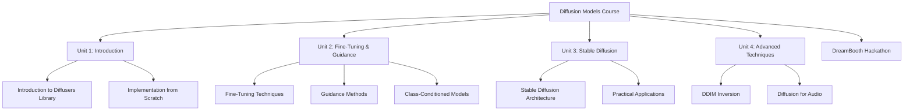

Sources: [README.md:19-26](), [_toctree.yml:1-55]()

## Learning Path and Technical Components

The course follows a structured learning path from basic concepts to advanced applications, covering key technical components of diffusion models.

### Learning Path Diagram

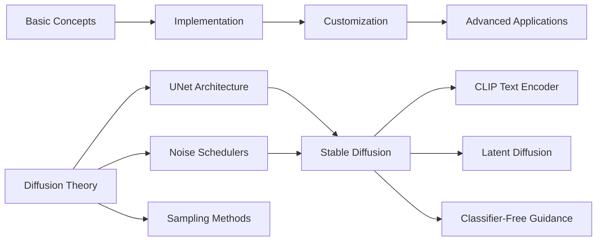

Sources: [README.md:8-15](), [unit0/README.md:22-32]()

## Implementation Approaches

The course presents three main implementation approaches for working with diffusion models, bridging theoretical concepts to practical code implementations.

### Implementation Approaches Comparison

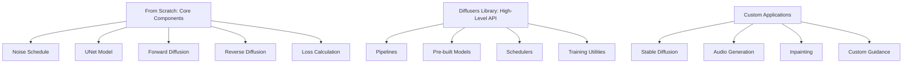

Sources: [README.md:8-15](), [_toctree.yml:13-18](), [_toctree.yml:25-31]()

## Practical Applications

The course covers a range of practical applications for diffusion models:

| Application | Description | Unit |
|-------------|-------------|------|
| Image Generation | Creating images from noise | Unit 1 |
| Text-to-Image | Generating images from text prompts | Unit 3 |
| Image Inpainting | Filling in missing parts of images | Unit 3 |
| Fine-tuning | Adapting models to new datasets | Unit 2 |
| Audio Generation | Creating audio with diffusion | Unit 4 |
| Model Personalization | DreamBooth technique for personalized models | Hackathon |

Sources: [README.md:8-15](), [_toctree.yml:33-54]()

## Prerequisites

To successfully complete this course, you should have:
- Good Python programming skills
- Basic understanding of deep learning concepts
- Familiarity with PyTorch

Optional resources for prerequisite skills are provided in the repository documentation.

Sources: [README.md:31-38](), [unit0/README.md:12-17]()

## Course Format and Community

The course is designed to be self-paced with a combination of theoretical explanations and hands-on exercises. Each unit includes Jupyter notebooks that guide users through practical implementations. Community interaction is encouraged through Discord channels where users can ask questions and share their work.

The DreamBooth Hackathon section provides an opportunity for applying learned concepts to a real-world project with community engagement and model sharing capabilities on the Hugging Face Hub.

Sources: [README.md:16-18](), [README.md:53-57](), [unit0/README.md:55-57]()

---

# Page: Getting Started

# Getting Started

<details>
<summary>Relevant source files</summary>

The following files were used as context for generating this wiki page:

- [README.md](README.md)
- [_toctree.yml](_toctree.yml)
- [unit0/README.md](unit0/README.md)

</details>


This page guides you through setting up your environment and starting the Hugging Face Diffusion Models Course. You'll find information about prerequisites, environment setup, and how to navigate the course materials. For an overview of the course content and objectives, see [Overview](#1).

## Prerequisites

Before starting the course, ensure you have:

### Required Knowledge
- Good Python programming skills
- Basic understanding of deep learning concepts
- Familiarity with PyTorch

If you need to refresh these skills, these free resources are recommended:
- Python: [Udacity's Introduction to Python](https://www.udacity.com/course/introduction-to-python--ud1110)
- PyTorch: [PyTorch in 60 Minutes](https://pytorch.org/tutorials/beginner/deep_learning_60min_blitz.html)
- Deep Learning with PyTorch: [Udacity's Intro Course](https://www.udacity.com/course/deep-learning-pytorch--ud188)

### Required Accounts
- A [Hugging Face account](https://huggingface.co/join) (free) - necessary for uploading models to the Hugging Face Hub

Sources: [README.md:31-38](), [unit0/README.md:12-17]()

## Environment Setup

### Python Environment Configuration

The course provides two main options for environment setup:

#### Option 1: Google Colab (Recommended for Beginners)
All notebooks can be run in Google Colab without local setup. Each notebook has a "Open in Colab" button at the top.

#### Option 2: Local Setup
To run notebooks locally:

1. **Clone the repository**:
   ```bash
   git clone https://github.com/huggingface/diffusion-models-class.git
   cd diffusion-models-class
   ```

2. **Create a virtual environment** (recommended):
   ```bash
   python -m venv diffusion-env
   source diffusion-env/bin/activate  # On Windows: diffusion-env\Scripts\activate
   ```

3. **Install required packages**:
   ```bash
   pip install diffusers transformers accelerate torch
   ```

### Setting Up Hugging Face Access

To access the Hugging Face Hub for model sharing:

1. Create a [Hugging Face account](https://huggingface.co/join) if needed
2. Create an access token at [Hugging Face settings page](https://huggingface.co/settings/tokens)
3. Set up your token using the Hugging Face CLI:
   ```bash
   pip install huggingface_hub
   huggingface-cli login
   ```

## Repository Structure

### Course Organization Diagram

```mermaid
flowchart TB
    Start["diffusion-models-class repository"] --> Unit1["unit1/ - Introduction to Diffusion Models"]
    Unit1 --> Unit1Readme["unit1/README.md - Theory overview"]
    Unit1 --> Unit1NB1["unit1/01_introduction_to_diffusers.ipynb - Diffusers library basics"]
    Unit1 --> Unit1NB2["unit1/02_diffusion_models_from_scratch.ipynb - Implementation basics"]
    
    Start --> Unit2["unit2/ - Fine-Tuning and Guidance"]
    Unit2 --> Unit2Readme["unit2/README.md - Theory overview"]
    Unit2 --> Unit2NB1["unit2/01_finetuning_and_guidance.ipynb - Fine-tuning techniques"]
    Unit2 --> Unit2NB2["unit2/02_class_conditioned_diffusion_model_example.ipynb - Conditioning methods"]
    
    Start --> Unit3["unit3/ - Stable Diffusion"]
    Unit3 --> Unit3Readme["unit3/README.md - Theory overview"]
    Unit3 --> Unit3NB1["unit3/01_stable_diffusion_introduction.ipynb - Practical implementation"]
    
    Start --> Unit4["unit4/ - Advanced Techniques"]
    Unit4 --> Unit4Readme["unit4/README.md - Theory overview"]
    Unit4 --> Unit4NB1["unit4/01_ddim_inversion.ipynb - DDIM techniques"]
    Unit4 --> Unit4NB2["unit4/02_diffusion_for_audio.ipynb - Audio diffusion"]
    
    Start --> Hackathon["hackathon/ - DreamBooth Hackathon"]
```

Sources: [_toctree.yml:1-64](), [README.md:19-26]()

## Key Components of the Diffusers Library

The course heavily uses the `diffusers` library. Here's a diagram of its main components:

```mermaid
flowchart TB
    diffusers["diffusers Library"] --> Pipeline["DiffusionPipeline"]
    diffusers --> Models["Model Components"]
    diffusers --> Schedulers["Noise Schedulers"]
    diffusers --> Training["Training Utilities"]
    
    Models --> UNet["UNet2DModel"]
    Models --> UNetCond["UNet2DConditionModel"]
    Models --> VAE["AutoencoderKL"]
    Models --> TextEncoder["CLIPTextModel"]
    
    Schedulers --> DDPM["DDPMScheduler"]
    Schedulers --> DDIM["DDIMScheduler"]
    Schedulers --> PNDM["PNDMScheduler"]
    Schedulers --> LMS["LMSDiscreteScheduler"]
    
    Pipeline --> TextToImage["StableDiffusionPipeline"]
    Pipeline --> ImageToImage["StableDiffusionImg2ImgPipeline"]
    Pipeline --> Inpainting["StableDiffusionInpaintPipeline"]
    Pipeline --> AudioDiffusion["AudioDiffusionPipeline"]
    
    Training --> TrainingArgs["TrainingArguments"]
    Training --> Trainer["Trainer"]
```

## Typical Notebook Workflow

Most notebooks in the course follow a similar pattern:

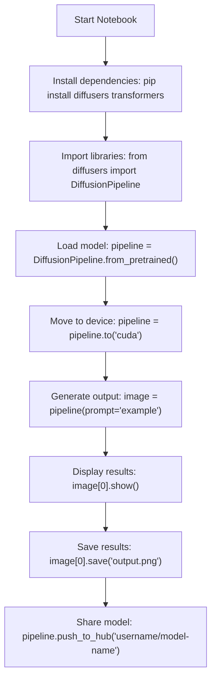

### Key Libraries Table

| Library | Purpose | Used In |
|---------|---------|---------|
| `diffusers` | Core diffusion models implementation | All notebooks |
| `transformers` | Text encoders and tokenizers | Text-to-image models |
| `torch` | Deep learning framework | All models |
| `accelerate` | Training optimization | Fine-tuning notebooks |
| `datasets` | Data loading and processing | Training notebooks |

## Running the Notebooks

### Instructions for Execution

1. **Open a notebook**:
   - Click the "Open in Colab" button at the top of the notebook in GitHub
   - Or in a local Jupyter server run: `jupyter notebook`

2. **Execute cells**:
   - Run cells in sequence (top to bottom) using Shift+Enter
   - Pay close attention to installation cells at the beginning
   - Some cells may take several minutes to run, especially model loading or training

3. **Hardware considerations**:
   - Basic inference can run on CPU, but GPU is recommended
   - Training requires GPU acceleration
   - In Google Colab, select: Runtime > Change runtime type > Hardware accelerator > GPU

## Community and Support

### Getting Help
- Join the [Discord server](https://discord.gg/aYka4Yhff9) for discussions
- Ask questions in the `#diffusion-models-class` channel
- For each unit page, click the "Ask a question" banner to be redirected to the right Discord section

Sources: [README.md:17](), [unit0/README.md:56-57]()

## Next Steps

Now that your environment is set up, proceed to [Unit 1: Introduction to Diffusion Models](#3) to begin learning. The first unit introduces the `diffusers` library and teaches you how to build diffusion models from scratch.

---

# Page: Unit 1: Introduction to Diffusion Models

# Unit 1: Introduction to Diffusion Models

<details>
<summary>Relevant source files</summary>

The following files were used as context for generating this wiki page:

- [unit1/README.md](unit1/README.md)

</details>


## Purpose and Scope

This unit serves as the foundational introduction to diffusion models, explaining their core concepts and providing hands-on experience with both the 🤗 Diffusers library and implementing models from scratch. The material covered here establishes the groundwork for more advanced topics in later units, including fine-tuning and guidance methods ([Unit 2: Fine-tuning and Guidance](#4)), and practical applications with Stable Diffusion ([Unit 3: Stable Diffusion](#5)).

Sources: [unit1/README.md:1-4]()

## What Are Diffusion Models?

Diffusion models are a class of generative models that learn to generate data (such as images or audio) by gradually denoising random noise over multiple steps. Unlike some other generative approaches, diffusion models use an iterative process that makes small corrections at each step, allowing them to produce high-quality outputs with greater stability.

### The Diffusion Process

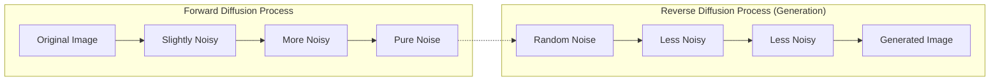

The diffusion process consists of two main phases:

1. **Forward Diffusion**: Gradually adding noise to data until it becomes pure random noise
2. **Reverse Diffusion**: The generative process where the model learns to gradually denoise data, starting from random noise

Generation begins with random noise that is iteratively refined over a number of steps. At each step, the model estimates how to transform the current noisy input toward a denoised version. Since only small changes are made at each step, errors in early estimations (when predicting the final output is difficult) can be corrected in later steps.

Sources: [unit1/README.md:20-30]()

### Training Process

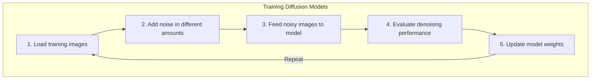

Training a diffusion model is relatively straightforward:

1. Load images from the training dataset
2. Add varying amounts of noise to these images (from slight to complete noise)
3. Feed the noisy images into the model
4. Evaluate how well the model denoises these inputs
5. Use this information to update the model weights

Sources: [unit1/README.md:32-39]()

### Generation Process

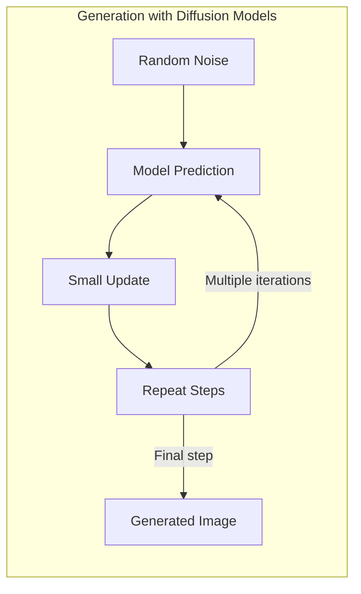

To generate new images with a trained model:
1. Begin with completely random noise
2. Repeatedly feed it through the model
3. Update it each time by a small amount based on the model prediction
4. Continue until a clear image emerges

Various sampling methods aim to streamline this process to generate quality outputs with fewer steps.

Sources: [unit1/README.md:39-41]()

## Hands-On Materials

Unit 1 provides two complementary notebooks that approach diffusion models from different perspectives:

### 1. Introduction to Diffusers

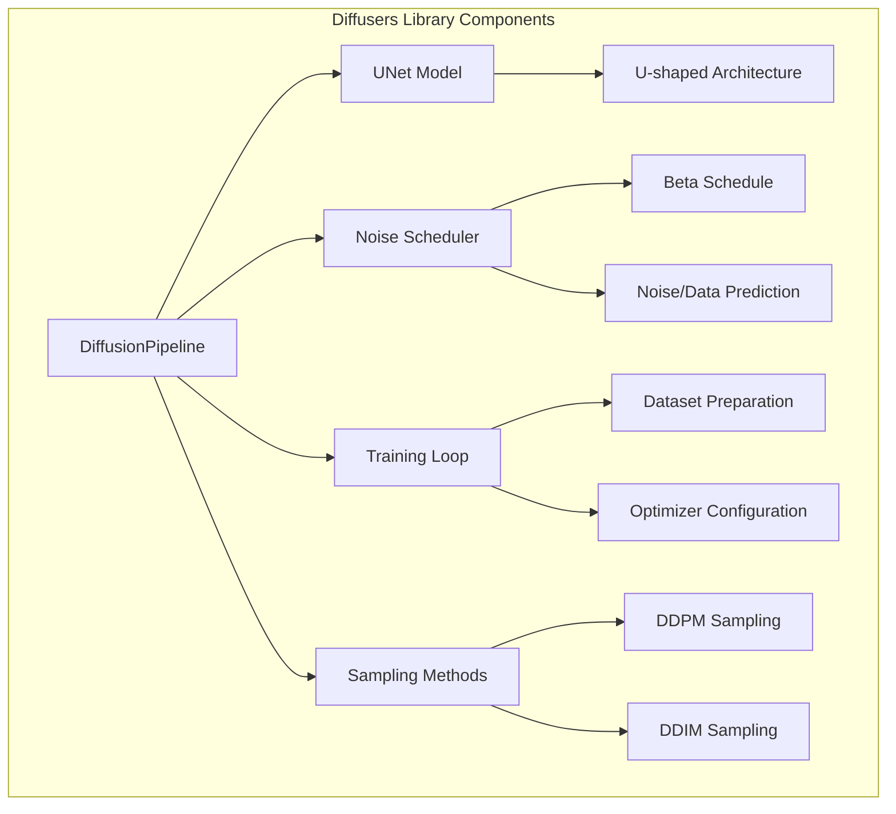

This notebook demonstrates how to use the 🤗 Diffusers library to create, train, and sample diffusion models. It shows the practical application of the concepts described above using a high-level API that simplifies working with diffusion models.

Key topics covered:
- Using pre-built diffusion pipelines
- Training custom diffusion models on your own datasets
- Exploring different sampling techniques
- Sharing trained models with the community

Sources: [unit1/README.md:44-54]()

### 2. Diffusion Models from Scratch

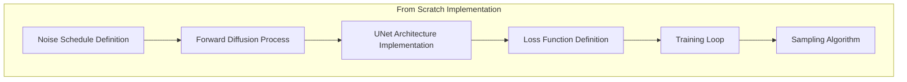

This notebook provides a minimal implementation of diffusion models using PyTorch, without relying on external libraries. It offers deeper insights into the underlying mechanics and design choices involved in diffusion models.

Key topics covered:
- Implementing the forward diffusion process
- Building a neural network for denoising
- Creating the reverse diffusion sampling process
- Comparing the implementation with the Diffusers library version

Sources: [unit1/README.md:54-56]()

## Project Exercise

After completing the notebooks, this unit encourages you to train your own diffusion models on datasets of your choice and share your findings with the community. This collaborative effort aims to identify effective "training recipes" for diffusion models at different scales.

Potential project areas include:
- Training models on different types of data (faces, landscapes, objects)
- Experimenting with model architecture sizes
- Testing various hyperparameter configurations
- Comparing different sampling strategies

Sources: [unit1/README.md:56-58]()

## Technical Components

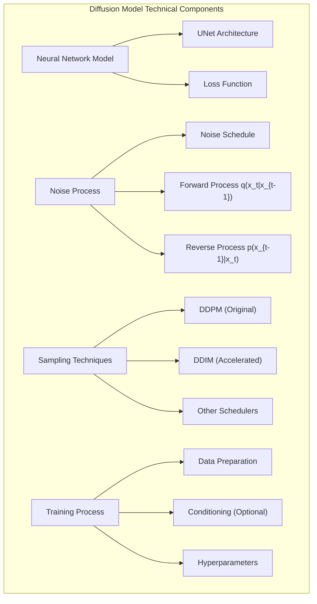

### Key Components

1. **UNet Architecture**: The backbone neural network that performs the denoising. Its encoder-decoder structure with skip connections is particularly effective for image processing tasks.

2. **Noise Schedule**: Determines how noise is added during the forward process and removed during sampling. Common schedules include linear, cosine, and sigmoid.

3. **Loss Functions**: Typically mean squared error (MSE) between the model's prediction and the actual noise or clean data.

4. **Sampling Strategies**: Methods to generate samples from the model, ranging from the original DDPM approach to faster techniques like DDIM.

Sources: [unit1/README.md:20-41]()

## Relationship to Course Structure

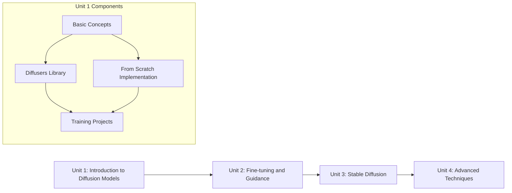

Unit 1 establishes the foundational knowledge required for the more advanced topics covered in later units:

- **Unit 2** builds on this foundation to explore fine-tuning techniques and guidance methods for controlling the generation process.
- **Unit 3** introduces Stable Diffusion, a powerful latent diffusion model for text-to-image generation.
- **Unit 4** covers advanced techniques and recent developments in the field.

Sources: [unit1/README.md:41-42]()

## Additional Resources

For deeper exploration of diffusion models, the following resources are recommended:

1. **The Annotated Diffusion Model**: An in-depth walk-through of the code and theory behind DDPMs with mathematical details.
2. **Hugging Face Documentation on Unconditional Image-Generation**: Examples of training diffusion models using the official training scripts.
3. **Video Resources**:
   - AI Coffee Break on Diffusion Models
   - Yannic Kilcher's explanation of DDPMs

Sources: [unit1/README.md:60-71]()

---

# Page: Introduction to the Diffusers Library

# Introduction to the Diffusers Library

<details>
<summary>Relevant source files</summary>

The following files were used as context for generating this wiki page:

- [unit1/01_introduction_to_diffusers.ipynb](unit1/01_introduction_to_diffusers.ipynb)

</details>


## Purpose and Scope

This document introduces the Hugging Face Diffusers library, a powerful toolkit designed to make working with diffusion models accessible, efficient, and flexible. The Diffusers library provides high-level abstractions for using pre-trained diffusion models while also offering access to the underlying components for customization. We'll cover the library's core architecture, components, and usage patterns.

For information about implementing diffusion models from first principles without using the Diffusers library, see [Building Diffusion Models from Scratch](#3.2).

## Library Overview

The Diffusers library abstracts the complexity of diffusion models through a modular and composable architecture, allowing both beginners and experts to work with state-of-the-art models.

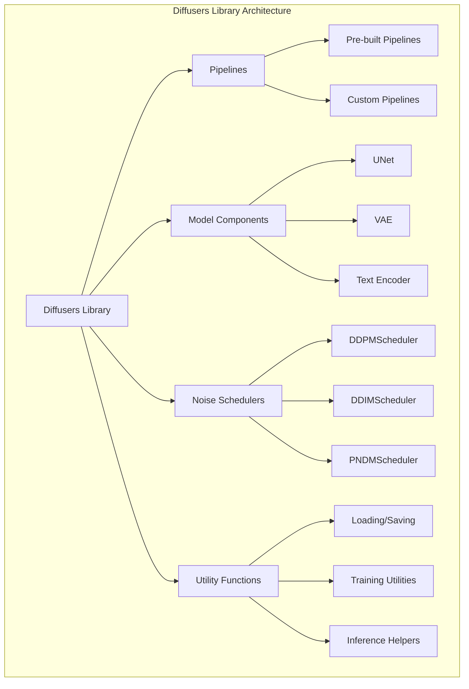

## Key Components

### 1. Pipelines

Pipelines are end-to-end implementations that bundle all necessary components for generating outputs with diffusion models. They simplify the process of loading models and generating images (or other content).

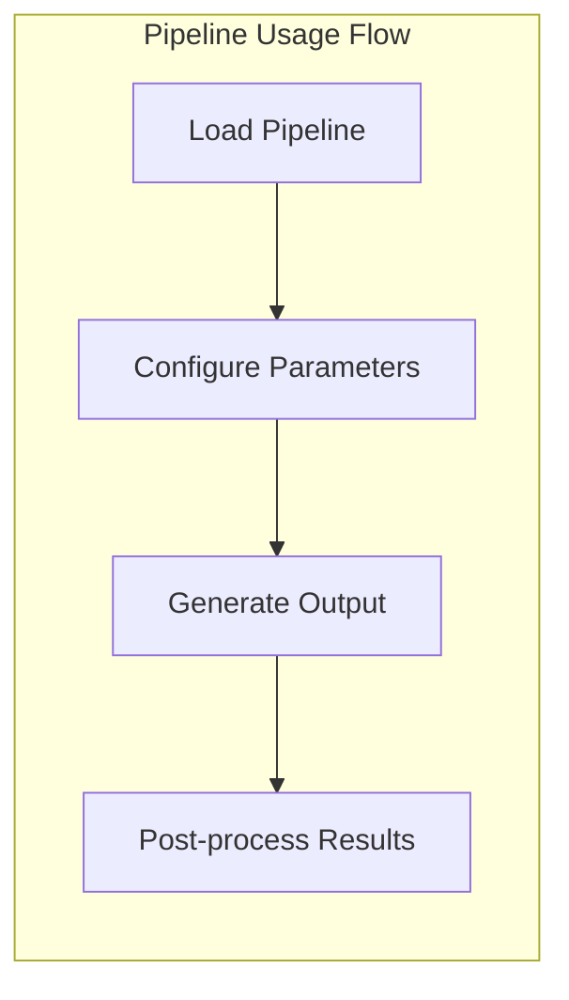

Key pipeline types:
- `DDPMPipeline`: For basic diffusion models
- `StableDiffusionPipeline`: For text-to-image generation
- `StableDiffusionImg2ImgPipeline`: For image-to-image transformations
- `StableDiffusionInpaintPipeline`: For inpainting applications

### 2. Models

The Models component includes various neural network architectures used across different diffusion models:

| Model Type | Description | Primary Function |
|------------|-------------|------------------|
| UNet | U-shaped neural network | Core noise prediction network |
| VAE | Variational Autoencoder | Image encoding/decoding (used in latent diffusion) |
| Text Encoder | Text embedding model (e.g., CLIP) | Convert text prompts to embeddings |

### 3. Schedulers

Schedulers manage the diffusion process by controlling how noise is added during forward diffusion and predicted/removed during reverse diffusion.

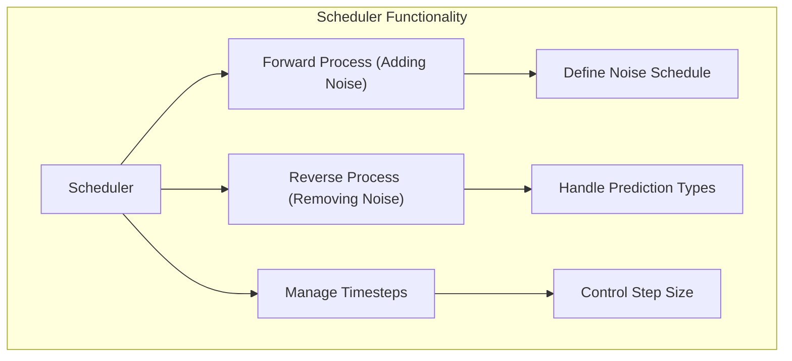

Common schedulers:
- `DDPMScheduler`: Original diffusion process
- `DDIMScheduler`: Accelerated, deterministic sampling
- `PNDMScheduler`: Higher quality with pseudo numerical methods
- `EulerDiscreteScheduler`: Popular for Stable Diffusion

### 4. Utility Functions

Utilities provide support for common operations:
- Loading and saving models
- Converting between model formats
- Training functionality
- Visualization helpers

## Using the Diffusers Library

### Basic Usage Example

```python
from diffusers import StableDiffusionPipeline
import torch

# Load a pre-trained model
pipeline = StableDiffusionPipeline.from_pretrained(
    "runwayml/stable-diffusion-v1-5", 
    torch_dtype=torch.float16
)
pipeline = pipeline.to("cuda")

# Generate an image
prompt = "A serene landscape with mountains and a lake"
image = pipeline(prompt).images[0]
image.save("landscape.png")
```

### Customizing the Pipeline

```python
from diffusers import StableDiffusionPipeline, EulerDiscreteScheduler

# Load pipeline with default components
pipeline = StableDiffusionPipeline.from_pretrained("runwayml/stable-diffusion-v1-5")

# Replace the scheduler
pipeline.scheduler = EulerDiscreteScheduler.from_config(pipeline.scheduler.config)

# Use the modified pipeline
image = pipeline("A futuristic city skyline", num_inference_steps=30).images[0]
```

### Accessing Individual Components

```python
from diffusers import UNet2DConditionModel, AutoencoderKL

# Load individual components
unet = UNet2DConditionModel.from_pretrained("CompVis/stable-diffusion-v1-4", subfolder="unet")
vae = AutoencoderKL.from_pretrained("CompVis/stable-diffusion-v1-4", subfolder="vae")

# Now you can inspect or modify these components
```

## Architectural Integration

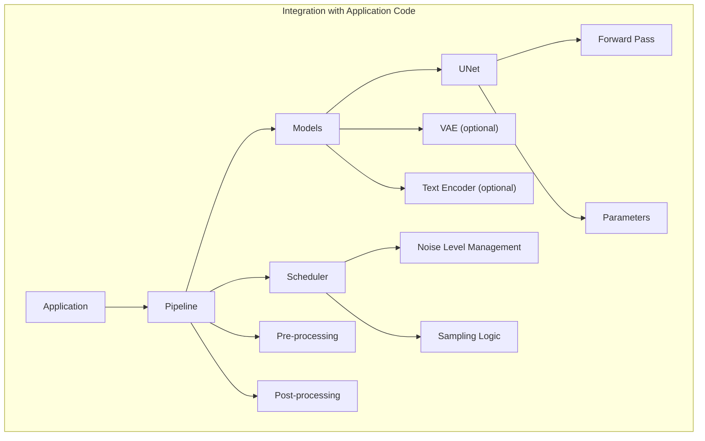

## Common Usage Patterns

### Task-specific Patterns

| Task | Pipeline | Key Parameters |
|------|----------|---------------|
| Text-to-Image | StableDiffusionPipeline | prompt, guidance_scale, num_inference_steps |
| Image-to-Image | StableDiffusionImg2ImgPipeline | prompt, init_image, strength |
| Inpainting | StableDiffusionInpaintPipeline | prompt, image, mask_image |
| Unconditional | DDPMPipeline | batch_size, num_inference_steps |

### Performance Optimization

- Using half-precision (`torch_dtype=torch.float16`)
- Enabling attention slicing (`pipeline.enable_attention_slicing()`)
- Utilizing model offloading for limited VRAM
- Adjusting `num_inference_steps` to balance quality and speed

## Integration in the Course

This introduction to the Diffusers library serves as the foundation for subsequent units in the course:

- In [Fine-tuning Techniques](#4.1), you'll learn how to adapt pre-trained diffusion models to new datasets
- In [Guidance and Conditioning Methods](#4.2), you'll explore how to control generation with various inputs
- In [Stable Diffusion Architecture](#5.1), you'll dive deeper into a specific implementation that leverages Diffusers

## Summary

The Diffusers library provides a flexible framework for working with diffusion models at varying levels of abstraction. Its modular design allows for:

1. Quick experimentation with state-of-the-art models
2. Customization of individual components
3. Building novel applications on top of existing architectures
4. Adapting models to specific use cases through fine-tuning

Understanding the Diffusers library is essential for efficiently working with diffusion models throughout this course and in practical applications.

---

# Page: Building Diffusion Models from Scratch

# Building Diffusion Models from Scratch

<details>
<summary>Relevant source files</summary>

The following files were used as context for generating this wiki page:

- [unit1/02_diffusion_models_from_scratch.ipynb](unit1/02_diffusion_models_from_scratch.ipynb)

</details>


## Purpose and Scope

This document explains how to implement diffusion models from first principles, without relying on high-level libraries. We'll cover the mathematical foundations, the forward and reverse diffusion processes, model architecture, loss calculation, and sampling procedures. For information about using the pre-built components in the Diffusers library, see [Introduction to the Diffusers Library](#3.1).

## Diffusion Models: Theoretical Foundation

Diffusion models are generative models based on gradually adding noise to data and then learning to reverse this process. The two core processes are:

1. **Forward diffusion process**: Gradually adds Gaussian noise to images according to a schedule
2. **Reverse diffusion process**: Learns to predict and remove noise step by step

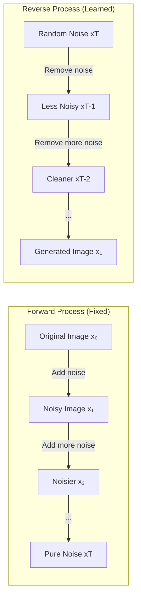

## Implementation Components

### Noise Scheduler

The noise scheduler defines how noise is added during the forward process and removed during the reverse process. It determines the noise schedule β₁, β₂, ..., βₜ and derived quantities such as αₜ = ∏ᵢ₌₁ᵗ(1-βᵢ).

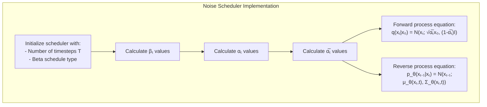

Our implementation includes different types of schedulers: linear, quadratic, cosine, and sigmoid schedules.

### UNet Architecture

The UNet architecture is the backbone neural network that predicts noise at each timestep. It takes a noisy image and timestep as input and outputs the predicted noise.

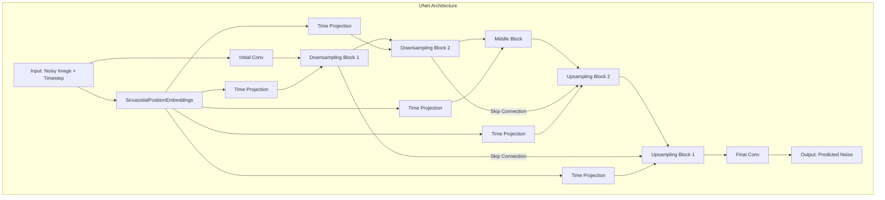

The UNet consists of:
- Time embeddings using sinusoidal position embeddings
- Down blocks that decrease spatial resolution
- Up blocks that increase resolution with skip connections
- Residual blocks for feature processing

### Diffusion Model Training

Training a diffusion model involves:
1. Sampling a batch of images from the dataset
2. Sampling random timesteps
3. Adding noise to the images according to the schedule
4. Training the UNet to predict the noise

```mermaid
flowchart TD
    subgraph "Diffusion Training Loop"
        dataset["Dataset of Images"]
        
        dataset --> batchSample["Sample Batch x₀"]
        batchSample --> timestepSample["Sample Random Timesteps t"]
        
        batchSample --> noiseAdd["Add Noise:
        xₜ = √α̅ₜx₀ + √(1-α̅ₜ)ε"]
        timestepSample --> noiseAdd
        noiseAdd --> noisyImages["Noisy Images xₜ"]
        noiseAdd --> trueNoise["True Noise ε"]
        
        noisyImages --> unet["UNet Model"]
        timestepSample --> unet
        unet --> predNoise["Predicted Noise ε_θ"]
        
        predNoise --> lossCalc["Loss Calculation:
        L = ||ε - ε_θ||²"]
        trueNoise --> lossCalc
        
        lossCalc --> optimizer["Optimizer Step"]
        optimizer --> |"Next Batch"| batchSample
    end
```

### Diffusion Model Sampling

To generate new images, we start with random noise and iteratively denoise it using the trained model:

```mermaid
flowchart TD
    subgraph "Diffusion Sampling Process"
        randomNoise["Generate Random Noise xT"]
        
        randomNoise --> denoisingLoop["For t = T, T-1, ..., 1"]
        
        denoisingLoop --> predictNoise["Predict Noise:
        ε_θ = UNet(xₜ, t)"]
        
        predictNoise --> denoiseStep["Denoise Step:
        xₜ₋₁ = 1/√αₜ (xₜ - (1-αₜ)/√(1-α̅ₜ) ε_θ) + σₜz"]
        
        denoiseStep --> |"Next Step"| denoisingLoop
        denoiseStep --> |"t = 0"| finalImage["Final Generated Image x₀"]
    end
```

## Implementation Details

### Forward Diffusion Process

The forward diffusion process adds noise to an image according to a schedule:

```python
def q_sample(x_start, t, noise=None):
    """
    Forward diffusion process: add noise to the input image
    """
    if noise is None:
        noise = torch.randn_like(x_start)
    
    sqrt_alphas_cumprod_t = extract(sqrt_alphas_cumprod, t, x_start.shape)
    sqrt_one_minus_alphas_cumprod_t = extract(sqrt_one_minus_alphas_cumprod, t, x_start.shape)
    
    return sqrt_alphas_cumprod_t * x_start + sqrt_one_minus_alphas_cumprod_t * noise
```

### Loss Function

The loss function trains the model to predict the noise that was added during the forward process:

```python
def p_losses(denoise_model, x_start, t, noise=None):
    """
    Calculate the loss between predicted noise and actual noise
    """
    if noise is None:
        noise = torch.randn_like(x_start)
    
    # Add noise to the input image
    x_noisy = q_sample(x_start, t, noise=noise)
    
    # Predict the noise using the model
    predicted_noise = denoise_model(x_noisy, t)
    
    # Calculate the loss
    loss = F.mse_loss(noise, predicted_noise)
    
    return loss
```

### Training Loop

A simplified training loop might look like:

```python
for epoch in range(num_epochs):
    for batch in dataloader:
        optimizer.zero_grad()
        
        # Sample random timesteps
        t = torch.randint(0, timesteps, (batch.shape[0],), device=device)
        
        # Calculate loss
        loss = p_losses(model, batch, t)
        
        # Update model parameters
        loss.backward()
        optimizer.step()
```

### Sampling Loop

A simplified sampling loop might look like:

```python
def p_sample_loop(model, shape, timesteps):
    """
    Generate samples by iteratively denoising
    """
    device = next(model.parameters()).device
    
    # Start with random noise
    img = torch.randn(shape, device=device)
    
    # Iteratively denoise
    for t in reversed(range(0, timesteps)):
        img = p_sample(model, img, torch.full((shape[0],), t, device=device))
    
    return img
```

## Key Classes and Their Relationships

The implementation consists of several key components that work together:

```mermaid
classDiagram
    class Diffusion {
        +noise_scheduler: NoiseScheduler
        +unet_model: UNet
        +train()
        +sample()
    }
    
    class NoiseScheduler {
        +betas: Tensor
        +alphas: Tensor
        +alphas_cumprod: Tensor
        +q_sample(x_start, t, noise)
        +p_sample(model, x, t)
    }
    
    class UNet {
        +time_embedding: Module
        +down_blocks: ModuleList
        +middle_block: Block
        +up_blocks: ModuleList
        +forward(x, timestep)
    }
    
    class Block {
        +time_emb_proj: Linear
        +residual_blocks: ModuleList
        +attention_blocks: ModuleList
        +forward(x, time_emb)
    }
    
    Diffusion --> NoiseScheduler: uses
    Diffusion --> UNet: uses
    UNet --> Block: contains
```

This diagram shows the relationship between the main classes in our implementation.

## Practical Tips for Implementation

1. **Numerical stability**: Use techniques like clamping values and working in the log domain to ensure stability.
2. **Efficient sampling**: Implement techniques like DDIM sampling for faster generation.
3. **Model size**: Balance model size with available computational resources.
4. **Training schedule**: Start with a simplified model and gradually increase complexity.
5. **Visualization**: Implement tools to visualize the denoising process during sampling.

## Conclusion

Building diffusion models from scratch provides a deep understanding of the underlying principles and complete control over the implementation. While more involved than using high-level libraries, it allows for customization and experimentation with different architectures and techniques.

For the next steps in learning about diffusion models, see [Fine-tuning Techniques](#4.1) which builds upon this foundation.

---

# Page: Unit 2: Fine-tuning and Guidance

# Unit 2: Fine-tuning and Guidance

<details>
<summary>Relevant source files</summary>

The following files were used as context for generating this wiki page:

- [unit2/README.md](unit2/README.md)

</details>


## Purpose and Scope

This document covers techniques for adapting pre-trained diffusion models through fine-tuning and controlling the generation process through guidance and conditioning. These methods allow leveraging existing models rather than training from scratch and incorporating additional control signals into the generation process. For fundamental diffusion model concepts, see [Unit 1: Introduction to Diffusion Models](#3).

## Fine-Tuning Diffusion Models

Fine-tuning allows adapting pre-trained diffusion models to new datasets without the computational expense of training from scratch. This approach leverages knowledge already captured in the pre-trained model weights, requiring less data and training time to achieve good results.

### Core Concept and Implementation

When fine-tuning a diffusion model, we start with weights from a model trained on a general or domain-specific dataset, then continue training on a new target dataset.

```mermaid
flowchart LR
    A["Pre-trained Model (e.g., google/ddpm-bedroom-256)"] --> B["Fine-tuning Process"]
    C["New Dataset (e.g., WikiArt)"] --> B
    B --> D["Domain-adapted Model"]
    
    subgraph "Fine-tuning Process"
    E["Lower Learning Rate (e.g., 1e-5)"]
    F["Fewer Steps (e.g., 500-1000)"]
    G["UNet Transfer Learning"]
    end
```

Even when the target domain differs significantly from the source domain, fine-tuning often produces surprisingly good results. For example, a model trained on bedroom images can be fine-tuned to generate artwork with as few as 500 training steps.

Sources: [unit2/README.md:19-25]()

### Implementation with Diffusers

The repository includes a dedicated script for fine-tuning diffusion models. The typical fine-tuning workflow includes:

1. Loading a pre-trained UNet from the Hugging Face Hub
2. Loading a noise scheduler
3. Setting up a dataset pipeline
4. Configuring training arguments with a reduced learning rate
5. Running the fine-tuning process

```mermaid
flowchart TD
    A["Load Pre-trained UNet Model"] --> B["Configure Noise Scheduler"]
    B --> C["Setup Dataset"]
    C --> D["Configure Training Arguments"]
    D --> E["Fine-tune Model"]
    E --> F["Save and Push to Hub"]
    
    subgraph "Training Configuration"
    G["Learning Rate: ~1e-5"]
    H["Steps: 500-1000"]
    I["Batch Size: 4-16"]
    J["Gradient Accumulation"]
    end
```

The fine-tuning script (`finetune_model.py`) makes it easy to experiment with different settings and datasets. It builds on the Diffusers library's training utilities, handling the details of the training loop.

Sources: [unit2/README.md:25-26](), [unit2/README.md:56-57]()

## Guidance Techniques

Guidance provides a way to control the output of unconditional diffusion models during the generation process. Unlike conditioning (which requires training or fine-tuning), guidance techniques modify the sampling procedure at inference time.

### Core Concept

In guided diffusion, we modify the model's predictions at each denoising step based on some guidance function, steering the generation process toward desired characteristics.

```mermaid
flowchart LR
    A["Noisy Image at Step t"] --> B["UNet Model"]
    B --> C["Noise Prediction"]
    C --> D["Apply Guidance Function"]
    D --> E["Modified Noise Prediction"]
    E --> F["Next Denoising Step"]
    
    G["Guidance Function (e.g., Color, CLIP)"] --> D
```

The guidance function evaluates the current predicted denoised image against some criteria and adjusts the prediction to better satisfy those criteria. The strength of the guidance can typically be controlled with a weight parameter.

Sources: [unit2/README.md:27-33]()

### Types of Guidance

1. **Color Guidance**: Controls the color distribution of generated images by comparing the current color histogram to a target and adjusting the prediction to minimize the difference.

2. **CLIP Guidance**: Uses the CLIP model to measure similarity between the current image and a text prompt, then adjusts the prediction to increase this similarity.

3. **Other possible guidance**: Shape constraints, structural properties, semantic features, etc.

```mermaid
flowchart TD
    A["Unconditional Diffusion Model"] --> B["Sampling Process"]
    
    subgraph "Guidance Functions"
    C["Color Guidance Function"]
    D["CLIP Text-Image Similarity"]
    E["Custom Guidance Functions"]
    end
    
    C --"Gradient Direction"--> B
    D --"Gradient Direction"--> B
    E --"Gradient Direction"--> B
    
    B --> F["Guided Output Image"]
```

What makes guidance powerful is its flexibility - almost any differentiable function that can evaluate an image can be used for guidance. The guidance is typically applied by computing a gradient of the guidance function with respect to the predicted image and using this gradient to adjust the prediction.

Sources: [unit2/README.md:31-33]()

## Conditioning Approaches

Conditioning differs from guidance in that the model is explicitly trained to incorporate additional information in its denoising process.

### Core Concept

Conditional diffusion models accept additional inputs (beyond the noisy image and timestep) that influence the generation. The model learns during training to use this conditioning information to produce specific types of outputs.

```mermaid
flowchart LR
    A["Noisy Image x_t"] --> D["Conditional UNet"]
    B["Timestep t"] --> D
    C["Conditioning c (e.g., class label)"] --> D
    D --> E["Predicted Noise ε"]
```

Examples of conditioning information include:
- Class labels (e.g., MNIST digits 0-9)
- Text descriptions (as in text-to-image models)
- Image features or embeddings
- Segmentation masks or layouts
- Depth maps

Sources: [unit2/README.md:35-40]()

### Conditioning Methods

There are several techniques for incorporating conditioning information into diffusion models:

1. **Input Channel Conditioning**:
   - Adds conditioning as additional input channels to the UNet
   - Used when conditioning has the same spatial dimensions as the image or can be expanded to match
   - Example: Class label embedding expanded to image dimensions (H×W) and concatenated with noisy image

2. **Embedding Projection and Addition**:
   - Projects conditioning to match internal feature dimensions
   - Adds to UNet block outputs (similar to timestep embedding)
   - Example: CLIP image embeddings in "Image Variations" models by Stable Diffusion

3. **Cross-Attention Conditioning**:
   - Uses cross-attention layers to attend to sequence data
   - Ideal for text conditioning with variable length
   - Example: Text conditioning in Stable Diffusion (covered in [Unit 3: Stable Diffusion](#5))

```mermaid
flowchart TD
    subgraph "Input Channel Method"
    A1["Conditioning Vector (e.g., class)"] --> A2["Embedding Layer"]
    A2 --> A3["Expand to Image Size (H×W)"]
    A3 --> A4["Concatenate with Noisy Image"]
    A4 --> A5["Input to UNet"]
    end
    
    subgraph "Embedding Addition Method"
    B1["Conditioning Vector"] --> B2["Projection Layer"]
    B2 --> B3["Match Feature Dimensions"]
    B3 --> B4["Add to Layer Outputs"]
    end
    
    subgraph "Cross-Attention Method"
    C1["Text Input"] --> C2["Text Encoder (e.g., CLIP)"]
    C2 --> C3["Sequence of Token Embeddings"]
    C3 --> C4["Cross-Attention in UNet Blocks"]
    end
```

Sources: [unit2/README.md:41-45]()

### Class-Conditioned Example

A practical example in the repository demonstrates a diffusion model conditioned on MNIST digit class labels (0-9). The class conditioning is implemented using the input channel method:

1. The class label is converted to an embedding
2. This embedding is expanded to match the image dimensions
3. The expanded embedding is concatenated with the noisy image input

```mermaid
flowchart LR
    A["Noisy Digit Image (1×28×28)"] --> E["Concatenate"]
    B["Class Label (0-9)"] --> C["Embedding Layer"]
    C --> D["Expand to (1×28×28)"]
    D --> E
    E --> F["UNet Input (2×28×28)"]
    F --> G["Class-Conditional UNet"]
    G --> H["Generated Digit"]
```

This conditioning allows precise control over what is generated at inference time by simply changing the class label input.

Sources: [unit2/README.md:35-38](), [unit2/README.md:58-59]()

## Practical Implementation

The repository provides two main notebooks for implementing these concepts:

### Fine-tuning and Guidance Notebook

This notebook (`01_finetuning_and_guidance.ipynb`) demonstrates:
1. How to fine-tune a pre-trained model on a new dataset
2. Implementing color guidance to control generation
3. Implementing CLIP guidance for text-based control
4. Creating a Gradio demo to showcase the model

The notebook serves as a practical guide for adapting and controlling diffusion models, with each example building on the previous ones.

### Class-Conditioned Model Example

The second notebook (`02_class_conditioned_diffusion_model_example.ipynb`) shows:
1. How to implement class conditioning in a diffusion model architecture
2. Training a conditional model on MNIST
3. Generating images with specific class controls

The focus is on demonstrating the core idea of conditioning as simply as possible, showing how to build controlled generation capabilities into the model during training.

### Fine-tuning Script

The `finetune_model.py` script provides a reusable implementation for fine-tuning experiments, with configurable options for:
- Source model selection
- Dataset choice and preprocessing
- Training hyperparameters
- Evaluation and logging

```mermaid
flowchart TD
    A["finetune_model.py"] --> B["Load Pre-trained Model"]
    B --> C["Configure Dataset"]
    C --> D["Setup Training Loop"]
    D --> E["Fine-tune Model"]
    E --> F["Evaluate & Log Results"]
    F --> G["Save & Push to Hub"]
    
    H["External Configuration"] --> A
```

Sources: [unit2/README.md:47-59]()

## Applications and Use Cases

Fine-tuning, guidance, and conditioning techniques enable several important applications:

| Technique | Application | Description |
|-----------|-------------|-------------|
| Fine-tuning | Domain Adaptation | Adapt general models to specific visual domains (e.g., art, medical imaging) |
| Fine-tuning | Style Transfer | Generate images in specific artistic styles |
| Guidance | Controlled Generation | Control specific attributes of generated images post-training |
| Conditioning | Personalized Generation | Train models to generate specific subjects or objects |
| Conditioning | Text-to-Image | Create images based on text descriptions |

These techniques form the foundation for more advanced applications covered in later units, particularly in relation to Stable Diffusion in [Unit 3: Stable Diffusion](#5).

Sources: [unit2/README.md:60-62]()

## Relationship to the Overall System

```mermaid
flowchart TD
    A["Diffusion Models Fundamentals"] --> B["Fine-tuning & Guidance"]
    B --> C["Stable Diffusion"]
    B --> D["DreamBooth Customization"]
    
    subgraph "Unit 2 Components"
    E["Fine-tuning Process"]
    F["Guidance Mechanisms"]
    G["Conditioning Methods"]
    end
    
    E --> H["Personalized Models"]
    F --> I["Enhanced Control"]
    G --> J["Multi-modal Generation"]
```

Unit 2 builds upon the fundamental concepts from Unit 1 and provides essential techniques that will be used in the more advanced applications in Units 3 and 4. The fine-tuning and guidance methods learned here form the basis for both the Stable Diffusion applications and the DreamBooth hackathon projects.

Sources: [unit2/README.md:3-4](), [unit2/README.md:19-45]()

---

# Page: Fine-tuning Techniques

# Fine-tuning Techniques

<details>
<summary>Relevant source files</summary>

The following files were used as context for generating this wiki page:

- [unit2/01_finetuning_and_guidance.ipynb](unit2/01_finetuning_and_guidance.ipynb)
- [unit2/README.md](unit2/README.md)
- [unit2/finetune_model.py](unit2/finetune_model.py)

</details>


## Purpose and Scope

This document details the techniques for fine-tuning pre-trained diffusion models on new datasets. Fine-tuning allows you to leverage existing model knowledge while adapting it to specific domains with substantially less computational resources than training from scratch. We'll explore the fine-tuning process, implementation details, and practical applications.

For information about guiding diffusion models during inference or conditioning them on additional inputs, see [Guidance and Conditioning Methods](#4.2).

Sources: [unit2/README.md:19-26]()

## Why Fine-tune Diffusion Models?

Training diffusion models from scratch is computationally intensive and time-consuming, especially at higher resolutions. Fine-tuning offers a solution by starting with a model that has already learned to denoise images, providing several key advantages:

- Reduced training time and computational resources
- Better results with smaller datasets
- Ability to adapt general-purpose models to specific domains

While fine-tuning typically works best when the new data resembles the base model's original training data, surprisingly good results can be achieved even with significant domain shifts. For example, the course demonstrates fine-tuning a model trained on bedroom images to generate artwork.

```mermaid
flowchart LR
    subgraph "From-Scratch Training"
        A1["Random Initialization"] --> B1["Large Dataset"] --> C1["Long Training Time"] --> D1["Specialized Model"]
    end
    
    subgraph "Fine-tuning Approach"
        A2["Pre-trained Model"] --> B2["Small Dataset"] --> C2["Short Training Time"] --> D2["Specialized Model"]
    end
```

**Fine-tuning vs. Training from Scratch**

Sources: [unit2/README.md:19-26]()

## The Fine-tuning Process

The fine-tuning process builds upon the same training methodology used for diffusion models, but starts from a pre-trained checkpoint instead of random weights.

```mermaid
flowchart TD
    A["Load Pre-trained Model"] --> B["Prepare Target Dataset"]
    B --> C["Configure Training Parameters"]
    C --> D["Fine-tuning Loop"]
    D --> |"Periodically"| E["Sample & Evaluate"]
    E --> |"Continue Training"| D
    D --> F["Save Fine-tuned Model"]
    
    subgraph "Fine-tuning Loop Details"
        G1["Get Clean Images"] --> G2["Sample Random Noise"]
        G2 --> G3["Sample Random Timesteps"]
        G3 --> G4["Add Noise to Images"]
        G4 --> G5["Predict Noise with UNet"]
        G5 --> G6["Calculate Loss"]
        G6 --> G7["Backward Pass"]
        G7 --> G8["Update Weights"]
    end
```

**Diffusion Model Fine-tuning Process**

Sources: [unit2/finetune_model.py:15-120]()

### Loading Pre-trained Models

Fine-tuning begins with loading a pre-trained model from the Hugging Face Hub using the `DDPMPipeline` from the diffusers library:

```python
image_pipe = DDPMPipeline.from_pretrained(start_model)
image_pipe.to(device)
```

The script also sets up a sampling scheduler for generating samples during training:

```python
sampling_scheduler = DDIMScheduler.from_config(start_model)
sampling_scheduler.set_timesteps(num_inference_steps=50)
```

Sources: [unit2/finetune_model.py:33-39]()

### Dataset Preparation

The dataset must be processed to match the input requirements of the model. This involves:

1. Loading the dataset from Hugging Face Hub
2. Defining preprocessing transformations
3. Setting up a dataloader for batched training

```python
preprocess = transforms.Compose([
    transforms.Resize((image_size, image_size)),
    transforms.RandomHorizontalFlip(),
    transforms.ToTensor(),
    transforms.Normalize([0.5], [0.5]),
])
```

Sources: [unit2/finetune_model.py:41-55]()

### Training Configuration

Fine-tuning requires configuring several parameters:

| Parameter | Purpose | Default Value |
|-----------|---------|---------------|
| image_size | Target image dimensions | 256 |
| batch_size | Images per batch | 16 |
| grad_accumulation_steps | Steps before weight update | 2 |
| num_epochs | Training epochs | 1 |
| start_model | Pre-trained model ID | "google/ddpm-bedroom-256" |
| dataset_name | Dataset to fine-tune on | "huggan/wikiart" |
| device | Training device | "cuda" |
| log_samples_every | Steps between sample generation | 250 |
| save_model_every | Steps between model saving | 2500 |

An optimizer and learning rate scheduler are initialized to manage the training:

```python
optimizer = torch.optim.AdamW(image_pipe.unet.parameters(), lr=1e-5)
scheduler = torch.optim.lr_scheduler.ExponentialLR(optimizer, gamma=0.9)
```

Sources: [unit2/finetune_model.py:15-62]()

### The Fine-tuning Loop

The core training loop follows the standard diffusion model training process:

1. Get clean images from the dataset
2. Sample random noise and timesteps
3. Add noise to the clean images according to the timesteps
4. Predict the noise using the UNet
5. Calculate loss between predicted and actual noise
6. Update model weights

```mermaid
graph TD
    A["Clean Images"] --> B["Add Noise"]
    C["Random Timesteps"] --> B
    D["Random Noise"] --> B
    B --> E["Noisy Images"]
    E --> F["UNet"]
    C --> F
    F --> G["Predicted Noise"]
    G --> H["Loss Calculation"]
    D --> H
    H --> I["Backpropagation"]
    I --> J["Model Update"]
```

**Core Fine-tuning Loop Components**

Sources: [unit2/finetune_model.py:62-94]()

### Periodic Evaluation and Saving

During training, the script periodically:

1. Generates sample images to visualize progress (every `log_samples_every` steps)
2. Saves model checkpoints (every `save_model_every` steps)
3. Logs metrics using Weights & Biases

Sampling uses the DDIM scheduler for faster inference:

```python
for i, t in tqdm(enumerate(sampling_scheduler.timesteps)):
    model_input = sampling_scheduler.scale_model_input(x, t)
    with torch.no_grad():
        noise_pred = image_pipe.unet(model_input, t)["sample"]
    x = sampling_scheduler.step(noise_pred, t, x).prev_sample
```

Sources: [unit2/finetune_model.py:96-112]()

## Practical Example: Fine-tuning on WikiArt

The course demonstrates fine-tuning the [google/ddpm-bedroom-256](https://huggingface.co/google/ddpm-bedroom-256) model (trained on LSUN Bedrooms dataset) on the WikiArt dataset. This represents a significant domain shift from photographs of bedrooms to diverse artistic styles.

Even with relatively few training steps (around 500), the fine-tuned model learns to generate artistic images that reflect the new domain. This example illustrates how pre-trained knowledge can be effectively transferred across visually distinct domains.

```mermaid
flowchart LR
    A["Pre-trained Model\n(LSUN Bedrooms)"] --> B["Fine-tuning\n(500 steps on WikiArt)"] --> C["Art-Generating Model"]
    
    subgraph "Technical Implementation"
        D["DDPMPipeline.from_pretrained()"] --> E["train_dataloader with WikiArt"] --> F["UNet Fine-tuning"] --> G["model.save_pretrained()"]
    end
```

**Domain Transfer via Fine-tuning**

Sources: [unit2/README.md:21-25](), [unit2/finetune_model.py:1-120]()

## Implementation and Usage

The implementation in this course uses the `finetune_model.py` script, which provides a complete workflow for fine-tuning diffusion models. The script uses:

- `diffusers` library to load and manage diffusion models
- `datasets` library to handle data loading and preprocessing
- `wandb` for experiment tracking and visualization
- PyTorch for the core training functionality

To fine-tune a model, you would run:

```bash
python finetune_model.py --start_model="google/ddpm-bedroom-256" --dataset_name="huggan/wikiart" --num_epochs=1
```

After fine-tuning, you can create a Gradio demo to showcase your model and share it on Hugging Face Spaces, as demonstrated in the accompanying notebook.

Sources: [unit2/README.md:54-58](), [unit2/finetune_model.py:14-121]()

## Combining Fine-tuning with Other Techniques

Fine-tuning can be combined with other techniques covered in this course:

1. **Guidance**: Apply guidance techniques to control the fine-tuned model's outputs (see [Guidance and Conditioning Methods](#4.2))
2. **Conditioning**: Fine-tune conditional diffusion models to provide even more control over generation

For example, after fine-tuning a model on the WikiArt dataset, you could apply color guidance to influence the color palette of the generated artwork.

Sources: [unit2/README.md:27-38]()

## Practical Considerations

When implementing fine-tuning, consider these practical aspects:

1. **Computational Requirements**: While less intensive than training from scratch, fine-tuning still requires GPU resources
2. **Domain Similarity**: The closer your target domain is to the pre-trained model's domain, the faster and more effective fine-tuning will be
3. **Gradient Accumulation**: Use gradient accumulation (as shown in the script) to effectively increase batch size on limited hardware
4. **Evaluation**: Regularly generate samples during training to assess model progress
5. **Checkpointing**: Save intermediate checkpoints to avoid losing progress

Sources: [unit2/finetune_model.py:91-94](), [unit2/finetune_model.py:96-112]()

## Conclusion

Fine-tuning provides an efficient pathway to customize diffusion models for specific domains. By leveraging pre-trained models, you can create specialized generative models with significantly reduced computational requirements compared to training from scratch.

The techniques covered in this document enable you to adapt existing diffusion models to new domains, creating custom generative models for specific applications without the need for extensive training infrastructure.

Sources: [unit2/README.md:19-26](), [unit2/README.md:54-62]()

---

# Page: Guidance and Conditioning Methods

# Guidance and Conditioning Methods

<details>
<summary>Relevant source files</summary>

The following files were used as context for generating this wiki page:

- [unit2/02_class_conditioned_diffusion_model_example.ipynb](unit2/02_class_conditioned_diffusion_model_example.ipynb)
- [unit2/README.md](unit2/README.md)
- [unit2/conditional_digit_generation.png](unit2/conditional_digit_generation.png)
- [unit2/guidance_eg.png](unit2/guidance_eg.png)

</details>


This page explains techniques for controlling diffusion models through guidance and conditioning methods. These approaches allow you to influence the generation process, resulting in outputs that match specific criteria such as color schemes, object classes, or text descriptions. For information about fine-tuning existing diffusion models, see [Fine-tuning Techniques](#4.1).

## Introduction

Diffusion models are powerful generative models, but without additional control mechanisms, they produce random samples from the distribution they were trained on. Two primary methods for controlling the generation process are:

1. **Guidance**: Applied at inference time to modify the behavior of an existing unconditional model
2. **Conditioning**: Applied during training to create models that accept additional inputs for controlled generation

```mermaid
flowchart TD
    subgraph "Diffusion Models Control Methods"
        A["Diffusion Model Control"] --> B["Guidance"]
        A --> C["Conditioning"]
        
        subgraph "Guidance Methods"
            B --> D["Applied at inference time"]
            D --> E["Uses existing unconditional model"]
            E --> F["Evaluates and modifies predictions"]
            F --> G["Examples: Color guidance, CLIP guidance"]
        end
        
        subgraph "Conditioning Methods"
            C --> H["Applied during training"]
            H --> I["Creates conditional model"]
            I --> J["Takes additional inputs"]
            J --> K["Examples: Class, text, image conditioning"]
        end
    end
```

Sources:
- [unit2/README.md:27-33]()

## Guidance Methods

Guidance allows you to control an already trained unconditional diffusion model without retraining it. This approach is useful when you have an existing model that you want to adapt for specific outputs.

### How Guidance Works

During the sampling process, at each step, the guidance function evaluates the current prediction and applies an adjustment to steer the generation in the desired direction:

```mermaid
flowchart LR
    A["Unconditional Diffusion Model"] --> B["Sample Generation Step"]
    B --> C["Current Prediction"]
    C --> D["Guidance Function\n(Color, CLIP, etc.)"]
    D --> E["Modified Prediction"]
    E --> F["Next Step"] 
    F -.-> B
    F --> G["Final Generated Image"]
```

The key advantage of guidance is its flexibility - the guidance function can be almost anything, from simple color specifications to complex perceptual preferences encoded in pre-trained models.

### Common Guidance Approaches

#### Color Guidance

One of the simplest forms of guidance is color guidance, where we steer the generation towards images with specific color characteristics. This is implemented by evaluating how closely the current model prediction matches the desired color distribution and adjusting accordingly.

#### CLIP Guidance

CLIP (Contrastive Language-Image Pre-training) models provide a powerful way to guide diffusion models based on text descriptions. By measuring how well the current generation aligns with a text prompt according to CLIP, we can modify the diffusion process to produce images that better match the text description.

Sources:
- [unit2/README.md:27-33]()

## Conditioning Methods

While guidance modifies an existing model during inference, conditioning involves training a model to accept additional inputs that control the generation process. This creates a **conditional model** that can be directed at inference time by providing specific conditioning information.

### Types of Conditioning

The course material describes three primary approaches to incorporating conditioning information into diffusion models:

```mermaid
flowchart LR
    A["Conditioning Methods"] --> B["Input Channels"]
    A --> C["Embedding"]
    A --> D["Cross-Attention"]
    
    B --> B1["Add channels to UNet input"]
    B --> B2["Used for: Class labels, segmentation masks"]
    
    C --> C1["Project to match internal layers"]
    C --> C2["Add to ResNet block outputs"]
    C --> C3["Used for: Timestep embedding, CLIP image embeddings"]
    
    D --> D1["Attend to sequence of embeddings"]
    D --> D2["Used for: Text conditioning"]
```

#### 1. Input Channels Conditioning

This method involves feeding conditioning information as additional channels to the UNet's input. It's particularly effective when the conditioning information has the same shape as the image, such as:

- Segmentation masks
- Depth maps
- Blurry versions of images (for super-resolution)

For example, in the class-conditioned MNIST example, class labels are mapped to embeddings and then expanded to match the image dimensions before being concatenated as additional input channels.

#### 2. Embedding Conditioning

This approach involves:
1. Creating an embedding from the conditioning information
2. Projecting it to match the number of channels at internal layers of the UNet
3. Adding it to those layer outputs

This is how timestep conditioning is handled in diffusion models - the output of each ResNet block has a projected timestep embedding added to it. This approach works well for vector-based conditioning like CLIP image embeddings.

#### 3. Cross-Attention Conditioning

Cross-attention conditioning uses attention mechanisms to incorporate sequential conditioning information:
1. The conditioning (e.g., text) is mapped to a sequence of embeddings
2. Cross-attention layers in the UNet attend to this sequence
3. This information is incorporated into the denoising path

This method is particularly effective for text conditioning, as used in text-to-image models like Stable Diffusion (covered in [Stable Diffusion](#5)).

Sources:
- [unit2/README.md:35-45]()

## Example: Class-Conditioned Diffusion Model

The course includes an example implementation of a class-conditioned diffusion model for MNIST digit generation. This example demonstrates how to create a conditional model that can generate different digit classes on demand.

```mermaid
flowchart TD
    subgraph "Class Conditioning Implementation"
        A["Input Image (bs, 1, 28, 28)"] --> D["Concatenated Input (bs, 5, 28, 28)"]
        B["Class Label (0-9)"] --> C["Embedding Layer (to size 4)"]
        C --> E["Reshape and Expand (bs, 4, 28, 28)"]
        E --> D
        D --> F["UNet2DModel"]
        F --> G["Predicted Noise"]
    end
```

### Implementation Details

The key components of the class-conditioned diffusion model implementation are:

1. **ClassConditionedUnet class**: A custom UNet that incorporates class conditioning
2. **Embedding layer**: Maps class labels (integers 0-9) to learned vectors
3. **Forward method**: Concatenates the embedded class information with the input image

```
class ClassConditionedUnet(nn.Module):
  def __init__(self, num_classes=10, class_emb_size=4):
    # The embedding layer maps the class label to a vector
    self.class_emb = nn.Embedding(num_classes, class_emb_size)

    # UNet with extra input channels for class conditioning
    self.model = UNet2DModel(
        sample_size=28,
        in_channels=1 + class_emb_size,
        # ... other parameters
    )

  def forward(self, x, t, class_labels):
    # Map class labels to embeddings and reshape
    class_cond = self.class_emb(class_labels)
    class_cond = class_cond.view(bs, class_cond.shape[1], 1, 1).expand(...)
    
    # Concatenate input and class conditioning
    net_input = torch.cat((x, class_cond), 1)
    
    # Forward pass through the UNet
    return self.model(net_input, t).sample
```

During training, the model learns to associate class labels with the corresponding digit appearances. During inference, you can control which digit is generated by specifying the desired class label.

Sources:
- [unit2/02_class_conditioned_diffusion_model_example.ipynb:222-267]()

## Practical Applications

The techniques described in this page enable a wide range of practical applications for diffusion models:

### Using Guidance

| Guidance Type | Description | Example Use Cases |
|---------------|-------------|------------------|
| Color Guidance | Steer generation toward specific color schemes | Art generation with specific palette, brand-aligned image creation |
| CLIP Guidance | Use text descriptions to guide image generation | Text-to-image generation, artistic style transfer |
| Aesthetic Guidance | Guide toward certain aesthetic qualities | High-quality image generation, specific art style emulation |

### Using Conditioning

| Conditioning Type | Description | Example Use Cases |
|-------------------|-------------|------------------|
| Class Conditioning | Generate specific classes of objects | Generating specific digits/objects, category-controlled image synthesis |
| Text Conditioning | Generate images based on text descriptions | Text-to-image generation, storytelling illustrations |
| Image Conditioning | Use image properties to condition generation | Image variations, inpainting, super-resolution |

The choice between guidance and conditioning depends on your specific needs:
- Use **guidance** when you already have an unconditional model and want to avoid retraining
- Use **conditioning** when you can incorporate the control information during training for more direct control

Sources:
- [unit2/README.md:27-45]()

## Summary

Guidance and conditioning methods provide powerful mechanisms for controlling diffusion models:

- **Guidance** offers flexibility with existing models, enabling post-training control
- **Conditioning** provides more direct control but requires specific training

Both approaches are essential tools in the diffusion modeling toolkit, enabling the creation of targeted and controllable generative models. The next unit in the course, [Stable Diffusion](#5), demonstrates how these conditioning methods are applied in practice with text-to-image models.

---

# Page: Unit 3: Stable Diffusion

# Unit 3: Stable Diffusion

<details>
<summary>Relevant source files</summary>

The following files were used as context for generating this wiki page:

- [unit3/README.md](unit3/README.md)

</details>


## Purpose and Scope

This document introduces Stable Diffusion (SD), a powerful text-conditioned latent diffusion model that can generate high-quality images from text descriptions. It covers the core architecture components, working principles, and key techniques that enable Stable Diffusion's capabilities. The document explains how latent diffusion and text conditioning work together to create a computationally efficient text-to-image generation system.

Sources: [unit3/README.md:1-23]()

## Stable Diffusion Architecture Overview

Stable Diffusion combines multiple neural network components to transform text prompts into images. The system operates primarily in a compressed latent space rather than directly on pixel data, which allows it to generate high-resolution images with significantly less computational resources.

```mermaid
flowchart TD
    subgraph "Stable Diffusion Architecture"
        Input["Text Prompt"] --> TextEncoder["CLIP Text Encoder"]
        TextEncoder --> TextEmbeddings["Text Embeddings (77x768/1024)"]
        Noise["Random Noise"] --> UNet["UNet with Cross-Attention"]
        TextEmbeddings --> CrossAtt["Cross-Attention Layers"]
        CrossAtt --> UNet
        Timestep["Timestep t"] --> UNet
        UNet --> PredictedNoise["Predicted Noise"]
        PredictedNoise --> Sampler["Sampling Algorithm"]
        Sampler --> LatentImage["Latent Representation (4×64×64)"]
        LatentImage --> VAEDecoder["VAE Decoder"]
        VAEDecoder --> FinalImage["Generated Image (512×512)"]
    end
```

The architecture consists of three primary components:
1. **CLIP Text Encoder** - Transforms text prompts into embeddings
2. **UNet with Cross-Attention** - Performs the denoising process, guided by text embeddings
3. **Variational Autoencoder (VAE)** - Compresses images to and from latent space

Sources: [unit3/README.md:26-46]()

## Latent Diffusion

Latent diffusion addresses a key computational challenge in generating high-resolution images. As image resolution increases, the computational requirements for diffusion models grow dramatically - especially for self-attention operations where the computational cost scales quadratically with the number of pixels.

```mermaid
flowchart LR
    subgraph "Latent Diffusion Process"
        Image["Input Image\n(3×512×512)"] --> VAEEnc["VAE Encoder"]
        VAEEnc --> Latent["Latent Representation\n(4×64×64)"]
        Latent --> DiffusionProcess["Diffusion Process\nin Latent Space"]
        DiffusionProcess --> DenoisedLatent["Denoised Latent"]
        DenoisedLatent --> VAEDec["VAE Decoder"]
        VAEDec --> OutputImage["Output Image\n(3×512×512)"]
    end
```

The Variational Auto-Encoder (VAE) compresses input images by a factor of 8 in each spatial dimension. A 512×512 pixel RGB image (3×512×512) is compressed to a 4×64×64 latent representation. This compression:

- Reduces memory requirements by ~64x
- Decreases computational complexity for self-attention
- Enables faster training and inference
- Allows generation of higher resolution images with the same computational budget

The diffusion process (adding and removing noise) happens entirely in this compressed latent space. The final denoised latent is then decoded back to a full-resolution image.

Sources: [unit3/README.md:25-34]()

## Text Conditioning

Stable Diffusion uses text descriptions to guide the image generation process. This conditioning allows users to specify what they want the model to generate through natural language.

```mermaid
flowchart TD
    subgraph "Text Conditioning Process"
        Prompt["Text Prompt"] --> Tokenizer["CLIP Tokenizer"]
        Tokenizer --> Tokens["Tokens (padded to 77)"]
        Tokens --> CLIPTextEnc["CLIP Text Encoder"]
        CLIPTextEnc --> TextEmbed["Text Embeddings\n(77×768 for SD 1.X)\n(77×1024 for SD 2.X)"]
        TextEmbed --> CrossAtt["Cross-Attention\nLayers in UNet"]
    end
```

The text conditioning process:

1. **Tokenization**: The text prompt is divided into tokens (words or subwords) from CLIP's vocabulary
2. **Padding/Truncation**: All prompts are standardized to 77 tokens
3. **Encoding**: The CLIP text encoder transforms tokens into high-dimensional embeddings
4. **Cross-Attention**: These embeddings are fed into the UNet's cross-attention layers

The cross-attention mechanism allows each spatial location in the UNet's feature maps to selectively attend to different parts of the text embedding, incorporating relevant textual information when denoising the image.

Sources: [unit3/README.md:35-47]()

## Classifier-Free Guidance

Even with well-designed text conditioning, diffusion models can sometimes ignore the text prompt and rely primarily on the noisy input. Classifier-Free Guidance (CFG) is a technique that improves text-to-image alignment without requiring an additional classifier.

```mermaid
flowchart TD
    subgraph "Classifier-Free Guidance Process"
        Noise["Noisy Latent"] --> UnconditionalPath["Unconditional Forward Pass"]
        Noise --> ConditionalPath["Conditional Forward Pass"]
        EmptyPrompt["Empty Prompt"] --> TextEnc1["CLIP Text Encoder"]
        TextEnc1 --> UnconditionalPath
        RealPrompt["Text Prompt"] --> TextEnc2["CLIP Text Encoder"]
        TextEnc2 --> ConditionalPath
        UnconditionalPath --> UncondPred["Unconditional Prediction"]
        ConditionalPath --> CondPred["Conditional Prediction"]
        UncondPred --> CFGFormula["CFG Formula:\nprediction = uncond + scale × (cond - uncond)"]
        CondPred --> CFGFormula
        GuidanceScale["Guidance Scale"] --> CFGFormula
        CFGFormula --> FinalPrediction["Final Prediction"]
    end
```

The CFG process:

1. During training, some batches use empty/null text conditioning
2. During inference, model makes two predictions:
   - **Unconditional**: Prediction with empty text prompt
   - **Conditional**: Prediction with the actual text prompt
3. The final prediction is calculated as: `prediction = unconditional + guidance_scale * (conditional - unconditional)`

The guidance scale (typically between 7-15) determines how strongly the model adheres to the prompt. Higher guidance scales produce images that match the text more closely but may appear less natural or have artifacts.

Sources: [unit3/README.md:49-56]()

## Additional Conditioning Methods

Beyond text conditioning, Stable Diffusion can be adapted to support other types of conditioning inputs:

### Inpainting

The model can be conditioned on a masked image, regenerating only the masked regions while preserving the unmasked parts.

### Super-Resolution

A specially trained version can upscale low-resolution images to higher resolutions with added details.

### Depth-to-Image

By conditioning on depth maps, the model can generate different images that maintain the same structural composition.

```mermaid
flowchart LR
    subgraph "Types of Conditioning in Stable Diffusion"
        Conditioning["Conditioning Types"] --> Text["Text-to-Image"]
        Conditioning --> Depth["Depth-to-Image"]
        Conditioning --> SR["Super-Resolution"]
        Conditioning --> Inpaint["Inpainting"]
        
        Text --> TextDesc["Text Descriptions"]
        Depth --> DepthMap["Depth Maps"]
        SR --> LowRes["Low-Resolution Images"]
        Inpaint --> Mask["Image + Mask"]
    end
```

Each conditioning method requires either fine-tuning the base model or modifying the UNet architecture to accept the additional input channels.

Sources: [unit3/README.md:58-65]()

## DreamBooth Fine-Tuning

DreamBooth is a technique for personalizing Stable Diffusion by teaching it new concepts from just a few example images.

```mermaid
flowchart TD
    subgraph "DreamBooth Fine-Tuning Process"
        InputImages["3-5 Images of Subject"] --> Preprocess["Image Preprocessing"]
        Preprocess --> TrainingData["Training Data with\nSpecial Token Identifier"]
        PretrainedSD["Pre-trained\nStable Diffusion"] --> FineTuning["Fine-Tuning Process"]
        TrainingData --> FineTuning
        SpecialToken["Unique Identifier Token\n(e.g., 'sks')"] --> PromptTemplate["Prompt Template\n'a photo of sks person'"]
        PromptTemplate --> FineTuning
        FineTuning --> PersonalizedModel["Personalized SD Model"]
        PersonalizedModel --> Inference["Inference with\nPrompts Using Special Token"]
        Inference --> CustomImages["Generated Images\nFeaturing the Subject"]
    end
```

DreamBooth workflow:
1. Collect 3-5 images of a specific subject (person, pet, object, style)
2. Assign a unique identifier token to represent the subject
3. Fine-tune the model using these images and carefully constructed prompts
4. Generate new images by using the unique identifier in new prompts

This technique allows for personalized image generation while maintaining the model's ability to follow complex prompts and compositional abilities.

Sources: [unit3/README.md:67-72]()

## UNet Architecture with Cross-Attention

The core of Stable Diffusion is a UNet with cross-attention mechanisms. This specialized architecture allows the conditional information from text to influence the denoising process.

```mermaid
flowchart TD
    subgraph "UNet with Cross-Attention"
        Input["Noisy Latent"] --> DownBlocks["Downsampling Blocks"]
        DownBlocks --> MiddleBlock["Middle Block"]
        MiddleBlock --> UpBlocks["Upsampling Blocks"]
        UpBlocks --> Output["Noise Prediction"]
        
        TextEmbed["Text Embeddings\n(77×768/1024)"] --> CA1["Cross-Attention in\nDown Blocks"]
        TextEmbed --> CA2["Cross-Attention in\nMiddle Block"]
        TextEmbed --> CA3["Cross-Attention in\nUp Blocks"]
        
        CA1 --> DownBlocks
        CA2 --> MiddleBlock
        CA3 --> UpBlocks
        
        Timestep["Timestep Embedding"] --> TE1["Time Embedding\nin Down Blocks"]
        Timestep --> TE2["Time Embedding\nin Middle Block"]
        Timestep --> TE3["Time Embedding\nin Up Blocks"]
        
        TE1 --> DownBlocks
        TE2 --> MiddleBlock
        TE3 --> UpBlocks
    end
```

Key features of the UNet architecture:
1. **Downsampling Path**: Reduces spatial dimensions while increasing feature depth
2. **Middle Block**: Processes features at the lowest resolution
3. **Upsampling Path**: Increases spatial dimensions with skip connections from the downsampling path
4. **Cross-Attention Layers**: Allow text embeddings to influence features at every level
5. **Time Embeddings**: Provide information about the current noise level being removed

The cross-attention mechanism is crucial for text-to-image generation. It enables each spatial position in the feature maps to attend to the most relevant parts of the text embedding.

Sources: [unit3/README.md:39-47]()

## Practical Applications

Stable Diffusion can be used for various creative tasks:

1. **Text-to-Image Generation**: Create images from text descriptions
2. **Style Transfer**: Generate images in specific artistic styles
3. **Inpainting**: Fill in missing or masked parts of images
4. **Image Editing**: Modify existing images through text prompts
5. **Concept Creation**: Teach the model new visual concepts through fine-tuning

The balance between prompt adherence (guidance scale) and image quality/diversity can be adjusted depending on the specific application needs.

Sources: [unit3/README.md:20-89]()

## Learning Resources

The Stable Diffusion Introduction notebook provides hands-on examples demonstrating practical applications of Stable Diffusion using the Diffusers library. For those interested in customizing Stable Diffusion, the DreamBooth notebook guides through the fine-tuning process.

For deeper understanding, the "Stable Diffusion Deep Dive" notebook explores the internal components and how they can be modified for different effects.

Sources: [unit3/README.md:74-89]()

---

# Page: Stable Diffusion Architecture

# Stable Diffusion Architecture

<details>
<summary>Relevant source files</summary>

The following files were used as context for generating this wiki page:

- [unit3/README.md](unit3/README.md)

</details>


## Purpose and Scope

This document provides a detailed technical overview of the Stable Diffusion architecture, focusing on its core components, their interactions, and the data flow during both training and inference. This page covers the internal architecture of the model rather than its applications. For practical implementation and usage examples, see [Practical Stable Diffusion Applications](#5.2).

## Overview

Stable Diffusion is a text-conditioned latent diffusion model designed for high-quality image generation. Its architecture combines several key innovations:

1. **Latent diffusion** - Operating in a compressed latent space to reduce computational requirements
2. **Text conditioning** - Using text embeddings to guide the generation process
3. **Cross-attention mechanisms** - Incorporating text information throughout the UNet backbone
4. **Classifier-free guidance** - Enhancing adherence to text prompts through a specialized sampling technique

```mermaid
graph TD
    subgraph "Stable Diffusion Architecture"
        Input["Text Prompt + Random Noise"]
        Output["Generated Image"]
        
        subgraph "Text Encoder (CLIP)"
            TextTokenizer["Tokenizer"]
            TextEncoder["Transformer Encoder"]
        end
        
        subgraph "Core Components"
            UNet["UNet with Cross-Attention"]
            Scheduler["Noise Scheduler"]
        end
        
        subgraph "VAE"
            Encoder["VAE Encoder"]
            Decoder["VAE Decoder"]
        end
        
        Input --> TextTokenizer
        TextTokenizer --> TextEncoder
        TextEncoder --> |"Text Embeddings\n(77 x 768/1024)"|UNet
        
        Input --> |"Random Latent\n(4 x 64 x 64)"|UNet
        UNet --> |"Predicted Noise"|Scheduler
        Scheduler --> |"Denoised Latent"|Decoder
        Decoder --> Output
    end
```

Sources: [unit3/README.md:25-32, 36-47]

## Core Components

### 1. Variational Auto-Encoder (VAE)

The VAE serves as both the first and last component in the pipeline, responsible for:
1. Compressing input images to a more efficient latent representation (during training)
2. Converting generated latents back to full-resolution images (during inference)

**Key specifications:**
- **Input**: 3-channel RGB images (typically 512×512 pixels)
- **Output**: 4-channel latent representations
- **Reduction factor**: 8× spatial dimension reduction
- **Latent shape**: For a 512×512 image, produces a 4×64×64 latent tensor

The VAE significantly reduces the computational requirements by:
- Decreasing the spatial dimensions that the UNet must process
- Enabling the diffusion process to run in a compressed space
- Allowing for high-resolution output while maintaining reasonable computing needs

```mermaid
graph LR
    subgraph "VAE Architecture"
        I["RGB Image\n(3 x 512 x 512)"] --> Encoder
        Encoder --> L["Latent\n(4 x 64 x 64)"]
        L --> Decoder
        Decoder --> O["RGB Image\n(3 x 512 x 512)"]
    end
```

Sources: [unit3/README.md:25-34]

### 2. CLIP Text Encoder

The text encoder transforms natural language prompts into numerical representations that can guide the image generation process.

**Specifications:**
- Based on OpenAI's CLIP text encoder or variants like OpenCLIP
- Produces embeddings with 768 dimensions (SD 1.x) or 1024 dimensions (SD 2.x)
- Processes a maximum of 77 tokens (padded/truncated as needed)
- Final conditioning tensor shape: 77×768 or 77×1024

```mermaid
graph LR
    subgraph "CLIP Text Encoder"
        P["Text Prompt"] --> T["Tokenizer"]
        T --> |"Tokens"|E["Transformer Encoder"]
        E --> EH["Text Embeddings\n(77 x 768/1024)"]
    end
```

Sources: [unit3/README.md:36-43]

### 3. UNet with Cross-Attention

The UNet is the core component that performs the actual denoising process. In Stable Diffusion, the standard UNet architecture is enhanced with cross-attention layers that incorporate the text conditioning.

**Key features:**
- **Structure**: Consists of a contracting path (encoder), bottleneck, and expansive path (decoder)
- **Cross-attention layers**: Distributed throughout the network to incorporate text conditioning
- **Time embedding**: Adds information about the current noise level/timestep
- **Skip connections**: Connect corresponding layers in the contracting and expansive paths

```mermaid
graph TD
    subgraph "UNet with Cross-Attention Architecture"
        Input["Noisy Latent\n(4 x 64 x 64)"]
        Output["Noise Prediction"]
        
        subgraph "Contracting Path"
            DownBlock1["Down Block 1"]
            DownBlock2["Down Block 2"]
            DownBlock3["Down Block 3"]
        end
        
        subgraph "Bottleneck"
            Mid["Middle Block with\nCross-Attention"]
        end
        
        subgraph "Expansive Path"
            UpBlock3["Up Block 3"]
            UpBlock2["Up Block 2"]
            UpBlock1["Up Block 1"]
        end
        
        TextEmb["Text Embeddings\n(77 x 768/1024)"]
        TimeEmb["Time Embedding"]
        
        Input --> DownBlock1
        TimeEmb --> DownBlock1
        TextEmb --> |"Cross-Attention"| DownBlock1
        
        DownBlock1 --> DownBlock2
        TimeEmb --> DownBlock2
        TextEmb --> |"Cross-Attention"| DownBlock2
        
        DownBlock2 --> DownBlock3
        TimeEmb --> DownBlock3
        TextEmb --> |"Cross-Attention"| DownBlock3
        
        DownBlock3 --> Mid
        TimeEmb --> Mid
        TextEmb --> |"Cross-Attention"| Mid
        
        Mid --> UpBlock3
        TimeEmb --> UpBlock3
        TextEmb --> |"Cross-Attention"| UpBlock3
        DownBlock3 -.-> |"Skip Connection"| UpBlock3
        
        UpBlock3 --> UpBlock2
        TimeEmb --> UpBlock2
        TextEmb --> |"Cross-Attention"| UpBlock2
        DownBlock2 -.-> |"Skip Connection"| UpBlock2
        
        UpBlock2 --> UpBlock1
        TimeEmb --> UpBlock1
        TextEmb --> |"Cross-Attention"| UpBlock1
        DownBlock1 -.-> |"Skip Connection"| UpBlock1
        
        UpBlock1 --> Output
    end
```

Sources: [unit3/README.md:44-47]

### 4. Cross-Attention Mechanism

The cross-attention mechanism is a critical innovation in Stable Diffusion that enables text-guided image generation. It allows each spatial position in the UNet's feature maps to attend to different parts of the text conditioning.

**How it works:**
1. Features from the UNet are projected to create queries (Q)
2. Text embeddings are projected to create keys (K) and values (V)
3. Attention scores are computed between Q and K
4. These scores determine how much each text token influences each spatial position
5. The weighted sum of V based on these scores is incorporated back into the UNet's features

```mermaid
graph TD
    subgraph "Cross-Attention Layer"
        UF["UNet Features"] --> QP["Query Projection"]
        TE["Text Embeddings"] --> KP["Key Projection"]
        TE --> VP["Value Projection"]
        
        QP --> |"Q"| AM["Attention Matrix\nQ × K^T / √d"]
        KP --> |"K"| AM
        
        AM --> |"Softmax(Attention Matrix)"| WS["Weighted Sum"]
        VP --> |"V"| WS
        
        WS --> OUT["Output Features"]
    end
```

Sources: [unit3/README.md:44-47]

### 5. Noise Scheduler

The noise scheduler controls the diffusion process by managing:
1. The noise schedule during training (forward process)
2. The step size and noise prediction conversion during sampling (reverse process)

Different schedulers offer tradeoffs between sample quality and inference speed, with options including:
- DDPM (original diffusion scheduler)
- DDIM (deterministic and faster sampling)
- PNDM (Pseudo Numerical methods for Diffusion Models)
- DPM-Solver (faster high-quality sampling)

Sources: [unit3/README.md:48-57]

## Generation Process

The complete generation process in Stable Diffusion follows these steps:

1. **Text encoding**: The input prompt is tokenized and encoded through the CLIP text encoder
2. **Latent initialization**: Random noise is generated in the latent space
3. **Denoising loop**:
   - The UNet predicts the noise in the current latent
   - The scheduler uses this prediction to produce a less noisy latent
   - This process repeats for a specified number of steps (typically 20-50)
4. **Decoding**: The VAE decoder converts the final denoised latent to an RGB image

```mermaid
sequenceDiagram
    participant User
    participant TE as Text Encoder
    participant UNet
    participant Scheduler
    participant VAE
    
    User->>TE: Provide text prompt
    TE->>UNet: Generate text embeddings
    User->>Scheduler: Initialize random noise
    
    loop Denoising Steps
        Scheduler->>UNet: Current noisy latent
        UNet->>Scheduler: Predict noise component
        Scheduler->>Scheduler: Update latent (remove noise)
    end
    
    Scheduler->>VAE: Final denoised latent
    VAE->>User: Decoded RGB image
```

Sources: [unit3/README.md:48-57]

### Classifier-Free Guidance

Classifier-Free Guidance (CFG) is a technique used during inference to enhance the model's adherence to the input prompt.

**Process:**
1. For each denoising step, two predictions are made:
   - Unconditional prediction (with an empty/null text embedding)
   - Conditional prediction (with the actual text embedding)
2. These predictions are combined using the formula:
   ```
   prediction = unconditional_prediction + guidance_scale * (conditional_prediction - unconditional_prediction)
   ```
3. The `guidance_scale` parameter (typically 7-9) controls how strongly the generation follows the text prompt

**Effect of guidance scale:**
- Low values (0-1): More creative but less prompt-adherent outputs
- Medium values (2-7): Balanced outputs
- High values (8+): Strong prompt adherence but potentially overly stereotypical images

```mermaid
graph TD
    subgraph "Classifier-Free Guidance"
        Latent["Current Latent"] --> UNet1["UNet (No Text)"]
        Latent --> UNet2["UNet (With Text)"]
        
        UNet1 --> |"Unconditional\nPrediction"| Combine["Combine Predictions"]
        UNet2 --> |"Conditional\nPrediction"| Combine
        
        GS["Guidance Scale"] --> Combine
        
        Combine --> |"Final Prediction"| Next["Next Denoising Step"]
    end
```

Sources: [unit3/README.md:50-57]

## Architecture Variants

The Stable Diffusion architecture has been adapted for specialized tasks:

| Variant | Description | Architectural Modification |
|---------|-------------|----------------------------|
| Inpainting | Regenerates specific masked regions of an image | Additional input channels for image and mask |
| Super-resolution | Upscales low-resolution images | Low-resolution image as conditioning |
| Depth-to-image | Preserves structural layout while changing content | Depth map as additional conditioning |

```mermaid
graph TD
    subgraph "Stable Diffusion Variants"
        Base["Base Architecture"]
        
        Base --> Inpaint["Inpainting Model"]
        Base --> SR["Super-Resolution Model"]
        Base --> Depth["Depth-to-Image Model"]
        
        subgraph "Input Modifications"
            Inpaint --- IM["Image + Mask Input"]
            SR --- LR["Low-Res Image Input"]
            Depth --- DM["Depth Map Input"]
        end
    end
```

Sources: [unit3/README.md:58-65]

## Technical Specifications Summary

| Component | Input Size | Output Size | Notes |
|-----------|------------|-------------|-------|
| VAE Encoder | 3×512×512 | 4×64×64 | 8× spatial reduction |
| VAE Decoder | 4×64×64 | 3×512×512 | Reconstructs full image |
| CLIP Text Encoder | 77 tokens | 77×768 (SD 1.x) or 77×1024 (SD 2.x) | Transforms text to embeddings |
| UNet | 4×64×64 + text embeddings | 4×64×64 | Predicts noise in latent |

Sources: [unit3/README.md:25-47]

## Summary

Stable Diffusion's architecture effectively combines several innovations - latent diffusion, text conditioning via cross-attention, and classifier-free guidance - to create a powerful text-to-image model with reasonable computational requirements. The key insight is performing the diffusion process in a compressed latent space while using rich text embeddings to guide the generation, enabling high-resolution outputs without the computational burden of pixel-space diffusion.

Sources: [unit3/README.md:18-47]

---

# Page: Practical Stable Diffusion Applications

# Practical Stable Diffusion Applications

<details>
<summary>Relevant source files</summary>

The following files were used as context for generating this wiki page:

- [unit3/01_stable_diffusion_introduction.ipynb](unit3/01_stable_diffusion_introduction.ipynb)
- [unit3/inpaint_w_border.jpg](unit3/inpaint_w_border.jpg)

</details>


This document details the practical applications of Stable Diffusion, focusing on how to implement and use various Stable Diffusion capabilities in real-world scenarios. For information about the architectural components and theoretical foundations of Stable Diffusion, please refer to [Stable Diffusion Architecture](#5.1).

## 1. Overview of Stable Diffusion Applications

Stable Diffusion provides several practical applications that leverage its latent diffusion capabilities. These applications range from text-to-image generation to more specialized tasks like inpainting and image-to-image translation.

```mermaid
flowchart TD
    subgraph "Stable Diffusion Applications"
        Text2Img["Text-to-Image Generation"]
        Inpaint["Inpainting"]
        Img2Img["Image-to-Image Translation"]
        OutPaint["Outpainting"]
    end
    
    subgraph "Implementation Components"
        Pipeline["DiffusionPipeline"]
        SDPipeline["StableDiffusionPipeline"]
        InpaintPipeline["StableDiffusionInpaintPipeline"]
        Img2ImgPipeline["StableDiffusionImg2ImgPipeline"]
    end
    
    Text2Img --> SDPipeline
    Inpaint --> InpaintPipeline
    Img2Img --> Img2ImgPipeline
    OutPaint --> InpaintPipeline
    
    Pipeline --> SDPipeline
    Pipeline --> InpaintPipeline
    Pipeline --> Img2ImgPipeline
```

Sources: [unit3/inpaint_w_border.jpg]()

## 2. Text-to-Image Generation

Text-to-image generation is the most common application of Stable Diffusion, translating textual descriptions into corresponding images.

### 2.1 Implementation Workflow

```mermaid
sequenceDiagram
    participant User
    participant Pipeline as "StableDiffusionPipeline"
    participant TextEncoder as "CLIPTextModel"
    participant UNet as "UNet2DConditionModel"
    participant VAE as "AutoencoderKL"
    
    User->>Pipeline: "Input prompt"
    Pipeline->>TextEncoder: "Encode text"
    TextEncoder->>Pipeline: "Text embeddings"
    Pipeline->>Pipeline: "Generate random noise"
    
    loop For each denoising step
        Pipeline->>UNet: "Predict noise"
        UNet->>Pipeline: "Noise prediction"
        Pipeline->>Pipeline: "Denoising step"
    end
    
    Pipeline->>VAE: "Decode latents"
    VAE->>Pipeline: "Generated image"
    Pipeline->>User: "Return image"
```

Sources: [unit3/inpaint_w_border.jpg]()

### 2.2 Basic Usage

Text-to-image generation requires creating a pipeline and passing a prompt:

```python
# Basic text-to-image generation
from diffusers import StableDiffusionPipeline
import torch

pipeline = StableDiffusionPipeline.from_pretrained("runwayml/stable-diffusion-v1-5")
pipeline = pipeline.to("cuda")

prompt = "A photo of an astronaut riding a horse on Mars"
image = pipeline(prompt).images[0]
```

### 2.3 Advanced Prompt Engineering

Effective prompt engineering can significantly improve generation results:

| Technique | Example | Purpose |
|-----------|---------|---------|
| Style specification | "oil painting of a cat" | Control artistic style |
| Quality boosters | "highly detailed, 4K resolution" | Improve detail level |
| Subject focus | "portrait of a woman, centered" | Control composition |
| Negative prompts | negative_prompt="blurry, low quality" | Avoid unwanted elements |

## 3. Inpainting with Stable Diffusion

Inpainting allows for replacing or modifying specific parts of an image while keeping the rest unchanged.

### 3.1 Inpainting Architecture and Data Flow

```mermaid
flowchart TD
    subgraph "Inpainting Process"
        OrigImg["Original Image"]
        Mask["Mask Image"]
        Prompt["Text Prompt"]
        Encoded["Encoded Image + Mask"]
        InpaintPipeline["StableDiffusionInpaintPipeline"]
        Result["Inpainted Result"]
    end
    
    subgraph "Pipeline Components"
        TextEnc["CLIPTextModel"]
        VAEEnc["VAE Encoder"]
        UNetCond["UNet2DConditionModel"]
        VAEDec["VAE Decoder"]
        Scheduler["Scheduler"]
    end
    
    OrigImg --> Encoded
    Mask --> Encoded
    Encoded --> InpaintPipeline
    Prompt --> InpaintPipeline
    
    InpaintPipeline --> TextEnc
    InpaintPipeline --> VAEEnc
    InpaintPipeline --> UNetCond
    InpaintPipeline --> VAEDec
    InpaintPipeline --> Scheduler
    
    TextEnc --> UNetCond
    VAEEnc --> UNetCond
    UNetCond --> VAEDec
    Scheduler --> UNetCond
    
    VAEDec --> Result
```

Sources: [unit3/inpaint_w_border.jpg]()

### 3.2 Implementing Inpainting

Inpainting requires three key inputs:
1. An original image
2. A mask image (white indicates areas to inpaint)
3. A text prompt describing what to generate in the masked area

```python
# Basic inpainting example
from diffusers import StableDiffusionInpaintPipeline
from PIL import Image
import torch

pipeline = StableDiffusionInpaintPipeline.from_pretrained(
    "runwayml/stable-diffusion-inpainting"
)
pipeline = pipeline.to("cuda")

# Load image and mask
image = Image.open("original_image.png")
mask_image = Image.open("mask.png")

# Run inpainting
prompt = "a cat sitting on a bench"
result = pipeline(
    prompt=prompt,
    image=image,
    mask_image=mask_image
).images[0]
```

### 3.3 Example Results

The repository includes `unit3/inpaint_w_border.jpg` which demonstrates the inpainting capabilities, showing how specific areas of an image can be regenerated while maintaining coherence with the surrounding content.

## 4. Image-to-Image Translation

Image-to-image translation transforms an existing image according to a text prompt, preserving varying degrees of the original structure.

### 4.1 Implementation Workflow

```mermaid
flowchart TD
    subgraph "Image-to-Image Process"
        OrigImg["Input Image"]
        Prompt["Text Prompt"]
        Strength["Strength Parameter"]
        Img2ImgPipeline["StableDiffusionImg2ImgPipeline"]
        Result["Transformed Image"]
    end
    
    subgraph "Pipeline Components"
        VAEEncoder["AutoencoderKL.encode()"]
        NoiseGen["Add Noise (Based on Strength)"]
        UNetDenoiser["UNet2DConditionModel"]
        TextEncoder["CLIPTextModel"]
        VAEDecoder["AutoencoderKL.decode()"]
    end
    
    OrigImg --> VAEEncoder
    VAEEncoder --> NoiseGen
    Strength --> NoiseGen
    Prompt --> TextEncoder
    
    NoiseGen --> UNetDenoiser
    TextEncoder --> UNetDenoiser
    UNetDenoiser --> VAEDecoder
    VAEDecoder --> Result
```

Sources: [unit3/inpaint_w_border.jpg]()

### 4.2 Key Parameters

The most important parameter in image-to-image translation is the `strength` value:

| Strength Value | Effect |
|----------------|--------|
| 0.0 | Returns original image unchanged |
| 0.3 | Subtle changes, preserves structure |
| 0.7 | Major changes, maintains rough composition |
| 1.0 | Complete regeneration (equivalent to text-to-image) |

### 4.3 Implementation Example

```python
# Basic image-to-image example
from diffusers import StableDiffusionImg2ImgPipeline
from PIL import Image
import torch

pipeline = StableDiffusionImg2ImgPipeline.from_pretrained(
    "runwayml/stable-diffusion-v1-5"
)
pipeline = pipeline.to("cuda")

# Load input image
init_image = Image.open("input_image.png")

# Run transformation
prompt = "A fantasy landscape with castle and dragons"
result = pipeline(
    prompt=prompt,
    image=init_image,
    strength=0.75,  # Controls how much to transform
    guidance_scale=7.5  # Controls prompt adherence
).images[0]
```

## 5. Advanced Applications

### 5.1 Outpainting (Extending Images)

Outpainting extends images beyond their original boundaries, effectively the inverse of inpainting. This can be implemented using the inpainting pipeline with a custom mask preparation process.

```mermaid
flowchart TD
    subgraph "Outpainting Process"
        OrigImg["Original Image"]
        CanvasPrep["Prepare Expanded Canvas"]
        MaskGen["Generate Border Mask"]
        InpaintStep["Run Inpainting"]
        Result["Extended Image"]
    end
    
    OrigImg --> CanvasPrep
    CanvasPrep --> MaskGen
    CanvasPrep --> InpaintStep
    MaskGen --> InpaintStep
    InpaintStep --> Result
```

Sources: [unit3/inpaint_w_border.jpg]()

### 5.2 Combining Multiple Techniques

For complex image editing tasks, multiple techniques can be combined:

```mermaid
flowchart LR
    subgraph "Multi-Step Image Editing"
        OrigImg["Original Image"]
        Step1["Inpainting: Remove Object"]
        Step2["Image-to-Image: Change Style"]
        Step3["Outpainting: Extend Canvas"]
        Result["Final Composite"]
    end
    
    OrigImg --> Step1
    Step1 --> Step2
    Step2 --> Step3
    Step3 --> Result
```

Sources: [unit3/inpaint_w_border.jpg]()

## 6. Performance Optimization

### 6.1 Memory and Speed Optimizations

| Technique | Implementation | Effect |
|-----------|----------------|--------|
| Half precision | `pipeline.to(torch.float16)` | Reduces memory usage by ~50% |
| Attention slicing | `pipeline.enable_attention_slicing()` | Reduces memory with slight speed penalty |
| Sequential CPU offloading | `pipeline.enable_sequential_cpu_offload()` | Enables running on smaller GPUs |
| Model pruning | Use smaller variants | Faster inference, lower quality |
| Fewer inference steps | `num_inference_steps=25` | Faster generation, potentially lower quality |

### 6.2 Production Deployment Considerations

- **Model Quantization**: For deployment on edge devices or with limited resources
- **Batch Processing**: Processing multiple prompts in parallel for higher throughput
- **Caching**: Reusing text encodings for repeated or similar prompts

## 7. Troubleshooting Common Issues

| Issue | Potential Solution |
|-------|-------------------|
| Out of VRAM errors | Reduce image resolution, use attention slicing, or enable CPU offloading |
| Poor inpainting results | Ensure mask is properly defined (white areas = inpaint) |
| Inconsistent results | Use fixed seeds for reproducibility |
| Slow generation | Reduce number of inference steps, use optimized model variants |
| Undesirable artifacts | Refine prompts, use higher guidance scale, or try negative prompts |

## 8. Conclusion

Stable Diffusion offers a versatile set of practical applications through its various pipelines. By understanding the implementation details and parameters of each application, you can effectively leverage these capabilities for a wide range of image generation and manipulation tasks.

The examples shown in this document serve as starting points for more complex implementations, and the optimization techniques can help deploy these models in various environments with different resource constraints.

---

# Page: Unit 4: Advanced Diffusion Techniques

# Unit 4: Advanced Diffusion Techniques

<details>
<summary>Relevant source files</summary>

The following files were used as context for generating this wiki page:

- [unit4/02_diffusion_for_audio.ipynb](unit4/02_diffusion_for_audio.ipynb)
- [unit4/README.md](unit4/README.md)

</details>


## Purpose and Scope

This page provides an overview of advanced techniques in diffusion models research and development, covering recent innovations that extend beyond the fundamentals covered in earlier units. This unit is less code-heavy than previous sections and serves as a jumping-off point for exploring cutting-edge developments in the field.

For foundational concepts, see [Unit 1: Introduction to Diffusion Models](#3). For information about fine-tuning and guidance, see [Unit 2: Fine-tuning and Guidance](#4). For details on Stable Diffusion specifically, see [Unit 3: Stable Diffusion](#5).

Sources: [unit4/README.md:1-4]()

## Overview of Advanced Techniques

This unit covers several categories of advancements in diffusion models:

```mermaid
flowchart TD
    subgraph "Advanced Diffusion Techniques"
        A["Faster Sampling"] --> A1["Progressive Distillation"]
        A --> A2["Guided Distillation"]
        
        B["Training Improvements"] --> B1["Noise Schedule Tuning"]
        B --> B2["Diverse Aspect Ratios"]
        B --> B3["Cascaded Models"]
        B --> B4["Enhanced Conditioning"]
        B --> B5["Mixture of Denoising Experts"]
        
        C["Enhanced Control"] --> C1["img2img & Inversion"]
        C --> C2["Mask-based Editing"]
        C --> C3["Cross-attention Control"]
        C --> C4["Single-Image Fine-tuning"]
        
        D["Media Extensions"] --> D1["Video Diffusion"]
        D --> D2["Audio Diffusion"]
        
        E["New Architectures"] --> E1["Cold Diffusion"]
        E --> E2["Transformer-based Models"]
        E --> E3["Masked Generation"]
    end
```

Sources: [unit4/README.md:16-27]()

## Faster Sampling via Distillation

Progressive distillation is a technique for accelerating diffusion model inference by training a "student" model to match the results of multiple sampling steps from a "teacher" model in a single step. This process creates models that can produce quality samples in significantly fewer steps (typically 4-8) compared to conventional models.

```mermaid
sequenceDiagram
    participant Teacher as "Teacher Model"
    participant Student as "Student Model"
    participant Loss as "Distillation Loss"
    
    Note over Teacher, Student: "Progressive Distillation Process"
    
    Teacher->>Teacher: "Perform two denoising steps from x_t to x_(t-2)"
    Student->>Student: "Attempt single step from x_t to x_(t-2)"
    Teacher->>Loss: "Output after two steps"
    Student->>Loss: "Output after one step"
    Loss->>Student: "Update weights to match teacher output"
    
    Note over Teacher, Student: "Process can be repeated with student becoming teacher"
```

The technique can be extended to guided models where classifier-free guidance is used by the teacher model and the student learns to produce equivalent output with a guidance scale parameter.

Sources: [unit4/README.md:31-46]()

## Training Improvements

Recent research has introduced several effective training enhancements for diffusion models:

| Improvement | Description |
|-------------|-------------|
| Noise Schedule Tuning | Optimizing noise schedules, loss weighting, and sampling trajectories for more efficient training |
| Diverse Aspect Ratios | Training on various image dimensions to improve model flexibility |
| Cascaded Models | Training separate models for low-resolution generation followed by super-resolution models |
| Enhanced Conditioning | Using richer text embeddings or multiple conditioning types |
| Knowledge Enhancement | Incorporating pre-trained image captioning and object detection models |
| Mixture of Denoising Experts (MoDE) | Training specialized model variants for different noise levels |

```mermaid
graph TD
    subgraph "Training Pipeline with Improvements"
        Input["Input: Text Prompt + Optional Conditions"]
        Model["Diffusion Model with Improvements"]
        Output["Generated Image"]
        
        subgraph "Enhanced Conditioning"
            TextEmbed["Rich Text Embeddings (e.g., T5)"]
            MultiCond["Multiple Condition Types"]
        end
        
        subgraph "Model Architecture"
            AspectR["Diverse Aspect Ratio Support"]
            Experts["Mixture of Denoising Experts"]
            Schedule["Optimized Noise Schedule"]
        end
        
        subgraph "Knowledge Enhancement"
            Caption["Image Captioning"]
            Detection["Object Detection"]
        end
        
        Input --> TextEmbed
        Input --> MultiCond
        TextEmbed --> Model
        MultiCond --> Model
        Caption --> Model
        Detection --> Model
        
        Model --> AspectR
        Model --> Experts
        Model --> Schedule
        
        Model --> Output
    end
```

For more detailed information about these training improvements, see [Faster Sampling and Training Improvements](#6.1).

Sources: [unit4/README.md:47-67]()

## Enhanced Control for Generation and Editing

Advanced diffusion models offer several techniques for more controlled image generation and editing:

1. **Image-to-Image Techniques**:
   - `img2img` pipeline: Adding noise to an existing image and denoising with a new prompt
   - DDIM inversion: Using the model to "reverse" the sampling trajectory
   - Null-text inversion: Optimizing unconditional text embeddings for better editing

2. **Masked Editing**:
   - Applying changes only to selected regions using a mask
   - Using models to automatically generate masks based on text descriptions

3. **Cross-attention Control**:
   - Manipulating the cross-attention maps to control the spatial location of edits
   - Enabling capabilities like "paint-with-words"

4. **Single-Image Fine-tuning**:
   - Overfitting a model on a single image for precise editing capabilities

```mermaid
flowchart LR
    subgraph "Image Editing Techniques"
        Original["Original Image"]
        
        subgraph "img2img Approaches"
            Img2img["img2img Pipeline"]
            DDIM["DDIM Inversion"]
            Null["Null-text Inversion"]
        end
        
        subgraph "Masked Editing"
            Mask["Manual Mask"]
            AutoMask["Automatic Mask Generation"]
        end
        
        subgraph "Attention Control"
            CrossAtt["Cross-attention Manipulation"]
            PWW["Paint-with-Words"]
        end
        
        subgraph "Model Adaptation"
            Finetune["Single-Image Fine-tuning"]
        end
        
        Original --> Img2img
        Original --> DDIM
        Original --> Null
        Original --> Mask
        Original --> AutoMask
        Original --> CrossAtt
        Original --> PWW
        Original --> Finetune
        
        Result["Edited Image"]
        
        Img2img --> Result
        DDIM --> Result
        Null --> Result
        Mask --> Result
        AutoMask --> Result
        CrossAtt --> Result
        PWW --> Result
        Finetune --> Result
    end
```

For more detailed information about enhanced control techniques, see [Enhanced Control for Generation and Editing](#6.2).

Sources: [unit4/README.md:68-94]()

## Diffusion Models for Audio and Video

### Video Diffusion

Video diffusion models apply the core diffusion model principles to sequences of images. Key approaches include:

- Using 3D UNets that operate on entire sequences
- Efficient processing strategies for high-dimensional data
- Multi-stage approaches that first generate low-resolution/low-frame-rate video and then apply spatial and temporal super-resolution

### Audio Diffusion

Audio diffusion models have developed along two main paths:

1. Direct generation in the raw audio domain (e.g., DiffWave)
2. Generation in the spectrogram domain, where audio is converted to a 2D representation that can be processed by image-focused diffusion models

```mermaid
graph TD
    subgraph "Media Applications of Diffusion Models"
        subgraph "Video Diffusion"
            VPrompt["Text Prompt"]
            V3DUNet["3D UNet Model"]
            VLowRes["Low-res/Low-FPS Generation"]
            VSuperRes["Spatial/Temporal Super-resolution"]
            VOutput["High-Quality Video"]
            
            VPrompt --> V3DUNet
            V3DUNet --> VLowRes
            VLowRes --> VSuperRes
            VSuperRes --> VOutput
        end
        
        subgraph "Audio Diffusion"
            APrompt["Text/Audio Prompt"]
            
            subgraph "Direct Approach"
                ADirect["Direct Waveform Model"]
                AWave["Generated Waveform"]
            end
            
            subgraph "Spectrogram Approach"
                ASpec["Spectrogram Generation"]
                AConvert["Spectrogram to Audio Conversion"]
            end
            
            AAudio["Generated Audio"]
            
            APrompt --> ADirect
            APrompt --> ASpec
            ADirect --> AWave
            AWave --> AAudio
            ASpec --> AConvert
            AConvert --> AAudio
        end
    end
```

For more detailed information about diffusion models for audio and video, see [Diffusion Models for Audio and Video](#6.3).

Sources: [unit4/README.md:97-126]()

## New Architectures and Approaches

Recent research is expanding beyond the original definition of diffusion models toward more general "iterative refinement" approaches:

- **Cold Diffusion**: Demonstrates that many types of corruption beyond Gaussian noise can be iteratively reversed to generate images
- **Transformer-based Architectures**: Replacing UNets with transformer models (e.g., DiT - Diffusion Transformers)
- **Token-based Methods**: Working with discrete tokens instead of continuous representations (e.g., MaskGIT, MUSE)

```mermaid
flowchart LR
    subgraph "Evolution of Diffusion Architectures"
        subgraph "Classical Diffusion"
            GNoise["Gaussian Noise Corruption"]
            UNet["UNet Architecture"]
            Continuous["Continuous Latent Space"]
        end
        
        subgraph "Advanced Approaches"
            AltCorruption["Alternative Corruptions (Cold Diffusion)"]
            Transformer["Transformer Architectures (DiT)"]
            Tokens["Discrete Token Representations"]
            
            AltCorruption --> ColdDiff["Cold Diffusion Process"]
            Transformer --> DiT["Diffusion Transformer (DiT)"]
            Tokens --> MaskGIT["MaskGIT/MUSE Token Refinement"]
        end
        
        GNoise --> AltCorruption
        UNet --> Transformer
        Continuous --> Tokens
    end
```

For more detailed information about new architectures and approaches, see [New Architectures and Approaches](#6.4).

Sources: [unit4/README.md:127-151]()

## Hands-On Resources

Two practical notebooks are provided to explore selected topics from this unit:

1. **DDIM Inversion**: Demonstrates how inversion techniques can be used to edit images with existing diffusion models
2. **Diffusion for Audio**: Introduces spectrograms and shows how to fine-tune an audio diffusion model on a specific music genre

```mermaid
graph TD
    subgraph "Practical Application Notebooks"
        subgraph "DDIM Inversion Notebook"
            DI_Input["Input Image"]
            DI_Invert["DDIM Inversion Process"]
            DI_Latent["Latent Representation"]
            DI_Modify["Text-guided Modification"]
            DI_Output["Edited Image"]
            
            DI_Input --> DI_Invert
            DI_Invert --> DI_Latent
            DI_Latent --> DI_Modify
            DI_Modify --> DI_Output
        end
        
        subgraph "Audio Diffusion Notebook"
            AD_Audio["Audio Samples"]
            AD_Convert["Audio to Spectrogram Conversion"]
            AD_Train["Fine-tuning Diffusion Model"]
            AD_Generate["Generate New Spectrograms"]
            AD_Back["Spectrogram to Audio Conversion"]
            AD_Output["Generated Audio Samples"]
            
            AD_Audio --> AD_Convert
            AD_Convert --> AD_Train
            AD_Train --> AD_Generate
            AD_Generate --> AD_Back
            AD_Back --> AD_Output
        end
    end
```

Sources: [unit4/README.md:152-162]()

## Summary

Unit 4 provides an overview of cutting-edge advancements in diffusion models, demonstrating how this field continues to evolve rapidly. The techniques covered include faster sampling methods, training improvements, enhanced control mechanisms, applications to new media types, and architectural innovations.

These advanced topics build upon the foundations covered in previous units and point toward future developments in the field of generative AI.

Sources: [unit4/README.md:163-166]()

---

# Page: Faster Sampling and Training Improvements

# Faster Sampling and Training Improvements

<details>
<summary>Relevant source files</summary>

The following files were used as context for generating this wiki page:

- [unit4/02_diffusion_for_audio.ipynb](unit4/02_diffusion_for_audio.ipynb)
- [unit4/README.md](unit4/README.md)

</details>


## Purpose and Scope

This page documents advanced techniques for accelerating the sampling process in diffusion models and enhancing their training procedures. These methods represent recent research developments that enable faster inference and improved generation quality. For information about basic diffusion model concepts, see [Introduction to Diffusion Models](#3). For control techniques and editing capabilities, see [Enhanced Control for Generation and Editing](#6.2).

## Faster Sampling via Distillation

Diffusion models typically require dozens or hundreds of sequential steps to generate high-quality images, making inference slow. Progressive distillation addresses this performance bottleneck by training more efficient models that require fewer steps.

### Progressive Distillation

Progressive distillation is a technique where a "student" model is trained to match the outputs of a "teacher" model while using fewer denoising steps. The process works as follows:

```mermaid
flowchart LR
    subgraph "Progressive Distillation Process"
        direction LR
        A["Teacher Model\n(N steps)"] --> B["Student Model\n(N/2 steps)"]
        B --> C["New Teacher\n(N/2 steps)"]
        C --> D["Final Student\n(4-8 steps)"]
        
        A1["Two denoising\nsteps"] --> B1["Single step\nwith same result"]
        
        style A1 stroke-dasharray: 5 5
        style B1 stroke-dasharray: 5 5
    end
```

The key principles of progressive distillation:

1. Initialize a student model with the teacher model's weights
2. During training, the teacher performs two sampling steps while the student attempts to match the result in a single step
3. The student model becomes the teacher for the next distillation stage
4. This process is repeated until reaching models that can produce good results in just 4-8 steps

Guided distillation extends this concept to create models that can incorporate classifier-free guidance in a single step, further reducing the number of model evaluations needed.

Sources: [unit4/README.md:31-46]()

### Distilled Models in Practice

Distilled models make a tradeoff between speed and quality, but can achieve near-equivalent results with drastically reduced computation:

```mermaid
graph TD
    subgraph "Sampling Methods Comparison"
        A["Full Diffusion Model\n(50+ steps)"] --> B["High Quality\nSlow Generation"]
        C["Distilled Model\n(4-8 steps)"] --> D["Comparable Quality\nFast Generation"]
        E["Guided Distilled Model"] --> F["Guidance Built-in\nEven Faster"]
    end
```

A distilled version of Stable Diffusion is available in the Diffusers library, allowing for much faster image generation with minimal quality loss.

Sources: [unit4/README.md:40-41]()

## Training Improvements

Recent research has introduced numerous techniques to enhance diffusion model training, leading to better generation quality and capabilities.

### Noise Schedule and Trajectory Optimization

Careful tuning of noise schedules, loss weighting, and sampling trajectories significantly impacts model performance. The design space for these parameters has been systematically explored in recent research.

```mermaid
flowchart TD
    subgraph "Diffusion Model Training Parameters"
        A["Training Optimization"] --> B["Noise Schedule\nTuning"]
        A --> C["Loss Weighting\nAdjustment"]
        A --> D["Sampling Trajectory\nOptimization"]
        B --> E["More Efficient\nTraining"]
        C --> E
        D --> E
        E --> F["Better Generation\nQuality"]
    end
```

Sources: [unit4/README.md:54-56]()

### Aspect Ratio and Resolution Strategies

Training on diverse aspect ratios allows models to generate images of varying dimensions, expanding their practical applications. This technique is crucial for models like Stable Diffusion that need to handle different output formats.

For high-resolution image generation, cascaded diffusion models have proven effective. This approach uses:
- An initial model that generates low-resolution images
- One or more super-resolution models that progressively enhance resolution

This cascade architecture is employed in systems like DALLE-2 and Imagen.

Sources: [unit4/README.md:57-58]()

### Enhanced Conditioning Techniques

Advanced conditioning methods improve a model's ability to follow prompts and generate appropriate content:

```mermaid
graph TD
    subgraph "Enhanced Conditioning Methods"
        A["Text-to-Image\nConditioning"] --> B["Rich Text Embeddings\n(e.g., T5 in Imagen)"]
        A --> C["Multiple Conditioning Types\n(eDiffi approach)"]
        A --> D["Knowledge Enhancement\n(ERNIE-ViLG 2.0)"]
        D --> E["Pre-trained Image\nCaptioning Models"]
        D --> F["Object Detection\nModels"]
    end
```

These advanced conditioning approaches provide more precise control over the generation process and lead to better alignment between prompts and generated images.

Sources: [unit4/README.md:59-60]()

### Mixture of Denoising Experts (MoDE)

The MoDE approach trains specialized model variants ("experts") for different noise levels in the diffusion process, then combines them during inference:

```mermaid
flowchart LR
    subgraph "Mixture of Denoising Experts (MoDE)"
        A["Input Noise Level"] --> B{"Noise Level\nSelector"}
        B --> C["Expert 1\n(High Noise)"]
        B --> D["Expert 2\n(Medium Noise)"]
        B --> E["Expert 3\n(Low Noise)"]
        C --> F["Weighted\nCombination"]
        D --> F
        E --> F
        F --> G["Denoised Output"]
    end
```

This technique allows each expert to specialize in a particular noise regime, improving overall performance compared to a single model that must handle all noise levels.

Sources: [unit4/README.md:60-61]()

## Implementation Examples

### DDIM Inversion

DDIM inversion is a technique that "reverses" the sampling trajectory rather than adding random noise, providing more control over the generation process. The Unit 4 materials include a notebook demonstrating this technique for image editing.

Sources: [unit4/README.md:153-161]()

## Key References

The field of faster sampling and training improvements is rapidly evolving, with significant contributions from the following papers:

1. **Progressive Distillation:**
   - "Progressive Distillation For Fast Sampling Of Diffusion Models" (Salimans & Ho, 2022)
   - "On Distillation Of Guided Diffusion Models" (Meng et al., 2022)

2. **Training Improvements:**
   - "Elucidating the Design Space of Diffusion-Based Generative Models" (Karras et al., 2022)
   - "eDiffi: Text-to-Image Diffusion Models with an Ensemble of Expert Denoisers"
   - "ERNIE-ViLG 2.0: Improving Text-to-Image Diffusion Model with Knowledge-Enhanced Mixture-of-Denoising-Experts"
   - "Imagen - Photorealistic Text-to-Image Diffusion Models with Deep Language Understanding"

Sources: [unit4/README.md:43-66]()

## Practical Applications

These techniques have practical benefits for diffusion model deployment:

| Technique | Performance Improvement | Common Applications |
|-----------|-------------------------|---------------------|
| Progressive Distillation | 5-10x faster inference | Mobile applications, real-time generation |
| Guided Distillation | Combines guidance and speed | Text-to-image generation with prompts |
| Noise Schedule Optimization | More efficient training | Reducing computational requirements |
| Cascaded Models | High-resolution generation | Creating detailed, large images |
| MoDE | Better handling of different noise levels | Improving overall image quality |

For hands-on exploration of these techniques, refer to the DDIM Inversion notebook that demonstrates advanced sampling control.

Sources: [unit4/README.md:152-161]()

---

# Page: Enhanced Control for Generation and Editing

# Enhanced Control for Generation and Editing

<details>
<summary>Relevant source files</summary>

The following files were used as context for generating this wiki page:

- [unit4/02_diffusion_for_audio.ipynb](unit4/02_diffusion_for_audio.ipynb)
- [unit4/README.md](unit4/README.md)

</details>


## Purpose and Scope

This document explains advanced techniques for controlling diffusion models during generation and editing processes. We cover methods that provide fine-grained control over image editing, enabling precise modifications to generated outputs. These techniques represent recent innovations in the field, extending beyond standard text-to-image generation by allowing for detailed manipulation of images with diffusion models.

For information about basic diffusion model concepts, see [Unit 1: Introduction to Diffusion Models](#3). For guidance on conditioning methods, see [Guidance and Conditioning Methods](#4.2).

## Taxonomy of Image Generation and Editing Techniques

Below is a taxonomy of the major techniques for enhancing control in diffusion-based image generation and editing:

```mermaid
flowchart TD
    A["Enhanced Control Techniques"] --> B["Image-to-Image Translation"]
    A --> C["Mask-based Inpainting"]
    A --> D["Cross-attention Control"]
    A --> E["Single-Image Fine-tuning"]
    A --> F["Natural Language Instructions"]
    
    B --> B1["img2img Pipeline"]
    B --> B2["SDEdit"]
    B --> B3["MagicMix"]
    B --> B4["DDIM Inversion"]
    B --> B5["Null-text Inversion"]
    
    C --> C1["Blended Diffusion"]
    C --> C2["CLIPSeg Text-based Inpainting"]
    C --> C3["DiffEdit"]
    C --> C4["SmartBrush"]
    
    D --> D1["Prompt-to-Prompt"]
    D --> D2["Paint-with-words (eDiffi)"]
    
    E --> E1["Imagic"]
    E --> E2["UniTune"]
    
    F --> F1["InstructPix2Pix"]
```

Sources: [unit4/README.md:68-94]()

## Image-to-Image Translation

Image-to-Image (img2img) translation techniques allow for transforming existing images using diffusion models, rather than generating completely new ones from random noise. These approaches generally work by:

1. Starting with an existing image
2. Adding a controlled amount of noise to destroy some of the original details
3. Denoising using a new prompt to guide the generation

```mermaid
sequenceDiagram
    participant I as "Input Image"
    participant N as "Noised Image"
    participant D as "Diffusion Model"
    participant O as "Output Image"
    
    I ->> N: Add noise (strength parameter)
    Note over N: Higher strength = more changes<br>Lower strength = more faithful to original
    N ->> D: Denoise with new prompt
    D ->> O: Generate modified image
```

Key techniques in this category include:

| Technique | Description | Key Innovation |
|-----------|------------|----------------|
| img2img | Basic approach for transforming images with new prompts | Controllable noise level |
| SDEdit | Adds noise to specific parts of an image | Region-specific editing |
| MagicMix | Progressive mixing of content and style | Better preservation of structure |
| DDIM Inversion | Uses deterministic sampling to "reverse" the diffusion process | More precise control than random noise |
| Null-text Inversion | Optimizes unconditional embeddings during the process | Significantly improved text-based editing |

The DDIM Inversion technique is demonstrated in the provided notebook. This approach enables more precise reconstructions by leveraging DDIM's deterministic sampling properties.

Sources: [unit4/README.md:77-81]()

## Mask-based Editing and Inpainting

Mask-based editing extends img2img techniques by applying modifications only to specific regions of an image, defined by a mask. The unmasked regions remain unchanged, allowing for targeted edits.

```mermaid
flowchart LR
    subgraph "Mask-based Editing Process"
        A["Original Image"] --> B["Create/Generate Mask"]
        M["Text Prompt"] --> B
        B --> C["Apply Diffusion<br>Only to Masked Region"]
        A --> C
        M --> C
        C --> D["Final Edited Image"]
    end
```

Key approaches:

1. **Blended Diffusion**: Pioneered the concept of localized editing with diffusion models
2. **Text-based Inpainting with CLIPSeg**: Uses a pretrained model to automatically generate masks from text descriptions
3. **DiffEdit**: Leverages the diffusion model itself to identify which regions should be modified based on text prompt changes
4. **SmartBrush**: Fine-tunes models specifically for the inpainting task, allowing for more accurate and coherent results

These techniques are particularly valuable for practical applications where users want to modify specific elements of an image without changing everything else.

Sources: [unit4/README.md:82-86]()

## Cross-attention Control

Cross-attention control represents one of the most powerful approaches for fine-grained control of generation. It leverages the internal attention mechanisms of diffusion models to control where specific concepts appear in the generated image.

```mermaid
flowchart TD
    subgraph "Cross-attention Control Workflow"
        A["Text Prompt"] --> B["Text Encoder"]
        B --> C["Word Embeddings"]
        C --> D["UNet with<br>Cross-attention Layers"]
        E["Noise/Latent"] --> D
        D --> F["Modified Latent"]
        
        G["Attention Map<br>Manipulation"] --> D
        
        F --> H["Decoder"]
        H --> I["Final Image"]
    end
```

Key implementations:

1. **Prompt-to-Prompt Image Editing**:
   - Controls cross-attention maps to maintain spatial layout while changing content
   - Allows for word swapping, addition, and removal with spatial consistency

2. **Paint-with-words (eDiffi)**:
   - Allows users to associate text prompts with specific regions of the image
   - Creates a more intuitive interface for spatial control

Cross-attention control works by manipulating the internal attention maps of the model during the sampling process, directly controlling how and where text concepts influence the generated image.

Sources: [unit4/README.md:87-89]()

## Single-Image Fine-tuning

Another powerful approach involves fine-tuning a pretrained diffusion model on a specific image, effectively "overfitting" the model to that image. This enables high-quality edits that maintain the key characteristics of the original image.

```mermaid
flowchart LR
    subgraph "Single-Image Fine-tuning"
        A["Target Image"] --> B["Fine-tune Diffusion Model<br>on Single Image"]
        B --> C["Fine-tuned Model"]
        D["New Text Prompt"] --> E["Generate with<br>Fine-tuned Model"]
        C --> E
        E --> F["Edited Image"]
    end
```

Two notable implementations of this approach:

1. **Imagic**: Fine-tunes both the text embedding and the diffusion model to enable text-driven edits of real images
2. **UniTune**: Focuses on efficient fine-tuning strategies for single-image adaptation

This approach produces high-fidelity edits that maintain the identity and key features of the original image, though at the cost of requiring a separate fine-tuning process for each source image.

Sources: [unit4/README.md:90-92]()

## Natural Language Instruction-based Editing

Recent advances have moved toward more intuitive interfaces where users can simply describe the edits they want in natural language.

```mermaid
flowchart LR
    subgraph "InstructPix2Pix Approach"
        A["Original Image"] --> C["InstructPix2Pix Model"]
        B["Edit Instruction<br>'Make the cat wear a hat'"] --> C
        C --> D["Edited Image"]
    end
```

The most prominent example is **InstructPix2Pix**, which was trained on a synthetic dataset of image pairs and corresponding edit instructions (generated with GPT-3.5). This enables the model to follow natural language instructions for image editing, making the technology more accessible to non-technical users.

This approach represents a significant step toward more intuitive human-AI collaboration in creative processes.

Sources: [unit4/README.md:94-94]()

## Practical Implementation: DDIM Inversion

A practical implementation of enhanced control techniques is DDIM inversion, which is demonstrated in the notebook [01_ddim_inversion.ipynb](). 

DDIM inversion works by:
1. Using a deterministic sampling process (DDIM) to reverse-engineer the noise that would produce a given image
2. Modifying the prompt or other parameters
3. Generating a new image that preserves key aspects of the original

This technique provides more precise control than random noise addition, making it particularly effective for subtle edits.

```mermaid
sequenceDiagram
    participant I as "Input Image"
    participant L as "Latent Space"
    participant N as "Noise Vector"
    participant P as "New Prompt"
    participant D as "Diffusion Model"
    participant O as "Output Image"
    
    I ->> L: Encode to Latent
    L ->> N: DDIM Inversion
    N ->> D: Denoise with new prompt
    P ->> D: Guide generation
    D ->> L: Generate new latent
    L ->> O: Decode to image
```

The notebook demonstrates how this technique can be applied using the diffusers library, providing a practical example of enhanced control for image editing.

Sources: [unit4/README.md:155-161]()

## Conclusion

The techniques described in this document represent significant advances in controlling diffusion models for image generation and editing. Each approach offers different trade-offs between control precision, ease of use, and computational requirements.

As research in this area continues to evolve rapidly, these techniques are being combined and refined to create even more powerful and intuitive tools for creative expression and image manipulation.

Sources: [unit4/README.md:68-94]()

---

# Page: Diffusion Models for Audio and Video

# Diffusion Models for Audio and Video

<details>
<summary>Relevant source files</summary>

The following files were used as context for generating this wiki page:

- [unit4/02_diffusion_for_audio.ipynb](unit4/02_diffusion_for_audio.ipynb)
- [unit4/README.md](unit4/README.md)

</details>


## Purpose and Scope

This document explains how diffusion models are extended beyond image generation to create audio and video content. We cover the architectural approaches, data representations, and key implementations in both domains. For information about other advanced diffusion techniques, see [Advanced Diffusion Techniques](#6) and for specific information about new architectures emerging in the field, see [New Architectures and Approaches](#6.4).

## Overview

Diffusion models have been successfully adapted to generate both audio and video by applying the core denoising principles to different data representations. This extension requires specialized approaches to handle the temporal dimension present in both modalities.

```mermaid
flowchart TD
    subgraph "Diffusion Models for Temporal Media"
        A["Image Diffusion Models"] --> B["Video Diffusion Models"]
        A --> C["Audio Diffusion Models"]
        
        B --> D["3D UNets"]
        B --> E["Temporal Attention"]
        
        C --> F["Direct Waveform Models"]
        C --> G["Spectrogram-Based Models"]
    end
```

Sources: [unit4/README.md:97-126]()

## Video Diffusion Models

Video diffusion models extend image generation techniques to create coherent sequences of frames that maintain temporal consistency. Unlike static images, videos present unique challenges due to their temporal dimension and significantly larger data volume.

### Architecture Adaptations

Video diffusion models typically employ one of two approaches:

1. **3D UNets**: Extended from 2D UNets used in image diffusion, these architectures process entire video clips as 3D volumes, where the third dimension represents time.

2. **Frame-by-frame with temporal attention**: Some models generate frames sequentially while using attention mechanisms to maintain consistency across frames.

### Resolution Strategy

Due to the computational demands of video generation, many approaches employ a cascaded generation strategy:

```mermaid
flowchart LR
    A["Initial Low-Resolution\nLow-Frame-Rate\nGeneration"] --> B["Spatial\nSuper-Resolution"]
    B --> C["Temporal\nSuper-Resolution"]
    C --> D["Final High-Quality\nVideo Output"]
```

Sources: [unit4/README.md:98-102]()

### Key Implementations

Major video diffusion implementations include:

- **Video Diffusion Models**: One of the first approaches to adapt diffusion models specifically for video generation.
- **Imagen Video**: Google's high-definition video generation system using cascaded diffusion models.

Sources: [unit4/README.md:103-107]()

## Audio Diffusion Models

Audio diffusion models generate sound using either direct waveform modeling or spectrogram-based approaches. The latter has gained more traction due to its ability to leverage existing image diffusion architectures.

### Direct Waveform Approach

Some models like DiffWave directly generate audio waveforms through iterative denoising of random signals:

```mermaid
flowchart LR
    A["Random Noise"] --> B["Denoising UNet\nor Transformer"]
    B --> C["Generated\nAudio Waveform"]
    D["Text Prompt\nor Conditioning"] --> B
```

Sources: [unit4/README.md:119]()

### Spectrogram-Based Approach

The most successful audio generation approach converts audio into visual representations called spectrograms, which can be processed using existing image diffusion techniques:

```mermaid
flowchart LR
    A["Text Prompt"] --> B["Image Diffusion Model\n(trained on spectrograms)"]
    B --> C["Generated\nSpectrogram"]
    C --> D["Spectrogram-to-Audio\nConversion"]
    D --> E["Generated Audio"]
```

Spectrograms represent audio frequencies over time as a 2D "image," making them compatible with image diffusion models.

Sources: [unit4/README.md:112-114]()

### Notable Implementations

Several significant implementations demonstrate the capabilities of audio diffusion:

- **Riffusion**: Fine-tuned Stable Diffusion to generate music spectrograms from text prompts
- **MusicLM**: Google's system that generates consistent audio from text and can be conditioned with hummed melodies
- **Noise2Music**: Produces high-quality 30-second audio clips from text descriptions
- **Make-An-Audio**: Generates diverse sounds based on text input
- **Moûsai**: Text-to-music generation using long-context latent diffusion

Sources: [unit4/README.md:116-126]()

## Technical Implementation Details

### Video Implementation

The technical implementation of video diffusion models requires addressing both spatial and temporal dimensions:

```mermaid
flowchart TD
    subgraph "Video Diffusion Implementation"
        A["Input: Random Noise Sequence\n(batch_size, frames, channels, height, width)"] --> B["3D UNet Architecture"]
        C["Text/Image Conditioning"] --> B
        B --> D["Denoised Frame Sequence"]
        D --> E["Post-Processing\n(frame interpolation, super-resolution)"]
    end
```

Key challenges in video diffusion implementation:

1. Memory constraints when processing multiple frames
2. Maintaining temporal coherence between frames
3. Balancing quality and generation speed

Sources: [unit4/README.md:98-102]()

### Audio Implementation

Audio diffusion implementation depends on the chosen representation method:

```mermaid
flowchart TD
    subgraph "Audio Diffusion Pipeline"
        A["Text Description"] --> B["Text Encoder"]
        B --> C["Conditional Diffusion Model"]
        
        subgraph "Approach 1: Direct Waveform"
            C --> D1["Waveform Generator"]
            D1 --> E1["Audio Output"]
        end
        
        subgraph "Approach 2: Spectrogram"
            C --> D2["Spectrogram Generator"]
            D2 --> E2["Spectrogram to Waveform\nConverter"]
            E2 --> F2["Audio Output"]
        end
    end
```

In the spectrogram approach, the audio is represented as a time-frequency visualization where:
- X-axis represents time
- Y-axis represents frequency
- Color/intensity represents amplitude

This makes audio generation similar to image generation, allowing the reuse of image diffusion architectures.

Sources: [unit4/README.md:112-114]()

## Practical Application

### Fine-tuning for Audio Generation

Fine-tuning existing diffusion models for audio generation requires:

1. Converting audio data to spectrograms
2. Training or fine-tuning a diffusion model on these spectrograms
3. Implementing a conversion pipeline from generated spectrograms back to audio

The provided notebook "Diffusion for Audio" demonstrates fine-tuning a model on a specific music genre.

Sources: [unit4/README.md:157-162]()

## Future Directions

The field of audio and video diffusion is rapidly evolving, with new approaches emerging frequently. Recent advances suggest several promising directions:

1. **Multimodal conditioning**: Generating audio/video from multiple input modalities (text, images, audio samples)
2. **Improved temporal coherence**: Enhancing consistency across longer video sequences
3. **Efficiency improvements**: Reducing computational requirements for high-quality generation
4. **Real-time applications**: Moving toward interactive generation speeds
5. **Fine-grained control**: Providing more precise control over generated content

Sources: [unit4/README.md:116-126]()

## Conclusion

Diffusion models for audio and video represent a significant extension of the core diffusion techniques developed for images. While they face unique challenges due to the temporal nature and higher data volume of these media types, current implementations demonstrate impressive capabilities in generating coherent audio and video content from text prompts or other conditions.

As research continues to advance, we can expect both improved quality and more efficient generation processes, opening new possibilities for creative applications and content generation.

---

# Page: New Architectures and Approaches

# New Architectures and Approaches

<details>
<summary>Relevant source files</summary>

The following files were used as context for generating this wiki page:

- [unit4/02_diffusion_for_audio.ipynb](unit4/02_diffusion_for_audio.ipynb)
- [unit4/README.md](unit4/README.md)

</details>


This document explores the evolution of diffusion models beyond their original definition towards more general "iterative refinement" approaches. We examine alternative corruption processes, new model architectures, and token-based approaches that are pushing the boundaries of generative models. For information about diffusion models for specific media types, see [Diffusion Models for Audio and Video](#6.3).

## The Emergence of Iterative Refinement Models

Traditional diffusion models operate by gradually adding noise to images and then learning to reverse this process. However, recent research has expanded this concept into a broader framework of iterative refinement, where various types of corruption (not just Gaussian noise) can be gradually reversed to generate high-quality samples.

### Cold Diffusion: Beyond Gaussian Noise

Cold Diffusion demonstrates that many other types of corruption beyond Gaussian noise can be iteratively "undone" to generate images. This includes blurring, masking, downsampling, and other image transformations.

```mermaid
flowchart LR
    subgraph "Traditional Diffusion"
        A["Image"] --> B["Add Gaussian Noise"]
        B --> C["More Noise"]
        C --> D["Pure Noise"]
        D --> E["Denoise Step 1"]
        E --> F["Denoise Step 2"]
        F --> G["Generated Image"]
    end
    
    subgraph "Cold Diffusion"
        H["Image"] --> I["Apply Transformation"]
        I --> J["More Transformation"]
        J --> K["Fully Transformed"]
        K --> L["Reverse Transform Step 1"]
        L --> M["Reverse Transform Step 2"]
        M --> N["Generated Image"]
    end
    
    style A stroke-dasharray: 5 5
    style H stroke-dasharray: 5 5
```

Sources: [unit4/README.md:128-133]()

## Transformer-Based Architectures

The UNet architecture that forms the backbone of many diffusion models is now being replaced with alternative structures, most notably transformer-based architectures which offer different capabilities and efficiency trade-offs.

### Diffusion Transformers (DiT)

Scalable Diffusion Models with Transformers (DiT) replaces the UNet with a transformer architecture while maintaining the standard diffusion model approach, achieving excellent results in image generation tasks.

### Recurrent Interface Networks

This novel transformer-based architecture implements specialized training strategies to improve efficiency, particularly for generating high-resolution images without relying on latent diffusion or super-resolution techniques.

```mermaid
flowchart TB
    subgraph "Architecture Evolution"
        A["Traditional Diffusion Models"] --> B["UNet Architecture"]
        A --> C["Transformer-Based Models"]
        
        B --> D["Latent Diffusion (Stable Diffusion)"]
        C --> E["DiT (Diffusion Transformers)"]
        C --> F["Recurrent Interface Networks"]
    end
    
    subgraph "Key Differences"
        G["UNet"] --> G1["Convolutional Layers"]
        G --> G2["Skip Connections"]
        G --> G3["Local Processing"]
        
        H["Transformers"] --> H1["Self-Attention"]
        H --> H2["Global Context"]
        H --> H3["Parallelization"]
    end
```

Sources: [unit4/README.md:139-140]()

## Token-Based Approaches

A significant development in generative models is the use of tokenized representations of images, where images are broken down into discrete tokens that can be predicted or refined sequentially or in parallel.

### MaskGIT and MUSE

These approaches use transformer models to work with tokenized representations of images, applying techniques inspired by masked language modeling to the visual domain. The process typically involves:

1. Tokenizing images into discrete representations
2. Masking and predicting tokens in an iterative process
3. Converting the final token predictions back to an image

### Paella: UNet for Token-Based Generation

The Paella model demonstrates that a UNet architecture can also be successfully applied to token-based regimes, showing the versatility of both approaches.

```mermaid
flowchart LR
    subgraph "Token-Based Generation Pipeline"
        A["Input"] --> B["Image Tokenization"]
        B --> C["Token Masking/Corruption"]
        C --> D["Iterative Token Refinement"]
        D --> E["Image Reconstruction"]
    end
    
    subgraph "MaskGIT Approach"
        F["Image"] --> G["VQ-GAN Tokenization"]
        G --> H["Random Token Masking"]
        H --> I["Transformer Prediction"]
        I --> J["Confidence-Based Sampling"]
        J --> K["Final Image"]
    end
    
    subgraph "Architecture Variants"
        L["Transformer (MaskGIT/MUSE)"]
        M["UNet (Paella)"]
    end
```

Sources: [unit4/README.md:136-139]()

## Ongoing Developments and Efficiency Improvements

With each new paper published, more efficient approaches are being developed for iterative refinement tasks. The field is rapidly evolving with substantial room for exploration and improvement.

### Efficiency Innovations

Some recent improvements focus on:

1. **Higher resolution generation**: Techniques like Recurrent Interface Networks and Simple Diffusion enable end-to-end high-resolution image generation without cascaded approaches
2. **Faster sampling**: Various architectural innovations reduce the number of steps needed for quality generation
3. **Novel noise schedules**: Specialized noise scheduling improves training stability and generation quality

```mermaid
flowchart TD
    A["Efficiency Improvements"] --> B["Architectural Innovations"]
    A --> C["Sampling Strategies"]
    A --> D["Training Techniques"]
    
    B --> B1["Transformer-Based Models"]
    B --> B2["Specialized UNets"]
    B --> B3["Hybrid Architectures"]
    
    C --> C1["Progressive Distillation"]
    C --> C2["Deterministic Sampling"]
    C --> C3["Consistency Models"]
    
    D --> D1["Optimized Noise Schedules"]
    D --> D2["Loss Function Engineering"]
    D --> D3["Data Preprocessing"]
```

Sources: [unit4/README.md:141-150]()

## Comparison of Approaches

The following table compares key characteristics of different architectural approaches for diffusion and iterative refinement models:

| Approach | Base Architecture | Corruption Type | Key Innovation | Notable Models |
|----------|-------------------|----------------|----------------|----------------|
| Traditional Diffusion | UNet | Gaussian Noise | Noise prediction | DDPM, DDIM |
| Latent Diffusion | UNet | Gaussian Noise in Latent Space | Efficiency via compressed latent space | Stable Diffusion |
| Cold Diffusion | UNet | Various transformations | Generalizing beyond noise | - |
| Transformer Diffusion | Transformer | Gaussian Noise | Global context modeling | DiT |
| Token-Based (Transformer) | Transformer | Token masking | Discrete token prediction | MaskGIT, MUSE |
| Token-Based (UNet) | UNet | Token masking | UNet for discrete tokens | Paella |
| Recurrent Models | Specialized Transformer | Gaussian Noise | Recurrent processing | Recurrent Interface Networks |

Sources: [unit4/README.md:139-149]()

## Paper References

The following key papers provide additional details on the architectures and approaches discussed in this document:

1. [Cold Diffusion: Inverting Arbitrary Image Transforms Without Noise](http://arxiv.org/abs/2208.09392)
2. [Scalable Diffusion Models with Transformers (DiT)](https://www.wpeebles.com/DiT)
3. [MaskGIT: Masked Generative Image Transformer](http://arxiv.org/abs/2202.04200)
4. [Muse: Text-To-Image Generation via Masked Generative Transformers](http://arxiv.org/abs/2301.00704)
5. [Fast Text-Conditional Discrete Denoising on Vector-Quantized Latent Spaces (Paella)](https://arxiv.org/abs/2211.07292v1)
6. [Recurrent Interface Networks](https://arxiv.org/pdf/2212.11972.pdf)
7. [Simple Diffusion: End-to-end diffusion for high-resolution images](https://arxiv.org/abs/2301.11093)

Sources: [unit4/README.md:143-150]()

---

# Page: DreamBooth Hackathon

# DreamBooth Hackathon

<details>
<summary>Relevant source files</summary>

The following files were used as context for generating this wiki page:

- [hackathon/README.md](hackathon/README.md)
- [hackathon/dreambooth.ipynb](hackathon/dreambooth.ipynb)

</details>


## Purpose and Scope

This document details the DreamBooth Hackathon, a community event where participants personalized Stable Diffusion models by fine-tuning them on their own images using the DreamBooth technique. The hackathon was designed to encourage experimentation with model fine-tuning techniques, particularly DreamBooth, which allows users to implant subjects into a model's output domain using a unique identifier in the prompt. 

For information about the general structure of the Diffusion Models course, see [Overview](#1). For specific information about Stable Diffusion, refer to [Unit 3: Stable Diffusion](#5).

## Hackathon Overview

The DreamBooth Hackathon was structured around five thematic categories, with prizes awarded to the top three most-liked models in each theme. The event ran from December 21, 2022, to January 22, 2023, with winners announced between January 23-27, 2023.

### Hackathon Structure

```mermaid
flowchart TD
    subgraph "DreamBooth Hackathon"
        H["Hackathon Structure"]
        H --> T["Themes"]
        H --> P["Participation Process"]
        H --> E["Evaluation System"]
        H --> R["Rewards"]
        
        T --> A["Animal 🐨"]
        T --> S["Science 🔬"]
        T --> F["Food 🍔"]
        T --> L["Landscape 🏔"]
        T --> W["Wildcard 🔥"]
        
        P --> J["Join Discord"]
        P --> TR["Train Model"]
        P --> PU["Push to Hub with Tag"]
        
        E --> LB["Leaderboard"]
        E --> V["Vote/Like System"]
        
        R --> C["Certificates"]
        R --> PR["Theme Prizes"]
    end
```

Sources: [hackathon/README.md:8-16](), [hackathon/README.md:18-28](), [hackathon/README.md:38-44](), [hackathon/README.md:55-71]()

## Hackathon Themes

The hackathon was organized around five distinct themes, each focusing on different subjects for model fine-tuning:

| Theme | Description |
|-------|-------------|
| Animal 🐨 | Models fine-tuned on pets or favorite animals, enabling generation of these animals in various contexts |
| Science 🔬 | Models for generating synthetic images of scientific subjects like galaxies, proteins, or other natural/medical science domains |
| Food 🍔 | Models specialized in generating images of specific dishes or cuisines |
| Landscape 🏔 | Models fine-tuned on specific landscapes like mountains, lakes, or gardens |
| Wildcard 🔥 | Open category for any other creative use of DreamBooth fine-tuning |

Sources: [hackathon/README.md:8-16]()

## Technical Implementation

Participants could use a provided DreamBooth notebook or develop their own implementation. The official notebook was available on multiple platforms including Colab, Kaggle, Gradient, and SageMaker Studio Lab.

### Implementation Workflow

```mermaid
flowchart LR
    subgraph "DreamBooth Implementation"
        direction TB
        DS["Data Selection"]
        MB["Model Base Selection"]
        FT["Fine-tuning Process"]
        EV["Evaluation"]
        PS["Push to Hub"]
        
        DS --> FT
        MB --> FT
        FT --> EV
        EV --> PS
        
        subgraph "Base Models Options"
            SD14["CompVis/stable-diffusion-v1-4"]
            SD15["runwayml/stable-diffusion-v1-5"]
            SD2["stabilityai/stable-diffusion-2"]
            SD21["stabilityai/stable-diffusion-2-1"]
            OJ["prompthero/openjourney"]
            WD["hakurei/waifu-diffusion"]
            ER["nitrosocke/elden-ring-diffusion"]
        end
        
        MB --> SD14
        MB --> SD15
        MB --> SD2
        MB --> SD21
        MB --> OJ
        MB --> WD
        MB --> ER
    end
```

Sources: [hackathon/README.md:28-37]()

### Platform Options

The primary implementation notebook was accessible through multiple platforms:

| Platform | Access Method |
|----------|---------------|
| Google Colab | Via Colab badge link |
| Kaggle | Via Kaggle badge link |
| Gradient | Via Gradient badge link |
| SageMaker Studio Lab | Via Studio Lab badge link |

Sources: [hackathon/README.md:24-27]()

## Participation Process

The hackathon participation workflow followed these key steps:

1. Join the Hugging Face Discord server's `#dreambooth-hackathon` channel
2. Select and prepare personal images for fine-tuning
3. Use the provided notebook or custom implementation to train a DreamBooth model
4. Push the trained model to the Hugging Face Hub with the `dreambooth-hackathon` tag
5. Monitor the leaderboard for model ranking based on likes

```mermaid
sequenceDiagram
    participant P as "Participant"
    participant N as "Notebook"
    participant H as "Hugging Face Hub"
    participant L as "Leaderboard"
    
    P->>N: 1. Prepare instance/images
    P->>N: 2. Select base model
    N->>N: 3. Run DreamBooth training
    N->>H: 4. Push model with tag
    H->>L: 5. Automatic entry to leaderboard
    P->>L: 6. Monitor ranking
    Note over P,L: Community members vote by liking models
```

Sources: [hackathon/README.md:18-28](), [hackathon/README.md:38-44]()

## Evaluation System

Models were evaluated based on community engagement through a simple but effective mechanism:

1. Each model submitted with the `dreambooth-hackathon` tag was automatically added to the leaderboard
2. Community members could like models on the Hugging Face Hub
3. The number of likes determined the model's ranking on the leaderboard
4. The top three most-liked models in each theme received prizes

The leaderboard was hosted as a Hugging Face Space: `dreambooth-hackathon/leaderboard`.

Sources: [hackathon/README.md:38-44](), [hackathon/README.md:55-71]()

## Timeline and Prizes

### Timeline

The hackathon followed this schedule:

| Date | Milestone |
|------|-----------|
| December 21, 2022 | Hackathon start date |
| December 31, 2022 | Deadline for Colab Pro registration |
| January 22, 2023 | Final submissions deadline |
| January 23-27, 2023 | Winner announcements |

Sources: [hackathon/README.md:46-53]()

### Prizes

Prizes were awarded to the top three models in each theme category:

| Placement | Prize |
|-----------|-------|
| 1st place | Hugging Face Pro subscription for 1 year or $100 merch store voucher |
| 2nd place | Copy of "NLP with Transformers" book or $50 merch store voucher |
| 3rd place | Hugging Face Pro subscription for 1 month or $15 merch store voucher |

Additionally, all participants who submitted at least one model received a certificate of completion.

Sources: [hackathon/README.md:55-71]()

## Compute Resources

Google Colab sponsored the event by providing Colab Pro credits to 100 randomly selected participants who registered by December 31, 2022. Participants could register for these credits through a Google form.

Sources: [hackathon/README.md:74-78]()

## Technical Guidelines and FAQ

### Data Usage Guidelines

- Participants were encouraged to use their own images or images with permissive licenses
- For face models, participants were recommended to use their own likeness
- Personal data was encouraged as it created more unique and engaging models

### Technical Flexibility

While the hackathon focused on DreamBooth, participants were allowed to experiment with other fine-tuning techniques such as Textual Inversion. Participants could use any frameworks, code, or services that helped them create their models.

Sources: [hackathon/README.md:80-89]()

## Current Status

The hackathon has concluded, with winners announced via Discord. While new models can still be submitted to the leaderboard with the appropriate tag, prizes and certificates are no longer being offered.

Sources: [hackathon/README.md:3-4]()

---

# Page: Development and Documentation

# Development and Documentation

<details>
<summary>Relevant source files</summary>

The following files were used as context for generating this wiki page:

- [.github/workflows/build_documentation.yml](.github/workflows/build_documentation.yml)
- [.github/workflows/build_pr_documentation.yml](.github/workflows/build_pr_documentation.yml)
- [.github/workflows/upload_pr_documentation.yml](.github/workflows/upload_pr_documentation.yml)
- [.gitignore](.gitignore)
- [LICENSE](LICENSE)

</details>


## Purpose and Scope

This document outlines the development processes and documentation standards for the Hugging Face Diffusion Models Course repository. It covers the repository structure, contribution workflow, documentation building process, and best practices for developers who wish to contribute to the codebase. For information about the course content itself, please refer to the [Overview](#1) page.

## Repository Structure

The Diffusion Models Course repository is structured to support educational content, code examples, and documentation. Below is a high-level overview of the repository organization.

```mermaid
flowchart TD
    subgraph "Repository Structure"
        repo["diffusion-models-class"]
        repo --> notebooks["Jupyter Notebooks"]
        repo --> github[".github"]
        repo --> docs["Documentation"]
        repo --> src["Source Code"]
        
        github --> workflows["Workflows"]
        workflows --> build_doc["build_documentation.yml"]
        workflows --> build_pr_doc["build_pr_documentation.yml"]
        workflows --> upload_pr_doc["upload_pr_documentation.yml"]
        
        notebooks --> unit1["Unit 1 Notebooks"]
        notebooks --> unit2["Unit 2 Notebooks"]
        notebooks --> unit3["Unit 3 Notebooks"]
        notebooks --> unit4["Unit 4 Notebooks"]
        
        docs --> md_files["Markdown Files"]
        docs --> assets["Images & Assets"]
        
        src --> helpers["Helper Functions"]
        src --> utils["Utility Modules"]
    end
```

Sources: [.github/workflows/build_documentation.yml](), [.github/workflows/build_pr_documentation.yml](), [.github/workflows/upload_pr_documentation.yml]()

## Development Workflow

The development workflow leverages GitHub's pull request system and automated workflows to ensure code quality and continuous documentation updates.

```mermaid
sequenceDiagram
    participant Developer
    participant GitHubRepo as "GitHub Repository"
    participant PRProcess as "Pull Request"
    participant CISystem as "CI/GitHub Actions"
    participant DocSite as "Documentation Site"
    
    Developer->>Developer: Fork repository
    Developer->>Developer: Create branch
    Developer->>Developer: Make changes
    Developer->>GitHubRepo: Push changes
    Developer->>PRProcess: Create pull request
    
    PRProcess->>CISystem: Trigger PR workflows
    CISystem->>CISystem: Run build_pr_documentation.yml
    CISystem->>CISystem: Build documentation
    CISystem->>DocSite: Upload PR documentation
    CISystem->>PRProcess: Post preview link
    
    PRProcess->>Developer: Request changes (if needed)
    Developer->>PRProcess: Address feedback
    
    PRProcess->>GitHubRepo: Merge PR
    GitHubRepo->>CISystem: Trigger main workflows
    CISystem->>CISystem: Run build_documentation.yml
    CISystem->>DocSite: Deploy to production
```

Sources: [.github/workflows/build_documentation.yml](), [.github/workflows/build_pr_documentation.yml](), [.github/workflows/upload_pr_documentation.yml]()

### Setting Up Development Environment

To contribute to the repository, you should:

1. Fork the repository on GitHub
2. Clone your fork locally
3. Set up Python environment with required dependencies
4. Make changes and test locally
5. Create a pull request with your changes

## Documentation System

The repository uses Hugging Face's Doc-Builder system for generating and publishing documentation. This system automatically converts Jupyter notebooks to documentation pages and builds a cohesive documentation site.

```mermaid
flowchart TD
    subgraph "Documentation Build Process"
        md["Markdown Files"]
        notebooks["Jupyter Notebooks"]
        assets["Assets (Images, etc.)"]
        
        md --> docBuilder["Doc-Builder"]
        notebooks --> converter["Notebook Converter"]
        converter --> docBuilder
        assets --> docBuilder
        
        docBuilder --> html["HTML Documentation"]
        
        html --> mainSite["Main Documentation Site"]
        html --> prPreview["PR Preview Site"]
        
        trigger1["Push to main"] --> mainWorkflow["build_documentation.yml"]
        mainWorkflow --> docBuilder
        
        trigger2["Pull Request"] --> prWorkflow["build_pr_documentation.yml"]
        prWorkflow --> docBuilder
        
        prWorkflow --> uploadWorkflow["upload_pr_documentation.yml"]
        uploadWorkflow --> prPreview
    end
```

Sources: [.github/workflows/build_documentation.yml](), [.github/workflows/build_pr_documentation.yml](), [.github/workflows/upload_pr_documentation.yml]()

### Documentation Build Process

The documentation build process involves several key components:

| Component | Description |
|-----------|-------------|
| Doc-Builder | HuggingFace's documentation building tool |
| Workflows | GitHub Actions that automate build and deployment |
| Notebook Conversion | Process that transforms Jupyter notebooks into documentation pages |
| Documentation Hosting | System for hosting both production and PR preview documentation |

#### Main Documentation Build

When changes are pushed to the main branch, the `build_documentation.yml` workflow is triggered, which:

1. Runs the Doc-Builder tool on the repository content
2. Converts Jupyter notebooks to documentation pages
3. Builds HTML documentation
4. Deploys to the main documentation site

#### Pull Request Documentation Preview

For pull requests, two workflows are involved:

1. `build_pr_documentation.yml` - Builds documentation for the PR changes
2. `upload_pr_documentation.yml` - Uploads the documentation to a preview URL

This allows reviewers to see how documentation changes will look before merging.

## Best Practices

### Code Standards

- Follow PEP 8 style guidelines for Python code
- Include docstrings for all functions and classes
- Write clear, descriptive variable and function names
- Add type hints where appropriate

### Documentation Standards

- Use Markdown for documentation files
- Include clear, descriptive headings
- Provide examples where appropriate
- Use cross-references to related documentation
- Include diagrams to explain complex concepts

### Git Workflow

- Create feature branches for changes
- Write descriptive commit messages
- Keep pull requests focused on a single task
- Respond to review feedback promptly

## Contribution Guidelines

1. Check existing issues or create a new one to discuss your contribution
2. Create a fork and implement your changes
3. Ensure your code follows the repository's style guidelines
4. Add or update documentation as needed
5. Submit a pull request with a clear description

## License Information

The repository is licensed under the Apache License 2.0, which allows for freedom to use, modify, and distribute the code, with certain conditions.

Key points of the license:

- You can freely use, modify, and distribute the code
- You must include the original license and copyright notice
- Contributions are subject to the same license
- No warranty is provided

Sources: [LICENSE]()