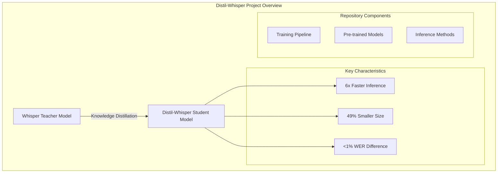
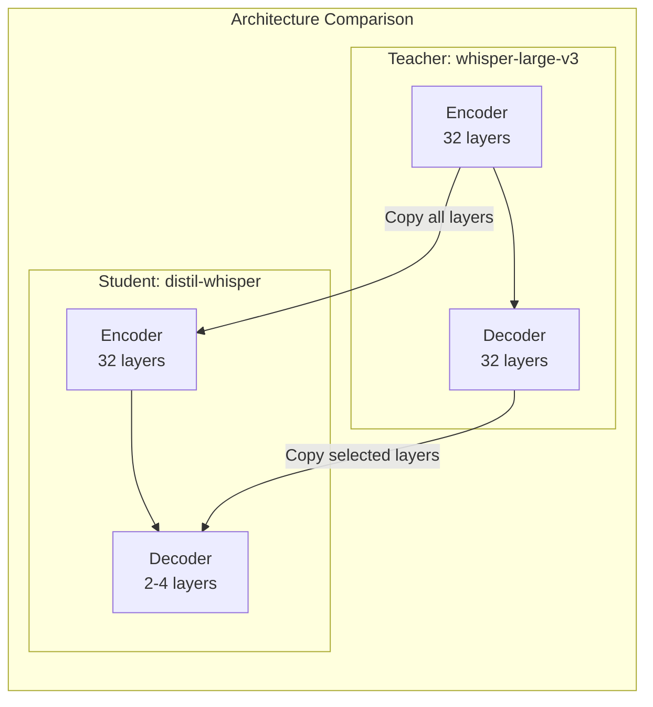
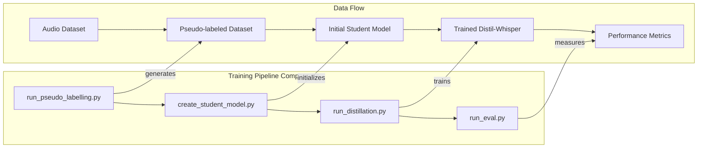
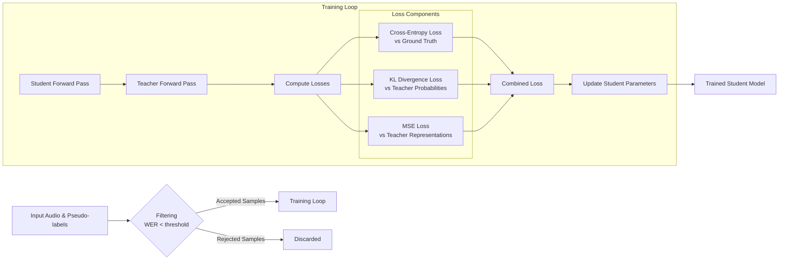
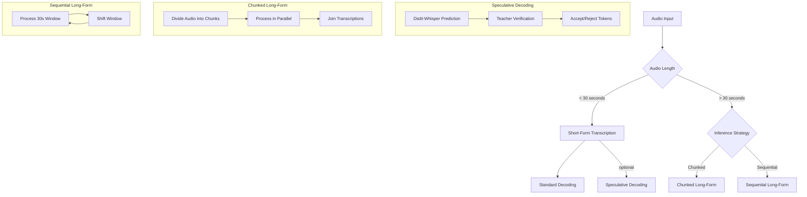
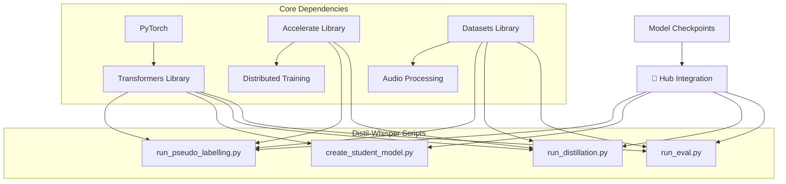

<!-- source: DeepWiki mcp.deepwiki.com · repo huggingface/distil-whisper · page 1 Overview · fetched 2026-10-26 -->

# Overview

Relevant source files

The following files were used as context for generating this wiki page:

- [README.md](README.md)
- [training/README.md](training/README.md)

This document provides a comprehensive overview of the Distil-Whisper project, a knowledge distillation framework for creating smaller, faster versions of OpenAI's Whisper automatic speech recognition (ASR) models while maintaining comparable performance. The overview covers the project's architecture, training pipeline, inference methods, and key components.

For detailed information about the training pipeline, see [Training Pipeline](#2).

## What is Distil-Whisper?

Distil-Whisper is a distilled version of OpenAI's Whisper model for English speech recognition. It achieves:
- 6x faster inference speeds
- 49% smaller model size
- Performance within 1% word error rate (WER) on out-of-distribution evaluation sets

The repository provides both pre-trained distilled models and the complete training pipeline to create your own distilled models, potentially for languages beyond English.

Sources: [README.md:1-28](). [training/README.md:1-13]()

## System Architecture

Distil-Whisper is based on a student-teacher architecture where a smaller student model is trained to mimic the behavior of a larger teacher model (Whisper). The key architectural innovation is retaining the full encoder from the teacher while drastically reducing the decoder size.

### Model Architecture Comparison

The student model preserves the entire encoder component (all 32 layers) from the teacher model to maintain audio processing capabilities, while significantly reducing the decoder to just 2-4 layers. This architectural design allows the student to be substantially smaller and faster while retaining most of the accuracy.

For distil-large-v3, the 2 student decoder layers are specifically copied from teacher layers 1 and 32 (the first and last layers), as these represent maximally spaced layers that capture different aspects of the decoding process.

Sources: [training/README.md:195-220](). [README.md:514-521]()

## Training Pipeline

The Distil-Whisper training pipeline consists of four sequential stages: pseudo-labeling, student model creation, distillation training, and evaluation.

### 1. Pseudo-Labeling

In this stage, a large teacher model (e.g., whisper-large-v3) is used to generate high-quality transcriptions for audio data. The script [run_pseudo_labelling.py]() handles this process, supporting:
- Streaming mode for processing massive audio datasets
- Audio concatenation to 30-second chunks for optimal training
- Language specification for multilingual applications
- WER filtering to remove inaccurate transcriptions

### 2. Student Model Creation

This stage initializes a smaller student model from the teacher model. The script [create_student_model.py]() handles this by:
- Copying the entire encoder from the teacher model
- Selecting specific decoder layers from the teacher (typically first and last layers for a 2-layer decoder)
- Preserving embedding layers and output projections

### 3. Distillation Training

The knowledge distillation process is implemented in [run_distillation.py](), which:
- Trains the student to mimic the teacher's outputs using multiple loss components
- Filters training samples based on WER threshold to ensure quality
- Applies optimizations like encoder freezing for efficient training
- Supports multiple datasets for diverse training

### 4. Evaluation

The final stage evaluates the distilled model using [run_eval.py]() across different metrics:
- Word Error Rate (WER) for accuracy
- Inverse Real-Time Factor (RTFx) for speed
- Token generation speed measurements
- Testing on both in-distribution and out-of-distribution data

Sources: [training/README.md:14-27](). [training/README.md:90-103](). [training/README.md:172-189](). [training/README.md:247-288](). [training/README.md:328-352]()

## Distillation Training Process

The distillation process involves a specialized training approach that combines multiple loss components to ensure the student model effectively learns from the teacher.

Key aspects of the distillation process:

1. **Data Filtering**: Samples with Word Error Rate (WER) above a threshold (typically 10-20%) are discarded to ensure training on high-quality pseudo-labels
2. **Multiple Loss Components**:
   - Cross-entropy loss against ground truth/pseudo-labels
   - KL divergence loss between student and teacher output probabilities
   - Optionally, MSE loss between internal representations
3. **Training Optimizations**:
   - Encoder freezing (since it's identical to the teacher)
   - Positional embedding freezing
   - Timestamp and conditioning probabilities tuning

Sources: [training/README.md:246-323](). [README.md:523-536]()

## Inference Methods

Distil-Whisper supports several inference methods for different use cases, balancing speed and accuracy requirements.

### Short-Form Transcription

For audio clips under 30 seconds (within Whisper's context window), standard decoding can be used directly. The model processes the entire audio in one forward pass.

### Long-Form Transcription

For longer audio, two main approaches are available:

1. **Sequential Long-Form**: Uses a sliding window to process consecutive segments, with positioning determined by timestamp predictions. This is slower but typically provides better accuracy.

2. **Chunked Long-Form**: Divides audio into chunks with small overlaps, processes them in parallel, and joins the results. This method is significantly faster but may be slightly less accurate.

### Speculative Decoding

Speculative decoding uses the distilled model as an "assistant" to predict tokens, which are then verified by the teacher model. This provides:
- 2x faster inference while guaranteeing the same outputs as the teacher
- Minimal additional memory requirements (just 8% increase)
- A perfect drop-in replacement for existing Whisper pipelines

Sources: [README.md:40-171](). [README.md:158-285](). [README.md:286-350](). [README.md:352-432](). [training/README.md:329-486]()

## Available Models

Distil-Whisper provides several pre-trained models with different size/performance tradeoffs:

| Model | Parameters | Relative Speed | Short-Form WER | Long-Form WER |
|-------|------------|----------------|----------------|---------------|
| distil-large-v3 | 756M | 6.3x | 9.7% | 10.8% |
| distil-large-v2 | 756M | 5.8x | 10.1% | 11.6% |
| distil-medium.en | 394M | 6.8x | 11.1% | 12.4% |
| distil-small.en | 166M | 5.6x | 12.1% | 12.8% |

For most applications, `distil-large-v3` is recommended for its optimal performance, while `distil-small.en` is suitable for resource-constrained environments.

Sources: [README.md:11-24]()

## System Dependencies

Key dependencies for the Distil-Whisper project include:
- PyTorch for the core neural network operations
- 🤗 Transformers for the Whisper model implementation
- 🤗 Accelerate for distributed training capabilities
- 🤗 Datasets for data loading and processing, with streaming support

Optional dependencies for improved performance include:
- Flash Attention 2 for faster attention operations
- BetterTransformers/SDPA for optimized inference

Sources: [training/README.md:27-47](). [README.md:433-468]()

## Current Limitations

- Distil-Whisper is currently only available for English speech recognition
- For multilingual speech recognition, OpenAI's Whisper Large-V3-Turbo is recommended as it applies similar principles
- The distillation pipeline requires substantial data (ideally >1000 hours) for optimal results
- Speculative decoding requires both models to be loaded, increasing total memory usage

Sources: [README.md:25-27](). [training/README.md:496-500]()

---

