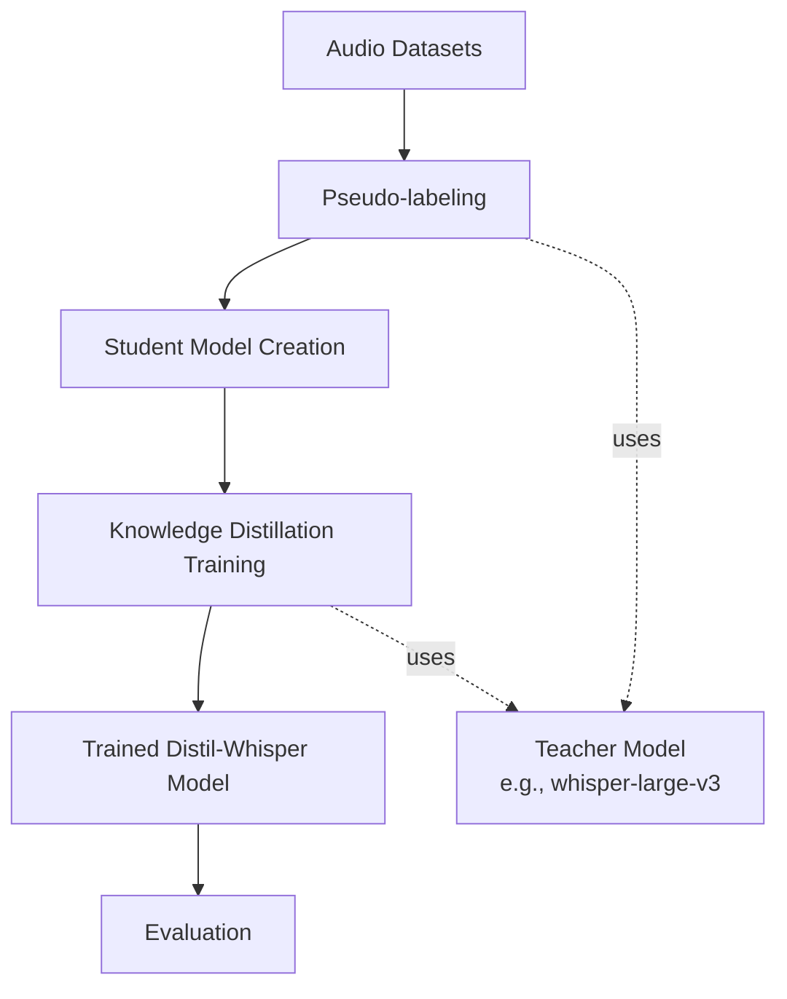
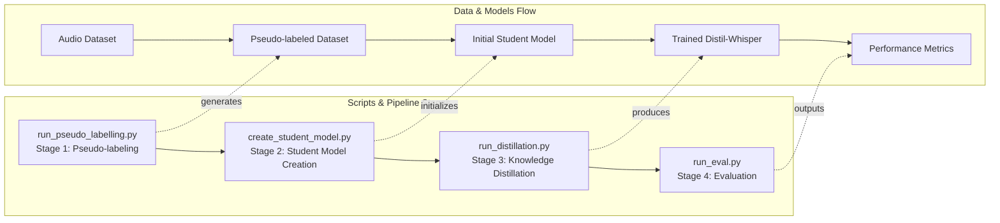
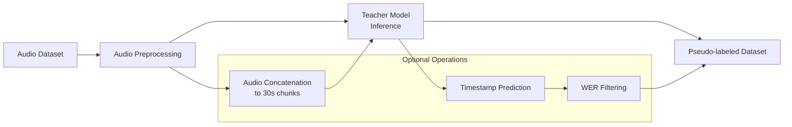
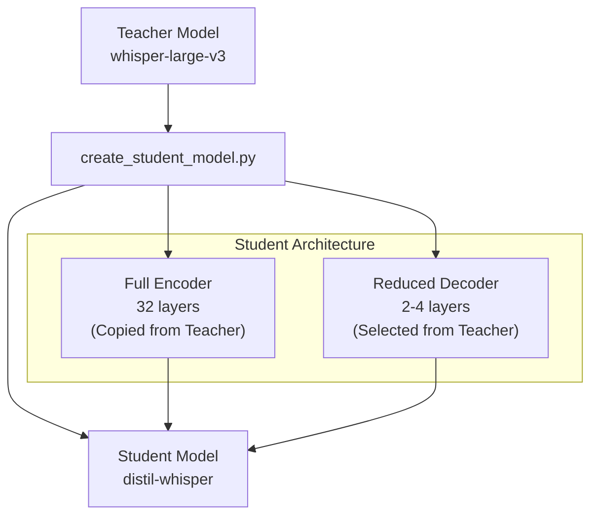
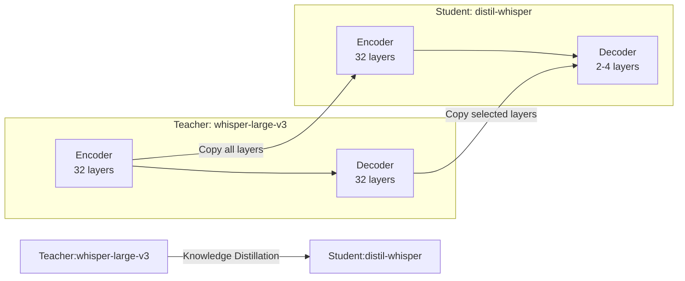
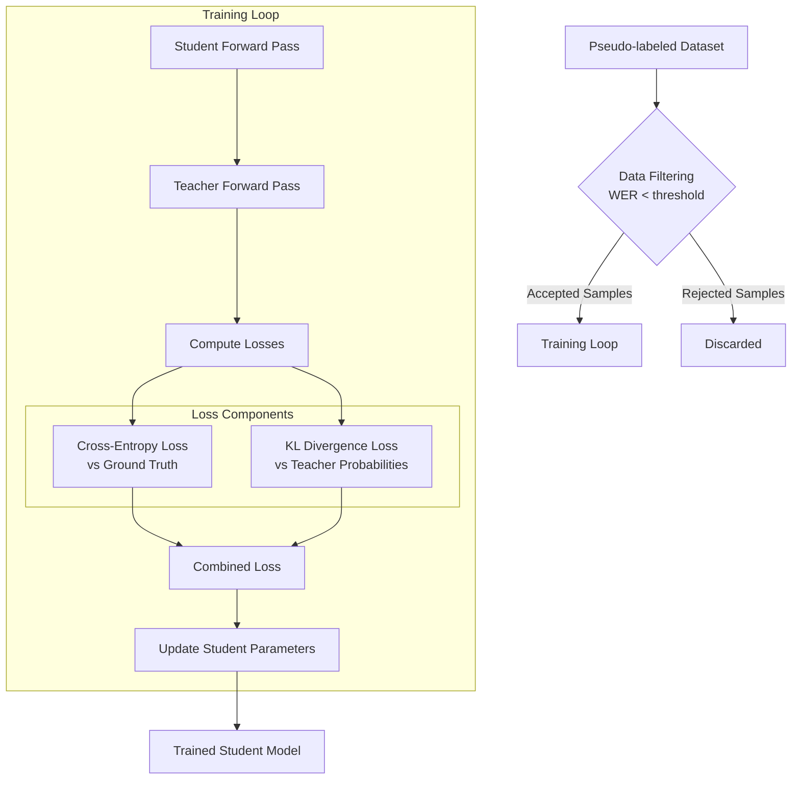
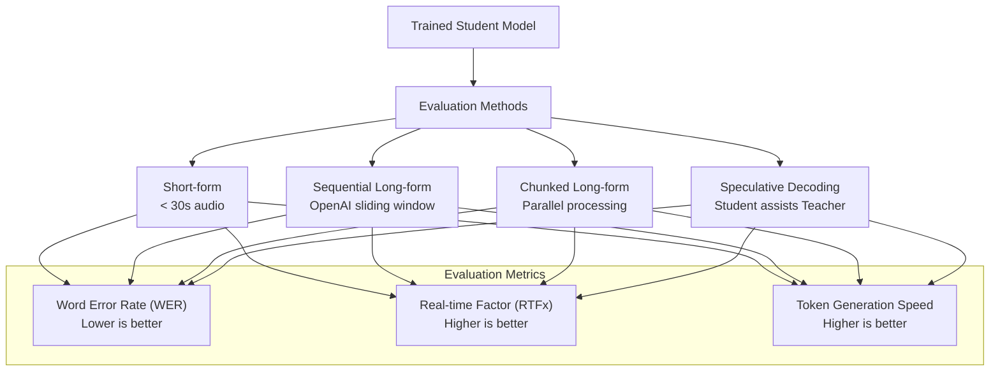

<!-- source: DeepWiki mcp.deepwiki.com · repo huggingface/distil-whisper · page 2 Training Pipeline · fetched 2026-10-26 -->

# Training Pipeline

Relevant source files

The following files were used as context for generating this wiki page:

- [README.md](README.md)
- [training/Makefile](training/Makefile)
- [training/README.md](training/README.md)
- [training/pyproject.toml](training/pyproject.toml)
- [training/setup.py](training/setup.py)

This document provides a comprehensive overview of the four-stage training pipeline used to create Distil-Whisper models. The pipeline enables the creation of smaller, faster versions of OpenAI's Whisper models while maintaining most of the accuracy. For information about the model architecture itself, see [Model Architecture](#3).

## Pipeline Overview

The Distil-Whisper training pipeline consists of four sequential stages that must be completed in order:

Sources: [training/README.md:14-19]()

The pipeline begins with audio datasets, which are processed by a teacher model (typically whisper-large-v3) to generate high-quality transcriptions called pseudo-labels. Next, a smaller student model is initialized with a reduced architecture by copying select layers from the teacher. This student model is then trained through knowledge distillation to mimic the teacher's outputs. Finally, the trained model is evaluated on various metrics and tasks.

Here's a view of how these stages map to the repository scripts:

Sources: [training/README.md:91-135](), [training/README.md:170-220](), [training/README.md:228-290](), [training/README.md:328-371]()

## Stage 1: Pseudo-labeling

The first stage involves using a larger teacher model (typically whisper-large-v3) to generate high-quality transcriptions (pseudo-labels) for audio datasets.

### Process Overview

Sources: [training/README.md:91-104]()

The pseudo-labeling process is implemented in `run_pseudo_labelling.py` and offers several important features:

1. **Audio concatenation (packing)**: Concatenates shorter audio samples into 30-second chunks, which improves training throughput by minimizing zero-padding and leads to WER improvements when using the sequential long-form decoding algorithm.

2. **Language specification**: Explicitly setting the language token during inference substantially improves generation performance since the model is forced to predict in the given language.

3. **Timestamp prediction**: Allows the model to predict timestamps, which is required for sequential long-form transcription.

4. **Generation parameters**: Configurable beam search size, with greedy decoding (num_beams=1) recommended for efficiency.

### Key Configuration Options

| Parameter | Description | Recommended Setting |
|-----------|-------------|-----------------|
| `model_name_or_path` | Teacher model to use | "openai/whisper-large-v3" |
| `concatenate_audio` | Pack audio to 30s chunks | True (improves performance) |
| `preprocessing_batch_size` | Batch size for concatenation | 500 (adjust for RAM) |
| `preprocessing_num_workers` | Worker processes | Based on available CPUs |
| `language` | Target language | Language-specific code (e.g., "en") |
| `return_timestamps` | Include timestamp tokens | True (for generality) |
| `generation_num_beams` | Number of beams | 1 (greedy, faster) |

Sources: [training/README.md:106-133]()

## Stage 2: Student Model Creation

The second stage involves initializing a smaller student model from the teacher model. This is a critical step that establishes the architecture of the distilled model.

### Process Overview

Sources: [training/README.md:170-225]()

The student model creation is implemented in `create_student_model.py` and follows these key principles:

1. **Encoder preservation**: The full encoder (typically 32 layers) is copied from the teacher model to preserve audio processing capabilities.

2. **Decoder reduction**: The decoder is drastically reduced (typically to 2-4 layers), with layers selected by maximal spacing. For example, with 2 decoder layers, they're typically copied from teacher layers 1 and 32.

3. **Language transfer**: For non-English languages, initialization can leverage an existing English distilled model (like distil-large-v3) to improve performance.

### Model Architecture Comparison

Sources: [training/README.md:501-513]()

### Decoder Layer Selection

The choice of decoder layers impacts the balance between speed and accuracy:

| Decoder Layers | Relative Token Gen. Speed | WER Change (%) |
|----------------|---------------------------|----------------|
| 2 layers       | 3.66x faster              | -3.5% WER      |
| 3 layers       | 3.35x faster              | -2.3% WER      |
| 4 layers       | 3.11x faster              | -1.8% WER      |

Sources: [training/README.md:501-513]()

## Stage 3: Knowledge Distillation Training

The third stage involves training the student model to mimic the teacher model's behavior through knowledge distillation.

### Process Overview

Sources: [training/README.md:228-323]()

The distillation training is implemented in `run_distillation.py` and includes these key features:

1. **Loss formulation**: Uses a weighted sum of cross-entropy (against pseudo-labels) and KL-divergence (against teacher probabilities).

2. **WER filtering**: Applies a threshold to filter out samples with high Word Error Rate (WER) between pseudo-labels and ground truth, avoiding training on incorrect transcriptions.

3. **Encoder freezing**: Can freeze the student encoder during training, which provides significant memory savings and enables larger batch sizes.

4. **Multi-dataset training**: Supports training on multiple datasets with configurable sampling probabilities.

5. **Timestamp and conditioning control**: Configurable probabilities for retaining timestamp tokens and conditioning on previous labels.

### Training Configuration Options

| Parameter | Description | Recommended Setting |
|-----------|-------------|-----------------|
| `wer_threshold` | Filter threshold for pseudo-labels | 10-20% (language dependent) |
| `freeze_encoder` | Whether to freeze encoder | True (memory efficient) |
| `freeze_embed_positions` | Freeze decoder positions | True (preserve context handling) |
| `timestamp_probability` | Prob. for timestamp tokens | 0.2 (balance of tasks) |
| `condition_on_prev_probability` | Prob. for prev token conditioning | 0.2 (enables sequential long-form) |
| `max_steps` | Total training steps | At least 50k for convergence |
| `lr_scheduler_type` | Learning rate schedule | "linear" for long runs, "constant_with_warmup" for short runs |

Sources: [training/README.md:262-322]()

## Stage 4: Evaluation

The final stage involves evaluating the distilled model on various metrics and tasks to assess its performance compared to the teacher model.

### Evaluation Types

Sources: [training/README.md:328-386]()

The evaluation process is implemented in `run_eval.py` and includes four primary evaluation methodologies:

1. **Short-form evaluation**: For audio samples less than 30 seconds, evaluating standard transcription accuracy and speed.

2. **Sequential long-form evaluation**: Using the original OpenAI algorithm that sequentially transcribes 30-second segments and shifts the window according to predicted timestamps.

3. **Chunked long-form evaluation**: Dividing long audio into chunks processed in parallel and joined, which is much faster but slightly less accurate.

4. **Speculative decoding evaluation**: Using the distilled model as an assistant to the teacher model, which guarantees the same outputs as the teacher while being about 2x faster.

### Evaluation Configuration

| Parameter | Description | Use Case |
|-----------|-------------|----------|
| `use_pipeline` | Use pipeline for chunked inference | For chunked long-form |
| `chunk_length_s` | Length of chunked segments | 25s optimal for distil-large-v3 |
| `assistant_model_name_or_path` | Model for speculative decoding | Distilled model path |
| `dataset_name` | Evaluation datasets | Both in-distribution and out-of-distribution |
| `language` | Target language | Language-specific code |
| `attn_implementation` | Attention implementation | "sdpa" or "flash_attention_2" |

Sources: [training/README.md:360-483]()

## Recommendations for Successful Distillation

Based on the Distil-Whisper implementation and experiments, here are key recommendations for successful model distillation:

1. **Data quantity**: Aim for at least 1000 hours of audio data for training, with more data leading to better results. The original Distil-Whisper used 21,000+ hours.

2. **Training duration**: Train for at least 50,000 steps to reach convergence, with longer training for larger datasets.

3. **Decoder size**: Use 2-4 decoder layers based on your speed/accuracy requirements, with 2 layers offering the best speed and 4 layers the best accuracy.

4. **Domain diversity**: Train on diverse audio datasets spanning multiple domains to ensure robustness.

5. **WER filtering**: Use an appropriate WER threshold to filter out poor pseudo-labels, typically around 10-20% depending on the language.

6. **Evaluation strategy**: Evaluate on both in-distribution and out-of-distribution datasets to assess generalization.

7. **Language transfer**: For non-English languages, consider initializing from an existing distilled English model.

8. **Language mixing**: For low-resource languages (<500 hours), consider mixing with a closely related language to improve performance.

Sources: [training/README.md:492-548]()

---

