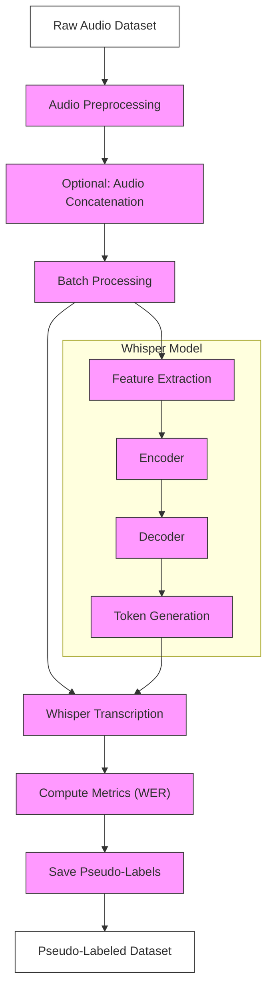
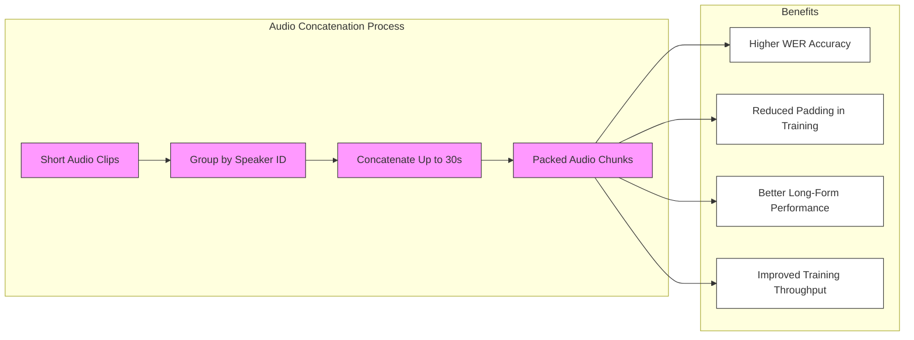
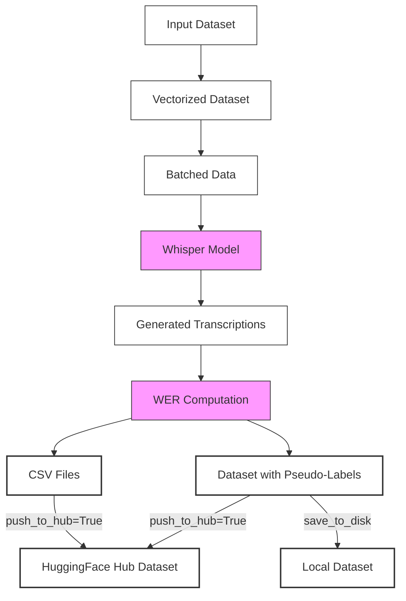
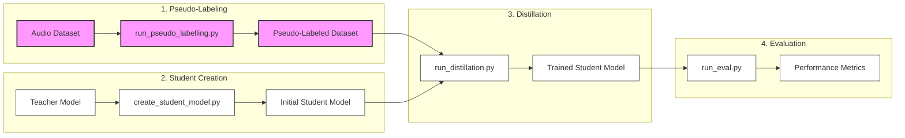

<!-- source: DeepWiki mcp.deepwiki.com · repo huggingface/distil-whisper · page 2.1 Pseudo-Labeling · fetched 2026-10-26 -->

# Pseudo-Labeling

<details>
<summary>Relevant source files</summary>

The following files were used as context for generating this wiki page:

- [README.md](README.md)
- [training/README.md](training/README.md)
- [training/run_pseudo_labelling.py](training/run_pseudo_labelling.py)

</details>


## Purpose and Scope

Pseudo-labeling is the first stage in the Distil-Whisper training pipeline, where a large teacher model (typically Whisper large-v3) is used to generate high-quality transcriptions for audio datasets. These transcriptions serve as "pseudo-labels" that will later be used to train the smaller student model through knowledge distillation. This page documents the pseudo-labeling process, its implementation, configuration options, and how it integrates with the rest of the training pipeline.

For information about creating the student model, see [Student Model Creation](#2.2). For details on the distillation training process itself, see [Distillation Training](#2.3).

## Process Overview

Pseudo-labeling converts an audio dataset into a dataset with high-quality transcriptions generated by the Whisper model. The process handles audio preprocessing, batching, transcription generation, and optimally saves the results.



Sources: [training/README.md:91-100](), [training/run_pseudo_labelling.py:16-19]()

## Key Components and Configuration

The pseudo-labeling implementation is controlled by several component configurations:

```mermaid
flowchart TD
    A["run_pseudo_labelling.py"] --> B["ModelArguments"]
    A --> C["DataTrainingArguments"]
    A --> D["Seq2SeqTrainingArguments"]
    
    B --> B1["model_name_or_path"]
    B --> B2["dtype (float16/bfloat16)"]
    B --> B3["attn_implementation"]
    
    C --> C1["dataset_name/config"]
    C --> C2["audio_column_name"]
    C --> C3["text_column_name"]
    C --> C4["id_column_name"]
    C --> C5["concatenate_audio"]
    C --> C6["max_duration_in_seconds"]
    C --> C7["language/task settings"]
    C --> C8["streaming mode"]
    
    D --> D1["per_device_eval_batch_size"]
    D --> D2["generation_num_beams"]
    D --> D3["output_dir"]
    D --> D4["push_to_hub"]
    
    classDef main fill:#f9f,stroke:#333,stroke-width:1px
    classDef args fill:#fff,stroke:#333,stroke-width:1px
    classDef options fill:#fff,stroke:#333,stroke-width:1px
    
    class A main
    class B,C,D args
    class B1,B2,B3,C1,C2,C3,C4,C5,C6,C7,C8,D1,D2,D3,D4 options
```



Sources: [training/run_pseudo_labelling.py:71-306]()

## Audio Preprocessing and Concatenation

A key performance optimization in pseudo-labeling is audio concatenation, which packs multiple short audio clips into 30-second chunks. This improves both transcription quality and training efficiency.



Sources: [training/README.md:99-102](), [training/run_pseudo_labelling.py:632-686]()

## Implementation Details

### Model and Processor Initialization

The process begins with loading the Whisper model, tokenizer, and feature extractor. The configuration depends on whether you're working with multilingual or English-only setups.

For multilingual models, language and task tokens are set explicitly:

```
tokenizer.set_prefix_tokens(language=data_args.language, task=data_args.task, predict_timestamps=return_timestamps)
```

Sources: [training/run_pseudo_labelling.py:530-578]()

### Audio Processing Pipeline

The audio processing pipeline includes several key steps:

1. **Dataset Loading**: Loads audio datasets from Hugging Face Hub or local sources
2. **Resampling**: Ensures audio is at the correct sample rate (16kHz for Whisper)
3. **Audio Concatenation**: Optionally packs shorter audio segments to maximize efficiency 
4. **Feature Extraction**: Converts audio into log-mel spectrograms used by Whisper

Sources: [training/run_pseudo_labelling.py:497-576](), [training/run_pseudo_labelling.py:632-686]()

### Transcription Generation

The transcription process uses configurations like:

| Parameter | Purpose | Typical Value |
|-----------|---------|---------------|
| `max_length` | Maximum length of generated tokens | 256 |
| `num_beams` | Number of beams for beam search | 1 (greedy) |
| `return_timestamps` | Whether to include timestamp tokens | True/False |
| `language` | Language token (multilingual models) | "en", "hi", etc. |
| `task` | Task token (transcribe/translate) | "transcribe" |

Generation is run through model.generate(), with a batch size controlled by `per_device_eval_batch_size`.

Sources: [training/run_pseudo_labelling.py:841-856](), [training/run_pseudo_labelling.py:892]()

### Metrics and Evaluation

For validation and test sets, the script computes Word Error Rate (WER) metrics to evaluate the quality of the pseudo-labels:

1. Generated tokens are decoded to text
2. Text is normalized using language-specific text normalizers
3. WER is computed between normalized text and ground truth
4. Predictions, references, and metrics are logged

Sources: [training/run_pseudo_labelling.py:787-812](), [training/run_pseudo_labelling.py:934-952]()

## Data Flow and Storage

The pseudo-labeling process reads from and writes to several data structures:



Sources: [training/run_pseudo_labelling.py:858-972](), [training/run_pseudo_labelling.py:1015-1018]()

## Running Pseudo-Labeling

A typical command to run pseudo-labeling looks like:

```bash
accelerate launch run_pseudo_labelling.py \
  --model_name_or_path "openai/whisper-large-v3" \
  --dataset_name "mozilla-foundation/common_voice_16_1" \
  --dataset_config_name "hi" \
  --dataset_split_name "train+validation+test" \
  --text_column_name "sentence" \
  --id_column_name "path" \
  --output_dir "./common_voice_16_1_hi_pseudo_labelled" \
  --per_device_eval_batch_size 64 \
  --dtype "bfloat16" \
  --attn_implementation "sdpa" \
  --max_label_length 256 \
  --concatenate_audio \
  --language "hi" \
  --task "transcribe" \
  --return_timestamps \
  --generation_num_beams 1 \
  --push_to_hub
```

Important flags include:
- `concatenate_audio`: Activates the audio packing optimization
- `return_timestamps`: Includes timestamp tokens in pseudo-labels (recommended for general models)
- `language`/`task`: Required for multilingual models, omitted for English-only models
- `generation_num_beams`: Controls beam search width (1 = greedy search)

Sources: [training/README.md:106-134]()

## Key Recommendations

1. **Audio Concatenation**: Always enable audio concatenation (`--concatenate_audio`) to improve both WER performance and training throughput
2. **Include Timestamps**: Generate pseudo-labels with timestamps (`--return_timestamps`) to ensure the distilled model can predict timestamps at inference time
3. **Batch Size**: Use the largest possible batch size that fits in memory to maximize throughput
4. **Generation Speed**: For most cases, greedy decoding (`generation_num_beams=1`) provides the best speed/quality tradeoff for pseudo-labeling
5. **Hardware Optimizations**: Enable hardware-specific optimizations like `attn_implementation="sdpa"` or `attn_implementation="flash_attention_2"` for faster inference

Sources: [training/README.md:140-151]()

## Integration with Training Pipeline

After pseudo-labeling is complete, the output dataset is used in the next stage of the Distil-Whisper pipeline:



Sources: [training/README.md:14-20](), [README.md:3-7]()

## Common Challenges and Solutions

| Challenge | Solution |
|-----------|----------|
| Memory limitations | Reduce `per_device_eval_batch_size` and enable mixed precision with `dtype="bfloat16"` |
| Slow processing | Enable hardware optimizations like Flash Attention, increase batch size, use `generation_num_beams=1` |
| Non-English languages | Set appropriate `language` and `task` parameters for multilingual models |
| Large datasets | Enable `streaming=True` for datasets that don't fit in memory |
| Low quality transcriptions | For languages with poor Whisper performance (>20% WER), consider fine-tuning before pseudo-labeling |

Sources: [training/README.md:140-151](), [training/README.md:573-616]()

---

