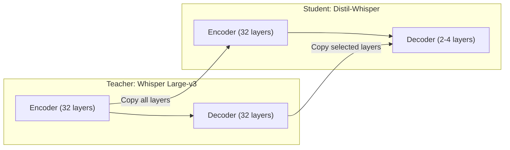
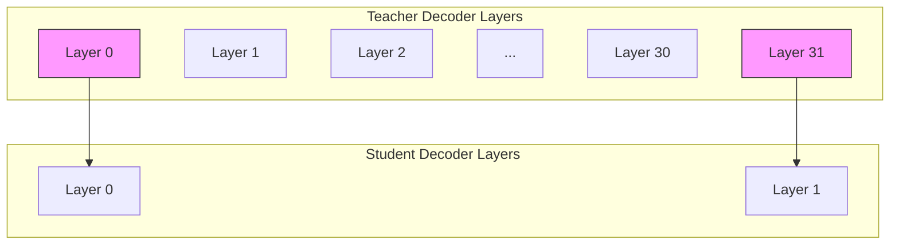
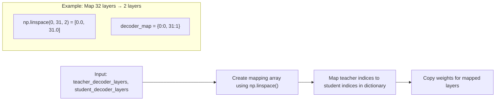
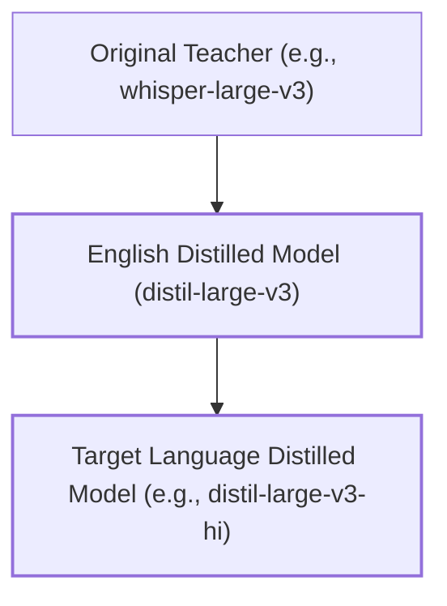

<!-- source: DeepWiki mcp.deepwiki.com · repo huggingface/distil-whisper · page 2.2 Student Model Creation · fetched 2026-10-26 -->

# Student Model Creation

<details>
<summary>Relevant source files</summary>

The following files were used as context for generating this wiki page:

- [README.md](README.md)
- [training/README.md](training/README.md)
- [training/create_student_model.py](training/create_student_model.py)

</details>


## Purpose and Overview

This document explains the second stage of the Distil-Whisper training pipeline: creating a smaller, more efficient student model which will be trained to mimic the larger teacher Whisper model. The student model creation process involves initializing a reduced-size model architecture from the teacher model's weights using a strategic layer selection approach.

This page focuses on the technical implementation of creating the student model's architecture and initializing its weights. For information about the previous step (pseudo-labeling), see [Pseudo-Labeling](#2.1), and for the following step (distillation training), see [Distillation Training](#2.3).

## Architecture Design

The key insight in the Distil-Whisper approach is that most of the computational overhead in Whisper comes from the decoder layers, while the encoder is responsible for processing the audio features. By keeping the entire encoder but drastically reducing the decoder layers, we achieve significant speedups with minimal accuracy loss.



The student model architecture typically:
- Retains the complete encoder from the teacher model (all 32 layers)
- Uses only 2-4 decoder layers selected from the teacher model
- Keeps the same embedding dimensions and vocabulary size
- Preserves input and output interfaces to ensure compatibility

Sources: [training/README.md:162-176](), [README.md:508-523]()

## Layer Selection Strategy

When creating a student model with fewer layers than the teacher, the layers are selected using a "maximally spaced" strategy. This means selecting layers that are evenly distributed across the teacher's architecture, ensuring that both early and late layer behaviors are captured.



For a 2-layer decoder model, this means selecting layers 0 and 31 (first and last). For more layers, the algorithm computes linearly spaced indices using `numpy.linspace()` to determine which teacher layers to select.

Sources: [training/create_student_model.py:129-145]()

## Implementation Details

The student model initialization process involves:

1. **Configuration Generation**: Creating a new configuration based on the teacher model but with fewer decoder layers
2. **Layer Mapping**: Establishing mappings between teacher and student layer indices
3. **Weight Initialization**: Loading and transferring weights from the teacher to the student
4. **Validation**: Verifying the student model can successfully perform a forward pass

The core of this logic is implemented in the `init_student_model_from_teacher` function.

### Layer Mapping Algorithm

For decoder layers, the mapping is calculated as follows:



This mapping ensures that when we select a reduced number of layers, we maintain a representation of both the early processing (lower layers) and the more abstract representations (higher layers).

Sources: [training/create_student_model.py:129-145](), [training/create_student_model.py:169-182]()

## Key Parameters

The student model creation script accepts several important parameters:

| Parameter | Description | Default | Example Value |
|-----------|-------------|---------|--------------|
| `teacher_checkpoint` | HF Hub ID of the teacher model | (required) | "openai/whisper-large-v3" |
| `encoder_layers` | Number of encoder layers in student | None (all) | 32 |
| `decoder_layers` | Number of decoder layers in student | 2 | 2, 3, or 4 |
| `decoder_layers_numbers` | Specific teacher decoder layers to use | None | [0, 31] |
| `save_dir` | Directory to save the student model | (required) | "./distil-large-v3-init" |

When `decoder_layers_numbers` is provided, it overrides the default equally-spaced layer selection, allowing for manual selection of specific teacher layers.

Sources: [training/create_student_model.py:33-89]()

## Usage Example

Here's a typical example of using the script to create a student model:

```bash
python create_student_model.py \
  --teacher_checkpoint "openai/whisper-large-v3" \
  --encoder_layers 32 \
  --decoder_layers 2 \
  --save_dir "./distil-large-v3-init"
```

This creates a student model with all 32 encoder layers (matching the teacher) and 2 decoder layers, saving it to the specified directory.

Sources: [training/README.md:207-220]()

## Language Transfer

An important technique in student model creation is "language transfer." Instead of initializing the student model directly from the original Whisper model, you can initialize it from an already distilled model such as "distil-whisper/distil-large-v3".



This approach has been shown to improve performance, particularly for a 2-layer decoder configuration, with WER improvements of up to 1.9% compared to initializing directly from the original Whisper model. This technique is especially useful when distilling for non-English languages.

To use language transfer, simply change the `teacher_checkpoint` parameter to point to an already distilled model:

```bash
python create_student_model.py \
  --teacher_checkpoint "distil-whisper/distil-large-v3" \
  --encoder_layers 32 \
  --decoder_layers 2 \
  --save_dir "./distil-large-v3-init"
```

Sources: [training/README.md:516-524]()

## Performance Considerations

The choice of decoder layers significantly impacts the speed-accuracy tradeoff. Based on experimental results after 10,000 training steps, the following performance characteristics were observed:

| Decoder Layers | Relative Token Generation Speed | WER Change (vs Teacher) |
|----------------|--------------------------------|-------------------------|
| 2 layers       | 3.66× faster                   | -3.5% WER              |
| 3 layers       | 3.35× faster                   | -2.3% WER              |
| 4 layers       | 3.11× faster                   | -1.8% WER              |

These measurements were performed on an 80GB Nvidia H100 with a batch size of 16 and 20 tokens generation, compared to the Whisper large-v3 baseline.

Sources: [training/README.md:501-513]()

## Next Steps

After creating the student model, the next stage in the pipeline is [Distillation Training](#2.3). During training, the encoder is typically frozen (using the `--freeze_encoder` option) since it's an exact copy of the teacher's encoder. This provides significant memory savings and can enable up to 2× larger batch sizes during training.

Additionally, it's recommended to freeze the decoder positional embeddings (`--freeze_embed_positions`) to help the student model retain the teacher's representation capability for handling long sequences up to the full maximum input length.

Sources: [training/README.md:314-317]()

---

