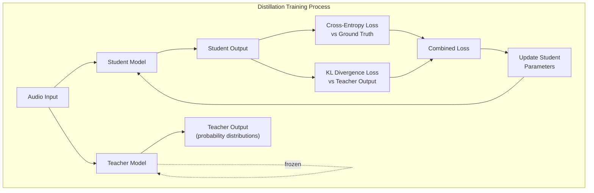
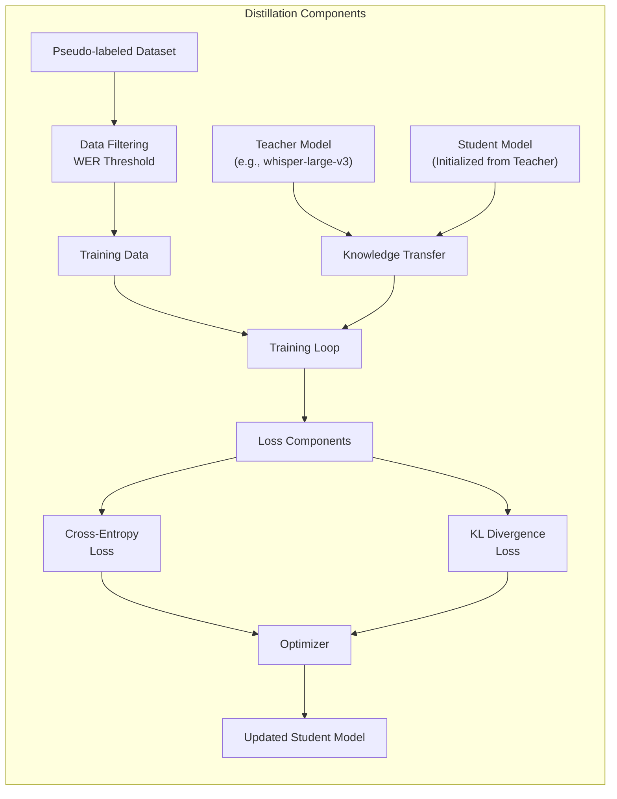
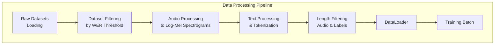
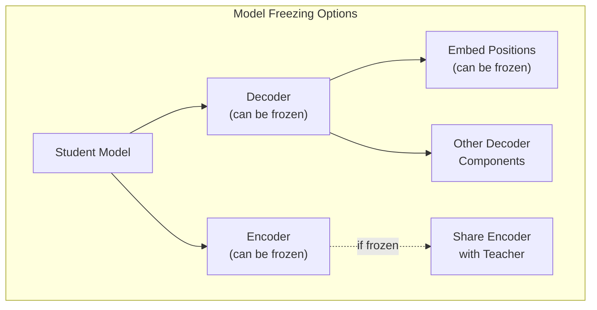
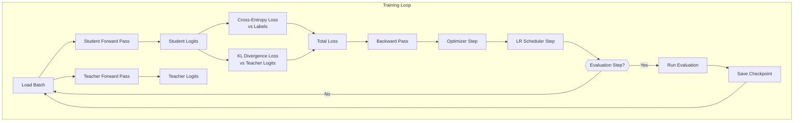

<!-- source: DeepWiki mcp.deepwiki.com · repo huggingface/distil-whisper · page 2.3 Distillation Training · fetched 2026-10-26 -->

# Distillation Training

<details>
<summary>Relevant source files</summary>

The following files were used as context for generating this wiki page:

- [README.md](README.md)
- [training/README.md](training/README.md)
- [training/run_distillation.py](training/run_distillation.py)

</details>


This page details the knowledge distillation process used to train a Distil-Whisper student model to mimic the behavior of a larger Whisper teacher model. Distillation training is the third stage of the four-stage Distil-Whisper pipeline, following [Pseudo-Labeling](#2.1) and [Student Model Creation](#2.2), and preceding the final [Evaluation](#2.4) stage.

## Overview of Knowledge Distillation

Knowledge distillation is a technique where a smaller "student" model is trained to reproduce the behavior of a larger "teacher" model. In Distil-Whisper, the student model has a significantly reduced decoder (typically 2-4 layers versus the teacher's 32 layers) while maintaining the full encoder architecture.

The distillation process uses a combination of:
1. Cross-entropy loss against the ground truth labels (or pseudo-labels)
2. KL-divergence loss to match the teacher's probability distributions
3. Optional representation matching through MSE loss on hidden states



Sources: [training/run_distillation.py:351-402](training/run_distillation.py:351-402), [training/README.md:229-249](training/README.md:229-249)

## Key Components for Distillation

The distillation training process combines several components to effectively transfer knowledge from the teacher to the student model:



Sources: [training/run_distillation.py:1-40](training/run_distillation.py:1-40), [training/run_distillation.py:784-817](training/run_distillation.py:784-817)

## Training Configuration

Distillation training is controlled by three main groups of arguments:

### Model Arguments

Model arguments control the teacher and student model configurations:

```python
@dataclass
class ModelArguments:
    model_name_or_path: str  # Path to student model
    teacher_model_name_or_path: str  # Path to teacher model
    config_name: Optional[str] = None  # Config name if different from model
    tokenizer_name: Optional[str] = None  # Tokenizer name if different from model
    feature_extractor_name: Optional[str] = None  # Feature extractor name
    cache_dir: Optional[str] = None  # Cache directory for models
    attn_implementation: Optional[str] = None  # Attention implementation (eager, sdpa, flash_attention_2)
    # ... other arguments
```

Sources: [training/run_distillation.py:77-149](training/run_distillation.py:77-149)

### Data Training Arguments

Data arguments control the dataset loading and processing:

```python
@dataclass
class DataTrainingArguments:
    train_dataset_name: str  # Training dataset name
    train_dataset_config_name: Optional[str] = None  # Training dataset config
    train_dataset_samples: str = None  # Number of samples per dataset
    eval_dataset_name: str = None  # Evaluation dataset name
    wer_threshold: float = None  # Filter samples with WER above threshold
    use_pseudo_labels: bool = True  # Whether to use pseudo-label transcriptions
    timestamp_probability: float = 0.2  # Probability for timestamp tokens
    condition_on_prev_probability: float = 0.2  # Probability for conditioning on previous text
    # ... other arguments
```

Sources: [training/run_distillation.py:151-347](training/run_distillation.py:151-347)

### Distillation Training Arguments

Distillation-specific arguments that extend the standard training arguments:

```python
@dataclass
class DistillationTrainingArguments(Seq2SeqTrainingArguments):
    freeze_encoder: Optional[bool] = False  # Whether to freeze the encoder
    freeze_decoder: Optional[bool] = False  # Whether to freeze the decoder
    freeze_embed_positions: Optional[bool] = False  # Whether to freeze positional embeddings
    temperature: Optional[float] = 2.0  # Temperature for softmax in KL divergence
    kl_weight: Optional[float] = 1.0  # Weight for KL divergence loss
    dtype: Optional[str] = "float32"  # Data type for training (float32, float16, bfloat16)
    # ... other arguments
```

Sources: [training/run_distillation.py:350-401](training/run_distillation.py:350-401)

## Data Processing Pipeline

The distillation training script processes data through several stages:



Key components of the data pipeline:

1. **Dataset Loading**: Multiple datasets can be loaded and combined
2. **WER Filtering**: Filters out samples where the WER between pseudo-labels and reference transcripts exceeds a threshold
3. **Feature Extraction**: Converts audio to log-mel spectrograms
4. **Text Processing**: Tokenizes text and handles timestamps and previous context
5. **Length Filtering**: Removes samples that are too long or too short
6. **Batch Preparation**: Prepares batches for training with appropriate padding

Sources: [training/run_distillation.py:881-1300](training/run_distillation.py:881-1300)

### Data Collator

A specialized data collator handles the padding and preparation of inputs for the model:

```python
@dataclass
class DataCollatorSpeechSeq2SeqWithPadding:
    processor: Any
    decoder_start_token_id: int
    decoder_prev_token_id: int
    input_padding: Union[bool, str] = "max_length"
    target_padding: Union[bool, str] = "max_length"
    max_target_length: Optional[int] = None
    
    # Handles padding and preparation of input features and labels
    # Creates decoder input IDs and properly masks labels
```

Sources: [training/run_distillation.py:404-478](training/run_distillation.py:404-478)

## Training Implementation

The training process combines several key techniques to effectively distill knowledge from the teacher to the student model.

### Model Initialization and Freezing

Depending on configuration, parts of the student model can be frozen during training:



The script provides options to:
- Freeze the encoder (typically done since it's copied from the teacher)
- Freeze the decoder (leaving only the LM head trainable)
- Freeze the positional embeddings

Sources: [training/run_distillation.py:1010-1045](training/run_distillation.py:1010-1045)

### Optimization

The training script uses a customized optimizer configuration:

1. **Parameter Grouping**: Different weight decay for different parameter types
2. **Optimizer**: AdamW with configurable learning rate, betas, and epsilon
3. **LR Scheduler**: Support for various schedules like linear, constant with warmup, etc.

```python
# Example optimizer configuration
optimizer_grouped_parameters = [
    {
        "params": [param for name, param in student_model.named_parameters() 
                   if name in decay_parameters],
        "weight_decay": training_args.weight_decay,
    },
    {
        "params": [param for name, param in student_model.named_parameters() 
                   if name not in decay_parameters],
        "weight_decay": 0.0,
    },
]
optimizer = torch.optim.AdamW(
    params=optimizer_grouped_parameters,
    lr=training_args.learning_rate,
    betas=(training_args.adam_beta1, training_args.adam_beta2),
    eps=training_args.adam_epsilon,
)
```

Sources: [training/run_distillation.py:1376-1407](training/run_distillation.py:1376-1407)

### Training and Evaluation Loop

The training loop follows these key steps:

1. Forward pass of student model
2. Forward pass of teacher model (if not using frozen encoder)
3. Compute loss components:
   - Cross-entropy loss against labels/pseudo-labels
   - KL divergence between student and teacher outputs
4. Backpropagate combined loss
5. Update student model parameters
6. Periodically evaluate on validation set



Sources: [training/run_distillation.py:2441-2700](training/run_distillation.py:2441-2700)

## Evaluation During Training

During training, the model is periodically evaluated on validation data:

1. **Metrics Computation**: WER is calculated both with and without normalization
2. **Logging**: Performance metrics are logged to tracking systems (wandb, tensorboard)
3. **Checkpointing**: Best checkpoints are saved based on validation WER

```python
# Compute metrics function for evaluation
def compute_metrics(preds, labels):
    # Replace padded labels with padding token
    # Decode predictions and references
    # Compute WER with and without normalization
    # Return metrics and decoded strings for logging
```

Sources: [training/run_distillation.py:1319-1341](training/run_distillation.py:1319-1341)

## Best Practices and Recommendations

Based on the training code and README, here are key recommendations for effective distillation training:

### Data Requirements

| WER of Pre-trained Model | Recommended Data Amount | Recommended Method  |
|--------------------------|-------------------------|---------------------|
| < 20%                    | > 1000 hours            | Knowledge Distillation |
| > 20%                    | < 1000 hours            | Fine-tuning         |

### Critical Parameters

| Parameter | Recommended Value | Description |
|-----------|-------------------|-------------|
| `wer_threshold` | 10-20% | Filter threshold for pseudo-labels |
| `timestamp_probability` | 0.2 | Probability for retaining timestamp tokens |
| `condition_on_prev_probability` | 0.2 | Probability for conditioning on previous text |
| `freeze_encoder` | True | Freeze and share encoder with teacher |
| `temperature` | 2.0 | Temperature for softmax in KL divergence |
| `learning_rate` | ~1e-4 | Learning rate for optimization |
| `lr_scheduler_type` | `constant_with_warmup` for short runs (<5k steps)<br>`linear` for long runs (>5k steps) | Learning rate schedule |

### Architecture Choices

The choice of decoder layers affects the speed vs. accuracy trade-off:

| Decoder Layers | Relative Token Gen. Speed | WER Change |
|----------------|---------------------------|------------|
| 2 layers       | 3.66x                     | +3.5%      |
| 3 layers       | 3.35x                     | +2.3%      |
| 4 layers       | 3.11x                     | +1.8%      |

Sources: [training/README.md:291-323](training/README.md:291-323), [training/README.md:494-512](training/README.md:494-512)

## Language Transfer and Mixing

For low-resource languages (<500 hours of audio data), consider:

1. **Language Transfer**: Initialize the student model from an existing English distilled model
2. **Language Mixing**: Combine data from the target language with data from a closely related language

These techniques can significantly improve performance for low-resource scenarios.

Sources: [training/README.md:513-561](training/README.md:513-561)

## Implementation Details

The main training functions in the script include:

1. `main()`: Overall training pipeline
2. `log_metric()`: Helper function for logging metrics
3. `compute_metrics()`: Computes WER and other evaluation metrics
4. `get_parameter_names()`: Helper for getting parameter names for optimization
5. `load_multiple_datasets()`: Loads and combines multiple datasets

The script integrates with:
- 🤗 Accelerate for distributed training
- 🤗 Transformers for model components
- 🤗 Datasets for data loading

Sources: [training/run_distillation.py:781-2700](training/run_distillation.py:781-2700)

## Related Pages

- For details on generating pseudo-labels, see [Pseudo-Labeling](#2.1)
- For information on creating the initial student model, see [Student Model Creation](#2.2)
- For evaluating the trained model, see [Evaluation](#2.4)
- For architecture details, see [Model Architecture](#3)

---

