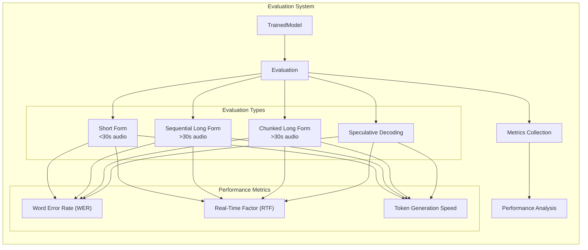
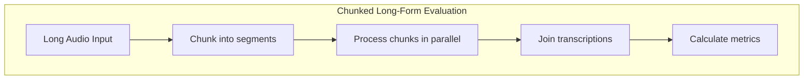
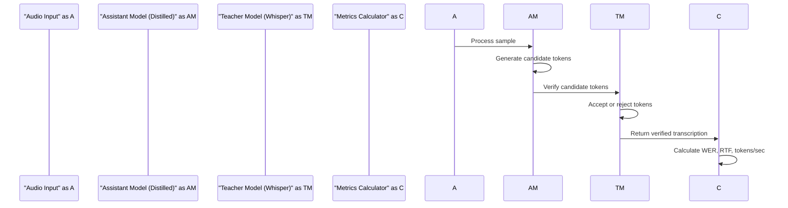
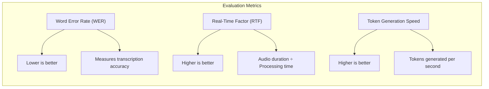
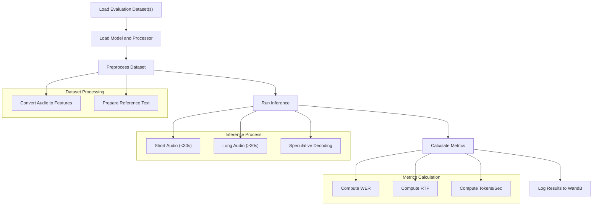
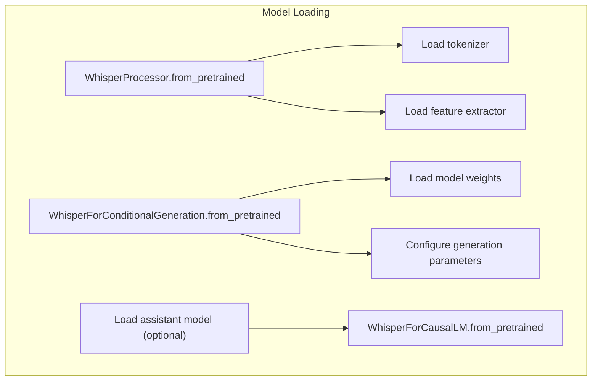
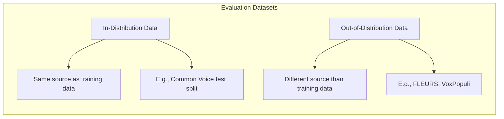

<!-- source: DeepWiki mcp.deepwiki.com · repo huggingface/distil-whisper · page 2.4 Evaluation · fetched 2026-10-26 -->

# Evaluation

<details>
<summary>Relevant source files</summary>

The following files were used as context for generating this wiki page:

- [README.md](README.md)
- [training/README.md](training/README.md)
- [training/run_eval.py](training/run_eval.py)

</details>


This page documents the evaluation systems and processes used to assess Distil-Whisper models after training. This is the final step in the Distil-Whisper training pipeline, where models are evaluated on various speech recognition datasets to measure their performance in terms of accuracy and speed. For information about training the models, see [Distillation Training](#2.3).

## Overview of Evaluation in Distil-Whisper

The evaluation system in Distil-Whisper is designed to comprehensively assess model performance across different scenarios and metrics. Models are evaluated for both transcription accuracy and inference speed to ensure distilled models maintain quality while achieving the primary goal of faster inference.



Sources: [training/README.md:327-346](). [training/run_eval.py:15-18]().

## Evaluation Types

Distil-Whisper supports four distinct types of evaluation, each targeting different usage scenarios:

### 1. Short Form Evaluation

Used for audio samples less than 30 seconds in duration. This mode evaluates the model's performance on typical ASR test sets like LibriSpeech validation.

```mermaid
sequenceDiagram
    participant "Audio Sample (<30s)" as A
    participant "Whisper Model" as M
    participant "Metrics Calculator" as C
    
    A->>M: Process full sample
    M->>M: Generate transcription
    M->>C: Return transcription
    C->>C: Calculate WER, RTF, tokens/sec
```

Sources: [training/README.md:350-385](). [training/run_eval.py:726-753]().

### 2. Sequential Long Form Evaluation

Used for audio samples longer than 30 seconds, using the original "sequential" long-form algorithm from OpenAI. This evaluates the model on complete audio files like TED talks or earnings calls.

```mermaid
sequenceDiagram
    participant "Long Audio (>30s)" as A
    participant "Whisper Model" as M
    participant "Metrics Calculator" as C
    
    A->>A: Split into 30s segments
    loop For each segment
        A->>M: Process segment
        M->>M: Generate transcription with timestamps
        M->>A: Use timestamps to determine next window position
    end
    M->>C: Return complete transcription
    C->>C: Calculate WER, RTF, tokens/sec
```

Sources: [training/README.md:386-414](). [training/run_eval.py:732-736]().

### 3. Chunked Long Form Evaluation

Used for audio samples longer than 30 seconds, using the Transformers "chunked" long-form algorithm. This approach chunks the audio and processes segments in parallel for faster inference.



Sources: [training/README.md:415-451](). [training/run_eval.py:752-783]().

### 4. Speculative Decoding Evaluation

Evaluates a setup where a faster, distilled model is used as an assistant to a slower, teacher model. This allows for approximately 2x faster inference while ensuring identical outputs to the teacher model.



Sources: [training/README.md:452-491](). [training/run_eval.py:578-599]().

## Evaluation Metrics

The evaluation system assesses models using three primary metrics:



### 1. Word Error Rate (WER)

WER measures the number of substitution, deletion, and insertion errors relative to the total number of words in the reference text. It's the primary metric for measuring transcription accuracy.

```
WER = (Substitutions + Deletions + Insertions) / Total Words × 100%
```

The evaluation script computes both raw WER and normalized WER (after applying text normalization).

Sources: [training/README.md:343-345](). [training/run_eval.py:676-688]().

### 2. Real-Time Factor (RTF)

RTF measures the ratio of audio duration to processing time. A higher RTF indicates a faster model - for example, an RTF of 6 means the model can process audio 6 times faster than real-time.

```
RTF = Audio Duration / Processing Time
```

This metric is WER-dependent, meaning it's only meaningful to compare RTF between models with similar WER performance. A model that makes more deletion errors might seem faster but at the cost of accuracy.

Sources: [training/README.md:343-345](). [training/run_eval.py:894-895]().

### 3. Token Generation Speed

This metric measures the number of tokens the model can generate per second. By default, it's calculated by averaging the total number of generated tokens divided by the generation time across the test set.

The evaluation script also supports a more precise measurement option using the `--precise_tok_generation` flag, which computes this metric by generating a fixed number of tokens.

Sources: [training/README.md:343-345](). [training/run_eval.py:745-746](), [training/run_eval.py:806-844]().

## Evaluation Workflow

The evaluation process follows a structured workflow from data loading to results reporting:



### 1. Loading and Preprocessing Datasets

The evaluation script first loads one or multiple datasets specified by the user. Each dataset is preprocessed to prepare it for model inference:

1. Audio is resampled to the model's expected sampling rate (16kHz)
2. Audio features are extracted using the model's feature extractor
3. Reference text is prepared for WER calculation

The script also supports filtering datasets for short-form or long-form evaluation using the `--only_short_form` and `--only_long_form` flags.

Sources: [training/run_eval.py:433-540](). [training/run_eval.py:602-674]().

### 2. Model and Processor Loading

The script loads the specified model, processor, and optionally an assistant model for speculative decoding:



Sources: [training/run_eval.py:547-599]().

### 3. Inference and Metrics Calculation

The evaluation script runs inference on the preprocessed data and calculates the relevant metrics:

1. For each batch, the model generates transcriptions
2. Generation time is measured for speed metrics
3. WER is calculated by comparing the generated text to reference text
4. RTF and token generation speed are calculated based on timing measurements

Sources: [training/run_eval.py:726-783](). [training/run_eval.py:885-896]().

### 4. Results Logging

Results are logged to Weights & Biases (WandB) for visualization and analysis:

1. Overall metrics for each dataset
2. Per-sample predictions and references (if enabled)
3. Combined metrics across all datasets

Sources: [training/run_eval.py:901-938]().

## Running Evaluation

The evaluation script (`run_eval.py`) provides a flexible command-line interface for running different types of evaluations. Here are examples for each evaluation type:

### Short Form Evaluation

```bash
python run_eval.py \
  --model_name_or_path "./your-model-checkpoint" \
  --dataset_name "common_voice_16_1_hi_pseudo_labelled+google/fleurs" \
  --dataset_config_name "default+hi_in" \
  --dataset_split_name "test+test" \
  --text_column_name "sentence+transcription" \
  --batch_size 16 \
  --dtype "bfloat16" \
  --generation_max_length 256 \
  --language "hi" \
  --attn_implementation "sdpa" \
  --streaming
```

Sources: [training/README.md:361-376]().

### Sequential Long Form Evaluation

```bash
python run_eval.py \
  --model_name_or_path "distil-whisper/distil-large-v3" \
  --dataset_name "distil-whisper/tedlium-long-form" \
  --dataset_config_name "default" \
  --dataset_split_name "validation" \
  --text_column_name "text" \
  --batch_size 16 \
  --dtype "bfloat16" \
  --generation_max_length 256 \
  --language "en" \
  --attn_implementation "sdpa" \
  --streaming
```

Sources: [training/README.md:400-413]().

### Chunked Long Form Evaluation

```bash
python run_eval.py \
  --model_name_or_path "openai/whisper-large-v3" \
  --dataset_name "distil-whisper/tedlium-long-form" \
  --dataset_config_name "default" \
  --dataset_split_name "validation" \
  --text_column_name "text" \
  --use_pipeline \
  --chunk_length_s 25.0 \
  --language "en" \
  --return_timestamps \
  --dtype "bfloat16" \
  --streaming
```

Sources: [training/README.md:432-444]().

### Speculative Decoding Evaluation

```bash
python run_eval.py \
  --model_name_or_path "openai/whisper-large-v3" \
  --assistant_model_name_or_path "./your-distilled-model" \
  --dataset_name "common_voice_16_1_hi_pseudo_labelled+google/fleurs" \
  --dataset_config_name "default+hi_in" \
  --dataset_split_name "test+test" \
  --text_column_name "sentence+transcription" \
  --batch_size 16 \
  --dtype "bfloat16" \
  --generation_max_length 256 \
  --language "hi" \
  --attn_implementation "sdpa" \
  --streaming
```

Sources: [training/README.md:472-484]().

## Key Parameters for Evaluation

The evaluation script accepts many parameters to configure the evaluation process. Here are some of the most important ones:

| Parameter | Description | Default |
|-----------|-------------|---------|
| `--model_name_or_path` | Path or name of the model to evaluate | - |
| `--dataset_name` | Name of the dataset(s) to use | - |
| `--dataset_split_name` | Split of the dataset to use | - |
| `--batch_size` | Batch size for inference | 1 |
| `--use_pipeline` | Whether to use the pipeline for chunked long-form evaluation | False |
| `--chunk_length_s` | Chunk length in seconds for chunked long-form evaluation | 30.0 |
| `--return_timestamps` | Whether to generate timestamps | True |
| `--language` | Language for multilingual evaluation | None |
| `--assistant_model_name_or_path` | Path to assistant model for speculative decoding | None |
| `--precise_tok_per_s` | Use precise token/sec calculation | False |
| `--only_short_form` | Only evaluate on audio samples <= 30s | False |
| `--only_long_form` | Only evaluate on audio samples > 30s | False |
| `--attn_implementation` | Attention implementation to use | None |

Sources: [training/run_eval.py:62-306]().

## Best Practices for Evaluation

To ensure meaningful evaluation results, consider the following best practices:

### 1. Evaluate on Multiple Datasets

It's important to evaluate models on both in-distribution (ID) and out-of-distribution (OOD) data:



Evaluating on OOD data provides insights into how well the model generalizes to different audio distributions.

Sources: [training/README.md:347-353]().

### 2. Benchmark Against Teacher Model

Always benchmark the distilled model against the original teacher model to understand the trade-offs between speed and accuracy:

1. Evaluate both models on the same datasets
2. Compare WER to measure accuracy degradation
3. Compare RTF and token generation speed to measure speedup

Sources: [training/README.md:379-383]().

### 3. Use Appropriate Evaluation Type

Choose the evaluation type that matches your deployment scenario:

- For transcribing short clips: use Short Form Evaluation
- For highest accuracy on long files: use Sequential Long Form
- For fastest single-file transcription: use Chunked Long Form
- For maintaining teacher model accuracy with faster inference: use Speculative Decoding

Sources: [training/README.md:327-334]().

## Conclusion

The evaluation system in Distil-Whisper provides comprehensive tools to assess model performance across various scenarios. By measuring both accuracy (WER) and speed (RTF, tokens/sec), it enables users to make informed decisions about model selection based on their specific requirements.

When using the evaluation results, remember that there's often a trade-off between speed and accuracy. The goal of Distil-Whisper is to find the optimal balance, providing significantly faster inference with minimal accuracy degradation compared to the original Whisper model.

---

