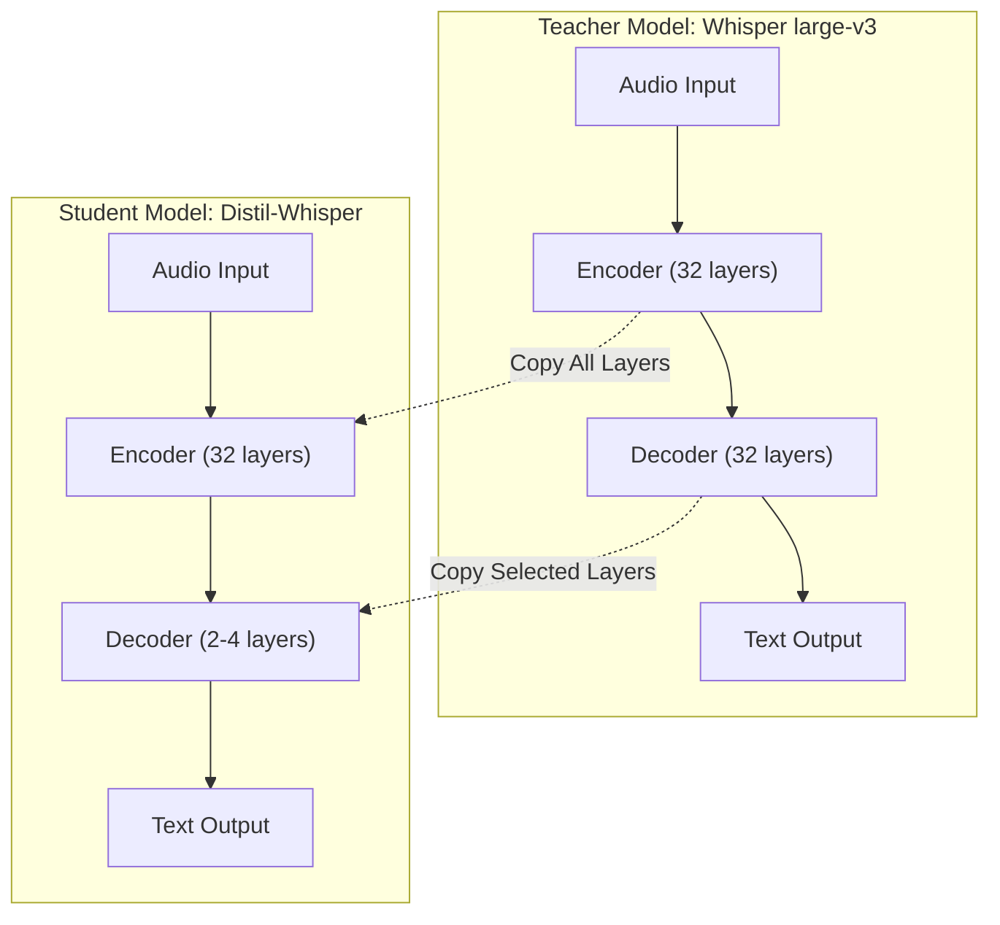
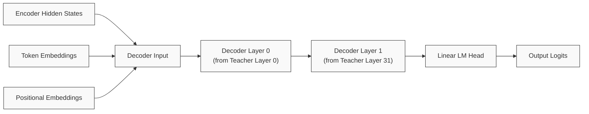
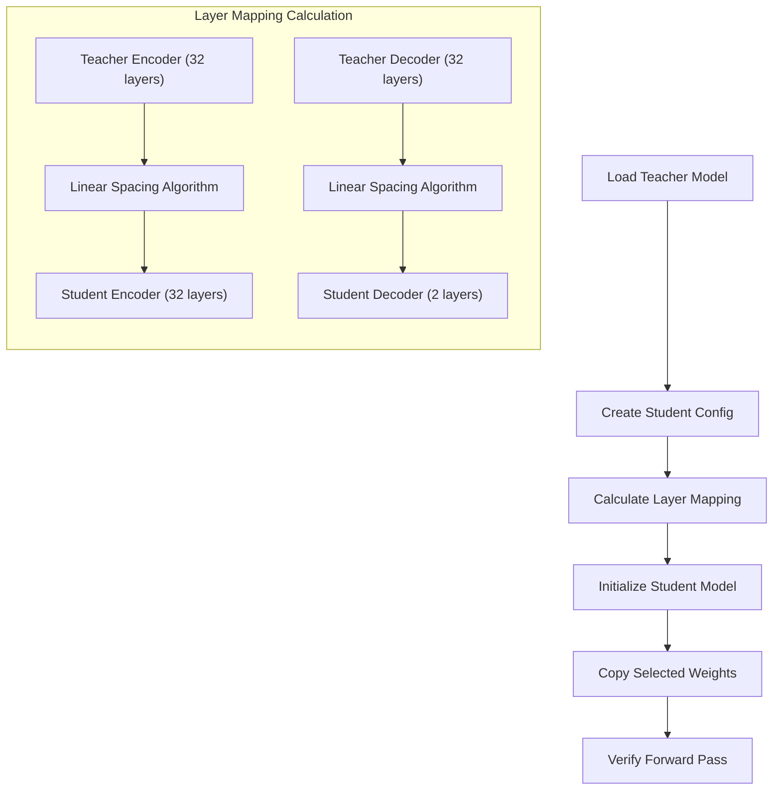
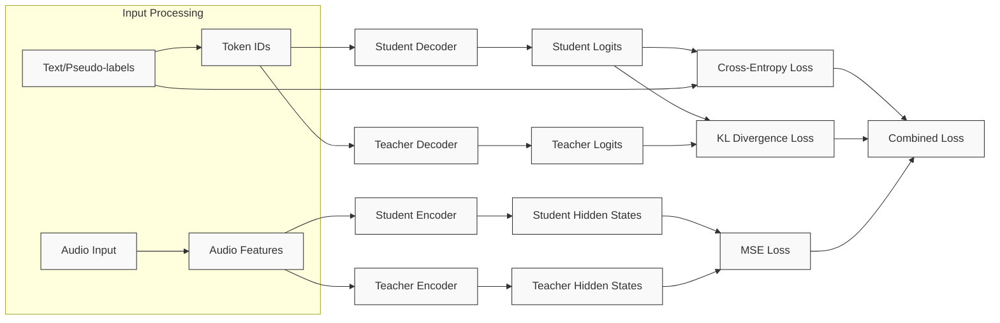
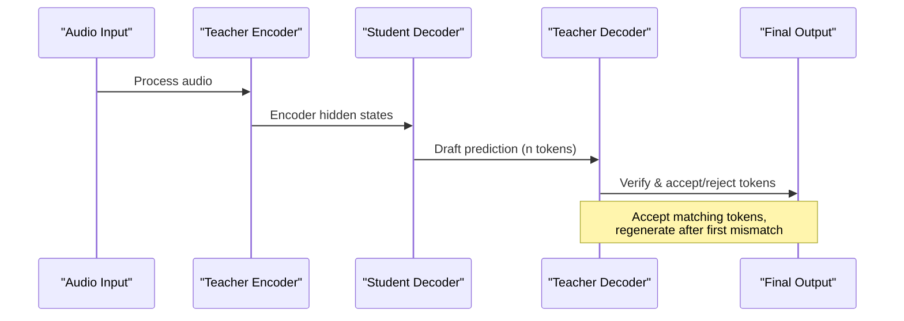

<!-- source: DeepWiki mcp.deepwiki.com · repo huggingface/distil-whisper · page 3 Model Architecture · fetched 2026-10-26 -->

# Model Architecture

Relevant source files

The following files were used as context for generating this wiki page:

- [README.md](README.md)
- [training/README.md](training/README.md)
- [training/create_student_model.py](training/create_student_model.py)
- [training/run_distillation.py](training/run_distillation.py)

This page details the architecture of Distil-Whisper, focusing on the structural design decisions, component relationships, and knowledge distillation approach that allows the model to achieve high performance while being significantly smaller and faster than the original Whisper model. For information about the training pipeline used to create Distil-Whisper models, see [Training Pipeline](#2).

## Overview

Distil-Whisper uses knowledge distillation to create a smaller, faster speech recognition model while maintaining comparable accuracy to the original Whisper model. The key architectural insight is maintaining the full encoder capacity while drastically reducing the decoder size.

Distil-Whisper's design demonstrates that most of the model's understanding of audio content happens in the encoder, while the decoder can be dramatically reduced without significant performance loss. This insight enables a model that is 6x faster and up to 49% smaller than the original Whisper while performing within 1% WER on evaluation sets.

Sources: [README.md:18-24](), [training/README.md:508-513]()

## Architecture Components

### Encoder

The encoder in Distil-Whisper is typically identical to the teacher Whisper model's encoder:

- Processes mel spectrogram audio features (audio waveforms are converted to log-mel spectrograms)
- Contains 32 transformer layers with multi-head attention
- Maintains the full audio understanding capability of the original model
- Preserves robustness to different audio distributions and noise levels

In some variants (like distil-small.en), the encoder may also be reduced, but the default approach is to keep the full encoder.

During training, the encoder is typically frozen, which provides two benefits:
1. Memory efficiency: gradients don't need to be computed and stored for encoder parameters
2. Speed: since the encoder is identical to the teacher, its outputs can be reused

Sources: [training/create_student_model.py:124-127](), [training/run_distillation.py:1024-1026]()

### Decoder

The decoder is where the significant size reduction occurs:

- Reduced from 32 layers to typically just 2-4 layers
- Uses a "maximally-spaced" selection strategy from the teacher model
- For a 2-layer decoder, typically the first and last layers (0 and 31) from the teacher are selected
- Maintains cross-attention to encoder outputs and self-attention within the decoder
- The input embeddings and output projections (language modeling head) remain tied

The choice of which teacher layers to use is automatically calculated in the initialization process based on evenly spaced indices, but can also be explicitly specified using the `decoder_layers_numbers` parameter.

Sources: [training/create_student_model.py:136-144](), [training/README.md:508-513]()

## Student Model Initialization

The initialization of the student model from the teacher involves these key steps:

The student model initialization follows this process:

1. The teacher model is loaded from a checkpoint (e.g., `whisper-large-v3`)
2. A new student configuration is created with the specified encoder and decoder layer counts
3. Mapping indices are calculated to select which teacher layers to transfer:
   - For the encoder (when reduced): layers are linearly spaced across the teacher's encoder depth
   - For the decoder: layers are linearly spaced across the teacher's decoder depth
4. The student model is initialized with the new configuration
5. Weights are copied from the teacher to the student according to the mapping
6. The model is validated with a simple forward pass

For a 2-layer decoder, the mapping typically selects the first and last layers from the teacher (layers 0 and 31).

Sources: [training/create_student_model.py:92-217]()

## Model Variants

Distil-Whisper is available in several configurations:

| Variant | Encoder Layers | Decoder Layers | Parameters | Relative Speed | Purpose |
|---------|----------------|----------------|------------|----------------|---------|
| distil-small.en | 4 | 4 | 166M | 5.6x | Resource-constrained applications |
| distil-medium.en | 24 | 2 | 394M | 6.8x | Balanced size/performance |
| distil-large-v2 | 32 | 2 | 756M | 5.8x | General-purpose model |
| distil-large-v3 | 32 | 2 | 756M | 6.3x | Latest model with best performance |

The specific architecture of each variant is determined by the initialization parameters in `create_student_model.py`. For example:

- `distil-small.en`: 4 encoder layers, 4 decoder layers
- `distil-large-v3`: 32 encoder layers (full encoder), 2 decoder layers

Sources: [README.md:12-19]()

## Distillation Training Process

The training approach combines several loss components to transfer knowledge from the teacher to the student:

Key aspects of the distillation training process:

1. **Shared Architecture Components:**
   - The student and teacher models share the same input processing and output processing layers
   - The student model's encoder is often identical to the teacher's and frozen during training

2. **Loss Components:**
   - Cross-entropy loss against ground truth or pseudo-labels
   - KL divergence loss between teacher and student logits
   - Optional MSE loss between teacher and student hidden states

3. **Optimization Strategies:**
   - Encoder is typically frozen during training (if identical to teacher)
   - Positional embeddings are often frozen to maintain context length handling
   - A temperature parameter controls the softness of the teacher distributions

Sources: [training/run_distillation.py:351-401](), [training/README.md:227-307]()

## Inference Methods

Distil-Whisper supports several inference methods, which leverage different aspects of the architecture:

### Standard Decoding

The model generates tokens autoregressively, one at a time. This is the simplest approach and works well for short audio clips.

### Speculative Decoding

Leverages the fact that the student and teacher share the same encoder. The student model makes an initial prediction (draft) that is verified by the teacher model, resulting in 2x faster inference while producing the exact same outputs as the teacher.

### Long-Form Inference

For longer audio (>30s), two approaches are supported:

1. **Sequential Long-Form:** Processes 30s segments sequentially, using timestamps to determine window shifts
2. **Chunked Long-Form:** Divides audio into chunks with overlapping windows and processes them in parallel

The architectural design of Distil-Whisper, particularly the preservation of the encoder, ensures that these inference methods work effectively despite the reduced decoder size.

Sources: [README.md:158-228](), [training/README.md:385-445]()

## Architecture Considerations

Several key architectural decisions influence the performance of Distil-Whisper:

1. **Full Encoder Preservation:** Keeping the entire encoder preserves audio understanding capabilities and robustness to different distributions
2. **Maximally-Spaced Decoder Layer Selection:** Selecting widely-spaced layers from the teacher model provides better coverage of the original functionality
3. **Shared Embeddings:** Input embeddings and output projections remain tied, reducing parameter count
4. **Freezing Strategies:** Ability to freeze the encoder, decoder, or positional embeddings during training affects performance and resource usage

These considerations highlight how the architecture balances size, speed, and accuracy to create a model that provides significant efficiency improvements while maintaining high-quality transcriptions.

Sources: [training/run_distillation.py:1016-1037](), [training/README.md:314-329]()

---

