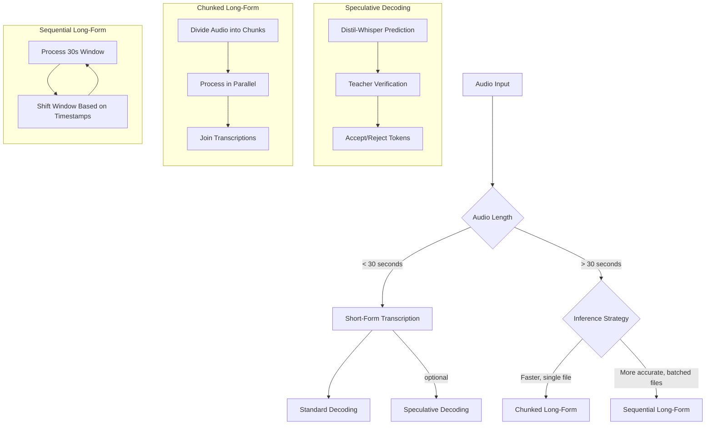
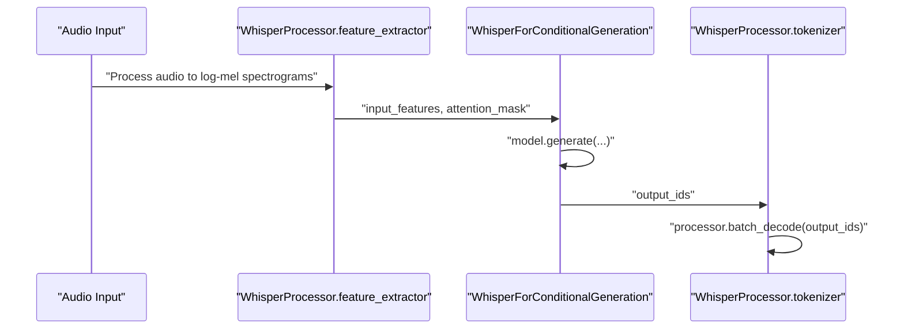
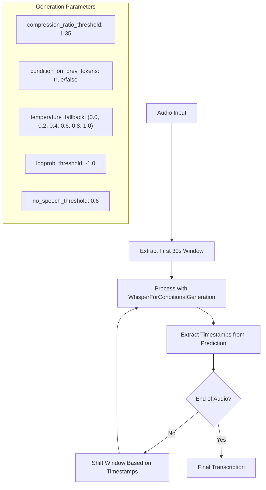
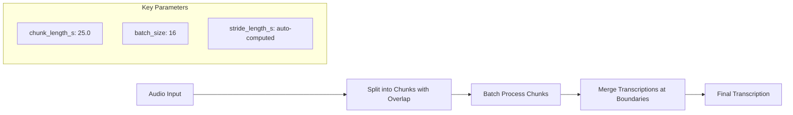
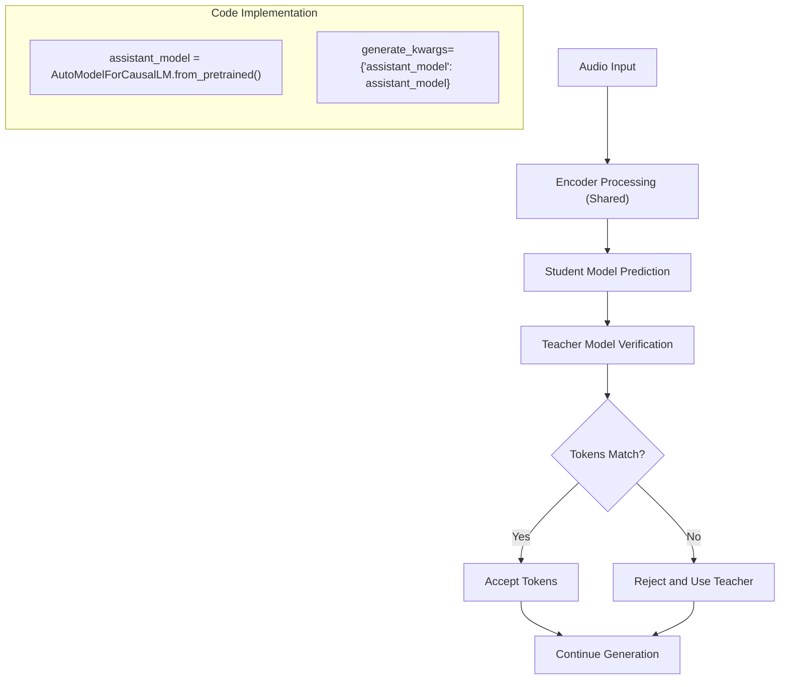
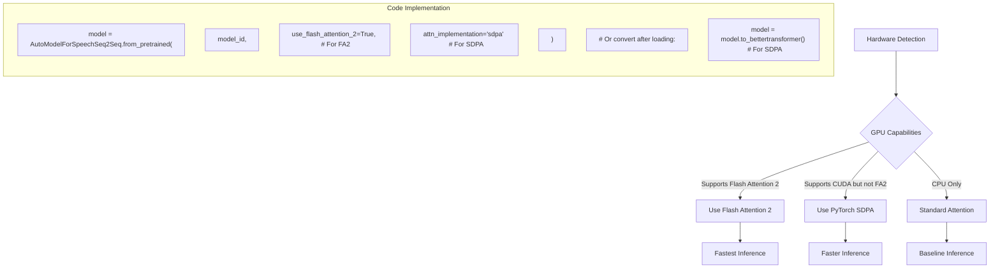

<!-- source: DeepWiki mcp.deepwiki.com · repo huggingface/distil-whisper · page 4 Inference Methods · fetched 2026-10-26 -->

# Inference Methods

Relevant source files

The following files were used as context for generating this wiki page:

- [README.md](README.md)
- [training/README.md](training/README.md)
- [training/run_eval.py](training/run_eval.py)

This page documents the various inference methods available in Distil-Whisper for automatic speech recognition. It covers short-form transcription, long-form transcription (both sequential and chunked approaches), and speculative decoding, along with their implementation details and performance characteristics.

## Overview of Inference Methods

Distil-Whisper supports several inference strategies optimized for different scenarios. The choice of method depends primarily on audio length, speed requirements, and accuracy needs.

### Inference Method Selection Flowchart

Sources: [README.md:40-108](), [README.md:158-228](), [README.md:285-326]()

## Short-Form Transcription

Short-form transcription is designed for audio clips under 30 seconds, which is the maximum context length the model can handle in a single forward pass. This method is the most straightforward approach, where the entire audio is processed at once.

### Implementation and Usage

The short-form transcription process involves:

The primary entry points for inference are:

1. Direct model usage:
   - Load model with `AutoModelForSpeechSeq2Seq.from_pretrained()`
   - Use `model.generate()` with appropriate parameters
   - Decode output IDs with `processor.batch_decode()`

2. Pipeline approach:
   - Create pipeline with `pipeline("automatic-speech-recognition")`
   - Pass audio directly to the pipeline

Key generation parameters include:
- `max_new_tokens`: Maximum number of tokens to generate
- `num_beams`: Controls beam search (1 for greedy, >1 for beam search)
- `return_timestamps`: Whether to predict timestamps

Sources: [README.md:40-108](), [run_eval.py:726-750]()

## Long-Form Transcription

For audio longer than 30 seconds, Distil-Whisper offers two approaches: sequential and chunked.

### Sequential Long-Form

The sequential long-form algorithm was introduced in the original Whisper paper and is implemented in the main model's generation logic. It processes 30-second segments sequentially, using predicted timestamps to determine how to shift the window.

The sequential algorithm uses special parameters defined in `run_eval.py:712-718`:
- `condition_on_prev_tokens`: Controls whether to condition on previous segments
- `compression_ratio_threshold`: Used for repetition detection
- `temperature`: Array of temperatures for fallback strategies
- `logprob_threshold`: For filtering low-confidence outputs
- `no_speech_threshold`: For detecting silence

This method is recommended when:
- Transcription accuracy is the priority
- Processing batches of long audio files

Sources: [README.md:158-228](), [run_eval.py:712-718](), [run_eval.py:732-735]()

### Chunked Long-Form

The chunked long-form algorithm divides audio into overlapping segments and processes them in parallel using the Transformers pipeline. This approach is significantly faster for single long files.

The chunked algorithm is implemented primarily through the pipeline interface:
- Create a pipeline with `chunk_length_s` parameter
- Set appropriate batch size with `batch_size` parameter
- The pipeline handles chunking, overlap, and merging automatically

The optimal chunk length for `distil-large-v3` is 25 seconds, controlled by the `chunk_length_s` parameter in [run_eval.py:107-113]().

This method is recommended when:
- Processing speed is the priority
- Transcribing a single long audio file

Sources: [README.md:285-326](), [run_eval.py:106-113](), [run_eval.py:767-783]()

## Speculative Decoding

Speculative decoding uses a smaller model (the "assistant" or "student") to accelerate a larger model (the "teacher") while guaranteeing mathematically identical outputs. This approach is particularly effective for Distil-Whisper, as it shares the encoder with the teacher model and only loads the smaller decoder.

Implementation details:
1. Load the teacher model as normal with `AutoModelForSpeechSeq2Seq`
2. Load the assistant model with `AutoModelForCausalLM`
3. Pass the assistant model to the generation function:
   - Pipeline: `generate_kwargs={"assistant_model": assistant_model}`
   - Direct: `model.generate(..., assistant_model=assistant_model)`

The speculative decoding process is handled internally by the Transformers library, which:
1. Uses the student to predict a sequence of tokens
2. Verifies these tokens with the teacher model
3. Accepts matching tokens and rejects mismatches
4. Continues generation with the teacher when needed

Key benefits:
- 2x faster inference
- Identical outputs as the teacher model
- Small memory overhead (only the decoder needs to be loaded)

Sources: [README.md:352-432](), [run_eval.py:578-599](), [run_eval.py:706-708]()

## Performance Optimizations

Distil-Whisper supports several optimizations to maximize inference speed:

### Hardware Acceleration Options

The attention implementation is controlled by the `attn_implementation` parameter in [run_eval.py:135-138](), with options:
- `'flash_attention_2'`: Fastest if the hardware supports it
- `'sdpa'`: PyTorch's Scaled Dot Product Attention
- `'eager'`: Standard attention implementation

### Batch Size and Precision

Performance can be further optimized by adjusting:
1. **Batch size**: Controlled by `batch_size` parameter [run_eval.py:139-142]()
   - Higher batch sizes improve throughput for parallel processing
   - Sequential long-form requires batch_size=1

2. **Precision**: Controlled by `dtype` parameter [run_eval.py:97-105]()
   - Options include `'float16'`, `'bfloat16'`, and `'float32'`
   - `'bfloat16'` is recommended for A100 GPUs
   - `'float16'` is recommended for V100 GPUs

### Performance Metrics

Distil-Whisper evaluation tracks three key performance metrics:
1. **Word Error Rate (WER)**: Accuracy metric (lower is better)
2. **Real-Time Factor (RTF)**: Ratio of audio length to processing time (higher is better)
3. **Token generation speed**: Tokens generated per second

These metrics are calculated in [run_eval.py:878-896]() and provide a comprehensive view of model performance.

| Inference Method | Relative Speed | WER Impact | Use Case |
|------------------|----------------|------------|----------|
| Short-form | Baseline | Baseline | Audio < 30s |
| Sequential long-form | Slowest | Best | Batched long audio |
| Chunked long-form | 9x faster than sequential | +0.5% WER | Single long audio file |
| Speculative decoding | 2x faster than normal | No impact | Any audio, with teacher model |

Sources: [README.md:433-469](), [run_eval.py:52-63](), [run_eval.py:878-896]()

## Cross-Library Compatibility

Distil-Whisper is designed to be compatible with multiple libraries beyond Hugging Face Transformers:

| Library | Compatible Models | Supported Methods |
|---------|-------------------|-------------------|
| OpenAI Whisper | distil-small.en, distil-medium.en, distil-large-v2 | Sequential long-form |
| Whisper CPP | distil-small.en, distil-medium.en, distil-large-v2 | Sequential long-form |
| Transformers.js | distil-small.en, distil-medium.en, distil-large-v2 | Sequential long-form |
| Candle (Rust) | distil-small.en, distil-medium.en, distil-large-v2 | Sequential long-form |

The newest model, distil-large-v3, is specifically designed for enhanced compatibility with the original OpenAI sequential long-form algorithm.

Sources: [README.md:470-485](), [training/README.md:332-414]()

---

