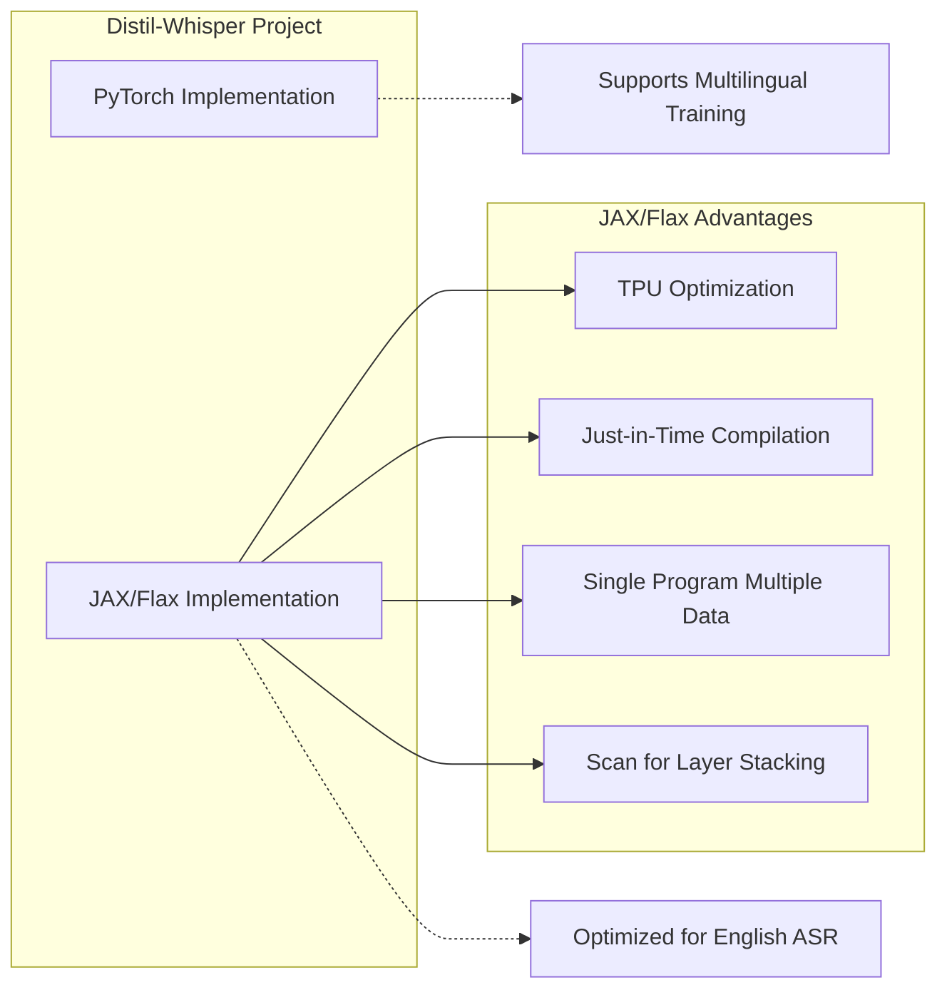
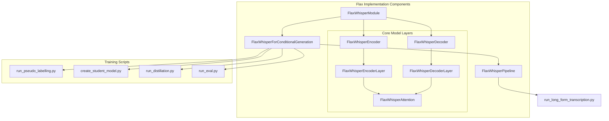
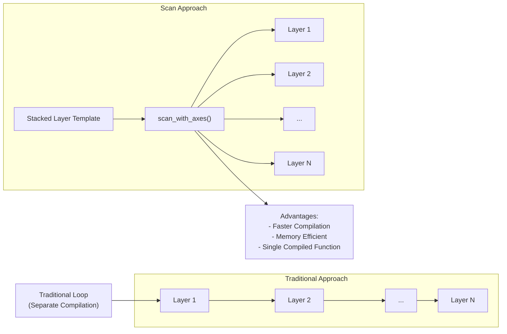
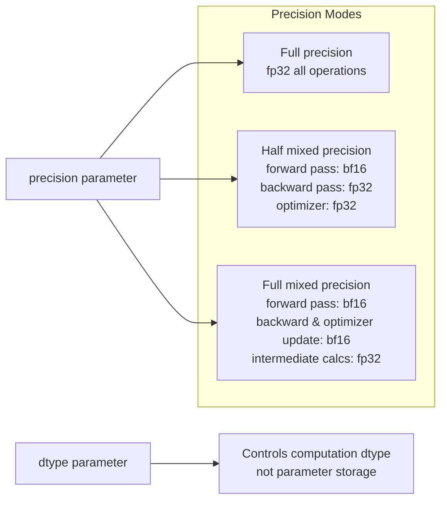
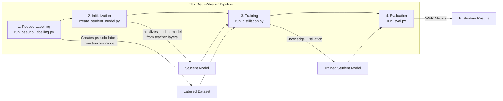
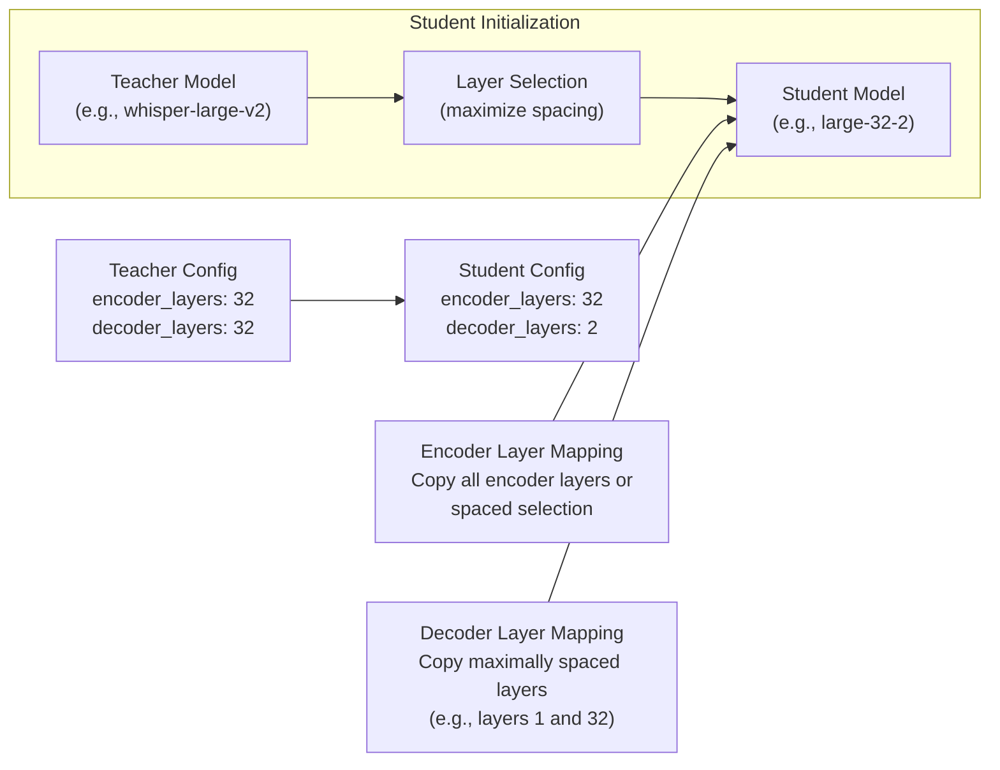
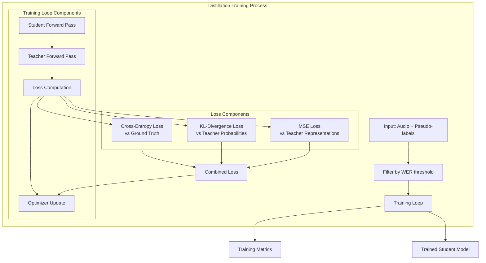
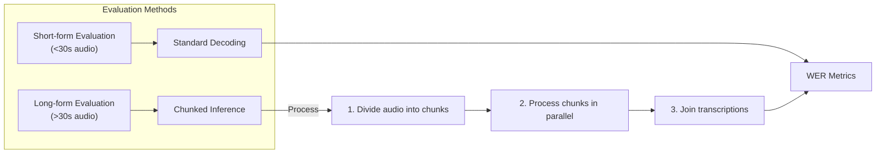

<!-- source: DeepWiki mcp.deepwiki.com · repo huggingface/distil-whisper · page 5 Flax Implementation · fetched 2026-10-26 -->

# Flax Implementation

<details>
<summary>Relevant source files</summary>

The following files were used as context for generating this wiki page:

- [training/flax/README.md](training/flax/README.md)
- [training/flax/create_student_model.py](training/flax/create_student_model.py)
- [training/flax/distil_whisper/modeling_flax_whisper.py](training/flax/distil_whisper/modeling_flax_whisper.py)
- [training/flax/distil_whisper/pipeline.py](training/flax/distil_whisper/pipeline.py)
- [training/flax/run_distillation.py](training/flax/run_distillation.py)
- [training/flax/run_pseudo_labelling_pt.py](training/flax/run_pseudo_labelling_pt.py)

</details>


This document provides technical details about the JAX/Flax implementation of Distil-Whisper, which enables efficient training and inference on TPU and GPU hardware. The Flax implementation is specifically designed for high-performance model training and deployment, leveraging JAX's just-in-time compilation, automatic differentiation, and device parallelism.

## Introduction to the Flax Backend

The Distil-Whisper project implements the model distillation pipeline in both PyTorch and JAX/Flax. This page focuses specifically on the Flax implementation, which offers several advantages for large-scale training:



The JAX/Flax implementation is primarily designed for English ASR, while the PyTorch implementation supports multilingual training. The JAX/Flax version has been optimized specifically for training on TPU v4 hardware, though it also works efficiently on GPUs without any code modifications.

Sources: [training/flax/README.md:1-18](training/flax/README.md:1-18)

## Architecture Overview

The Flax implementation consists of several key components that work together to implement the four-stage Distil-Whisper pipeline:



The architecture follows a modular design where:

1. `FlaxWhisperModule` is the core model implementation with encoder and decoder components
2. `FlaxWhisperForConditionalGeneration` extends this module for generation tasks
3. `FlaxWhisperPipeline` provides an easy-to-use interface for audio transcription
4. Training scripts implement the four stages of the distillation process

Sources: [training/flax/distil_whisper/modeling_flax_whisper.py:107-1184](training/flax/distil_whisper/modeling_flax_whisper.py:107-1184)

## Optimizations in the Flax Implementation

The Flax implementation incorporates several JAX-specific optimizations to achieve high performance:

### Scan Optimization

One of the key optimizations is the `use_scan` parameter, which utilizes JAX's `scan_with_axes` for layer stacking:



The `scan` optimization results in:
- Faster compile times: JAX only needs to compile the layer function once
- More efficient memory use during training
- Slower inference due to the overhead of stacking layers

The `use_scan` parameter is set to `True` by default for training and automatically disabled for inference.

Sources: [training/flax/README.md:380-389](training/flax/README.md:380-389), [training/flax/distil_whisper/modeling_flax_whisper.py:543-614](training/flax/distil_whisper/modeling_flax_whisper.py:543-614)

### Mixed Precision Training

The implementation supports different precision modes:



The precision mode can be configured through the `precision` parameter in the training arguments, while the `dtype` parameter controls the data type of the computation (not the model parameters).

Sources: [training/flax/run_distillation.py:422-441](training/flax/run_distillation.py:422-441)

## Four-Stage Pipeline Implementation

The Flax implementation follows the same four-stage pipeline as the PyTorch version:



### 1. Pseudo-Labelling

The pseudo-labelling process generates target text predictions using the teacher model, which replace ground truth labels during distillation.

Key components in the Flax implementation:
- `run_pseudo_labelling.py`: Flexible inference script for generating pseudo-labels
- Supports streaming mode via HuggingFace Datasets
- Supports greedy decoding or beam-search
- Can generate timestamp information in audio data

Sources: [training/flax/README.md:33-78](training/flax/README.md:33-78), [training/flax/run_pseudo_labelling_pt.py:17-113](training/flax/run_pseudo_labelling_pt.py:17-113)

### 2. Student Model Initialization

The student model initialization process creates a smaller model from the teacher model:



The `create_student_model.py` script handles:
- Copying maximally spaced layers from the teacher model
- Supporting different encoder/decoder configurations
- Preserving the model weights in the layers that are kept
- Ensuring the processor and feature extractor are updated accordingly

Sources: [training/flax/README.md:80-102](training/flax/README.md:80-102), [training/flax/create_student_model.py:97-226](training/flax/create_student_model.py:97-226)

### 3. Distillation Training

The distillation training process uses the `run_distillation.py` script, which implements the knowledge distillation framework:



Key components of the distillation training:
- Multi-dataset support with custom sampling probabilities
- Mixed-precision training options
- Teacher-student knowledge transfer via combined loss functions
- Encoder freezing option for memory efficiency
- WER threshold filtering to avoid training on poor pseudo-labels

Sources: [training/flax/README.md:103-168](training/flax/README.md:103-168), [training/flax/run_distillation.py:724-781](training/flax/run_distillation.py:724-781)

### 4. Evaluation

The Flax implementation provides two types of evaluation:

1. **Short-form evaluation**: For audio samples less than 30 seconds using `run_eval.py`
2. **Long-form evaluation**: For longer audio samples using `run_long_form_transcription.py` and the `FlaxWhisperPipeline`



The `FlaxWhisperPipeline` class enables chunked inference for long-form audio, dividing it into smaller segments with overlap and processing them in parallel.

Sources: [training/flax/README.md:176-242](training/flax/README.md:176-242), [training/flax/distil_whisper/pipeline.py:61-527](training/flax/distil_whisper/pipeline.py:61-527)

## Key Differences from PyTorch Implementation

The Flax implementation has some important differences compared to the PyTorch version:

| Feature | Flax Implementation | PyTorch Implementation |
|---------|---------------------|------------------------|
| Language Support | English ASR only | Multilingual support |
| Hardware Optimization | Optimized for TPU v4 | Optimized for GPU |
| Layer Optimization | `scan_with_axes` for compilation speed | Traditional layer stacking |
| Mixed Precision | Advanced options with fp32/bf16 | Standard mixed precision |
| Encoder Freezing | Memory-efficient encoder sharing | Standard freezing approach |
| Long-form Inference | Optimized chunked transcription | Standard chunked transcription |

Sources: [training/flax/README.md:16-18](training/flax/README.md:16-18)

## Practical Usage

### Requirements and Installation

To use the Flax implementation of Distil-Whisper:

1. Install JAX following the [official instructions](https://github.com/google/jax#installation)
2. Install the `distil_whisper` package:

```bash
git clone https://github.com/huggingface/distil-whisper.git
cd distil-whisper/training/flax
pip install -e .
```

### Running the Four-Stage Pipeline

Here's how to execute each stage of the pipeline:

1. **Pseudo-labelling**: Generate transcriptions using the teacher model
2. **Initialization**: Create a student model from the teacher
3. **Training**: Perform distillation training
4. **Evaluation**: Measure the performance on test sets

Each of these stages can be executed using the corresponding scripts in the repository, with examples provided in the README.

Sources: [training/flax/README.md:20-32](training/flax/README.md:20-32)

## Performance Considerations

When using the Flax implementation, consider these performance factors:

- **use_scan**: Enable for training (faster compilation, more memory efficient), disable for inference
- **freeze_encoder**: Enable when student encoder is identical to teacher (significant memory savings)
- **dtype**: Use `bfloat16` on TPUs and modern GPUs for best performance
- **chunk_length_s**: For long-form audio, tune this parameter to match the student model's training context length

For long-form transcription, the `chunk_length_s` parameter should be tuned to the specific model. The repository provides a sweep script to find the optimal value.

Sources: [training/flax/README.md:163-167](training/flax/README.md:163-167), [training/flax/README.md:236-242](training/flax/README.md:236-242)

## Conclusion

The Flax implementation of Distil-Whisper provides an efficient, high-performance framework for training and deploying distilled speech recognition models. It leverages JAX's advanced features for parallelism and compilation optimization, making it particularly well-suited for large-scale training on TPUs. While currently focused on English ASR, the architecture and approach provide a solid foundation for future multilingual extensions.

---

