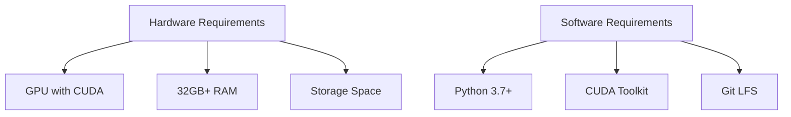
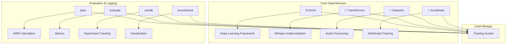
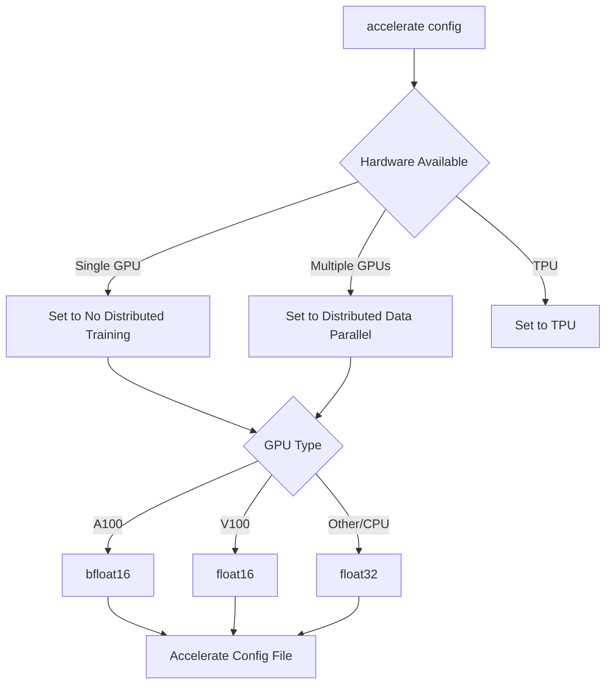
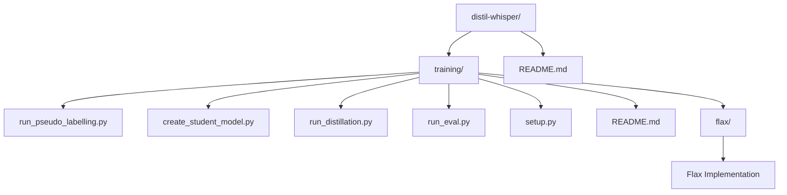
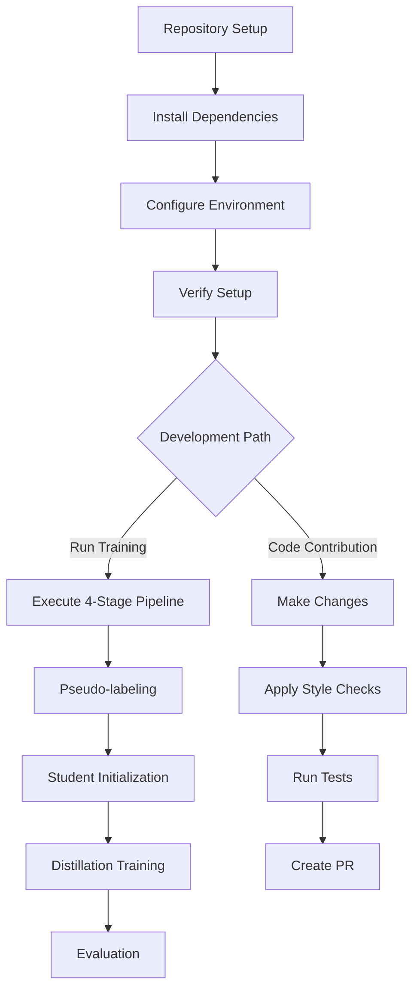

<!-- source: DeepWiki mcp.deepwiki.com · repo huggingface/distil-whisper · page 6 Project Setup · fetched 2026-10-26 -->

# Project Setup

<details>
<summary>Relevant source files</summary>

The following files were used as context for generating this wiki page:

- [README.md](README.md)
- [training/Makefile](training/Makefile)
- [training/README.md](training/README.md)
- [training/pyproject.toml](training/pyproject.toml)
- [training/setup.py](training/setup.py)

</details>


This document provides detailed instructions for setting up the Distil-Whisper project for development and training. It covers system requirements, dependencies, installation steps, configuration, and verification of a working environment. For information about the training pipeline itself, see [Training Pipeline](#2).

## 1. System Requirements

Distil-Whisper training requires the following hardware and software components:

- **GPU Hardware**: CUDA-capable GPU(s) recommended (A100s were used for the original training)
- **Operating System**: Linux recommended (most development and testing occurs on Linux)
- **Python**: Version 3.7 or higher
- **Disk Space**: Variable depending on datasets (streaming mode can eliminate disk requirements)
- **RAM**: Minimum 16GB, 32GB+ recommended for large dataset preprocessing



Sources: [training/README.md:27-47]()

## 2. Project Dependencies

Distil-Whisper has several core dependencies that form the foundation of the training infrastructure:

| Dependency | Version | Purpose |
|------------|---------|---------|
| PyTorch | >=1.10 | Deep learning framework |
| Transformers | >=4.35.1 | Provides Whisper implementation |
| Datasets | >=2.14.7 | Audio dataset handling |
| Accelerate | >=0.24.1 | Distributed training support |
| jiwer | - | WER calculation |
| evaluate | >=0.4.1 | Evaluation metrics |
| wandb | - | Experiment tracking |
| tensorboard | - | Training visualization |
| nltk | - | Text processing |



Sources: [training/setup.py:20-30](), [training/README.md:27-32]()

## 3. Installation Process

### 3.1 Installing PyTorch

Install PyTorch with the appropriate CUDA version for your hardware:

```bash
# Example for CUDA 11.8
pip install torch torchvision torchaudio --index-url https://download.pytorch.org/whl/cu118
```

For specific PyTorch installations, refer to the [official instructions](https://pytorch.org/get-started/locally/).

### 3.2 Repository Setup

Fork and clone the repository:


1. Fork the repository on GitHub
2. Clone your fork and set up the upstream remote:

```bash
git clone https://github.com/<your GitHub handle>/distil-whisper.git
cd distil-whisper
git remote add upstream https://github.com/huggingface/distil-whisper.git
```

3. Install Git LFS if not already installed (required for model weights):

```bash
# For Ubuntu/Debian
apt-get install git-lfs

# For MacOS
brew install git-lfs

# Initialize Git LFS
git lfs install
```

Sources: [training/README.md:33-42]()

### 3.3 Installing the Package

Install the project and its dependencies from the setup.py file:

```bash
cd training
pip install -e .
cd ..
```

This installs the package in development mode, allowing you to modify the code without reinstalling.

Sources: [training/README.md:43-48](), [training/setup.py:41-51]()

## 4. Configuration

### 4.1 Accelerate Configuration

Configure Accelerate to utilize your hardware properly:

```bash
accelerate config
```

During configuration, you'll need to specify:
- The distributed mode (DDP for multi-GPU, single-GPU, etc.)
- Number of GPUs to use
- Mixed precision type (e.g., `bfloat16` for A100s, `float16` for V100s)
- Whether to use DeepSpeed or other optimizations



Sources: [training/README.md:50-54]()

### 4.2 Hugging Face Authentication

Link your Hugging Face account to push/pull models:

```bash
git config --global credential.helper store
huggingface-cli login
```

Enter your authentication token from https://huggingface.co/settings/tokens. Ensure the token has "write" privileges to push trained models.

Sources: [training/README.md:56-62]()

## 5. Development Setup

### 5.1 Code Style and Quality

The project uses the following tools for code quality:

- **black**: Code formatting with line length 119
- **ruff**: Linting with selected rules

Configure your development environment to use these tools:

```bash
# Install development dependencies
pip install -e ".[dev]"

# Run quality checks
make quality

# Apply style fixes
make style
```

Sources: [training/pyproject.toml:1-16](), [training/Makefile:1-9](), [training/setup.py:32-34]()

### 5.2 Project Structure

Here's an overview of the key directories and files in the project:



The main components are:
- `training/`: Contains PyTorch training scripts
- `training/flax/`: Contains JAX/Flax implementation

The training scripts follow the four-stage pipeline:
1. `run_pseudo_labelling.py`: Generate pseudo-labels using a teacher Whisper model
2. `create_student_model.py`: Initialize the student model from the teacher
3. `run_distillation.py`: Perform knowledge distillation training
4. `run_eval.py`: Evaluate the distilled model

Sources: [training/README.md:14-19]()

## 6. Environment Verification

Verify your environment setup by running a simple inference test:

```python
from transformers import WhisperProcessor, WhisperForConditionalGeneration
from datasets import load_dataset, Audio

model = WhisperForConditionalGeneration.from_pretrained("openai/whisper-tiny", low_cpu_mem_usage=True)
processor = WhisperProcessor.from_pretrained("openai/whisper-tiny")

model.to("cuda")

common_voice = load_dataset("mozilla-foundation/common_voice_16_1", "en", split="validation", streaming=True)
common_voice = common_voice.cast_column("audio", Audio(sampling_rate=processor.feature_extractor.sampling_rate))

inputs = processor(next(iter(common_voice))["audio"]["array"], sampling_rate=16000, return_tensors="pt")
input_features = inputs.input_features

generated_ids = model.generate(input_features.to("cuda"), max_new_tokens=128)
pred_text = processor.decode(generated_ids[0], skip_special_tokens=True)

print("Pred text:", pred_text)
print("Environment set up successful?", generated_ids.shape[-1] == 20)
```

This test:
1. Loads a small Whisper model
2. Streams a sample from Common Voice
3. Transcribes the sample
4. Verifies the environment is working correctly

If the test runs successfully, your environment is properly set up for Distil-Whisper development and training.

Sources: [training/README.md:64-89]()

## 7. Development Workflow



The typical workflow after setting up the environment:
1. For training: Follow the four-stage pipeline outlined in the [Training Pipeline](#2)
2. For development: Make changes, ensure code quality, and submit contributions

Sources: [training/README.md:14-19](), [training/README.md:91-486]()