# Page: Overview

# Overview

<details>
<summary>Relevant source files</summary>

The following files were used as context for generating this wiki page:

- [README.md](README.md)
- [training/README.md](training/README.md)

</details>


This document provides a comprehensive overview of the Distil-Whisper project, a knowledge distillation framework for creating smaller, faster versions of OpenAI's Whisper automatic speech recognition (ASR) models while maintaining comparable performance. The overview covers the project's architecture, training pipeline, inference methods, and key components.

For detailed information about the training pipeline, see [Training Pipeline](#2).

## What is Distil-Whisper?

Distil-Whisper is a distilled version of OpenAI's Whisper model for English speech recognition. It achieves:
- 6x faster inference speeds
- 49% smaller model size
- Performance within 1% word error rate (WER) on out-of-distribution evaluation sets

The repository provides both pre-trained distilled models and the complete training pipeline to create your own distilled models, potentially for languages beyond English.

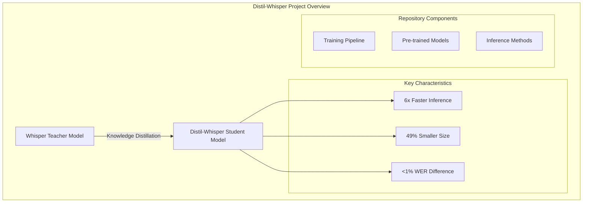

Sources: [README.md:1-28](). [training/README.md:1-13]()

## System Architecture

Distil-Whisper is based on a student-teacher architecture where a smaller student model is trained to mimic the behavior of a larger teacher model (Whisper). The key architectural innovation is retaining the full encoder from the teacher while drastically reducing the decoder size.

### Model Architecture Comparison

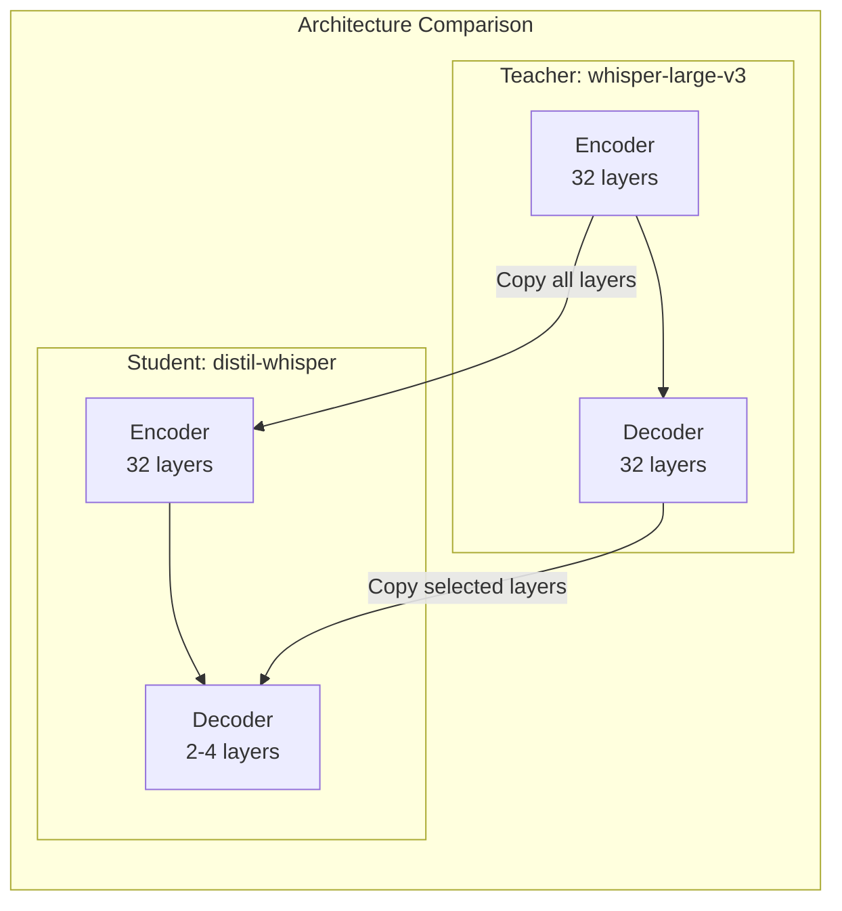

The student model preserves the entire encoder component (all 32 layers) from the teacher model to maintain audio processing capabilities, while significantly reducing the decoder to just 2-4 layers. This architectural design allows the student to be substantially smaller and faster while retaining most of the accuracy.

For distil-large-v3, the 2 student decoder layers are specifically copied from teacher layers 1 and 32 (the first and last layers), as these represent maximally spaced layers that capture different aspects of the decoding process.

Sources: [training/README.md:195-220](). [README.md:514-521]()

## Training Pipeline

The Distil-Whisper training pipeline consists of four sequential stages: pseudo-labeling, student model creation, distillation training, and evaluation.

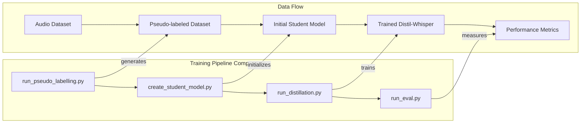

### 1. Pseudo-Labeling

In this stage, a large teacher model (e.g., whisper-large-v3) is used to generate high-quality transcriptions for audio data. The script [run_pseudo_labelling.py]() handles this process, supporting:
- Streaming mode for processing massive audio datasets
- Audio concatenation to 30-second chunks for optimal training
- Language specification for multilingual applications
- WER filtering to remove inaccurate transcriptions

### 2. Student Model Creation

This stage initializes a smaller student model from the teacher model. The script [create_student_model.py]() handles this by:
- Copying the entire encoder from the teacher model
- Selecting specific decoder layers from the teacher (typically first and last layers for a 2-layer decoder)
- Preserving embedding layers and output projections

### 3. Distillation Training

The knowledge distillation process is implemented in [run_distillation.py](), which:
- Trains the student to mimic the teacher's outputs using multiple loss components
- Filters training samples based on WER threshold to ensure quality
- Applies optimizations like encoder freezing for efficient training
- Supports multiple datasets for diverse training

### 4. Evaluation

The final stage evaluates the distilled model using [run_eval.py]() across different metrics:
- Word Error Rate (WER) for accuracy
- Inverse Real-Time Factor (RTFx) for speed
- Token generation speed measurements
- Testing on both in-distribution and out-of-distribution data

Sources: [training/README.md:14-27](). [training/README.md:90-103](). [training/README.md:172-189](). [training/README.md:247-288](). [training/README.md:328-352]()

## Distillation Training Process

The distillation process involves a specialized training approach that combines multiple loss components to ensure the student model effectively learns from the teacher.

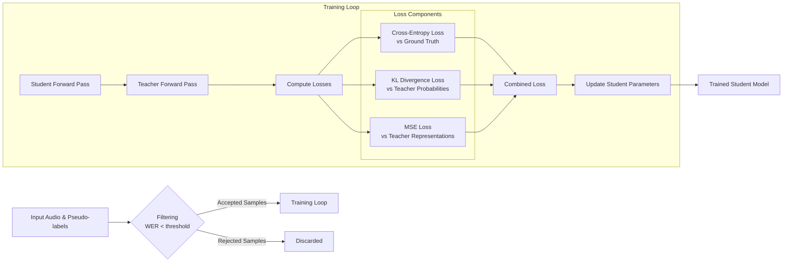

Key aspects of the distillation process:

1. **Data Filtering**: Samples with Word Error Rate (WER) above a threshold (typically 10-20%) are discarded to ensure training on high-quality pseudo-labels
2. **Multiple Loss Components**:
   - Cross-entropy loss against ground truth/pseudo-labels
   - KL divergence loss between student and teacher output probabilities
   - Optionally, MSE loss between internal representations
3. **Training Optimizations**:
   - Encoder freezing (since it's identical to the teacher)
   - Positional embedding freezing
   - Timestamp and conditioning probabilities tuning

Sources: [training/README.md:246-323](). [README.md:523-536]()

## Inference Methods

Distil-Whisper supports several inference methods for different use cases, balancing speed and accuracy requirements.

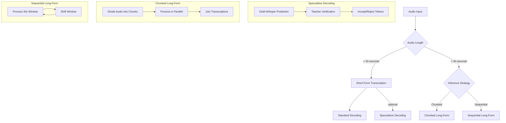

### Short-Form Transcription

For audio clips under 30 seconds (within Whisper's context window), standard decoding can be used directly. The model processes the entire audio in one forward pass.

### Long-Form Transcription

For longer audio, two main approaches are available:

1. **Sequential Long-Form**: Uses a sliding window to process consecutive segments, with positioning determined by timestamp predictions. This is slower but typically provides better accuracy.

2. **Chunked Long-Form**: Divides audio into chunks with small overlaps, processes them in parallel, and joins the results. This method is significantly faster but may be slightly less accurate.

### Speculative Decoding

Speculative decoding uses the distilled model as an "assistant" to predict tokens, which are then verified by the teacher model. This provides:
- 2x faster inference while guaranteeing the same outputs as the teacher
- Minimal additional memory requirements (just 8% increase)
- A perfect drop-in replacement for existing Whisper pipelines

Sources: [README.md:40-171](). [README.md:158-285](). [README.md:286-350](). [README.md:352-432](). [training/README.md:329-486]()

## Available Models

Distil-Whisper provides several pre-trained models with different size/performance tradeoffs:

| Model | Parameters | Relative Speed | Short-Form WER | Long-Form WER |
|-------|------------|----------------|----------------|---------------|
| distil-large-v3 | 756M | 6.3x | 9.7% | 10.8% |
| distil-large-v2 | 756M | 5.8x | 10.1% | 11.6% |
| distil-medium.en | 394M | 6.8x | 11.1% | 12.4% |
| distil-small.en | 166M | 5.6x | 12.1% | 12.8% |

For most applications, `distil-large-v3` is recommended for its optimal performance, while `distil-small.en` is suitable for resource-constrained environments.

Sources: [README.md:11-24]()

## System Dependencies

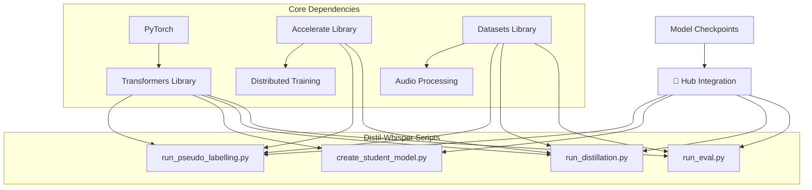

Key dependencies for the Distil-Whisper project include:
- PyTorch for the core neural network operations
- 🤗 Transformers for the Whisper model implementation
- 🤗 Accelerate for distributed training capabilities
- 🤗 Datasets for data loading and processing, with streaming support

Optional dependencies for improved performance include:
- Flash Attention 2 for faster attention operations
- BetterTransformers/SDPA for optimized inference

Sources: [training/README.md:27-47](). [README.md:433-468]()

## Current Limitations

- Distil-Whisper is currently only available for English speech recognition
- For multilingual speech recognition, OpenAI's Whisper Large-V3-Turbo is recommended as it applies similar principles
- The distillation pipeline requires substantial data (ideally >1000 hours) for optimal results
- Speculative decoding requires both models to be loaded, increasing total memory usage

Sources: [README.md:25-27](). [training/README.md:496-500]()

---

# Page: Training Pipeline

# Training Pipeline

<details>
<summary>Relevant source files</summary>

The following files were used as context for generating this wiki page:

- [README.md](README.md)
- [training/Makefile](training/Makefile)
- [training/README.md](training/README.md)
- [training/pyproject.toml](training/pyproject.toml)
- [training/setup.py](training/setup.py)

</details>


This document provides a comprehensive overview of the four-stage training pipeline used to create Distil-Whisper models. The pipeline enables the creation of smaller, faster versions of OpenAI's Whisper models while maintaining most of the accuracy. For information about the model architecture itself, see [Model Architecture](#3).

## Pipeline Overview

The Distil-Whisper training pipeline consists of four sequential stages that must be completed in order:

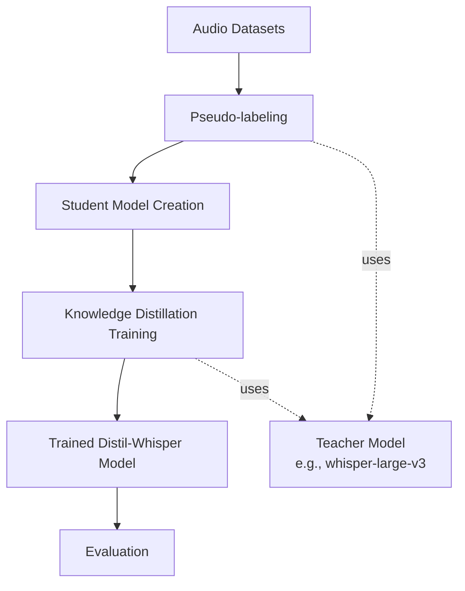

Sources: [training/README.md:14-19]()

The pipeline begins with audio datasets, which are processed by a teacher model (typically whisper-large-v3) to generate high-quality transcriptions called pseudo-labels. Next, a smaller student model is initialized with a reduced architecture by copying select layers from the teacher. This student model is then trained through knowledge distillation to mimic the teacher's outputs. Finally, the trained model is evaluated on various metrics and tasks.

Here's a view of how these stages map to the repository scripts:

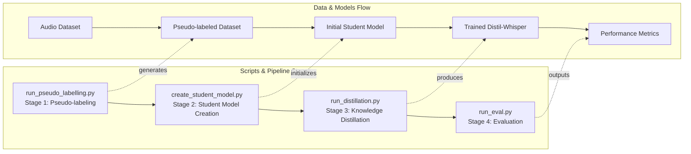

Sources: [training/README.md:91-135](), [training/README.md:170-220](), [training/README.md:228-290](), [training/README.md:328-371]()

## Stage 1: Pseudo-labeling

The first stage involves using a larger teacher model (typically whisper-large-v3) to generate high-quality transcriptions (pseudo-labels) for audio datasets.

### Process Overview

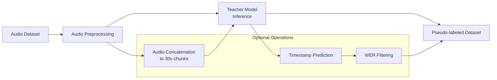

Sources: [training/README.md:91-104]()

The pseudo-labeling process is implemented in `run_pseudo_labelling.py` and offers several important features:

1. **Audio concatenation (packing)**: Concatenates shorter audio samples into 30-second chunks, which improves training throughput by minimizing zero-padding and leads to WER improvements when using the sequential long-form decoding algorithm.

2. **Language specification**: Explicitly setting the language token during inference substantially improves generation performance since the model is forced to predict in the given language.

3. **Timestamp prediction**: Allows the model to predict timestamps, which is required for sequential long-form transcription.

4. **Generation parameters**: Configurable beam search size, with greedy decoding (num_beams=1) recommended for efficiency.

### Key Configuration Options

| Parameter | Description | Recommended Setting |
|-----------|-------------|-----------------|
| `model_name_or_path` | Teacher model to use | "openai/whisper-large-v3" |
| `concatenate_audio` | Pack audio to 30s chunks | True (improves performance) |
| `preprocessing_batch_size` | Batch size for concatenation | 500 (adjust for RAM) |
| `preprocessing_num_workers` | Worker processes | Based on available CPUs |
| `language` | Target language | Language-specific code (e.g., "en") |
| `return_timestamps` | Include timestamp tokens | True (for generality) |
| `generation_num_beams` | Number of beams | 1 (greedy, faster) |

Sources: [training/README.md:106-133]()

## Stage 2: Student Model Creation

The second stage involves initializing a smaller student model from the teacher model. This is a critical step that establishes the architecture of the distilled model.

### Process Overview

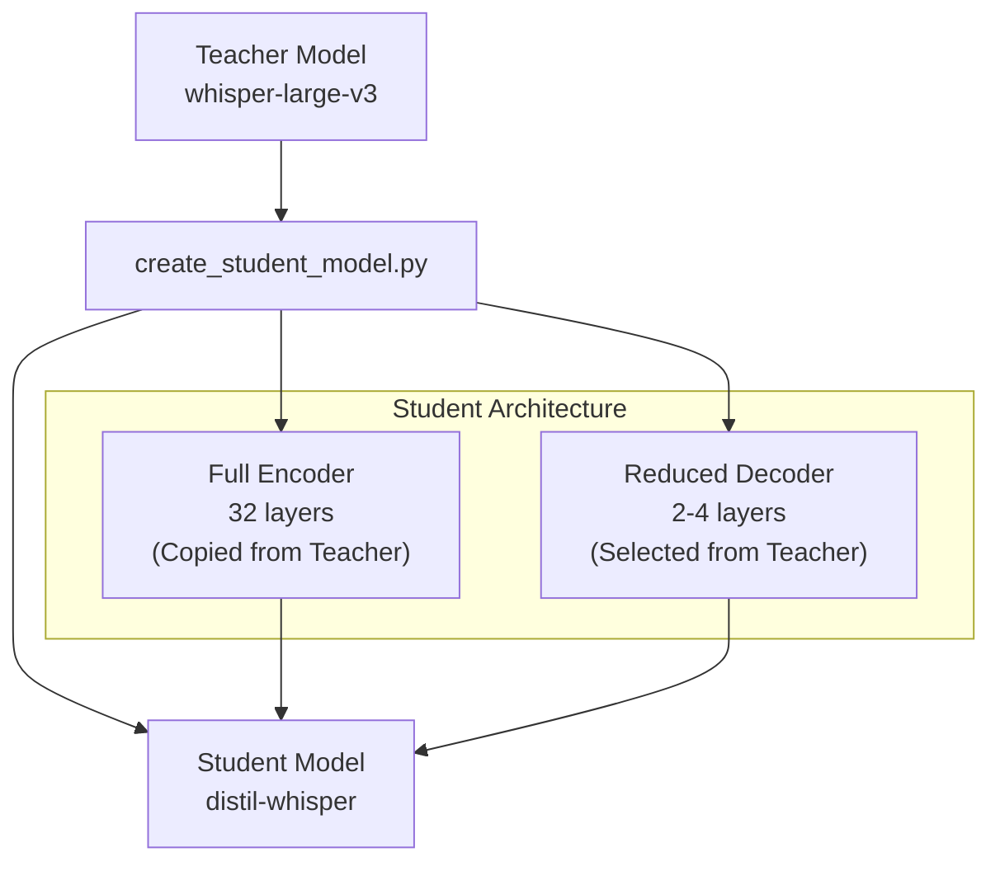

Sources: [training/README.md:170-225]()

The student model creation is implemented in `create_student_model.py` and follows these key principles:

1. **Encoder preservation**: The full encoder (typically 32 layers) is copied from the teacher model to preserve audio processing capabilities.

2. **Decoder reduction**: The decoder is drastically reduced (typically to 2-4 layers), with layers selected by maximal spacing. For example, with 2 decoder layers, they're typically copied from teacher layers 1 and 32.

3. **Language transfer**: For non-English languages, initialization can leverage an existing English distilled model (like distil-large-v3) to improve performance.

### Model Architecture Comparison

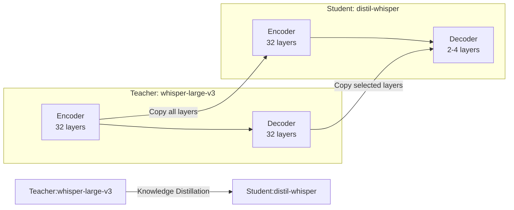

Sources: [training/README.md:501-513]()

### Decoder Layer Selection

The choice of decoder layers impacts the balance between speed and accuracy:

| Decoder Layers | Relative Token Gen. Speed | WER Change (%) |
|----------------|---------------------------|----------------|
| 2 layers       | 3.66x faster              | -3.5% WER      |
| 3 layers       | 3.35x faster              | -2.3% WER      |
| 4 layers       | 3.11x faster              | -1.8% WER      |

Sources: [training/README.md:501-513]()

## Stage 3: Knowledge Distillation Training

The third stage involves training the student model to mimic the teacher model's behavior through knowledge distillation.

### Process Overview

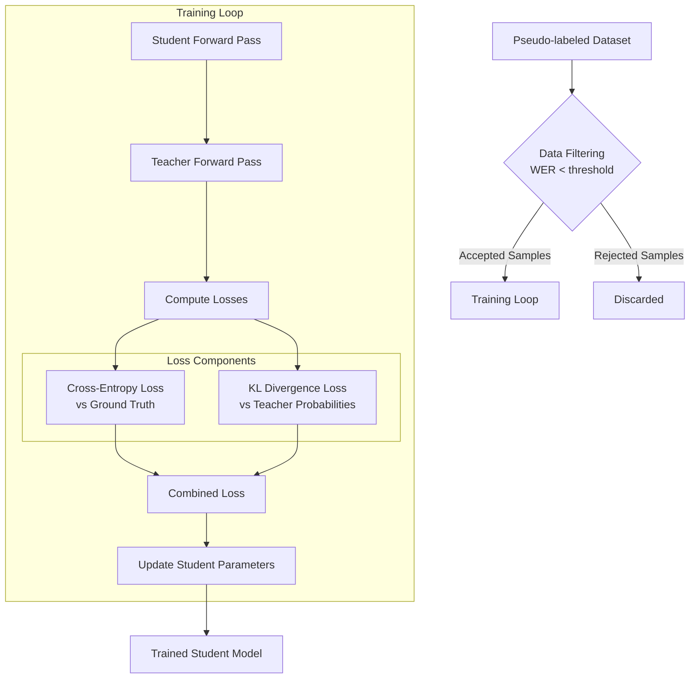

Sources: [training/README.md:228-323]()

The distillation training is implemented in `run_distillation.py` and includes these key features:

1. **Loss formulation**: Uses a weighted sum of cross-entropy (against pseudo-labels) and KL-divergence (against teacher probabilities).

2. **WER filtering**: Applies a threshold to filter out samples with high Word Error Rate (WER) between pseudo-labels and ground truth, avoiding training on incorrect transcriptions.

3. **Encoder freezing**: Can freeze the student encoder during training, which provides significant memory savings and enables larger batch sizes.

4. **Multi-dataset training**: Supports training on multiple datasets with configurable sampling probabilities.

5. **Timestamp and conditioning control**: Configurable probabilities for retaining timestamp tokens and conditioning on previous labels.

### Training Configuration Options

| Parameter | Description | Recommended Setting |
|-----------|-------------|-----------------|
| `wer_threshold` | Filter threshold for pseudo-labels | 10-20% (language dependent) |
| `freeze_encoder` | Whether to freeze encoder | True (memory efficient) |
| `freeze_embed_positions` | Freeze decoder positions | True (preserve context handling) |
| `timestamp_probability` | Prob. for timestamp tokens | 0.2 (balance of tasks) |
| `condition_on_prev_probability` | Prob. for prev token conditioning | 0.2 (enables sequential long-form) |
| `max_steps` | Total training steps | At least 50k for convergence |
| `lr_scheduler_type` | Learning rate schedule | "linear" for long runs, "constant_with_warmup" for short runs |

Sources: [training/README.md:262-322]()

## Stage 4: Evaluation

The final stage involves evaluating the distilled model on various metrics and tasks to assess its performance compared to the teacher model.

### Evaluation Types

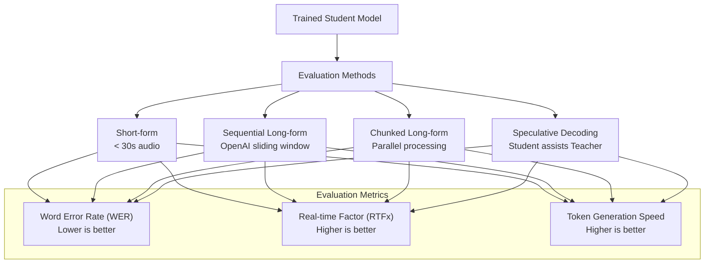

Sources: [training/README.md:328-386]()

The evaluation process is implemented in `run_eval.py` and includes four primary evaluation methodologies:

1. **Short-form evaluation**: For audio samples less than 30 seconds, evaluating standard transcription accuracy and speed.

2. **Sequential long-form evaluation**: Using the original OpenAI algorithm that sequentially transcribes 30-second segments and shifts the window according to predicted timestamps.

3. **Chunked long-form evaluation**: Dividing long audio into chunks processed in parallel and joined, which is much faster but slightly less accurate.

4. **Speculative decoding evaluation**: Using the distilled model as an assistant to the teacher model, which guarantees the same outputs as the teacher while being about 2x faster.

### Evaluation Configuration

| Parameter | Description | Use Case |
|-----------|-------------|----------|
| `use_pipeline` | Use pipeline for chunked inference | For chunked long-form |
| `chunk_length_s` | Length of chunked segments | 25s optimal for distil-large-v3 |
| `assistant_model_name_or_path` | Model for speculative decoding | Distilled model path |
| `dataset_name` | Evaluation datasets | Both in-distribution and out-of-distribution |
| `language` | Target language | Language-specific code |
| `attn_implementation` | Attention implementation | "sdpa" or "flash_attention_2" |

Sources: [training/README.md:360-483]()

## Recommendations for Successful Distillation

Based on the Distil-Whisper implementation and experiments, here are key recommendations for successful model distillation:

1. **Data quantity**: Aim for at least 1000 hours of audio data for training, with more data leading to better results. The original Distil-Whisper used 21,000+ hours.

2. **Training duration**: Train for at least 50,000 steps to reach convergence, with longer training for larger datasets.

3. **Decoder size**: Use 2-4 decoder layers based on your speed/accuracy requirements, with 2 layers offering the best speed and 4 layers the best accuracy.

4. **Domain diversity**: Train on diverse audio datasets spanning multiple domains to ensure robustness.

5. **WER filtering**: Use an appropriate WER threshold to filter out poor pseudo-labels, typically around 10-20% depending on the language.

6. **Evaluation strategy**: Evaluate on both in-distribution and out-of-distribution datasets to assess generalization.

7. **Language transfer**: For non-English languages, consider initializing from an existing distilled English model.

8. **Language mixing**: For low-resource languages (<500 hours), consider mixing with a closely related language to improve performance.

Sources: [training/README.md:492-548]()

---

# Page: Pseudo-Labeling

# Pseudo-Labeling

<details>
<summary>Relevant source files</summary>

The following files were used as context for generating this wiki page:

- [README.md](README.md)
- [training/README.md](training/README.md)
- [training/run_pseudo_labelling.py](training/run_pseudo_labelling.py)

</details>


## Purpose and Scope

Pseudo-labeling is the first stage in the Distil-Whisper training pipeline, where a large teacher model (typically Whisper large-v3) is used to generate high-quality transcriptions for audio datasets. These transcriptions serve as "pseudo-labels" that will later be used to train the smaller student model through knowledge distillation. This page documents the pseudo-labeling process, its implementation, configuration options, and how it integrates with the rest of the training pipeline.

For information about creating the student model, see [Student Model Creation](#2.2). For details on the distillation training process itself, see [Distillation Training](#2.3).

## Process Overview

Pseudo-labeling converts an audio dataset into a dataset with high-quality transcriptions generated by the Whisper model. The process handles audio preprocessing, batching, transcription generation, and optimally saves the results.

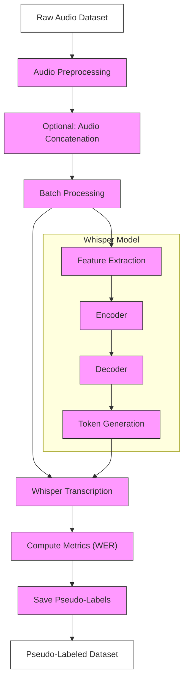

Sources: [training/README.md:91-100](), [training/run_pseudo_labelling.py:16-19]()

## Key Components and Configuration

The pseudo-labeling implementation is controlled by several component configurations:

```mermaid
flowchart TD
    A["run_pseudo_labelling.py"] --> B["ModelArguments"]
    A --> C["DataTrainingArguments"]
    A --> D["Seq2SeqTrainingArguments"]
    
    B --> B1["model_name_or_path"]
    B --> B2["dtype (float16/bfloat16)"]
    B --> B3["attn_implementation"]
    
    C --> C1["dataset_name/config"]
    C --> C2["audio_column_name"]
    C --> C3["text_column_name"]
    C --> C4["id_column_name"]
    C --> C5["concatenate_audio"]
    C --> C6["max_duration_in_seconds"]
    C --> C7["language/task settings"]
    C --> C8["streaming mode"]
    
    D --> D1["per_device_eval_batch_size"]
    D --> D2["generation_num_beams"]
    D --> D3["output_dir"]
    D --> D4["push_to_hub"]
    
    classDef main fill:#f9f,stroke:#333,stroke-width:1px
    classDef args fill:#fff,stroke:#333,stroke-width:1px
    classDef options fill:#fff,stroke:#333,stroke-width:1px
    
    class A main
    class B,C,D args
    class B1,B2,B3,C1,C2,C3,C4,C5,C6,C7,C8,D1,D2,D3,D4 options
```

Sources: [training/run_pseudo_labelling.py:71-306]()

## Audio Preprocessing and Concatenation

A key performance optimization in pseudo-labeling is audio concatenation, which packs multiple short audio clips into 30-second chunks. This improves both transcription quality and training efficiency.

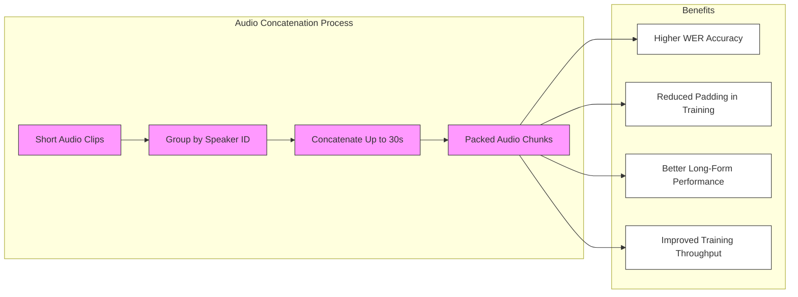

Sources: [training/README.md:99-102](), [training/run_pseudo_labelling.py:632-686]()

## Implementation Details

### Model and Processor Initialization

The process begins with loading the Whisper model, tokenizer, and feature extractor. The configuration depends on whether you're working with multilingual or English-only setups.

For multilingual models, language and task tokens are set explicitly:

```
tokenizer.set_prefix_tokens(language=data_args.language, task=data_args.task, predict_timestamps=return_timestamps)
```

Sources: [training/run_pseudo_labelling.py:530-578]()

### Audio Processing Pipeline

The audio processing pipeline includes several key steps:

1. **Dataset Loading**: Loads audio datasets from Hugging Face Hub or local sources
2. **Resampling**: Ensures audio is at the correct sample rate (16kHz for Whisper)
3. **Audio Concatenation**: Optionally packs shorter audio segments to maximize efficiency 
4. **Feature Extraction**: Converts audio into log-mel spectrograms used by Whisper

Sources: [training/run_pseudo_labelling.py:497-576](), [training/run_pseudo_labelling.py:632-686]()

### Transcription Generation

The transcription process uses configurations like:

| Parameter | Purpose | Typical Value |
|-----------|---------|---------------|
| `max_length` | Maximum length of generated tokens | 256 |
| `num_beams` | Number of beams for beam search | 1 (greedy) |
| `return_timestamps` | Whether to include timestamp tokens | True/False |
| `language` | Language token (multilingual models) | "en", "hi", etc. |
| `task` | Task token (transcribe/translate) | "transcribe" |

Generation is run through model.generate(), with a batch size controlled by `per_device_eval_batch_size`.

Sources: [training/run_pseudo_labelling.py:841-856](), [training/run_pseudo_labelling.py:892]()

### Metrics and Evaluation

For validation and test sets, the script computes Word Error Rate (WER) metrics to evaluate the quality of the pseudo-labels:

1. Generated tokens are decoded to text
2. Text is normalized using language-specific text normalizers
3. WER is computed between normalized text and ground truth
4. Predictions, references, and metrics are logged

Sources: [training/run_pseudo_labelling.py:787-812](), [training/run_pseudo_labelling.py:934-952]()

## Data Flow and Storage

The pseudo-labeling process reads from and writes to several data structures:

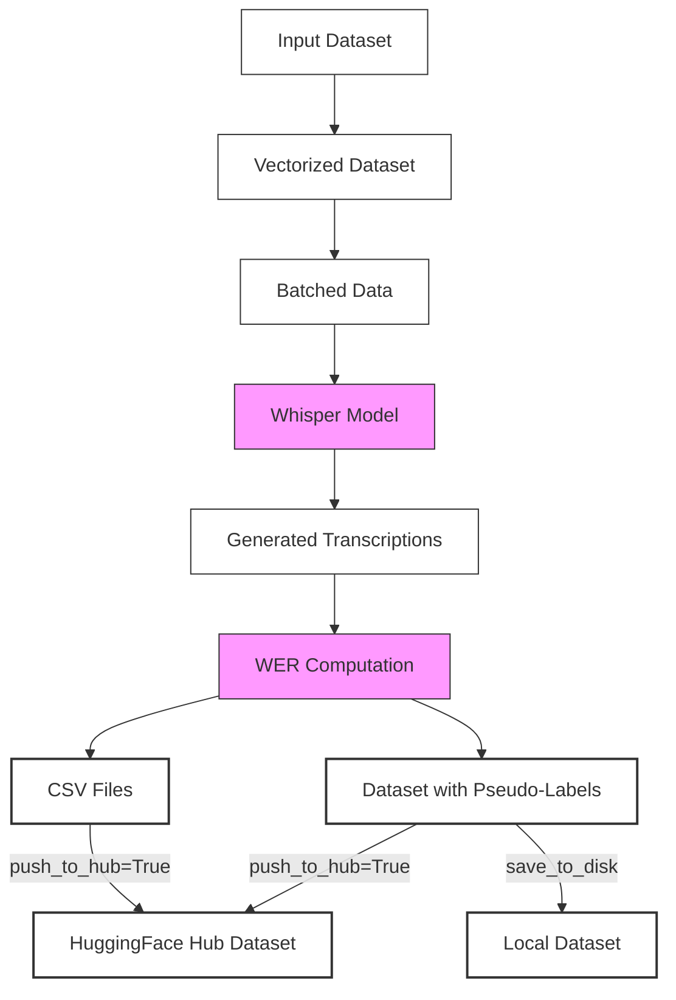

Sources: [training/run_pseudo_labelling.py:858-972](), [training/run_pseudo_labelling.py:1015-1018]()

## Running Pseudo-Labeling

A typical command to run pseudo-labeling looks like:

```bash
accelerate launch run_pseudo_labelling.py \
  --model_name_or_path "openai/whisper-large-v3" \
  --dataset_name "mozilla-foundation/common_voice_16_1" \
  --dataset_config_name "hi" \
  --dataset_split_name "train+validation+test" \
  --text_column_name "sentence" \
  --id_column_name "path" \
  --output_dir "./common_voice_16_1_hi_pseudo_labelled" \
  --per_device_eval_batch_size 64 \
  --dtype "bfloat16" \
  --attn_implementation "sdpa" \
  --max_label_length 256 \
  --concatenate_audio \
  --language "hi" \
  --task "transcribe" \
  --return_timestamps \
  --generation_num_beams 1 \
  --push_to_hub
```

Important flags include:
- `concatenate_audio`: Activates the audio packing optimization
- `return_timestamps`: Includes timestamp tokens in pseudo-labels (recommended for general models)
- `language`/`task`: Required for multilingual models, omitted for English-only models
- `generation_num_beams`: Controls beam search width (1 = greedy search)

Sources: [training/README.md:106-134]()

## Key Recommendations

1. **Audio Concatenation**: Always enable audio concatenation (`--concatenate_audio`) to improve both WER performance and training throughput
2. **Include Timestamps**: Generate pseudo-labels with timestamps (`--return_timestamps`) to ensure the distilled model can predict timestamps at inference time
3. **Batch Size**: Use the largest possible batch size that fits in memory to maximize throughput
4. **Generation Speed**: For most cases, greedy decoding (`generation_num_beams=1`) provides the best speed/quality tradeoff for pseudo-labeling
5. **Hardware Optimizations**: Enable hardware-specific optimizations like `attn_implementation="sdpa"` or `attn_implementation="flash_attention_2"` for faster inference

Sources: [training/README.md:140-151]()

## Integration with Training Pipeline

After pseudo-labeling is complete, the output dataset is used in the next stage of the Distil-Whisper pipeline:

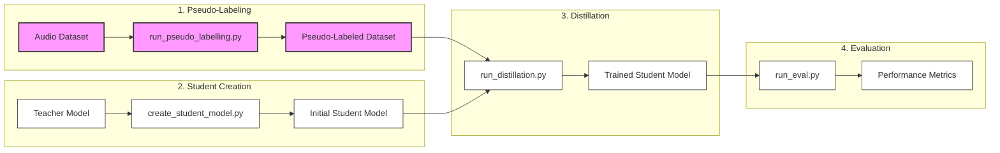

Sources: [training/README.md:14-20](), [README.md:3-7]()

## Common Challenges and Solutions

| Challenge | Solution |
|-----------|----------|
| Memory limitations | Reduce `per_device_eval_batch_size` and enable mixed precision with `dtype="bfloat16"` |
| Slow processing | Enable hardware optimizations like Flash Attention, increase batch size, use `generation_num_beams=1` |
| Non-English languages | Set appropriate `language` and `task` parameters for multilingual models |
| Large datasets | Enable `streaming=True` for datasets that don't fit in memory |
| Low quality transcriptions | For languages with poor Whisper performance (>20% WER), consider fine-tuning before pseudo-labeling |

Sources: [training/README.md:140-151](), [training/README.md:573-616]()

---

# Page: Student Model Creation

# Student Model Creation

<details>
<summary>Relevant source files</summary>

The following files were used as context for generating this wiki page:

- [README.md](README.md)
- [training/README.md](training/README.md)
- [training/create_student_model.py](training/create_student_model.py)

</details>


## Purpose and Overview

This document explains the second stage of the Distil-Whisper training pipeline: creating a smaller, more efficient student model which will be trained to mimic the larger teacher Whisper model. The student model creation process involves initializing a reduced-size model architecture from the teacher model's weights using a strategic layer selection approach.

This page focuses on the technical implementation of creating the student model's architecture and initializing its weights. For information about the previous step (pseudo-labeling), see [Pseudo-Labeling](#2.1), and for the following step (distillation training), see [Distillation Training](#2.3).

## Architecture Design

The key insight in the Distil-Whisper approach is that most of the computational overhead in Whisper comes from the decoder layers, while the encoder is responsible for processing the audio features. By keeping the entire encoder but drastically reducing the decoder layers, we achieve significant speedups with minimal accuracy loss.

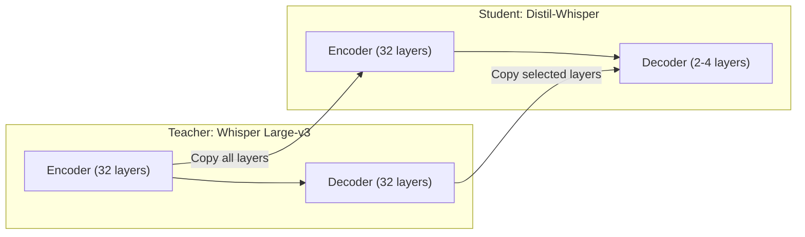

The student model architecture typically:
- Retains the complete encoder from the teacher model (all 32 layers)
- Uses only 2-4 decoder layers selected from the teacher model
- Keeps the same embedding dimensions and vocabulary size
- Preserves input and output interfaces to ensure compatibility

Sources: [training/README.md:162-176](), [README.md:508-523]()

## Layer Selection Strategy

When creating a student model with fewer layers than the teacher, the layers are selected using a "maximally spaced" strategy. This means selecting layers that are evenly distributed across the teacher's architecture, ensuring that both early and late layer behaviors are captured.

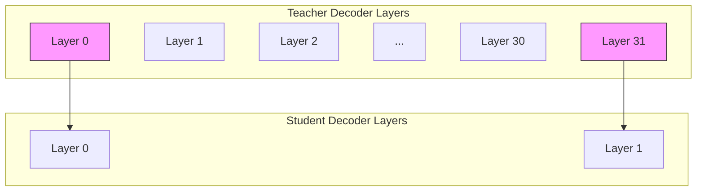

For a 2-layer decoder model, this means selecting layers 0 and 31 (first and last). For more layers, the algorithm computes linearly spaced indices using `numpy.linspace()` to determine which teacher layers to select.

Sources: [training/create_student_model.py:129-145]()

## Implementation Details

The student model initialization process involves:

1. **Configuration Generation**: Creating a new configuration based on the teacher model but with fewer decoder layers
2. **Layer Mapping**: Establishing mappings between teacher and student layer indices
3. **Weight Initialization**: Loading and transferring weights from the teacher to the student
4. **Validation**: Verifying the student model can successfully perform a forward pass

The core of this logic is implemented in the `init_student_model_from_teacher` function.

### Layer Mapping Algorithm

For decoder layers, the mapping is calculated as follows:

```mermaid
flowchart LR
    A["Input: teacher_decoder_layers, student_decoder_layers"] --> B["Create mapping array using np.linspace()"]
    B --> C["Map teacher indices to student indices in dictionary"]
    C --> D["Copy weights for mapped layers"]
    
    subgraph "Example: Map 32 layers → 2 layers"
        E["np.linspace(0, 31, 2) = [0.0, 31.0]"]
        F["decoder_map = {0:0, 31:1}"]
    end
```

This mapping ensures that when we select a reduced number of layers, we maintain a representation of both the early processing (lower layers) and the more abstract representations (higher layers).

Sources: [training/create_student_model.py:129-145](), [training/create_student_model.py:169-182]()

## Key Parameters

The student model creation script accepts several important parameters:

| Parameter | Description | Default | Example Value |
|-----------|-------------|---------|--------------|
| `teacher_checkpoint` | HF Hub ID of the teacher model | (required) | "openai/whisper-large-v3" |
| `encoder_layers` | Number of encoder layers in student | None (all) | 32 |
| `decoder_layers` | Number of decoder layers in student | 2 | 2, 3, or 4 |
| `decoder_layers_numbers` | Specific teacher decoder layers to use | None | [0, 31] |
| `save_dir` | Directory to save the student model | (required) | "./distil-large-v3-init" |

When `decoder_layers_numbers` is provided, it overrides the default equally-spaced layer selection, allowing for manual selection of specific teacher layers.

Sources: [training/create_student_model.py:33-89]()

## Usage Example

Here's a typical example of using the script to create a student model:

```bash
python create_student_model.py \
  --teacher_checkpoint "openai/whisper-large-v3" \
  --encoder_layers 32 \
  --decoder_layers 2 \
  --save_dir "./distil-large-v3-init"
```

This creates a student model with all 32 encoder layers (matching the teacher) and 2 decoder layers, saving it to the specified directory.

Sources: [training/README.md:207-220]()

## Language Transfer

An important technique in student model creation is "language transfer." Instead of initializing the student model directly from the original Whisper model, you can initialize it from an already distilled model such as "distil-whisper/distil-large-v3".

```mermaid
flowchart TD
    A["Original Teacher (e.g., whisper-large-v3)"] --> B["English Distilled Model (distil-large-v3)"]
    B --> C["Target Language Distilled Model (e.g., distil-large-v3-hi)"]
    
    style A stroke-width:1px
    style B stroke-width:2px
    style C stroke-width:2px
```

This approach has been shown to improve performance, particularly for a 2-layer decoder configuration, with WER improvements of up to 1.9% compared to initializing directly from the original Whisper model. This technique is especially useful when distilling for non-English languages.

To use language transfer, simply change the `teacher_checkpoint` parameter to point to an already distilled model:

```bash
python create_student_model.py \
  --teacher_checkpoint "distil-whisper/distil-large-v3" \
  --encoder_layers 32 \
  --decoder_layers 2 \
  --save_dir "./distil-large-v3-init"
```

Sources: [training/README.md:516-524]()

## Performance Considerations

The choice of decoder layers significantly impacts the speed-accuracy tradeoff. Based on experimental results after 10,000 training steps, the following performance characteristics were observed:

| Decoder Layers | Relative Token Generation Speed | WER Change (vs Teacher) |
|----------------|--------------------------------|-------------------------|
| 2 layers       | 3.66× faster                   | -3.5% WER              |
| 3 layers       | 3.35× faster                   | -2.3% WER              |
| 4 layers       | 3.11× faster                   | -1.8% WER              |

These measurements were performed on an 80GB Nvidia H100 with a batch size of 16 and 20 tokens generation, compared to the Whisper large-v3 baseline.

Sources: [training/README.md:501-513]()

## Next Steps

After creating the student model, the next stage in the pipeline is [Distillation Training](#2.3). During training, the encoder is typically frozen (using the `--freeze_encoder` option) since it's an exact copy of the teacher's encoder. This provides significant memory savings and can enable up to 2× larger batch sizes during training.

Additionally, it's recommended to freeze the decoder positional embeddings (`--freeze_embed_positions`) to help the student model retain the teacher's representation capability for handling long sequences up to the full maximum input length.

Sources: [training/README.md:314-317]()

---

# Page: Distillation Training

# Distillation Training

<details>
<summary>Relevant source files</summary>

The following files were used as context for generating this wiki page:

- [README.md](README.md)
- [training/README.md](training/README.md)
- [training/run_distillation.py](training/run_distillation.py)

</details>


This page details the knowledge distillation process used to train a Distil-Whisper student model to mimic the behavior of a larger Whisper teacher model. Distillation training is the third stage of the four-stage Distil-Whisper pipeline, following [Pseudo-Labeling](#2.1) and [Student Model Creation](#2.2), and preceding the final [Evaluation](#2.4) stage.

## Overview of Knowledge Distillation

Knowledge distillation is a technique where a smaller "student" model is trained to reproduce the behavior of a larger "teacher" model. In Distil-Whisper, the student model has a significantly reduced decoder (typically 2-4 layers versus the teacher's 32 layers) while maintaining the full encoder architecture.

The distillation process uses a combination of:
1. Cross-entropy loss against the ground truth labels (or pseudo-labels)
2. KL-divergence loss to match the teacher's probability distributions
3. Optional representation matching through MSE loss on hidden states

```mermaid
flowchart TD
    subgraph "Distillation Training Process"
        direction LR
        A["Audio Input"] --> B["Student Model"]
        A --> C["Teacher Model"]
        B --> D["Student Output"]
        C --> E["Teacher Output<br>(probability distributions)"]
        
        D --> F["Cross-Entropy Loss<br>vs Ground Truth"]
        D --> G["KL Divergence Loss<br>vs Teacher Output"]
        
        F --> H["Combined Loss"]
        G --> H
        
        H --> I["Update Student<br>Parameters"]
        
        C -.frozen.-> C
        I --> B
    end
```

Sources: [training/run_distillation.py:351-402](training/run_distillation.py:351-402), [training/README.md:229-249](training/README.md:229-249)

## Key Components for Distillation

The distillation training process combines several components to effectively transfer knowledge from the teacher to the student model:

```mermaid
graph TD
    subgraph "Distillation Components"
        direction TB
        A["Pseudo-labeled Dataset"] --> B["Data Filtering<br>WER Threshold"]
        B --> C["Training Data"]
        
        D["Teacher Model<br>(e.g., whisper-large-v3)"] --> E["Knowledge Transfer"]
        F["Student Model<br>(Initialized from Teacher)"] --> E
        
        C --> G["Training Loop"]
        E --> G
        
        G --> H["Loss Components"]
        H --> I["Cross-Entropy<br>Loss"]
        H --> J["KL Divergence<br>Loss"]
        
        I --> K["Optimizer"]
        J --> K
        
        K --> L["Updated Student Model"]
        
        classDef component fill:#f9f,stroke:#333,stroke-width:2px
    end
```

Sources: [training/run_distillation.py:1-40](training/run_distillation.py:1-40), [training/run_distillation.py:784-817](training/run_distillation.py:784-817)

## Training Configuration

Distillation training is controlled by three main groups of arguments:

### Model Arguments

Model arguments control the teacher and student model configurations:

```python
@dataclass
class ModelArguments:
    model_name_or_path: str  # Path to student model
    teacher_model_name_or_path: str  # Path to teacher model
    config_name: Optional[str] = None  # Config name if different from model
    tokenizer_name: Optional[str] = None  # Tokenizer name if different from model
    feature_extractor_name: Optional[str] = None  # Feature extractor name
    cache_dir: Optional[str] = None  # Cache directory for models
    attn_implementation: Optional[str] = None  # Attention implementation (eager, sdpa, flash_attention_2)
    # ... other arguments
```

Sources: [training/run_distillation.py:77-149](training/run_distillation.py:77-149)

### Data Training Arguments

Data arguments control the dataset loading and processing:

```python
@dataclass
class DataTrainingArguments:
    train_dataset_name: str  # Training dataset name
    train_dataset_config_name: Optional[str] = None  # Training dataset config
    train_dataset_samples: str = None  # Number of samples per dataset
    eval_dataset_name: str = None  # Evaluation dataset name
    wer_threshold: float = None  # Filter samples with WER above threshold
    use_pseudo_labels: bool = True  # Whether to use pseudo-label transcriptions
    timestamp_probability: float = 0.2  # Probability for timestamp tokens
    condition_on_prev_probability: float = 0.2  # Probability for conditioning on previous text
    # ... other arguments
```

Sources: [training/run_distillation.py:151-347](training/run_distillation.py:151-347)

### Distillation Training Arguments

Distillation-specific arguments that extend the standard training arguments:

```python
@dataclass
class DistillationTrainingArguments(Seq2SeqTrainingArguments):
    freeze_encoder: Optional[bool] = False  # Whether to freeze the encoder
    freeze_decoder: Optional[bool] = False  # Whether to freeze the decoder
    freeze_embed_positions: Optional[bool] = False  # Whether to freeze positional embeddings
    temperature: Optional[float] = 2.0  # Temperature for softmax in KL divergence
    kl_weight: Optional[float] = 1.0  # Weight for KL divergence loss
    dtype: Optional[str] = "float32"  # Data type for training (float32, float16, bfloat16)
    # ... other arguments
```

Sources: [training/run_distillation.py:350-401](training/run_distillation.py:350-401)

## Data Processing Pipeline

The distillation training script processes data through several stages:

```mermaid
flowchart TD
    subgraph "Data Processing Pipeline"
        A["Raw Datasets<br>Loading"] --> B["Dataset Filtering<br>by WER Threshold"]
        B --> C["Audio Processing<br>to Log-Mel Spectrograms"]
        C --> D["Text Processing<br>& Tokenization"]
        D --> E["Length Filtering<br>Audio & Labels"]
        E --> F["DataLoader"]
        F --> G["Training Batch"]
    end
```

Key components of the data pipeline:

1. **Dataset Loading**: Multiple datasets can be loaded and combined
2. **WER Filtering**: Filters out samples where the WER between pseudo-labels and reference transcripts exceeds a threshold
3. **Feature Extraction**: Converts audio to log-mel spectrograms
4. **Text Processing**: Tokenizes text and handles timestamps and previous context
5. **Length Filtering**: Removes samples that are too long or too short
6. **Batch Preparation**: Prepares batches for training with appropriate padding

Sources: [training/run_distillation.py:881-1300](training/run_distillation.py:881-1300)

### Data Collator

A specialized data collator handles the padding and preparation of inputs for the model:

```python
@dataclass
class DataCollatorSpeechSeq2SeqWithPadding:
    processor: Any
    decoder_start_token_id: int
    decoder_prev_token_id: int
    input_padding: Union[bool, str] = "max_length"
    target_padding: Union[bool, str] = "max_length"
    max_target_length: Optional[int] = None
    
    # Handles padding and preparation of input features and labels
    # Creates decoder input IDs and properly masks labels
```

Sources: [training/run_distillation.py:404-478](training/run_distillation.py:404-478)

## Training Implementation

The training process combines several key techniques to effectively distill knowledge from the teacher to the student model.

### Model Initialization and Freezing

Depending on configuration, parts of the student model can be frozen during training:

```mermaid
graph TD
    subgraph "Model Freezing Options"
        direction LR
        A["Student Model"] --> B["Encoder<br>(can be frozen)"]
        A --> C["Decoder<br>(can be frozen)"]
        C --> D["Embed Positions<br>(can be frozen)"]
        C --> E["Other Decoder<br>Components"]
        
        B -.if frozen.-> F["Share Encoder<br>with Teacher"]
        
        classDef frozen fill:#f9f,stroke:#333,stroke-width:2px
        classDef unfrozen fill:#bbf,stroke:#333,stroke-width:1px
    end
```

The script provides options to:
- Freeze the encoder (typically done since it's copied from the teacher)
- Freeze the decoder (leaving only the LM head trainable)
- Freeze the positional embeddings

Sources: [training/run_distillation.py:1010-1045](training/run_distillation.py:1010-1045)

### Optimization

The training script uses a customized optimizer configuration:

1. **Parameter Grouping**: Different weight decay for different parameter types
2. **Optimizer**: AdamW with configurable learning rate, betas, and epsilon
3. **LR Scheduler**: Support for various schedules like linear, constant with warmup, etc.

```python
# Example optimizer configuration
optimizer_grouped_parameters = [
    {
        "params": [param for name, param in student_model.named_parameters() 
                   if name in decay_parameters],
        "weight_decay": training_args.weight_decay,
    },
    {
        "params": [param for name, param in student_model.named_parameters() 
                   if name not in decay_parameters],
        "weight_decay": 0.0,
    },
]
optimizer = torch.optim.AdamW(
    params=optimizer_grouped_parameters,
    lr=training_args.learning_rate,
    betas=(training_args.adam_beta1, training_args.adam_beta2),
    eps=training_args.adam_epsilon,
)
```

Sources: [training/run_distillation.py:1376-1407](training/run_distillation.py:1376-1407)

### Training and Evaluation Loop

The training loop follows these key steps:

1. Forward pass of student model
2. Forward pass of teacher model (if not using frozen encoder)
3. Compute loss components:
   - Cross-entropy loss against labels/pseudo-labels
   - KL divergence between student and teacher outputs
4. Backpropagate combined loss
5. Update student model parameters
6. Periodically evaluate on validation set

```mermaid
flowchart TD
    subgraph "Training Loop"
        A["Load Batch"] --> B["Student Forward Pass"]
        A --> C["Teacher Forward Pass"]
        
        B --> D["Student Logits"]
        C --> E["Teacher Logits"]
        
        D --> F["Cross-Entropy Loss<br>vs Labels"]
        D --> G["KL Divergence Loss<br>vs Teacher Logits"]
        
        F --> H["Total Loss"]
        G --> H
        
        H --> I["Backward Pass"]
        I --> J["Optimizer Step"]
        J --> K["LR Scheduler Step"]
        
        K --> L{{"Evaluation Step?"}}
        L -- Yes --> M["Run Evaluation"]
        L -- No --> A
        
        M --> N["Save Checkpoint"]
        N --> A
    end
```

Sources: [training/run_distillation.py:2441-2700](training/run_distillation.py:2441-2700)

## Evaluation During Training

During training, the model is periodically evaluated on validation data:

1. **Metrics Computation**: WER is calculated both with and without normalization
2. **Logging**: Performance metrics are logged to tracking systems (wandb, tensorboard)
3. **Checkpointing**: Best checkpoints are saved based on validation WER

```python
# Compute metrics function for evaluation
def compute_metrics(preds, labels):
    # Replace padded labels with padding token
    # Decode predictions and references
    # Compute WER with and without normalization
    # Return metrics and decoded strings for logging
```

Sources: [training/run_distillation.py:1319-1341](training/run_distillation.py:1319-1341)

## Best Practices and Recommendations

Based on the training code and README, here are key recommendations for effective distillation training:

### Data Requirements

| WER of Pre-trained Model | Recommended Data Amount | Recommended Method  |
|--------------------------|-------------------------|---------------------|
| < 20%                    | > 1000 hours            | Knowledge Distillation |
| > 20%                    | < 1000 hours            | Fine-tuning         |

### Critical Parameters

| Parameter | Recommended Value | Description |
|-----------|-------------------|-------------|
| `wer_threshold` | 10-20% | Filter threshold for pseudo-labels |
| `timestamp_probability` | 0.2 | Probability for retaining timestamp tokens |
| `condition_on_prev_probability` | 0.2 | Probability for conditioning on previous text |
| `freeze_encoder` | True | Freeze and share encoder with teacher |
| `temperature` | 2.0 | Temperature for softmax in KL divergence |
| `learning_rate` | ~1e-4 | Learning rate for optimization |
| `lr_scheduler_type` | `constant_with_warmup` for short runs (<5k steps)<br>`linear` for long runs (>5k steps) | Learning rate schedule |

### Architecture Choices

The choice of decoder layers affects the speed vs. accuracy trade-off:

| Decoder Layers | Relative Token Gen. Speed | WER Change |
|----------------|---------------------------|------------|
| 2 layers       | 3.66x                     | +3.5%      |
| 3 layers       | 3.35x                     | +2.3%      |
| 4 layers       | 3.11x                     | +1.8%      |

Sources: [training/README.md:291-323](training/README.md:291-323), [training/README.md:494-512](training/README.md:494-512)

## Language Transfer and Mixing

For low-resource languages (<500 hours of audio data), consider:

1. **Language Transfer**: Initialize the student model from an existing English distilled model
2. **Language Mixing**: Combine data from the target language with data from a closely related language

These techniques can significantly improve performance for low-resource scenarios.

Sources: [training/README.md:513-561](training/README.md:513-561)

## Implementation Details

The main training functions in the script include:

1. `main()`: Overall training pipeline
2. `log_metric()`: Helper function for logging metrics
3. `compute_metrics()`: Computes WER and other evaluation metrics
4. `get_parameter_names()`: Helper for getting parameter names for optimization
5. `load_multiple_datasets()`: Loads and combines multiple datasets

The script integrates with:
- 🤗 Accelerate for distributed training
- 🤗 Transformers for model components
- 🤗 Datasets for data loading

Sources: [training/run_distillation.py:781-2700](training/run_distillation.py:781-2700)

## Related Pages

- For details on generating pseudo-labels, see [Pseudo-Labeling](#2.1)
- For information on creating the initial student model, see [Student Model Creation](#2.2)
- For evaluating the trained model, see [Evaluation](#2.4)
- For architecture details, see [Model Architecture](#3)

---

# Page: Evaluation

# Evaluation

<details>
<summary>Relevant source files</summary>

The following files were used as context for generating this wiki page:

- [README.md](README.md)
- [training/README.md](training/README.md)
- [training/run_eval.py](training/run_eval.py)

</details>


This page documents the evaluation systems and processes used to assess Distil-Whisper models after training. This is the final step in the Distil-Whisper training pipeline, where models are evaluated on various speech recognition datasets to measure their performance in terms of accuracy and speed. For information about training the models, see [Distillation Training](#2.3).

## Overview of Evaluation in Distil-Whisper

The evaluation system in Distil-Whisper is designed to comprehensively assess model performance across different scenarios and metrics. Models are evaluated for both transcription accuracy and inference speed to ensure distilled models maintain quality while achieving the primary goal of faster inference.

```mermaid
flowchart TB
    subgraph "Evaluation System"
        direction TB
        A["TrainedModel"] --> B["Evaluation"]
        B --> C["Metrics Collection"]
        C --> D["Performance Analysis"]
        
        subgraph "Evaluation Types"
            E["Short Form\n<30s audio"]
            F["Sequential Long Form\n>30s audio"]
            G["Chunked Long Form\n>30s audio"]
            H["Speculative Decoding"]
        end
        
        subgraph "Performance Metrics"
            I["Word Error Rate (WER)"]
            J["Real-Time Factor (RTF)"]
            K["Token Generation Speed"]
        end
        
        B --> E
        B --> F
        B --> G
        B --> H
        
        E --> I
        E --> J
        E --> K
        F --> I
        F --> J
        F --> K
        G --> I
        G --> J
        G --> K
        H --> I
        H --> J
        H --> K
    end
```

Sources: [training/README.md:327-346](). [training/run_eval.py:15-18]().

## Evaluation Types

Distil-Whisper supports four distinct types of evaluation, each targeting different usage scenarios:

### 1. Short Form Evaluation

Used for audio samples less than 30 seconds in duration. This mode evaluates the model's performance on typical ASR test sets like LibriSpeech validation.

```mermaid
sequenceDiagram
    participant "Audio Sample (<30s)" as A
    participant "Whisper Model" as M
    participant "Metrics Calculator" as C
    
    A->>M: Process full sample
    M->>M: Generate transcription
    M->>C: Return transcription
    C->>C: Calculate WER, RTF, tokens/sec
```

Sources: [training/README.md:350-385](). [training/run_eval.py:726-753]().

### 2. Sequential Long Form Evaluation

Used for audio samples longer than 30 seconds, using the original "sequential" long-form algorithm from OpenAI. This evaluates the model on complete audio files like TED talks or earnings calls.

```mermaid
sequenceDiagram
    participant "Long Audio (>30s)" as A
    participant "Whisper Model" as M
    participant "Metrics Calculator" as C
    
    A->>A: Split into 30s segments
    loop For each segment
        A->>M: Process segment
        M->>M: Generate transcription with timestamps
        M->>A: Use timestamps to determine next window position
    end
    M->>C: Return complete transcription
    C->>C: Calculate WER, RTF, tokens/sec
```

Sources: [training/README.md:386-414](). [training/run_eval.py:732-736]().

### 3. Chunked Long Form Evaluation

Used for audio samples longer than 30 seconds, using the Transformers "chunked" long-form algorithm. This approach chunks the audio and processes segments in parallel for faster inference.

```mermaid
flowchart TB
    subgraph "Chunked Long-Form Evaluation"
        A["Long Audio Input"] --> B["Chunk into segments"]
        B --> C["Process chunks in parallel"]
        C --> D["Join transcriptions"]
        D --> E["Calculate metrics"]
    end
```

Sources: [training/README.md:415-451](). [training/run_eval.py:752-783]().

### 4. Speculative Decoding Evaluation

Evaluates a setup where a faster, distilled model is used as an assistant to a slower, teacher model. This allows for approximately 2x faster inference while ensuring identical outputs to the teacher model.

```mermaid
sequenceDiagram
    participant "Audio Input" as A
    participant "Assistant Model (Distilled)" as AM
    participant "Teacher Model (Whisper)" as TM
    participant "Metrics Calculator" as C
    
    A->>AM: Process sample
    AM->>AM: Generate candidate tokens
    AM->>TM: Verify candidate tokens
    TM->>TM: Accept or reject tokens
    TM->>C: Return verified transcription
    C->>C: Calculate WER, RTF, tokens/sec
```

Sources: [training/README.md:452-491](). [training/run_eval.py:578-599]().

## Evaluation Metrics

The evaluation system assesses models using three primary metrics:

```mermaid
graph TD
    subgraph "Evaluation Metrics"
        direction TB
        A["Word Error Rate (WER)"] --> A1["Lower is better"]
        A --> A2["Measures transcription accuracy"]
        
        B["Real-Time Factor (RTF)"] --> B1["Higher is better"]
        B --> B2["Audio duration ÷ Processing time"]
        
        C["Token Generation Speed"] --> C1["Higher is better"]
        C --> C2["Tokens generated per second"]
    end
```

### 1. Word Error Rate (WER)

WER measures the number of substitution, deletion, and insertion errors relative to the total number of words in the reference text. It's the primary metric for measuring transcription accuracy.

```
WER = (Substitutions + Deletions + Insertions) / Total Words × 100%
```

The evaluation script computes both raw WER and normalized WER (after applying text normalization).

Sources: [training/README.md:343-345](). [training/run_eval.py:676-688]().

### 2. Real-Time Factor (RTF)

RTF measures the ratio of audio duration to processing time. A higher RTF indicates a faster model - for example, an RTF of 6 means the model can process audio 6 times faster than real-time.

```
RTF = Audio Duration / Processing Time
```

This metric is WER-dependent, meaning it's only meaningful to compare RTF between models with similar WER performance. A model that makes more deletion errors might seem faster but at the cost of accuracy.

Sources: [training/README.md:343-345](). [training/run_eval.py:894-895]().

### 3. Token Generation Speed

This metric measures the number of tokens the model can generate per second. By default, it's calculated by averaging the total number of generated tokens divided by the generation time across the test set.

The evaluation script also supports a more precise measurement option using the `--precise_tok_generation` flag, which computes this metric by generating a fixed number of tokens.

Sources: [training/README.md:343-345](). [training/run_eval.py:745-746](), [training/run_eval.py:806-844]().

## Evaluation Workflow

The evaluation process follows a structured workflow from data loading to results reporting:

```mermaid
flowchart TB
    A["Load Evaluation Dataset(s)"] --> B["Load Model and Processor"]
    B --> C["Preprocess Dataset"]
    C --> D["Run Inference"]
    D --> E["Calculate Metrics"]
    E --> F["Log Results to WandB"]
    
    subgraph "Dataset Processing"
        C1["Convert Audio to Features"]
        C2["Prepare Reference Text"]
    end
    
    subgraph "Inference Process"
        D1["Short Audio (<30s)"]
        D2["Long Audio (>30s)"]
        D3["Speculative Decoding"]
    end
    
    subgraph "Metrics Calculation"
        E1["Compute WER"]
        E2["Compute RTF"]
        E3["Compute Tokens/Sec"]
    end
    
    C --> C1
    C --> C2
    D --> D1
    D --> D2
    D --> D3
    E --> E1
    E --> E2
    E --> E3
```

### 1. Loading and Preprocessing Datasets

The evaluation script first loads one or multiple datasets specified by the user. Each dataset is preprocessed to prepare it for model inference:

1. Audio is resampled to the model's expected sampling rate (16kHz)
2. Audio features are extracted using the model's feature extractor
3. Reference text is prepared for WER calculation

The script also supports filtering datasets for short-form or long-form evaluation using the `--only_short_form` and `--only_long_form` flags.

Sources: [training/run_eval.py:433-540](). [training/run_eval.py:602-674]().

### 2. Model and Processor Loading

The script loads the specified model, processor, and optionally an assistant model for speculative decoding:

```mermaid
graph TD
    subgraph "Model Loading"
        A["WhisperProcessor.from_pretrained"] --> B["Load tokenizer"]
        A --> C["Load feature extractor"]
        
        D["WhisperForConditionalGeneration.from_pretrained"] --> E["Load model weights"]
        D --> F["Configure generation parameters"]
        
        G["Load assistant model (optional)"] --> H["WhisperForCausalLM.from_pretrained"]
    end
```

Sources: [training/run_eval.py:547-599]().

### 3. Inference and Metrics Calculation

The evaluation script runs inference on the preprocessed data and calculates the relevant metrics:

1. For each batch, the model generates transcriptions
2. Generation time is measured for speed metrics
3. WER is calculated by comparing the generated text to reference text
4. RTF and token generation speed are calculated based on timing measurements

Sources: [training/run_eval.py:726-783](). [training/run_eval.py:885-896]().

### 4. Results Logging

Results are logged to Weights & Biases (WandB) for visualization and analysis:

1. Overall metrics for each dataset
2. Per-sample predictions and references (if enabled)
3. Combined metrics across all datasets

Sources: [training/run_eval.py:901-938]().

## Running Evaluation

The evaluation script (`run_eval.py`) provides a flexible command-line interface for running different types of evaluations. Here are examples for each evaluation type:

### Short Form Evaluation

```bash
python run_eval.py \
  --model_name_or_path "./your-model-checkpoint" \
  --dataset_name "common_voice_16_1_hi_pseudo_labelled+google/fleurs" \
  --dataset_config_name "default+hi_in" \
  --dataset_split_name "test+test" \
  --text_column_name "sentence+transcription" \
  --batch_size 16 \
  --dtype "bfloat16" \
  --generation_max_length 256 \
  --language "hi" \
  --attn_implementation "sdpa" \
  --streaming
```

Sources: [training/README.md:361-376]().

### Sequential Long Form Evaluation

```bash
python run_eval.py \
  --model_name_or_path "distil-whisper/distil-large-v3" \
  --dataset_name "distil-whisper/tedlium-long-form" \
  --dataset_config_name "default" \
  --dataset_split_name "validation" \
  --text_column_name "text" \
  --batch_size 16 \
  --dtype "bfloat16" \
  --generation_max_length 256 \
  --language "en" \
  --attn_implementation "sdpa" \
  --streaming
```

Sources: [training/README.md:400-413]().

### Chunked Long Form Evaluation

```bash
python run_eval.py \
  --model_name_or_path "openai/whisper-large-v3" \
  --dataset_name "distil-whisper/tedlium-long-form" \
  --dataset_config_name "default" \
  --dataset_split_name "validation" \
  --text_column_name "text" \
  --use_pipeline \
  --chunk_length_s 25.0 \
  --language "en" \
  --return_timestamps \
  --dtype "bfloat16" \
  --streaming
```

Sources: [training/README.md:432-444]().

### Speculative Decoding Evaluation

```bash
python run_eval.py \
  --model_name_or_path "openai/whisper-large-v3" \
  --assistant_model_name_or_path "./your-distilled-model" \
  --dataset_name "common_voice_16_1_hi_pseudo_labelled+google/fleurs" \
  --dataset_config_name "default+hi_in" \
  --dataset_split_name "test+test" \
  --text_column_name "sentence+transcription" \
  --batch_size 16 \
  --dtype "bfloat16" \
  --generation_max_length 256 \
  --language "hi" \
  --attn_implementation "sdpa" \
  --streaming
```

Sources: [training/README.md:472-484]().

## Key Parameters for Evaluation

The evaluation script accepts many parameters to configure the evaluation process. Here are some of the most important ones:

| Parameter | Description | Default |
|-----------|-------------|---------|
| `--model_name_or_path` | Path or name of the model to evaluate | - |
| `--dataset_name` | Name of the dataset(s) to use | - |
| `--dataset_split_name` | Split of the dataset to use | - |
| `--batch_size` | Batch size for inference | 1 |
| `--use_pipeline` | Whether to use the pipeline for chunked long-form evaluation | False |
| `--chunk_length_s` | Chunk length in seconds for chunked long-form evaluation | 30.0 |
| `--return_timestamps` | Whether to generate timestamps | True |
| `--language` | Language for multilingual evaluation | None |
| `--assistant_model_name_or_path` | Path to assistant model for speculative decoding | None |
| `--precise_tok_per_s` | Use precise token/sec calculation | False |
| `--only_short_form` | Only evaluate on audio samples <= 30s | False |
| `--only_long_form` | Only evaluate on audio samples > 30s | False |
| `--attn_implementation` | Attention implementation to use | None |

Sources: [training/run_eval.py:62-306]().

## Best Practices for Evaluation

To ensure meaningful evaluation results, consider the following best practices:

### 1. Evaluate on Multiple Datasets

It's important to evaluate models on both in-distribution (ID) and out-of-distribution (OOD) data:

```mermaid
graph LR
    subgraph "Evaluation Datasets"
        A["In-Distribution Data"] --> A1["Same source as training data"]
        A --> A2["E.g., Common Voice test split"]
        
        B["Out-of-Distribution Data"] --> B1["Different source than training data"]
        B --> B2["E.g., FLEURS, VoxPopuli"]
    end
```

Evaluating on OOD data provides insights into how well the model generalizes to different audio distributions.

Sources: [training/README.md:347-353]().

### 2. Benchmark Against Teacher Model

Always benchmark the distilled model against the original teacher model to understand the trade-offs between speed and accuracy:

1. Evaluate both models on the same datasets
2. Compare WER to measure accuracy degradation
3. Compare RTF and token generation speed to measure speedup

Sources: [training/README.md:379-383]().

### 3. Use Appropriate Evaluation Type

Choose the evaluation type that matches your deployment scenario:

- For transcribing short clips: use Short Form Evaluation
- For highest accuracy on long files: use Sequential Long Form
- For fastest single-file transcription: use Chunked Long Form
- For maintaining teacher model accuracy with faster inference: use Speculative Decoding

Sources: [training/README.md:327-334]().

## Conclusion

The evaluation system in Distil-Whisper provides comprehensive tools to assess model performance across various scenarios. By measuring both accuracy (WER) and speed (RTF, tokens/sec), it enables users to make informed decisions about model selection based on their specific requirements.

When using the evaluation results, remember that there's often a trade-off between speed and accuracy. The goal of Distil-Whisper is to find the optimal balance, providing significantly faster inference with minimal accuracy degradation compared to the original Whisper model.

---

# Page: Model Architecture

# Model Architecture

<details>
<summary>Relevant source files</summary>

The following files were used as context for generating this wiki page:

- [README.md](README.md)
- [training/README.md](training/README.md)
- [training/create_student_model.py](training/create_student_model.py)
- [training/run_distillation.py](training/run_distillation.py)

</details>


This page details the architecture of Distil-Whisper, focusing on the structural design decisions, component relationships, and knowledge distillation approach that allows the model to achieve high performance while being significantly smaller and faster than the original Whisper model. For information about the training pipeline used to create Distil-Whisper models, see [Training Pipeline](#2).

## Overview

Distil-Whisper uses knowledge distillation to create a smaller, faster speech recognition model while maintaining comparable accuracy to the original Whisper model. The key architectural insight is maintaining the full encoder capacity while drastically reducing the decoder size.

```mermaid
flowchart TD
    subgraph "Teacher Model: Whisper large-v3"
        direction TB
        T_Input["Audio Input"] --> T_Encoder["Encoder (32 layers)"]
        T_Encoder --> T_Decoder["Decoder (32 layers)"]
        T_Decoder --> T_Output["Text Output"]
    end
    
    subgraph "Student Model: Distil-Whisper"
        direction TB
        S_Input["Audio Input"] --> S_Encoder["Encoder (32 layers)"]
        S_Encoder --> S_Decoder["Decoder (2-4 layers)"]
        S_Decoder --> S_Output["Text Output"]
    end
    
    T_Encoder -.Copy All Layers.-> S_Encoder
    T_Decoder -.Copy Selected Layers.-> S_Decoder
```

Distil-Whisper's design demonstrates that most of the model's understanding of audio content happens in the encoder, while the decoder can be dramatically reduced without significant performance loss. This insight enables a model that is 6x faster and up to 49% smaller than the original Whisper while performing within 1% WER on evaluation sets.

Sources: [README.md:18-24](), [training/README.md:508-513]()

## Architecture Components

### Encoder

The encoder in Distil-Whisper is typically identical to the teacher Whisper model's encoder:

- Processes mel spectrogram audio features (audio waveforms are converted to log-mel spectrograms)
- Contains 32 transformer layers with multi-head attention
- Maintains the full audio understanding capability of the original model
- Preserves robustness to different audio distributions and noise levels

In some variants (like distil-small.en), the encoder may also be reduced, but the default approach is to keep the full encoder.

```mermaid
flowchart LR
    Audio["Audio Waveform"] --> FeatExtractor["Feature Extractor"]
    FeatExtractor --> Spectrogram["Log-Mel Spectrogram"]
    Spectrogram --> EncoderBlocks["Encoder Stack
    (32 Transformer Layers)"]
    EncoderBlocks --> EncoderOutput["Encoder Hidden States"]
    
    classDef block fill:#f9f9f9,stroke:#333,stroke-width:1px
    classDef data fill:#f9f9f9,stroke:#333,stroke-width:1px
    
    class FeatExtractor,EncoderBlocks block
    class Audio,Spectrogram,EncoderOutput data
```

During training, the encoder is typically frozen, which provides two benefits:
1. Memory efficiency: gradients don't need to be computed and stored for encoder parameters
2. Speed: since the encoder is identical to the teacher, its outputs can be reused

Sources: [training/create_student_model.py:124-127](), [training/run_distillation.py:1024-1026]()

### Decoder

The decoder is where the significant size reduction occurs:

- Reduced from 32 layers to typically just 2-4 layers
- Uses a "maximally-spaced" selection strategy from the teacher model
- For a 2-layer decoder, typically the first and last layers (0 and 31) from the teacher are selected
- Maintains cross-attention to encoder outputs and self-attention within the decoder
- The input embeddings and output projections (language modeling head) remain tied

```mermaid
flowchart LR
    EncoderOutput["Encoder Hidden States"] --> DecoderInput["Decoder Input"]
    TokenEmbed["Token Embeddings"] --> DecoderInput
    PosEmbed["Positional Embeddings"] --> DecoderInput
    
    DecoderInput --> Layer0["Decoder Layer 0 
    (from Teacher Layer 0)"]
    Layer0 --> Layer1["Decoder Layer 1
    (from Teacher Layer 31)"]
    Layer1 --> LMHead["Linear LM Head"]
    LMHead --> Logits["Output Logits"]
    
    classDef block fill:#f9f9f9,stroke:#333,stroke-width:1px
    classDef data fill:#f9f9f9,stroke:#333,stroke-width:1px
    
    class Layer0,Layer1,LMHead block
    class EncoderOutput,DecoderInput,TokenEmbed,PosEmbed,Logits data
```

The choice of which teacher layers to use is automatically calculated in the initialization process based on evenly spaced indices, but can also be explicitly specified using the `decoder_layers_numbers` parameter.

Sources: [training/create_student_model.py:136-144](), [training/README.md:508-513]()

## Student Model Initialization

The initialization of the student model from the teacher involves these key steps:

```mermaid
flowchart TD
    LoadTeacher["Load Teacher Model"] --> CreateConfig["Create Student Config"]
    CreateConfig --> CalculateMapping["Calculate Layer Mapping"]
    CalculateMapping --> InitStudent["Initialize Student Model"]
    InitStudent --> CopyWeights["Copy Selected Weights"]
    CopyWeights --> VerifyModel["Verify Forward Pass"]
    
    subgraph "Layer Mapping Calculation"
        direction TB
        TeacherE["Teacher Encoder (32 layers)"] --> MappingE["Linear Spacing Algorithm"]
        MappingE --> StudentE["Student Encoder (32 layers)"]
        
        TeacherD["Teacher Decoder (32 layers)"] --> MappingD["Linear Spacing Algorithm"]
        MappingD --> StudentD["Student Decoder (2 layers)"]
    end
```

The student model initialization follows this process:

1. The teacher model is loaded from a checkpoint (e.g., `whisper-large-v3`)
2. A new student configuration is created with the specified encoder and decoder layer counts
3. Mapping indices are calculated to select which teacher layers to transfer:
   - For the encoder (when reduced): layers are linearly spaced across the teacher's encoder depth
   - For the decoder: layers are linearly spaced across the teacher's decoder depth
4. The student model is initialized with the new configuration
5. Weights are copied from the teacher to the student according to the mapping
6. The model is validated with a simple forward pass

For a 2-layer decoder, the mapping typically selects the first and last layers from the teacher (layers 0 and 31).

Sources: [training/create_student_model.py:92-217]()

## Model Variants

Distil-Whisper is available in several configurations:

| Variant | Encoder Layers | Decoder Layers | Parameters | Relative Speed | Purpose |
|---------|----------------|----------------|------------|----------------|---------|
| distil-small.en | 4 | 4 | 166M | 5.6x | Resource-constrained applications |
| distil-medium.en | 24 | 2 | 394M | 6.8x | Balanced size/performance |
| distil-large-v2 | 32 | 2 | 756M | 5.8x | General-purpose model |
| distil-large-v3 | 32 | 2 | 756M | 6.3x | Latest model with best performance |

The specific architecture of each variant is determined by the initialization parameters in `create_student_model.py`. For example:

- `distil-small.en`: 4 encoder layers, 4 decoder layers
- `distil-large-v3`: 32 encoder layers (full encoder), 2 decoder layers

Sources: [README.md:12-19]()

## Distillation Training Process

The training approach combines several loss components to transfer knowledge from the teacher to the student:

```mermaid
flowchart LR
    subgraph "Input Processing"
        Audio["Audio Input"] --> AudioFeatures["Audio Features"]
        Text["Text/Pseudo-labels"] --> TokenIDs["Token IDs"]
    end
    
    AudioFeatures --> StudentEncoder["Student Encoder"]
    TokenIDs --> StudentDecoder["Student Decoder"]
    
    AudioFeatures --> TeacherEncoder["Teacher Encoder"]
    TokenIDs --> TeacherDecoder["Teacher Decoder"]
    
    StudentEncoder --> StudentHidden["Student Hidden States"]
    StudentDecoder --> StudentLogits["Student Logits"]
    
    TeacherEncoder --> TeacherHidden["Teacher Hidden States"]
    TeacherDecoder --> TeacherLogits["Teacher Logits"]
    
    StudentLogits --> CELoss["Cross-Entropy Loss"]
    StudentLogits --> KLDLoss["KL Divergence Loss"]
    StudentHidden --> MSELoss["MSE Loss"]
    
    TeacherLogits --> KLDLoss
    TeacherHidden --> MSELoss
    Text --> CELoss
    
    CELoss --> CombinedLoss["Combined Loss"]
    KLDLoss --> CombinedLoss
    MSELoss --> CombinedLoss
    
    classDef model fill:#f9f9f9,stroke:#333,stroke-width:1px
    classDef data fill:#f9f9f9,stroke:#333,stroke-width:1px
    classDef loss fill:#f9f9f9,stroke:#333,stroke-width:1px
    
    class StudentEncoder,StudentDecoder,TeacherEncoder,TeacherDecoder model
    class Audio,Text,AudioFeatures,TokenIDs,StudentHidden,StudentLogits,TeacherHidden,TeacherLogits data
    class CELoss,KLDLoss,MSELoss,CombinedLoss loss
```

Key aspects of the distillation training process:

1. **Shared Architecture Components:**
   - The student and teacher models share the same input processing and output processing layers
   - The student model's encoder is often identical to the teacher's and frozen during training

2. **Loss Components:**
   - Cross-entropy loss against ground truth or pseudo-labels
   - KL divergence loss between teacher and student logits
   - Optional MSE loss between teacher and student hidden states

3. **Optimization Strategies:**
   - Encoder is typically frozen during training (if identical to teacher)
   - Positional embeddings are often frozen to maintain context length handling
   - A temperature parameter controls the softness of the teacher distributions

Sources: [training/run_distillation.py:351-401](), [training/README.md:227-307]()

## Inference Methods

Distil-Whisper supports several inference methods, which leverage different aspects of the architecture:

### Standard Decoding

The model generates tokens autoregressively, one at a time. This is the simplest approach and works well for short audio clips.

### Speculative Decoding

Leverages the fact that the student and teacher share the same encoder. The student model makes an initial prediction (draft) that is verified by the teacher model, resulting in 2x faster inference while producing the exact same outputs as the teacher.

```mermaid
sequenceDiagram
    participant AudioInput as "Audio Input"
    participant TeacherEncoder as "Teacher Encoder"
    participant StudentDecoder as "Student Decoder"
    participant TeacherDecoder as "Teacher Decoder"
    participant Output as "Final Output"
    
    AudioInput->>TeacherEncoder: Process audio
    TeacherEncoder->>StudentDecoder: Encoder hidden states
    StudentDecoder->>TeacherDecoder: Draft prediction (n tokens)
    TeacherDecoder->>Output: Verify & accept/reject tokens
    Note over TeacherDecoder,Output: Accept matching tokens,<br>regenerate after first mismatch
```

### Long-Form Inference

For longer audio (>30s), two approaches are supported:

1. **Sequential Long-Form:** Processes 30s segments sequentially, using timestamps to determine window shifts
2. **Chunked Long-Form:** Divides audio into chunks with overlapping windows and processes them in parallel

The architectural design of Distil-Whisper, particularly the preservation of the encoder, ensures that these inference methods work effectively despite the reduced decoder size.

Sources: [README.md:158-228](), [training/README.md:385-445]()

## Architecture Considerations

Several key architectural decisions influence the performance of Distil-Whisper:

1. **Full Encoder Preservation:** Keeping the entire encoder preserves audio understanding capabilities and robustness to different distributions
2. **Maximally-Spaced Decoder Layer Selection:** Selecting widely-spaced layers from the teacher model provides better coverage of the original functionality
3. **Shared Embeddings:** Input embeddings and output projections remain tied, reducing parameter count
4. **Freezing Strategies:** Ability to freeze the encoder, decoder, or positional embeddings during training affects performance and resource usage

These considerations highlight how the architecture balances size, speed, and accuracy to create a model that provides significant efficiency improvements while maintaining high-quality transcriptions.

Sources: [training/run_distillation.py:1016-1037](), [training/README.md:314-329]()

---

# Page: Inference Methods

# Inference Methods

<details>
<summary>Relevant source files</summary>

The following files were used as context for generating this wiki page:

- [README.md](README.md)
- [training/README.md](training/README.md)
- [training/run_eval.py](training/run_eval.py)

</details>


This page documents the various inference methods available in Distil-Whisper for automatic speech recognition. It covers short-form transcription, long-form transcription (both sequential and chunked approaches), and speculative decoding, along with their implementation details and performance characteristics.

## Overview of Inference Methods

Distil-Whisper supports several inference strategies optimized for different scenarios. The choice of method depends primarily on audio length, speed requirements, and accuracy needs.

### Inference Method Selection Flowchart

```mermaid
flowchart TD
    A["Audio Input"] --> B{"Audio Length"}
    
    B -- "< 30 seconds" --> C["Short-Form Transcription"]
    B -- "> 30 seconds" --> D{"Inference Strategy"}
    
    C --> E["Standard Decoding"]
    C -- "optional" --> F["Speculative Decoding"]
    
    D -- "Faster, single file" --> G["Chunked Long-Form"]
    D -- "More accurate, batched files" --> H["Sequential Long-Form"]
    
    subgraph "Speculative Decoding"
        direction TB
        F1["Distil-Whisper Prediction"] --> F2["Teacher Verification"]
        F2 --> F3["Accept/Reject Tokens"]
    end
    
    subgraph "Chunked Long-Form"
        direction TB
        G1["Divide Audio into Chunks"] --> G2["Process in Parallel"]
        G2 --> G3["Join Transcriptions"]
    end
    
    subgraph "Sequential Long-Form"
        direction TB
        H1["Process 30s Window"] --> H2["Shift Window Based on Timestamps"]
        H2 --> H1
    end
```

Sources: [README.md:40-108](), [README.md:158-228](), [README.md:285-326]()

## Short-Form Transcription

Short-form transcription is designed for audio clips under 30 seconds, which is the maximum context length the model can handle in a single forward pass. This method is the most straightforward approach, where the entire audio is processed at once.

### Implementation and Usage

The short-form transcription process involves:

```mermaid
sequenceDiagram
    participant Audio as "Audio Input"
    participant Feature as "WhisperProcessor.feature_extractor"
    participant Model as "WhisperForConditionalGeneration"
    participant Decoder as "WhisperProcessor.tokenizer"
    
    Audio->>Feature: "Process audio to log-mel spectrograms"
    Feature->>Model: "input_features, attention_mask"
    Model->>Model: "model.generate(...)"
    Model->>Decoder: "output_ids"
    Decoder->>Decoder: "processor.batch_decode(output_ids)"
```

The primary entry points for inference are:

1. Direct model usage:
   - Load model with `AutoModelForSpeechSeq2Seq.from_pretrained()`
   - Use `model.generate()` with appropriate parameters
   - Decode output IDs with `processor.batch_decode()`

2. Pipeline approach:
   - Create pipeline with `pipeline("automatic-speech-recognition")`
   - Pass audio directly to the pipeline

Key generation parameters include:
- `max_new_tokens`: Maximum number of tokens to generate
- `num_beams`: Controls beam search (1 for greedy, >1 for beam search)
- `return_timestamps`: Whether to predict timestamps

Sources: [README.md:40-108](), [run_eval.py:726-750]()

## Long-Form Transcription

For audio longer than 30 seconds, Distil-Whisper offers two approaches: sequential and chunked.

### Sequential Long-Form

The sequential long-form algorithm was introduced in the original Whisper paper and is implemented in the main model's generation logic. It processes 30-second segments sequentially, using predicted timestamps to determine how to shift the window.

```mermaid
flowchart TD
    A["Audio Input"] --> B["Extract First 30s Window"]
    B --> C["Process with WhisperForConditionalGeneration"]
    C --> D["Extract Timestamps from Prediction"]
    D --> E{"End of Audio?"}
    E -- "No" --> F["Shift Window Based on Timestamps"]
    F --> C
    E -- "Yes" --> G["Final Transcription"]
    
    subgraph "Generation Parameters"
        direction LR
        P1["compression_ratio_threshold: 1.35"]
        P2["condition_on_prev_tokens: true/false"]
        P3["temperature_fallback: (0.0, 0.2, 0.4, 0.6, 0.8, 1.0)"]
        P4["logprob_threshold: -1.0"]
        P5["no_speech_threshold: 0.6"]
    end
```

The sequential algorithm uses special parameters defined in `run_eval.py:712-718`:
- `condition_on_prev_tokens`: Controls whether to condition on previous segments
- `compression_ratio_threshold`: Used for repetition detection
- `temperature`: Array of temperatures for fallback strategies
- `logprob_threshold`: For filtering low-confidence outputs
- `no_speech_threshold`: For detecting silence

This method is recommended when:
- Transcription accuracy is the priority
- Processing batches of long audio files

Sources: [README.md:158-228](), [run_eval.py:712-718](), [run_eval.py:732-735]()

### Chunked Long-Form

The chunked long-form algorithm divides audio into overlapping segments and processes them in parallel using the Transformers pipeline. This approach is significantly faster for single long files.

```mermaid
flowchart LR
    A["Audio Input"] --> B["Split into Chunks with Overlap"]
    B --> C["Batch Process Chunks"]
    C --> D["Merge Transcriptions at Boundaries"]
    D --> E["Final Transcription"]
    
    subgraph "Key Parameters"
        direction TB
        P1["chunk_length_s: 25.0"]
        P2["batch_size: 16"]
        P3["stride_length_s: auto-computed"]
    end
```

The chunked algorithm is implemented primarily through the pipeline interface:
- Create a pipeline with `chunk_length_s` parameter
- Set appropriate batch size with `batch_size` parameter
- The pipeline handles chunking, overlap, and merging automatically

The optimal chunk length for `distil-large-v3` is 25 seconds, controlled by the `chunk_length_s` parameter in [run_eval.py:107-113]().

This method is recommended when:
- Processing speed is the priority
- Transcribing a single long audio file

Sources: [README.md:285-326](), [run_eval.py:106-113](), [run_eval.py:767-783]()

## Speculative Decoding

Speculative decoding uses a smaller model (the "assistant" or "student") to accelerate a larger model (the "teacher") while guaranteeing mathematically identical outputs. This approach is particularly effective for Distil-Whisper, as it shares the encoder with the teacher model and only loads the smaller decoder.

```mermaid
flowchart TD
    A["Audio Input"] --> B["Encoder Processing (Shared)"]
    B --> C["Student Model Prediction"]
    C --> D["Teacher Model Verification"]
    D --> E{"Tokens Match?"}
    E -- "Yes" --> F["Accept Tokens"]
    E -- "No" --> G["Reject and Use Teacher"]
    F --> H["Continue Generation"]
    G --> H
    
    subgraph "Code Implementation"
        direction TB
        I1["assistant_model = AutoModelForCausalLM.from_pretrained()"]
        I2["generate_kwargs={'assistant_model': assistant_model}"]
    end
```

Implementation details:
1. Load the teacher model as normal with `AutoModelForSpeechSeq2Seq`
2. Load the assistant model with `AutoModelForCausalLM`
3. Pass the assistant model to the generation function:
   - Pipeline: `generate_kwargs={"assistant_model": assistant_model}`
   - Direct: `model.generate(..., assistant_model=assistant_model)`

The speculative decoding process is handled internally by the Transformers library, which:
1. Uses the student to predict a sequence of tokens
2. Verifies these tokens with the teacher model
3. Accepts matching tokens and rejects mismatches
4. Continues generation with the teacher when needed

Key benefits:
- 2x faster inference
- Identical outputs as the teacher model
- Small memory overhead (only the decoder needs to be loaded)

Sources: [README.md:352-432](), [run_eval.py:578-599](), [run_eval.py:706-708]()

## Performance Optimizations

Distil-Whisper supports several optimizations to maximize inference speed:

### Hardware Acceleration Options

```mermaid
flowchart TD
    A["Hardware Detection"] --> B{"GPU Capabilities"}
    
    B -- "Supports Flash Attention 2" --> C["Use Flash Attention 2"]
    B -- "Supports CUDA but not FA2" --> D["Use PyTorch SDPA"]
    B -- "CPU Only" --> E["Standard Attention"]
    
    C --> F["Fastest Inference"]
    D --> G["Faster Inference"]
    E --> H["Baseline Inference"]
    
    subgraph "Code Implementation"
        direction TB
        I1["model = AutoModelForSpeechSeq2Seq.from_pretrained("]
        I2["    model_id,"]
        I3["    use_flash_attention_2=True,  # For FA2"]
        I4["    attn_implementation='sdpa'   # For SDPA"]
        I5[")"]
        I6["# Or convert after loading:"]
        I7["model = model.to_bettertransformer()  # For SDPA"]
    end
```

The attention implementation is controlled by the `attn_implementation` parameter in [run_eval.py:135-138](), with options:
- `'flash_attention_2'`: Fastest if the hardware supports it
- `'sdpa'`: PyTorch's Scaled Dot Product Attention
- `'eager'`: Standard attention implementation

### Batch Size and Precision

Performance can be further optimized by adjusting:
1. **Batch size**: Controlled by `batch_size` parameter [run_eval.py:139-142]()
   - Higher batch sizes improve throughput for parallel processing
   - Sequential long-form requires batch_size=1

2. **Precision**: Controlled by `dtype` parameter [run_eval.py:97-105]()
   - Options include `'float16'`, `'bfloat16'`, and `'float32'`
   - `'bfloat16'` is recommended for A100 GPUs
   - `'float16'` is recommended for V100 GPUs

### Performance Metrics

Distil-Whisper evaluation tracks three key performance metrics:
1. **Word Error Rate (WER)**: Accuracy metric (lower is better)
2. **Real-Time Factor (RTF)**: Ratio of audio length to processing time (higher is better)
3. **Token generation speed**: Tokens generated per second

These metrics are calculated in [run_eval.py:878-896]() and provide a comprehensive view of model performance.

| Inference Method | Relative Speed | WER Impact | Use Case |
|------------------|----------------|------------|----------|
| Short-form | Baseline | Baseline | Audio < 30s |
| Sequential long-form | Slowest | Best | Batched long audio |
| Chunked long-form | 9x faster than sequential | +0.5% WER | Single long audio file |
| Speculative decoding | 2x faster than normal | No impact | Any audio, with teacher model |

Sources: [README.md:433-469](), [run_eval.py:52-63](), [run_eval.py:878-896]()

## Cross-Library Compatibility

Distil-Whisper is designed to be compatible with multiple libraries beyond Hugging Face Transformers:

| Library | Compatible Models | Supported Methods |
|---------|-------------------|-------------------|
| OpenAI Whisper | distil-small.en, distil-medium.en, distil-large-v2 | Sequential long-form |
| Whisper CPP | distil-small.en, distil-medium.en, distil-large-v2 | Sequential long-form |
| Transformers.js | distil-small.en, distil-medium.en, distil-large-v2 | Sequential long-form |
| Candle (Rust) | distil-small.en, distil-medium.en, distil-large-v2 | Sequential long-form |

The newest model, distil-large-v3, is specifically designed for enhanced compatibility with the original OpenAI sequential long-form algorithm.

Sources: [README.md:470-485](), [training/README.md:332-414]()

---

# Page: Flax Implementation

# Flax Implementation

<details>
<summary>Relevant source files</summary>

The following files were used as context for generating this wiki page:

- [training/flax/README.md](training/flax/README.md)
- [training/flax/create_student_model.py](training/flax/create_student_model.py)
- [training/flax/distil_whisper/modeling_flax_whisper.py](training/flax/distil_whisper/modeling_flax_whisper.py)
- [training/flax/distil_whisper/pipeline.py](training/flax/distil_whisper/pipeline.py)
- [training/flax/run_distillation.py](training/flax/run_distillation.py)
- [training/flax/run_pseudo_labelling_pt.py](training/flax/run_pseudo_labelling_pt.py)

</details>


This document provides technical details about the JAX/Flax implementation of Distil-Whisper, which enables efficient training and inference on TPU and GPU hardware. The Flax implementation is specifically designed for high-performance model training and deployment, leveraging JAX's just-in-time compilation, automatic differentiation, and device parallelism.

## Introduction to the Flax Backend

The Distil-Whisper project implements the model distillation pipeline in both PyTorch and JAX/Flax. This page focuses specifically on the Flax implementation, which offers several advantages for large-scale training:

```mermaid
flowchart LR
    subgraph "Distil-Whisper Project"
        direction TB
        PyTorch["PyTorch Implementation"]
        Flax["JAX/Flax Implementation"]
    end
    
    subgraph "JAX/Flax Advantages"
        direction TB
        TPU["TPU Optimization"]
        JIT["Just-in-Time Compilation"]
        SPMD["Single Program Multiple Data"]
        Scan["Scan for Layer Stacking"]
    end
    
    Flax --> TPU
    Flax --> JIT
    Flax --> SPMD
    Flax --> Scan
    
    PyTorch -.-> Multilingual["Supports Multilingual Training"]
    Flax -.-> EnglishOnly["Optimized for English ASR"]
```

The JAX/Flax implementation is primarily designed for English ASR, while the PyTorch implementation supports multilingual training. The JAX/Flax version has been optimized specifically for training on TPU v4 hardware, though it also works efficiently on GPUs without any code modifications.

Sources: [training/flax/README.md:1-18](training/flax/README.md:1-18)

## Architecture Overview

The Flax implementation consists of several key components that work together to implement the four-stage Distil-Whisper pipeline:

```mermaid
flowchart TD
    subgraph "Flax Implementation Components"
        direction TB
        FWM["FlaxWhisperModule"]
        FWFCG["FlaxWhisperForConditionalGeneration"]
        FWP["FlaxWhisperPipeline"]
        
        FWM --> FWFCG
        
        subgraph "Core Model Layers"
            FWE["FlaxWhisperEncoder"]
            FWD["FlaxWhisperDecoder"]
            FWA["FlaxWhisperAttention"]
            FWEL["FlaxWhisperEncoderLayer"]
            FWDL["FlaxWhisperDecoderLayer"]
        end
        
        FWM --> FWE
        FWM --> FWD
        FWE --> FWEL
        FWD --> FWDL
        FWEL --> FWA
        FWDL --> FWA
        
        FWFCG --> FWP
    end
    
    subgraph "Training Scripts"
        RunPseudoLabelling["run_pseudo_labelling.py"]
        CreateStudentModel["create_student_model.py"]
        RunDistillation["run_distillation.py"]
        RunEval["run_eval.py"]
    end
    
    FWFCG --> RunPseudoLabelling
    FWFCG --> CreateStudentModel
    FWFCG --> RunDistillation
    FWFCG --> RunEval
    FWP --> RunLongFormTranscription["run_long_form_transcription.py"]
```

The architecture follows a modular design where:

1. `FlaxWhisperModule` is the core model implementation with encoder and decoder components
2. `FlaxWhisperForConditionalGeneration` extends this module for generation tasks
3. `FlaxWhisperPipeline` provides an easy-to-use interface for audio transcription
4. Training scripts implement the four stages of the distillation process

Sources: [training/flax/distil_whisper/modeling_flax_whisper.py:107-1184](training/flax/distil_whisper/modeling_flax_whisper.py:107-1184)

## Optimizations in the Flax Implementation

The Flax implementation incorporates several JAX-specific optimizations to achieve high performance:

### Scan Optimization

One of the key optimizations is the `use_scan` parameter, which utilizes JAX's `scan_with_axes` for layer stacking:

```mermaid
flowchart LR
    subgraph "Traditional Approach"
        TL1["Layer 1"] --> TL2["Layer 2"] --> TL3["..."] --> TLN["Layer N"]
    end
    
    subgraph "Scan Approach"
        direction TB
        SLT["Stacked Layer Template"] --> Scan["scan_with_axes()"]
        Scan --> S1["Layer 1"]
        Scan --> S2["Layer 2"]
        Scan --> S3["..."]
        Scan --> SN["Layer N"]
    end
    
    Traditional["Traditional Loop\n(Separate Compilation)"] --> TL1
    Scan --> ScanAdvantages["Advantages:\n- Faster Compilation\n- Memory Efficient\n- Single Compiled Function"]
```

The `scan` optimization results in:
- Faster compile times: JAX only needs to compile the layer function once
- More efficient memory use during training
- Slower inference due to the overhead of stacking layers

The `use_scan` parameter is set to `True` by default for training and automatically disabled for inference.

Sources: [training/flax/README.md:380-389](training/flax/README.md:380-389), [training/flax/distil_whisper/modeling_flax_whisper.py:543-614](training/flax/distil_whisper/modeling_flax_whisper.py:543-614)

### Mixed Precision Training

The implementation supports different precision modes:

```mermaid
flowchart LR
    subgraph "Precision Modes"
        direction TB
        Full["Full precision\nfp32 all operations"]
        HalfMixed["Half mixed precision\nforward pass: bf16\nbackward pass: fp32\noptimizer: fp32"]
        FullMixed["Full mixed precision\nforward pass: bf16\nbackward & optimizer update: bf16\nintermediate calcs: fp32"]
    end
    
    PrecisionParam["precision parameter"] --> Full
    PrecisionParam --> HalfMixed
    PrecisionParam --> FullMixed
    
    DtypeParam["dtype parameter"] --> DataType["Controls computation dtype\nnot parameter storage"]
```

The precision mode can be configured through the `precision` parameter in the training arguments, while the `dtype` parameter controls the data type of the computation (not the model parameters).

Sources: [training/flax/run_distillation.py:422-441](training/flax/run_distillation.py:422-441)

## Four-Stage Pipeline Implementation

The Flax implementation follows the same four-stage pipeline as the PyTorch version:

```mermaid
flowchart LR
    subgraph "Flax Distil-Whisper Pipeline"
        direction LR
        PL["1. Pseudo-Labelling\nrun_pseudo_labelling.py"] --> 
        Init["2. Initialization\ncreate_student_model.py"] --> 
        Train["3. Training\nrun_distillation.py"] --> 
        Eval["4. Evaluation\nrun_eval.py"]
    end
    
    PL -->|"Creates pseudo-labels\nfrom teacher model"| PLOutput["Labeled Dataset"] 
    Init --> |"Initializes student model\nfrom teacher layers"| InitOutput["Student Model"]
    PLOutput --> Train
    InitOutput --> Train
    Train --> |"Knowledge Distillation"| TrainOutput["Trained Student Model"]
    TrainOutput --> Eval
    Eval --> |"WER Metrics"| EvalOutput["Evaluation Results"]
```

### 1. Pseudo-Labelling

The pseudo-labelling process generates target text predictions using the teacher model, which replace ground truth labels during distillation.

Key components in the Flax implementation:
- `run_pseudo_labelling.py`: Flexible inference script for generating pseudo-labels
- Supports streaming mode via HuggingFace Datasets
- Supports greedy decoding or beam-search
- Can generate timestamp information in audio data

Sources: [training/flax/README.md:33-78](training/flax/README.md:33-78), [training/flax/run_pseudo_labelling_pt.py:17-113](training/flax/run_pseudo_labelling_pt.py:17-113)

### 2. Student Model Initialization

The student model initialization process creates a smaller model from the teacher model:

```mermaid
flowchart LR
    subgraph "Student Initialization"
        direction TB
        TeacherModel["Teacher Model\n(e.g., whisper-large-v2)"] --> 
        LayerSelection["Layer Selection\n(maximize spacing)"] --> 
        StudentInit["Student Model\n(e.g., large-32-2)"]
    end
    
    TeacherConfig["Teacher Config\nencoder_layers: 32\ndecoder_layers: 32"] -->
    StudentConfig["Student Config\nencoder_layers: 32\ndecoder_layers: 2"]
    
    EncoderMap["Encoder Layer Mapping\nCopy all encoder layers or\nspaced selection"] --> StudentInit
    DecoderMap["Decoder Layer Mapping\nCopy maximally spaced layers\n(e.g., layers 1 and 32)"] --> StudentInit
```

The `create_student_model.py` script handles:
- Copying maximally spaced layers from the teacher model
- Supporting different encoder/decoder configurations
- Preserving the model weights in the layers that are kept
- Ensuring the processor and feature extractor are updated accordingly

Sources: [training/flax/README.md:80-102](training/flax/README.md:80-102), [training/flax/create_student_model.py:97-226](training/flax/create_student_model.py:97-226)

### 3. Distillation Training

The distillation training process uses the `run_distillation.py` script, which implements the knowledge distillation framework:

```mermaid
flowchart TD
    subgraph "Distillation Training Process"
        direction TB
        InputData["Input: Audio + Pseudo-labels"] --> 
        Filter["Filter by WER threshold"] --> 
        Training["Training Loop"]
        
        subgraph "Training Loop Components"
            direction TB
            StudentFwd["Student Forward Pass"] --> 
            TeacherFwd["Teacher Forward Pass"] --> 
            LossComp["Loss Computation"] --> 
            Optimize["Optimizer Update"]
        end
        
        subgraph "Loss Components"
            direction LR
            CE["Cross-Entropy Loss\nvs Ground Truth"]
            KL["KL-Divergence Loss\nvs Teacher Probabilities"]
            MSE["MSE Loss\nvs Teacher Representations"]
        end
        
        LossComp --> CE
        LossComp --> KL
        LossComp --> MSE
        
        CE --> CombinedLoss["Combined Loss"]
        KL --> CombinedLoss
        MSE --> CombinedLoss
        
        CombinedLoss --> Optimize
    end
    
    Training --> Metrics["Training Metrics"]
    Training --> SavedModel["Trained Student Model"]
```

Key components of the distillation training:
- Multi-dataset support with custom sampling probabilities
- Mixed-precision training options
- Teacher-student knowledge transfer via combined loss functions
- Encoder freezing option for memory efficiency
- WER threshold filtering to avoid training on poor pseudo-labels

Sources: [training/flax/README.md:103-168](training/flax/README.md:103-168), [training/flax/run_distillation.py:724-781](training/flax/run_distillation.py:724-781)

### 4. Evaluation

The Flax implementation provides two types of evaluation:

1. **Short-form evaluation**: For audio samples less than 30 seconds using `run_eval.py`
2. **Long-form evaluation**: For longer audio samples using `run_long_form_transcription.py` and the `FlaxWhisperPipeline`

```mermaid
flowchart LR
    subgraph "Evaluation Methods"
        direction TB
        ShortForm["Short-form Evaluation\n(<30s audio)"] --> StandardDecoding["Standard Decoding"]
        LongForm["Long-form Evaluation\n(>30s audio)"] --> ChunkedInference["Chunked Inference"]
    end
    
    ChunkedInference --> |"Process"| CI1["1. Divide audio into chunks"]
    CI1 --> CI2["2. Process chunks in parallel"]
    CI2 --> CI3["3. Join transcriptions"]
    
    StandardDecoding --> Metrics["WER Metrics"]
    CI3 --> Metrics
```

The `FlaxWhisperPipeline` class enables chunked inference for long-form audio, dividing it into smaller segments with overlap and processing them in parallel.

Sources: [training/flax/README.md:176-242](training/flax/README.md:176-242), [training/flax/distil_whisper/pipeline.py:61-527](training/flax/distil_whisper/pipeline.py:61-527)

## Key Differences from PyTorch Implementation

The Flax implementation has some important differences compared to the PyTorch version:

| Feature | Flax Implementation | PyTorch Implementation |
|---------|---------------------|------------------------|
| Language Support | English ASR only | Multilingual support |
| Hardware Optimization | Optimized for TPU v4 | Optimized for GPU |
| Layer Optimization | `scan_with_axes` for compilation speed | Traditional layer stacking |
| Mixed Precision | Advanced options with fp32/bf16 | Standard mixed precision |
| Encoder Freezing | Memory-efficient encoder sharing | Standard freezing approach |
| Long-form Inference | Optimized chunked transcription | Standard chunked transcription |

Sources: [training/flax/README.md:16-18](training/flax/README.md:16-18)

## Practical Usage

### Requirements and Installation

To use the Flax implementation of Distil-Whisper:

1. Install JAX following the [official instructions](https://github.com/google/jax#installation)
2. Install the `distil_whisper` package:

```bash
git clone https://github.com/huggingface/distil-whisper.git
cd distil-whisper/training/flax
pip install -e .
```

### Running the Four-Stage Pipeline

Here's how to execute each stage of the pipeline:

1. **Pseudo-labelling**: Generate transcriptions using the teacher model
2. **Initialization**: Create a student model from the teacher
3. **Training**: Perform distillation training
4. **Evaluation**: Measure the performance on test sets

Each of these stages can be executed using the corresponding scripts in the repository, with examples provided in the README.

Sources: [training/flax/README.md:20-32](training/flax/README.md:20-32)

## Performance Considerations

When using the Flax implementation, consider these performance factors:

- **use_scan**: Enable for training (faster compilation, more memory efficient), disable for inference
- **freeze_encoder**: Enable when student encoder is identical to teacher (significant memory savings)
- **dtype**: Use `bfloat16` on TPUs and modern GPUs for best performance
- **chunk_length_s**: For long-form audio, tune this parameter to match the student model's training context length

For long-form transcription, the `chunk_length_s` parameter should be tuned to the specific model. The repository provides a sweep script to find the optimal value.

Sources: [training/flax/README.md:163-167](training/flax/README.md:163-167), [training/flax/README.md:236-242](training/flax/README.md:236-242)

## Conclusion

The Flax implementation of Distil-Whisper provides an efficient, high-performance framework for training and deploying distilled speech recognition models. It leverages JAX's advanced features for parallelism and compilation optimization, making it particularly well-suited for large-scale training on TPUs. While currently focused on English ASR, the architecture and approach provide a solid foundation for future multilingual extensions.

---

# Page: Project Setup

# Project Setup

<details>
<summary>Relevant source files</summary>

The following files were used as context for generating this wiki page:

- [README.md](README.md)
- [training/Makefile](training/Makefile)
- [training/README.md](training/README.md)
- [training/pyproject.toml](training/pyproject.toml)
- [training/setup.py](training/setup.py)

</details>


This document provides detailed instructions for setting up the Distil-Whisper project for development and training. It covers system requirements, dependencies, installation steps, configuration, and verification of a working environment. For information about the training pipeline itself, see [Training Pipeline](#2).

## 1. System Requirements

Distil-Whisper training requires the following hardware and software components:

- **GPU Hardware**: CUDA-capable GPU(s) recommended (A100s were used for the original training)
- **Operating System**: Linux recommended (most development and testing occurs on Linux)
- **Python**: Version 3.7 or higher
- **Disk Space**: Variable depending on datasets (streaming mode can eliminate disk requirements)
- **RAM**: Minimum 16GB, 32GB+ recommended for large dataset preprocessing

```mermaid
flowchart TD
    A["Hardware Requirements"] --> B["GPU with CUDA"]
    A --> C["32GB+ RAM"]
    A --> D["Storage Space"]
    
    E["Software Requirements"] --> F["Python 3.7+"]
    E --> G["CUDA Toolkit"]
    E --> H["Git LFS"]
```

Sources: [training/README.md:27-47]()

## 2. Project Dependencies

Distil-Whisper has several core dependencies that form the foundation of the training infrastructure:

| Dependency | Version | Purpose |
|------------|---------|---------|
| PyTorch | >=1.10 | Deep learning framework |
| Transformers | >=4.35.1 | Provides Whisper implementation |
| Datasets | >=2.14.7 | Audio dataset handling |
| Accelerate | >=0.24.1 | Distributed training support |
| jiwer | - | WER calculation |
| evaluate | >=0.4.1 | Evaluation metrics |
| wandb | - | Experiment tracking |
| tensorboard | - | Training visualization |
| nltk | - | Text processing |

```mermaid
graph TD
    subgraph "Core Dependencies"
        A["PyTorch"] --> B["Deep Learning Framework"]
        C["🤗 Transformers"] --> D["Whisper Implementation"]
        E["🤗 Datasets"] --> F["Audio Processing"]
        G["🤗 Accelerate"] --> H["Distributed Training"]
    end
    
    subgraph "Evaluation & Logging"
        I["jiwer"] --> J["WER Calculation"]
        K["evaluate"] --> L["Metrics"]
        M["wandb"] --> N["Experiment Tracking"]
        O["tensorboard"] --> P["Visualization"]
    end
    
    subgraph "Distil-Whisper"
        Q["Training Scripts"]
    end
    
    A --> Q
    C --> Q
    E --> Q
    G --> Q
    I --> Q
    K --> Q
    M --> Q
    O --> Q
```

Sources: [training/setup.py:20-30](), [training/README.md:27-32]()

## 3. Installation Process

### 3.1 Installing PyTorch

Install PyTorch with the appropriate CUDA version for your hardware:

```bash
# Example for CUDA 11.8
pip install torch torchvision torchaudio --index-url https://download.pytorch.org/whl/cu118
```

For specific PyTorch installations, refer to the [official instructions](https://pytorch.org/get-started/locally/).

### 3.2 Repository Setup

Fork and clone the repository:

```mermaid
flowchart LR
    A["Fork on GitHub"] --> B["Clone Repository"]
    B --> C["Add Upstream Remote"]
    C --> D["Install Dependencies"]
    D --> E["Configure Accelerate"]
    E --> F["HF Login"]
```

1. Fork the repository on GitHub
2. Clone your fork and set up the upstream remote:

```bash
git clone https://github.com/<your GitHub handle>/distil-whisper.git
cd distil-whisper
git remote add upstream https://github.com/huggingface/distil-whisper.git
```

3. Install Git LFS if not already installed (required for model weights):

```bash
# For Ubuntu/Debian
apt-get install git-lfs

# For MacOS
brew install git-lfs

# Initialize Git LFS
git lfs install
```

Sources: [training/README.md:33-42]()

### 3.3 Installing the Package

Install the project and its dependencies from the setup.py file:

```bash
cd training
pip install -e .
cd ..
```

This installs the package in development mode, allowing you to modify the code without reinstalling.

Sources: [training/README.md:43-48](), [training/setup.py:41-51]()

## 4. Configuration

### 4.1 Accelerate Configuration

Configure Accelerate to utilize your hardware properly:

```bash
accelerate config
```

During configuration, you'll need to specify:
- The distributed mode (DDP for multi-GPU, single-GPU, etc.)
- Number of GPUs to use
- Mixed precision type (e.g., `bfloat16` for A100s, `float16` for V100s)
- Whether to use DeepSpeed or other optimizations

```mermaid
flowchart TD
    A["accelerate config"] --> B{"Hardware Available"}
    
    B -->|"Single GPU"| C["Set to No Distributed Training"]
    B -->|"Multiple GPUs"| D["Set to Distributed Data Parallel"]
    B -->|"TPU"| E["Set to TPU"]
    
    C --> F{"GPU Type"}
    D --> F
    
    F -->|"A100"| G["bfloat16"]
    F -->|"V100"| H["float16"]
    F -->|"Other/CPU"| I["float32"]
    
    G --> J["Accelerate Config File"]
    H --> J
    I --> J
```

Sources: [training/README.md:50-54]()

### 4.2 Hugging Face Authentication

Link your Hugging Face account to push/pull models:

```bash
git config --global credential.helper store
huggingface-cli login
```

Enter your authentication token from https://huggingface.co/settings/tokens. Ensure the token has "write" privileges to push trained models.

Sources: [training/README.md:56-62]()

## 5. Development Setup

### 5.1 Code Style and Quality

The project uses the following tools for code quality:

- **black**: Code formatting with line length 119
- **ruff**: Linting with selected rules

Configure your development environment to use these tools:

```bash
# Install development dependencies
pip install -e ".[dev]"

# Run quality checks
make quality

# Apply style fixes
make style
```

Sources: [training/pyproject.toml:1-16](), [training/Makefile:1-9](), [training/setup.py:32-34]()

### 5.2 Project Structure

Here's an overview of the key directories and files in the project:

```mermaid
graph TD
    A["distil-whisper/"] --> B["training/"]
    A --> C["README.md"]
    
    B --> D["run_pseudo_labelling.py"]
    B --> E["create_student_model.py"]
    B --> F["run_distillation.py"]
    B --> G["run_eval.py"]
    B --> H["setup.py"]
    B --> I["README.md"]
    B --> J["flax/"]
    
    J --> K["Flax Implementation"]
```

The main components are:
- `training/`: Contains PyTorch training scripts
- `training/flax/`: Contains JAX/Flax implementation

The training scripts follow the four-stage pipeline:
1. `run_pseudo_labelling.py`: Generate pseudo-labels using a teacher Whisper model
2. `create_student_model.py`: Initialize the student model from the teacher
3. `run_distillation.py`: Perform knowledge distillation training
4. `run_eval.py`: Evaluate the distilled model

Sources: [training/README.md:14-19]()

## 6. Environment Verification

Verify your environment setup by running a simple inference test:

```python
from transformers import WhisperProcessor, WhisperForConditionalGeneration
from datasets import load_dataset, Audio

model = WhisperForConditionalGeneration.from_pretrained("openai/whisper-tiny", low_cpu_mem_usage=True)
processor = WhisperProcessor.from_pretrained("openai/whisper-tiny")

model.to("cuda")

common_voice = load_dataset("mozilla-foundation/common_voice_16_1", "en", split="validation", streaming=True)
common_voice = common_voice.cast_column("audio", Audio(sampling_rate=processor.feature_extractor.sampling_rate))

inputs = processor(next(iter(common_voice))["audio"]["array"], sampling_rate=16000, return_tensors="pt")
input_features = inputs.input_features

generated_ids = model.generate(input_features.to("cuda"), max_new_tokens=128)
pred_text = processor.decode(generated_ids[0], skip_special_tokens=True)

print("Pred text:", pred_text)
print("Environment set up successful?", generated_ids.shape[-1] == 20)
```

This test:
1. Loads a small Whisper model
2. Streams a sample from Common Voice
3. Transcribes the sample
4. Verifies the environment is working correctly

If the test runs successfully, your environment is properly set up for Distil-Whisper development and training.

Sources: [training/README.md:64-89]()

## 7. Development Workflow

```mermaid
flowchart TD
    A["Repository Setup"] --> B["Install Dependencies"]
    B --> C["Configure Environment"]
    C --> D["Verify Setup"]
    
    D --> E{"Development Path"}
    
    E -->|"Run Training"| F["Execute 4-Stage Pipeline"]
    E -->|"Code Contribution"| G["Make Changes"]
    
    F --> F1["Pseudo-labeling"]
    F1 --> F2["Student Initialization"]
    F2 --> F3["Distillation Training"]
    F3 --> F4["Evaluation"]
    
    G --> G1["Apply Style Checks"]
    G1 --> G2["Run Tests"]
    G2 --> G3["Create PR"]
```

The typical workflow after setting up the environment:
1. For training: Follow the four-stage pipeline outlined in the [Training Pipeline](#2)
2. For development: Make changes, ensure code quality, and submit contributions

Sources: [training/README.md:14-19](), [training/README.md:91-486]()