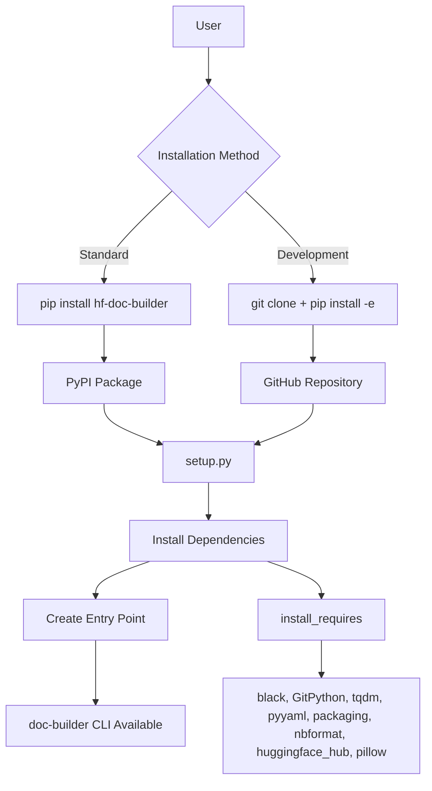
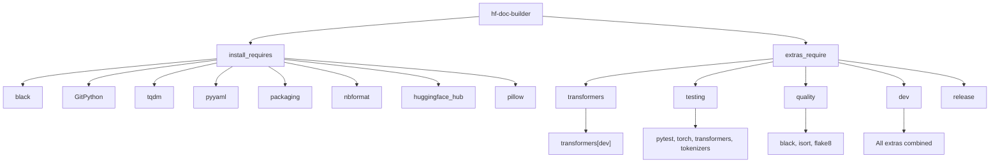
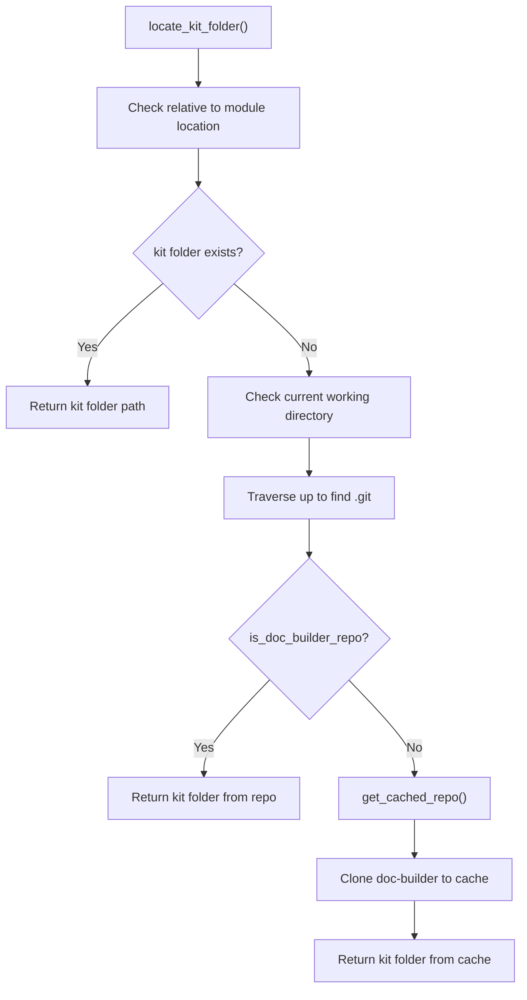

<!-- source: DeepWiki mcp.deepwiki.com · repo huggingface/doc-builder · page 1.1 Installation and Setup · fetched 2026-10-26 -->

# Installation and Setup

<details>
<summary>Relevant source files</summary>

The following files were used as context for generating this wiki page:

- [.gitignore](.gitignore)
- [MANIFEST.in](MANIFEST.in)
- [README.md](README.md)
- [setup.py](setup.py)
- [src/doc_builder/__init__.py](src/doc_builder/__init__.py)
- [src/doc_builder/commands/__init__.py](src/doc_builder/commands/__init__.py)
- [src/doc_builder/utils.py](src/doc_builder/utils.py)
- [tests/test_utils.py](tests/test_utils.py)

</details>


This document covers installing the doc-builder package and configuring it for basic use. It explains the available installation methods, dependencies, and initial configuration steps needed to start building documentation.

For information about using specific CLI commands after installation, see [Command Line Interface](#4). For details about configuring GitHub Actions workflows, see [GitHub Actions Integration](#3).

## Installation Methods

Doc-builder can be installed using two primary methods: from PyPI for standard usage, or from source for development and customization.

### PyPI Installation

The simplest installation method uses pip to install the published package:

```bash
pip install hf-doc-builder
```

This installs the `hf-doc-builder` package with all core dependencies and makes the `doc-builder` command available system-wide.

### Source Installation

For development or to use the latest features, install directly from the GitHub repository:

```bash
git clone https://github.com/huggingface/doc-builder.git
cd doc-builder
pip install -e .
```

The `-e` flag creates an editable installation, allowing modifications to the source code to take effect immediately.

**Installation Flow**



Sources: [README.md:40-53](), [setup.py:21-37]()

## Dependencies and Requirements

The package has several core dependencies that are automatically installed during setup.

### Core Dependencies

| Package | Purpose | 
|---------|---------|
| `black` | Code formatting and styling |
| `GitPython` | Git repository operations |
| `tqdm` | Progress bars for long operations |
| `pyyaml` | YAML configuration file parsing |
| `packaging` | Version parsing and comparison |
| `nbformat` | Jupyter notebook format handling |
| `huggingface_hub` | Integration with Hugging Face Hub |
| `pillow` | Image processing capabilities |

### Optional Dependencies

Additional functionality is available through optional dependency groups:

```bash
# For transformers integration
pip install hf-doc-builder[transformers]

# For testing capabilities  
pip install hf-doc-builder[testing]

# For development tools
pip install hf-doc-builder[dev]
```

**Dependency Architecture**



Sources: [setup.py:6-18]()

## Verification

After installation, verify that doc-builder is working correctly by checking the command availability and version.

### Command Availability

The installation creates a console script entry point that should be available in your PATH:

```bash
doc-builder --help
```

This command should display the available subcommands and options without errors.

### Version Check

Verify the installed version matches expectations:

```bash
python -c "import doc_builder; print(doc_builder.__version__)"
```

The current development version is `0.6.0.dev0` as defined in both [src/doc_builder/__init__.py:20]() and [setup.py:23]().

### Import Verification

Test that core modules can be imported successfully:

```bash
python -c "from doc_builder import build_doc, autodoc, convert_rst_to_mdx"
```

Sources: [setup.py:36](), [src/doc_builder/__init__.py:20-26]()

## Configuration and Cache Setup

Doc-builder uses several configuration mechanisms and caching strategies for optimal performance.

### Cache Directory

The package automatically creates a cache directory for storing temporary files and cloned repositories. The cache location follows this priority:

1. `DOC_BUILDER_CACHE` environment variable
2. `$HF_HOME/doc_builder` 
3. `$XDG_CACHE_HOME/huggingface/doc_builder`
4. `~/.cache/huggingface/doc_builder` (default)

### Kit Folder Resolution

For HTML documentation builds, doc-builder needs access to the `kit` folder containing SvelteKit components. The `locate_kit_folder()` function searches for this folder using the following strategy:



Sources: [src/doc_builder/utils.py:130-151](), [src/doc_builder/utils.py:154-182]()

### Documentation Configuration

Projects can include a `_config.py` file in their documentation source directory to customize doc-builder behavior. This file is executed as a Python module and can define configuration variables like `default_branch_name`.

The configuration is loaded via `read_doc_config()` and accessed through `get_doc_config()`.

Sources: [src/doc_builder/utils.py:91-108]()

## Common Setup Issues

### Windows Compatibility

The preview command has known limitations on Windows systems:

> **`preview` command does not work with Windows.**

For Windows users, use the build command with HTML output instead of the preview functionality.

### Missing Kit Folder

If HTML builds fail with kit folder errors, the system will automatically clone the doc-builder repository to the cache directory. Ensure you have:

- Git installed and available in PATH
- Internet connectivity for cloning
- Write permissions to the cache directory

### Node.js Requirements

HTML output generation requires Node.js version 14 or higher. Install Node.js before attempting HTML builds:

```bash
doc-builder build package_name /path/to/docs --build_dir /output/path --html
```

Sources: [README.md:68-70](), [README.md:86-91]()

---

