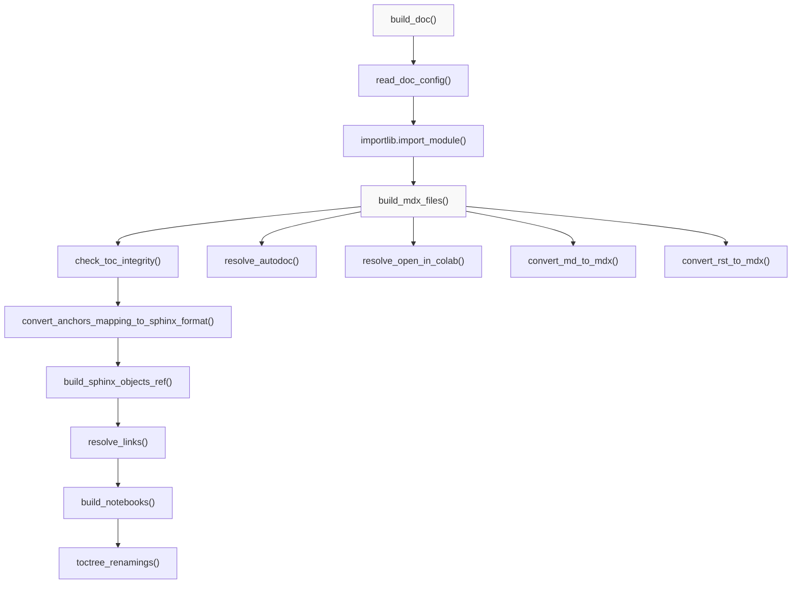
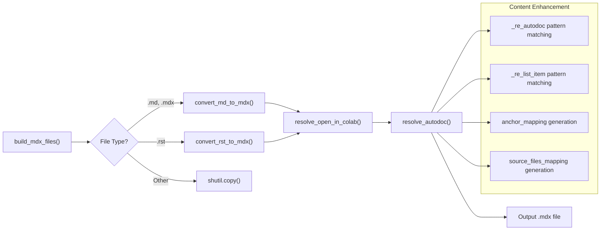
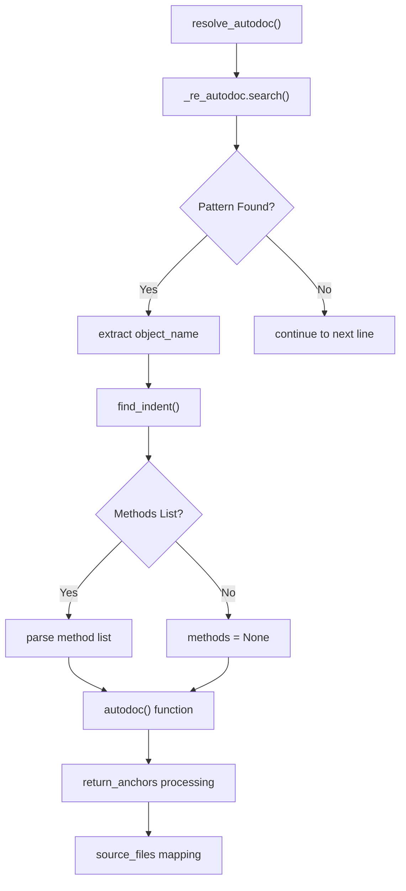
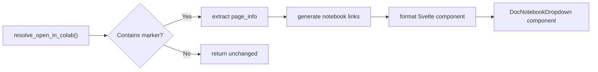
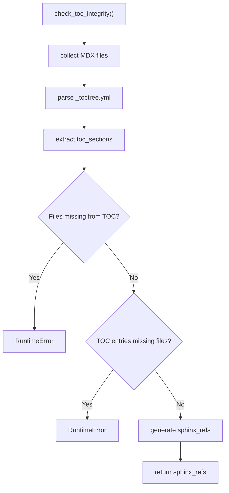

<!-- source: DeepWiki mcp.deepwiki.com · repo huggingface/doc-builder · page 2 Core Processing Systems · fetched 2026-10-26 -->

# Core Processing Systems

Relevant source files

The following files were used as context for generating this wiki page:

- [src/doc_builder/build_doc.py](src/doc_builder/build_doc.py)
- [src/doc_builder/commands/build.py](src/doc_builder/commands/build.py)
- [tests/test_build_doc.py](tests/test_build_doc.py)

The core processing systems form the backbone of doc-builder's documentation generation pipeline. These systems handle the conversion of source documentation files into structured MDX format, generate API documentation from Python source code, and orchestrate the entire build process. This document covers the main processing engines that transform raw documentation inputs into the final output format.

For information about the command-line interface that controls these systems, see [Command Line Interface](#4). For details about the document conversion specifics, see [Document Conversion System](#2.1) and [API Documentation Generation](#2.2).

## Build Orchestration System

The primary orchestration system is centered around the `build_doc` function, which coordinates all document processing activities. This system manages the entire documentation build lifecycle from input validation through final output generation.

### Build Flow Architecture

The `build_doc` function accepts multiple configuration parameters including `package_name`, `doc_folder`, `output_dir`, and various version-related settings. It orchestrates the entire build process by sequentially calling specialized processing functions.

Sources: [src/doc_builder/build_doc.py:309-388]()

### Core Processing Parameters

| Parameter | Purpose | Default Value |
|-----------|---------|---------------|
| `package_name` | Target Python package name | Required |
| `doc_folder` | Source documentation directory | Required |
| `output_dir` | Build output directory | Required |
| `version_tag_suffix` | GitHub link suffix | `"src/"` |
| `is_python_module` | Enable Python-specific processing | `False` |
| `watch_mode` | Skip validation for live preview | `False` |

Sources: [src/doc_builder/build_doc.py:324-352]()

## Document Processing Pipeline

The document processing pipeline handles multiple input formats and converts them to a unified MDX output format. The `build_mdx_files` function serves as the main processing coordinator.

### File Processing Flow

The pipeline processes three main file types:
- **Markdown files** (`.md`, `.mdx`): Processed by `convert_md_to_mdx`
- **reStructuredText files** (`.rst`): Processed by `convert_rst_to_mdx`
- **Other files**: Copied directly to output directory

Sources: [src/doc_builder/build_doc.py:159-251]()

### Pattern Recognition System

The system uses compiled regular expressions to identify special markup patterns:

- `_re_autodoc`: Matches `[[autodoc]] ClassName` patterns for API documentation generation
- `_re_list_item`: Matches `- method_name` patterns for method lists

These patterns enable automatic content expansion and cross-referencing.

Sources: [src/doc_builder/build_doc.py:34-35]()

## Content Resolution and Enhancement

The content resolution system handles special markup patterns and generates enhanced documentation features.

### Autodoc Resolution Process

The `resolve_autodoc` function processes `[[autodoc]]` markers by:
1. Extracting the target object name using `_re_autodoc` pattern
2. Determining indentation level with `find_indent`
3. Parsing optional method lists using `_re_list_item` pattern
4. Calling the `autodoc` function to generate documentation
5. Collecting anchors and source file mappings for cross-referencing

Sources: [src/doc_builder/build_doc.py:75-156]()

### Open-in-Colab Enhancement

The `resolve_open_in_colab` function transforms `[[open-in-colab]]` markers into interactive Svelte components:

The function generates links for multiple platforms:
- Google Colab (Mixed, PyTorch, TensorFlow variants)
- AWS SageMaker Studio Lab (Mixed, PyTorch, TensorFlow variants)

Sources: [src/doc_builder/build_doc.py:38-72]()

## Build Validation and Output Generation

The validation system ensures documentation integrity and generates auxiliary files for cross-referencing.

### Table of Contents Validation

The `check_toc_integrity` function validates that:
- All generated MDX files are referenced in `_toctree.yml`
- All TOC entries correspond to existing files
- Generates Sphinx references for cross-documentation linking

Sources: [src/doc_builder/build_doc.py:436-491]()

### Sphinx Objects Reference Generation

The system generates `objects.inv` files compatible with Sphinx documentation systems:

| Component | Function | Output Format |
|-----------|----------|---------------|
| Class objects | `py:class` | `ClassName py:class 1 page#anchor -` |
| Methods | `py:method` | `method_name py:method 1 page#anchor -` |
| Functions | `py:function` | `function_name py:function 1 page#anchor -` |

The `build_sphinx_objects_ref` function creates compressed inventory files that enable intersphinx linking from other documentation sites.

Sources: [src/doc_builder/build_doc.py:528-551](), [src/doc_builder/build_doc.py:494-525]()

### Link Resolution System

The `resolve_links` function processes all generated MDX files to resolve internal cross-references using the anchor mapping generated during the build process. This ensures that `[ClassName]` references are converted to proper documentation links.

Sources: [src/doc_builder/build_doc.py:253-271]()

---

