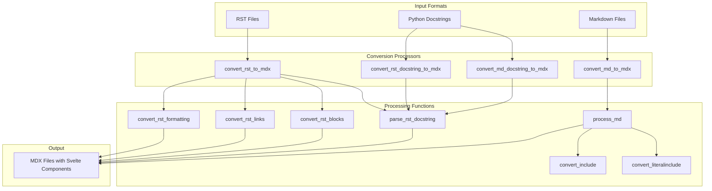
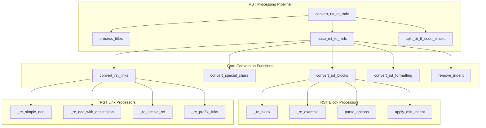
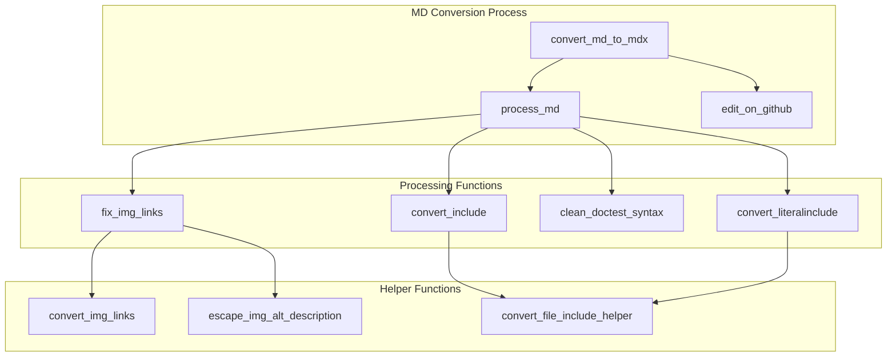
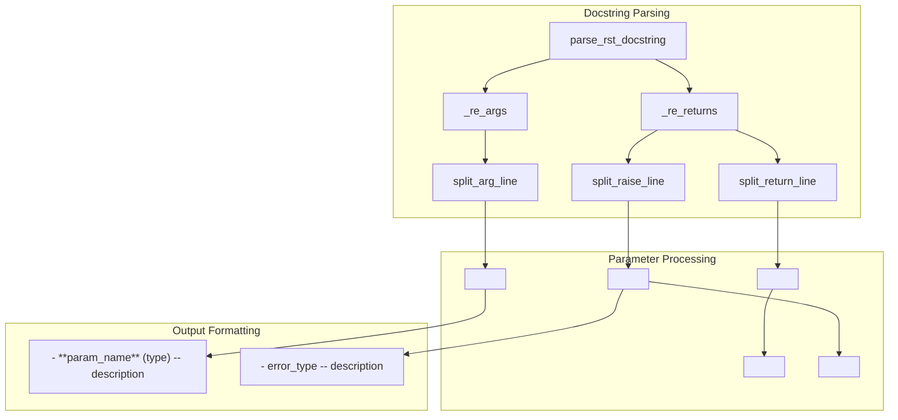

<!-- source: DeepWiki mcp.deepwiki.com · repo huggingface/doc-builder · page 2.1 Document Conversion System · fetched 2026-10-26 -->

# Document Conversion System

<details>
<summary>Relevant source files</summary>

The following files were used as context for generating this wiki page:

- [src/doc_builder/convert_md_to_mdx.py](src/doc_builder/convert_md_to_mdx.py)
- [src/doc_builder/convert_rst_to_mdx.py](src/doc_builder/convert_rst_to_mdx.py)
- [tests/test_convert_md_to_mdx.py](tests/test_convert_md_to_mdx.py)
- [tests/test_convert_rst_to_mdx.py](tests/test_convert_rst_to_mdx.py)

</details>


## Purpose and Scope

The Document Conversion System is responsible for transforming various input documentation formats into a unified MDX format that can be processed by the SvelteKit frontend. This system handles the conversion of reStructuredText (RST) and Markdown files, ensuring consistent formatting, proper link resolution, and integration with doc-builder's component ecosystem.

For information about API documentation generation from Python source code, see [API Documentation Generation](#2.2). For details about the SvelteKit frontend that renders the converted MDX files, see [Frontend System Architecture](#5).

## Conversion Pipeline Overview

The document conversion system operates as a two-track pipeline that processes different input formats and outputs standardized MDX files compatible with the SvelteKit frontend.

### High-Level Conversion Flow



Sources: [src/doc_builder/convert_rst_to_mdx.py:1-706](), [src/doc_builder/convert_md_to_mdx.py:1-242]()

## RST to MDX Conversion

The RST conversion system handles the complex task of transforming reStructuredText markup into MDX format while preserving semantic meaning and integrating with doc-builder's component system.

### RST Conversion Architecture



Sources: [src/doc_builder/convert_rst_to_mdx.py:657-706](), [src/doc_builder/convert_rst_to_mdx.py:559-578]()

### RST Formatting Conversion

The `convert_rst_formatting` function handles the transformation of RST-specific markup syntax to Markdown equivalents:

| RST Syntax | Converted Output | Purpose |
|------------|------------------|---------|
| `:obj:\`text\`` | `\`\`text\`\`` | Object references |
| `:class:\`text\`` | `[\`\`text\`\`]` | Class references |
| `:func:\`text\`` | `[\`\`text\`\`]` | Function references |
| `:math:\`formula\`` | `\\\\(formula\\\\)` | Mathematical expressions |
| `\`text\`` | `*text*` | Italic formatting |
| `\`\`text\`\`` | `\`text\`` | Code formatting |

Sources: [src/doc_builder/convert_rst_to_mdx.py:32-71](), [src/doc_builder/convert_rst_to_mdx.py:20-29]()

### RST Block Processing

The system converts various RST directives into corresponding MDX components:

```mermaid
graph LR
    subgraph "RST Blocks"
        A[".. note::"]
        B[".. warning::"]
        C[".. code-block::"]
        D[".. autoclass::"]
        E[".. image::"]
        F["Example::"]
    end
    
    subgraph "MDX Components"
        G["<Tip>"]
        H["<Tip warning={true}>"]
        I["```language"]
        J["[[autodoc]]"]
        K[""]
        L["<ExampleCodeBlock>"]
    end
    
    A --> G
    B --> H
    C --> I
    D --> J
    E --> K
    F --> L
```

Sources: [src/doc_builder/convert_rst_to_mdx.py:216-323](), [src/doc_builder/convert_rst_to_mdx.py:129-135]()

## Markdown to MDX Conversion

The Markdown conversion system transforms standard Markdown into MDX with embedded Svelte components and enhanced functionality.

### MD Conversion Components

The `convert_md_to_mdx` function wraps Markdown content with a comprehensive set of Svelte component imports and processing directives:



Sources: [src/doc_builder/convert_md_to_mdx.py:27-83](), [src/doc_builder/convert_md_to_mdx.py:229-241]()

### Include Directive Processing

The system supports `<include>` and `<literalinclude>` directives for embedding external file content:

| Feature | Configuration | Purpose |
|---------|---------------|---------|
| `path` | File path relative to current document | Source file location |
| `start-after` | Text marker in source file | Content inclusion start point |
| `end-before` | Text marker in source file | Content inclusion end point |
| `dedent` | Number of characters | Remove leading whitespace |
| `language` | Programming language identifier | Syntax highlighting (literalinclude only) |

Sources: [src/doc_builder/convert_md_to_mdx.py:170-201](), [src/doc_builder/convert_md_to_mdx.py:204-217]()

## Docstring Processing System

Both RST and Markdown conversion systems utilize a sophisticated docstring parser that handles structured documentation within Python docstrings.

### Docstring Parsing Pipeline



Sources: [src/doc_builder/convert_rst_to_mdx.py:378-471](), [src/doc_builder/convert_rst_to_mdx.py:325-368]()

## Framework-Specific Code Processing

The conversion system includes specialized handling for framework-specific code blocks, particularly for PyTorch and TensorFlow examples.

### Framework Code Block Structure

```mermaid
graph LR
    subgraph "Input Code Block"
        A["```python<br/>common_code<br/>## PYTORCH CODE<br/>pytorch_specific<br/>## TENSORFLOW CODE<br/>tensorflow_specific<br/>```"]
    end
    
    subgraph "Output Structure"
        B["<frameworkcontent><br/><pt><br/>```python<br/>common_code<br/>pytorch_specific<br/>```<br/></pt><br/><tf><br/>```python<br/>common_code<br/>tensorflow_specific<br/>```<br/></tf><br/></frameworkcontent>"]
    end
    
    A --> B
```

Sources: [src/doc_builder/convert_rst_to_mdx.py:613-655]()

## Integration with Build System

The conversion system integrates with the broader doc-builder architecture through standardized page information structures and consistent output formatting.

### Page Information Schema

The conversion functions require a `page_info` dictionary containing:

| Key | Type | Purpose |
|-----|------|---------|
| `package_name` | `str` | Target package identifier |
| `version` | `str` | Documentation version (default: "main") |
| `language` | `str` | Localization language (default: "en") |
| `page` | `str` | Current page path for relative links |
| `path` | `Path` | Source file path for include processing |
| `repo_name` | `str` | GitHub repository name |
| `repo_owner` | `str` | GitHub repository owner |

Sources: [src/doc_builder/convert_rst_to_mdx.py:88-127](), [src/doc_builder/convert_md_to_mdx.py:86-101]()

The Document Conversion System serves as a critical bridge between various documentation formats and the unified MDX output required by the SvelteKit frontend, ensuring consistent formatting, proper component integration, and seamless content processing across the entire doc-builder pipeline.

---

