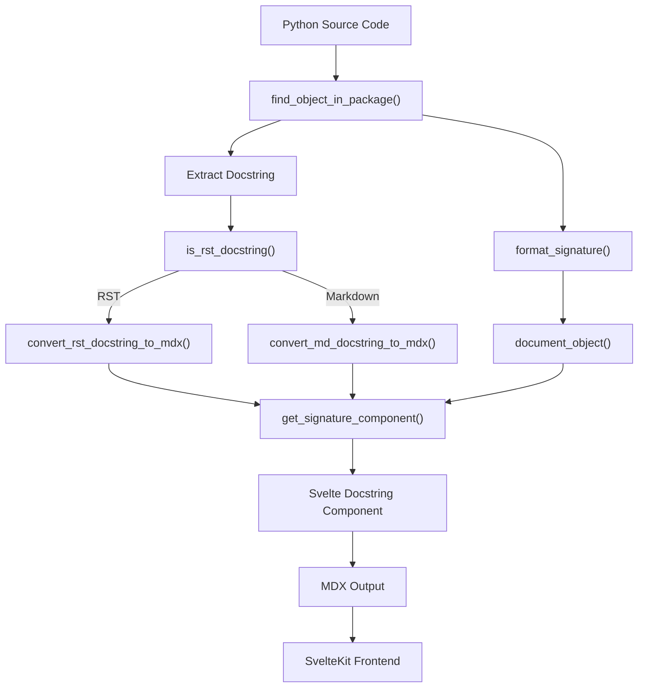
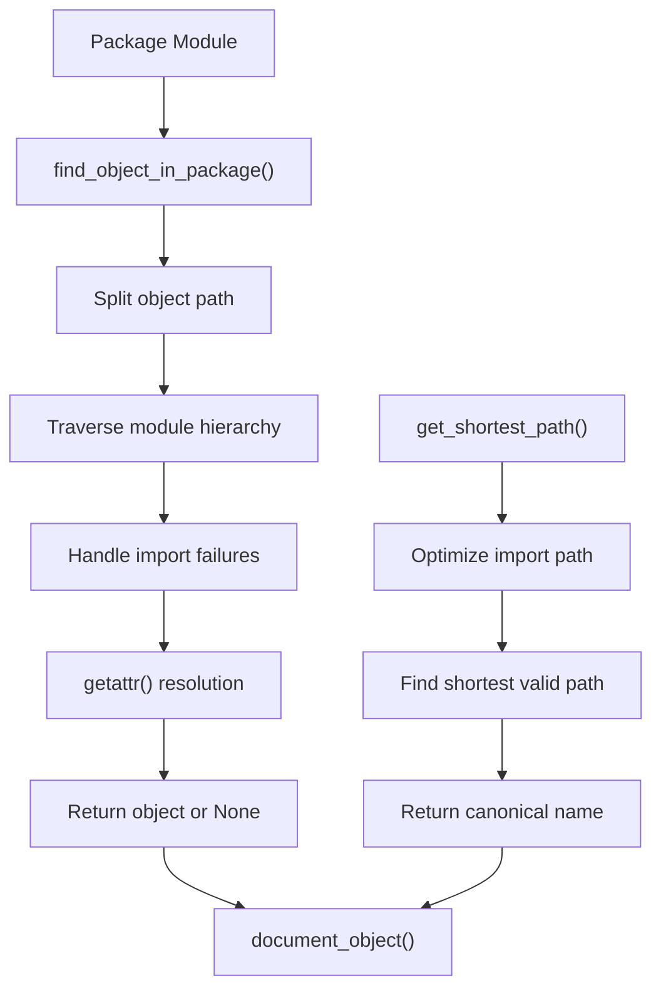
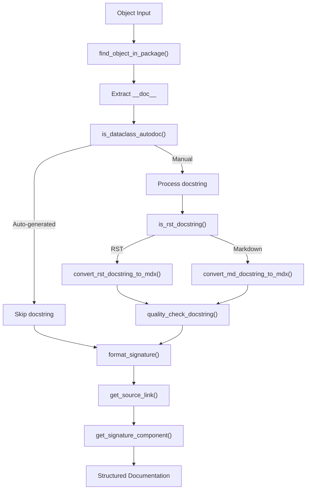
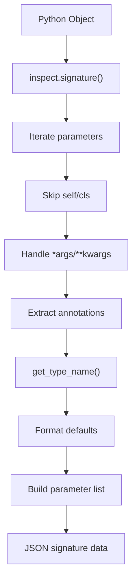
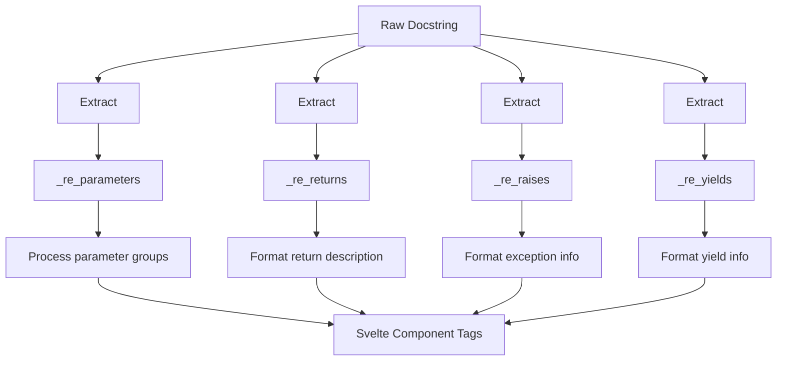
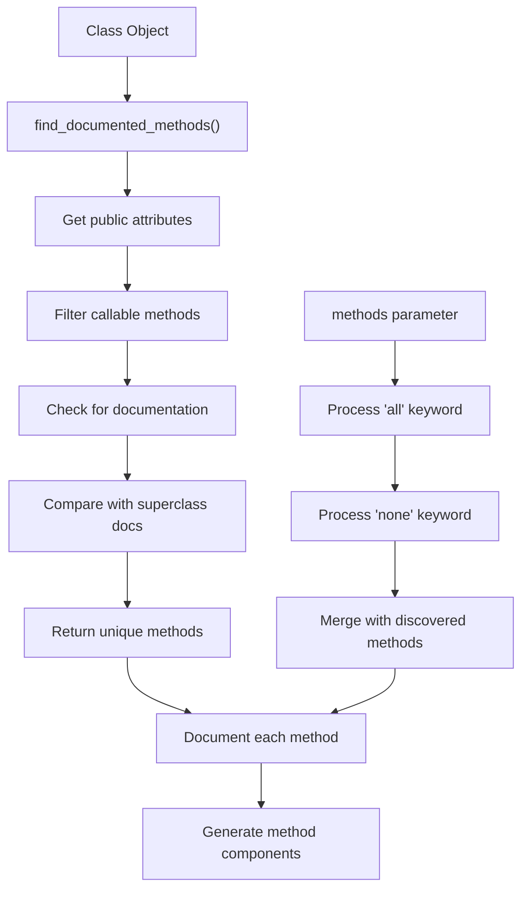
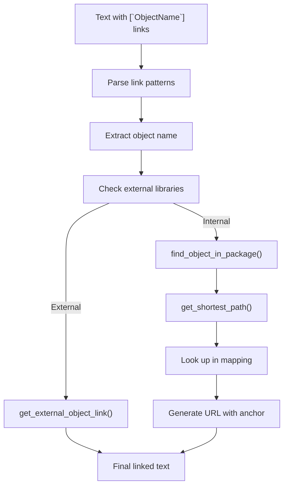
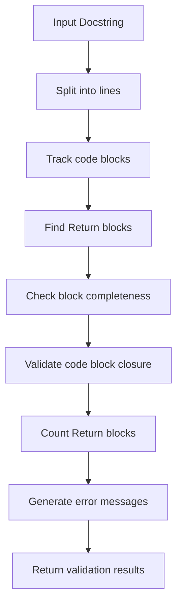

<!-- source: DeepWiki mcp.deepwiki.com · repo huggingface/doc-builder · page 2.2 API Documentation Generation · fetched 2026-10-26 -->

# API Documentation Generation

<details>
<summary>Relevant source files</summary>

The following files were used as context for generating this wiki page:

- [src/doc_builder/autodoc.py](src/doc_builder/autodoc.py)
- [tests/test_autodoc.py](tests/test_autodoc.py)

</details>


The API Documentation Generation system extracts Python API documentation from source code docstrings and converts it into structured documentation components for web rendering. This system processes Python objects (classes, functions, methods) to automatically generate comprehensive API reference documentation.

For information about converting standalone documentation files, see [Document Conversion System](#2.1). For content processing utilities, see [Content Processing and Styling](#2.3).

## Purpose and Architecture

The autodoc system serves as the bridge between Python source code and the rendered documentation website. It introspects Python packages to extract docstrings, function signatures, and metadata, then transforms this information into structured components that can be rendered by the SvelteKit frontend.

### Core Processing Flow



Sources: [src/doc_builder/autodoc.py:358-418](), [src/doc_builder/autodoc.py:449-521]()

### Object Discovery and Resolution

The system uses Python's introspection capabilities to discover and resolve objects within packages:



Sources: [src/doc_builder/autodoc.py:26-54](), [src/doc_builder/autodoc.py:63-87]()

## Core Functions and Classes

### Primary Entry Points

The `autodoc()` function serves as the main entry point for generating documentation. It processes a single object or class with its methods:

| Parameter | Type | Description |
|-----------|------|-------------|
| `object_name` | `str` | Full path to the Python object |
| `package` | `ModuleType` | Package containing the object |
| `methods` | `List[str]` | Methods to document for classes |
| `return_anchors` | `bool` | Whether to return anchor names |
| `page_info` | `Dict` | Metadata about the documentation page |

The function returns either a documentation string or a tuple containing documentation, anchors, and quality check errors.

Sources: [src/doc_builder/autodoc.py:449-521]()

### Object Documentation Pipeline

The `document_object()` function handles individual object processing:



Sources: [src/doc_builder/autodoc.py:358-418]()

### Signature Processing

The system extracts and formats function signatures with type annotations:



The `format_signature()` function returns a list of dictionaries with parameter names and their type/default information.

Sources: [src/doc_builder/autodoc.py:99-132]()

## Docstring Processing

### Format Detection and Conversion

The system automatically detects docstring formats and applies appropriate conversion:

| Format | Detection Method | Conversion Function |
|--------|------------------|-------------------|
| RST | `_re_rst_special_words`, `:obj:` patterns | `convert_rst_docstring_to_mdx()` |
| Markdown | Default format | `convert_md_docstring_to_mdx()` |
| NumPy Style | `_re_numpydocstring` pattern | Detected but not specifically handled |

Sources: [src/doc_builder/autodoc.py:248-300]()

### Special Section Processing

The system processes structured docstring sections using regex patterns:



The regex patterns used include:
- `_re_parameters` for parameter sections
- `_re_returns` for return descriptions
- `_re_raises` for exception documentation
- `_re_parameter_group` for parameter groupings

Sources: [src/doc_builder/autodoc.py:134-143](), [src/doc_builder/autodoc.py:145-238]()

## Component Generation

### Svelte Docstring Components

The `get_signature_component()` function generates structured Svelte components:

```xml
<docstring>
  <name>class transformers.BertModel</name>
  <anchor>transformers.BertModel</anchor>
  <source>https://github.com/huggingface/transformers/blob/main/src/...</source>
  <parameters>[{"name": "config", "val": ""}, ...]</parameters>
  <paramsdesc>Parameter descriptions...</paramsdesc>
  <rettype>Return type</rettype>
  <retdesc>Return description</retdesc>
  <raises>Exception descriptions</raises>
</docstring>
```

Sources: [src/doc_builder/autodoc.py:145-238]()

### Method Documentation for Classes

For class objects, the system automatically discovers and documents public methods:



Sources: [src/doc_builder/autodoc.py:420-444](), [src/doc_builder/autodoc.py:489-517]()

## Link Resolution and Cross-References

### Internal Link Processing

The `resolve_links_in_text()` function converts documentation links to proper URLs:



The system supports several link formats:
- `[`ObjectName`]` - Standard object reference
- `[`~full.path.ObjectName`]` - Shortened display name
- `[`ObjectName#parameter`]` - Link to specific parameter

Sources: [src/doc_builder/autodoc.py:523-588]()

### Source Code Linking

The `get_source_link()` function generates GitHub source links:

| Component | Source | Example |
|-----------|--------|---------|
| Repository | `page_info["repo_owner"]` | `huggingface` |
| Package | `page_info["repo_name"]` | `transformers` |
| Version | `page_info["version_tag"]` | `main` |
| File Path | `inspect.getsourcefile()` | `src/transformers/models/bert/modeling_bert.py` |
| Line Number | `inspect.getsourcelines()` | `#L123` |

Sources: [src/doc_builder/autodoc.py:328-343]()

## Quality Assurance and Error Handling

### Docstring Quality Checks

The `quality_check_docstring()` function validates docstring structure:



Common validation errors include:
- Empty Return blocks
- Multiple Return blocks (only one supported)
- Unclosed code blocks
- Malformed parameter sections

Sources: [src/doc_builder/autodoc.py:596-651]()

### Error Accumulation

The autodoc system accumulates quality check errors and returns them alongside documentation, allowing for batch error reporting rather than failing on the first issue encountered.

Sources: [src/doc_builder/autodoc.py:473-480](), [src/doc_builder/autodoc.py:507-509]()

## Integration with Frontend

The generated Svelte components integrate with the frontend documentation system through:

1. **CSS Styling**: Components use predefined CSS classes like `docstring_css_classes`
2. **Anchor Generation**: Each documented object receives a unique anchor for deep linking
3. **Example Code Blocks**: Special handling for example code with `hashlink_example_codeblock()`
4. **Interactive Features**: Integration with framework switchers and inference snippets

The CSS classes applied include: `"docstring border-l-2 border-t-2 pl-4 pt-3.5 border-gray-100 rounded-tl-xl mb-6 mt-8"`

Sources: [src/doc_builder/autodoc.py:446](), [src/doc_builder/autodoc.py:509](), [src/doc_builder/autodoc.py:518]()

---

