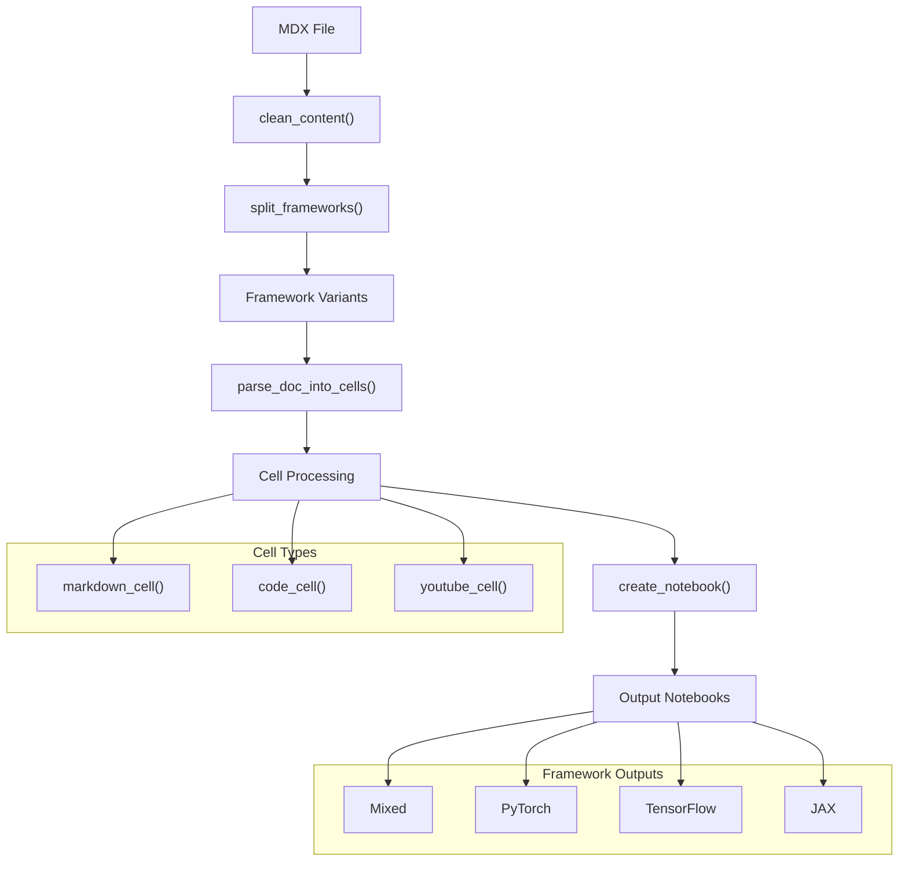
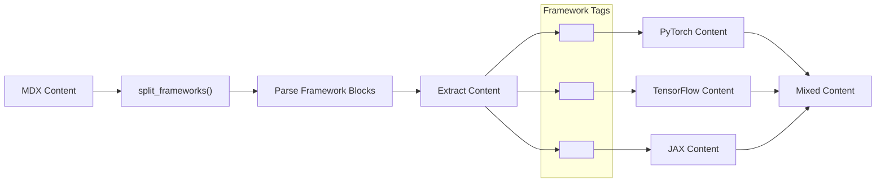
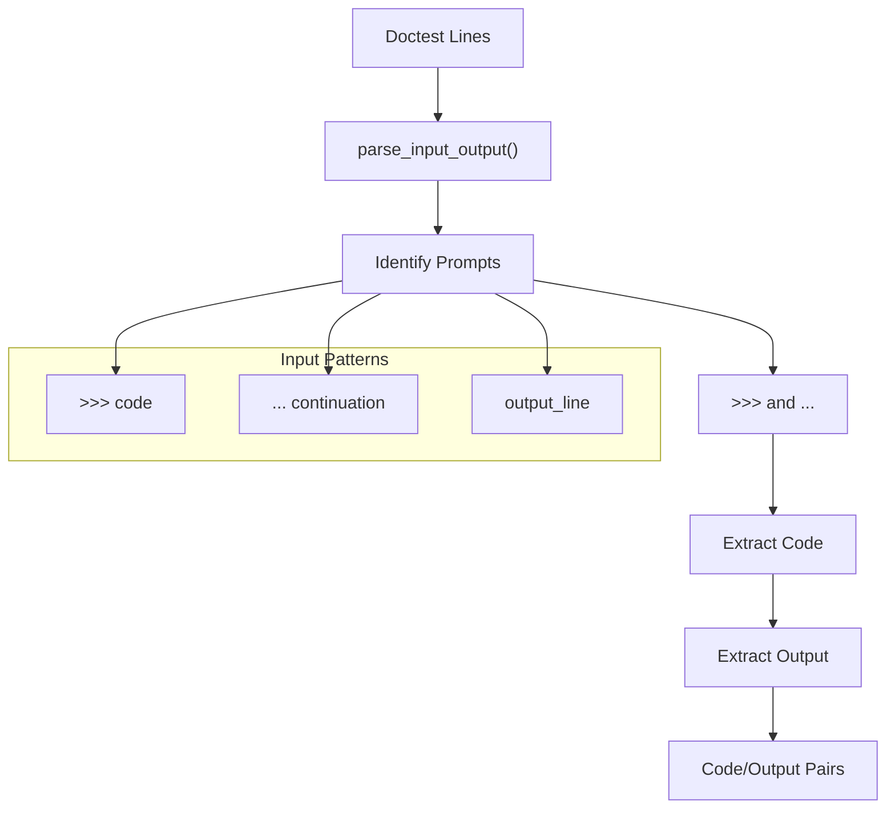
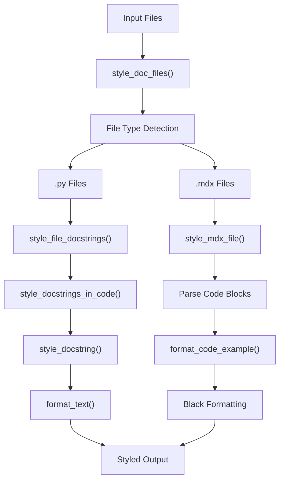
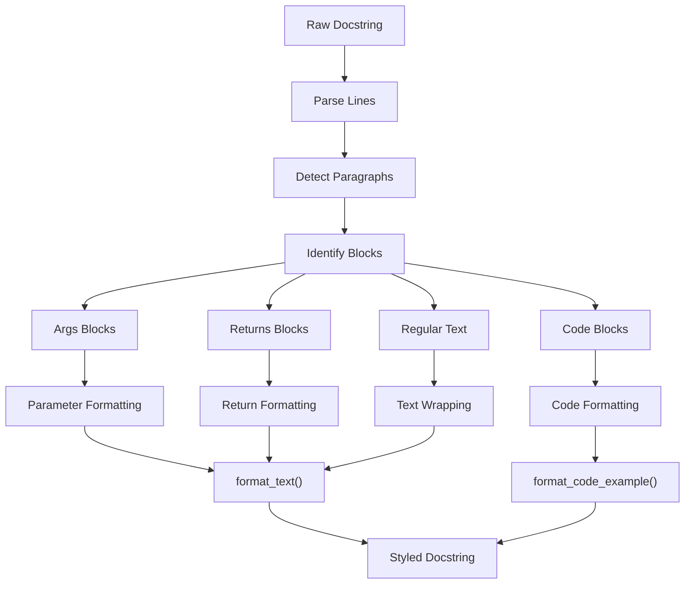
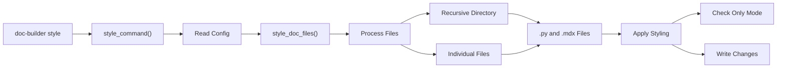
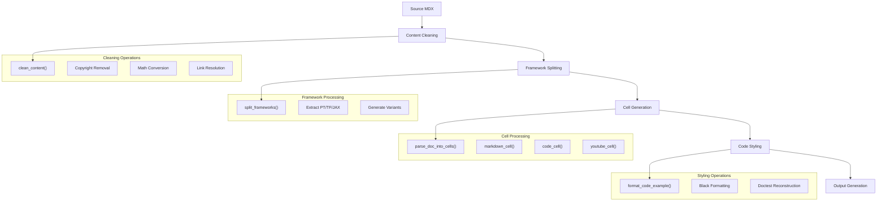

<!-- source: DeepWiki mcp.deepwiki.com · repo huggingface/doc-builder · page 2.3 Content Processing and Styling · fetched 2026-10-26 -->

# Content Processing and Styling

Relevant source files

The following files were used as context for generating this wiki page:

- [src/doc_builder/commands/style.py](src/doc_builder/commands/style.py)
- [src/doc_builder/convert_to_notebook.py](src/doc_builder/convert_to_notebook.py)
- [src/doc_builder/style_doc.py](src/doc_builder/style_doc.py)
- [tests/test_convert_to_notebook.py](tests/test_convert_to_notebook.py)
- [tests/test_style_doc.py](tests/test_style_doc.py)

This section covers the content transformation utilities that handle notebook conversion, code formatting, and styling within the doc-builder system. These components process MDX documentation files and convert them into various output formats while ensuring consistent code style and formatting.

For information about the core document conversion from RST and Markdown to MDX, see [Document Conversion System](#2.1). For API documentation extraction from Python source code, see [API Documentation Generation](#2.2).

## Overview

The content processing and styling system consists of three main components:

1. **Notebook Conversion** - Transforms MDX documentation into Jupyter notebooks with proper cell separation and framework-specific variants
2. **Code Styling** - Formats Python code samples in documentation using Black and enforces consistent docstring styling
3. **Content Transformation** - Handles special content like YouTube embeds, mathematical formulas, and framework-specific content blocks

## Notebook Conversion System

The notebook conversion system transforms MDX documentation files into executable Jupyter notebooks, supporting multiple ML frameworks and interactive content.

### Core Conversion Process

Sources: [src/doc_builder/convert_to_notebook.py:293-320]()

### Content Cleaning and Preprocessing

The `clean_content()` function handles several preprocessing steps:

| Operation | Regex Pattern | Purpose |
|-----------|---------------|---------|
| Copyright removal | `_re_copyright` | Removes copyright headers |
| Colab marker removal | `[[open-in-colab]]` | Removes special markers |
| Math formula conversion | `_re_math_delimiter` | Converts `\\(formula\\)` to `$formula$` |
| Link resolution | `resolve_links_in_text()` | Resolves documentation links |
| Link expansion | `expand_links()` | Expands relative links to full URLs |

Sources: [src/doc_builder/convert_to_notebook.py:67-82]()

### Framework Content Splitting

The `split_frameworks()` function processes `<frameworkcontent>` blocks to generate framework-specific notebook variants:

Sources: [src/doc_builder/convert_to_notebook.py:85-115]()

### Cell Creation and Parsing

The system creates different cell types based on content structure:

- **Markdown Cells**: Created by `markdown_cell()` for text content and headers
- **Code Cells**: Created by `code_cell()` for Python code blocks, with optional output
- **YouTube Cells**: Created by `youtube_cell()` for embedded videos with iframe HTML

The `parse_input_output()` function handles doctest syntax conversion:

Sources: [src/doc_builder/convert_to_notebook.py:125-158]()

## Code Styling System

The code styling system ensures consistent formatting of Python code samples and docstrings throughout the documentation.

### Styling Architecture

Sources: [src/doc_builder/style_doc.py:491-548]()

### Code Example Formatting

The `format_code_example()` function processes Python code samples:

1. **Parse Structure**: Uses `parse_code_example()` to separate code and output
2. **Black Formatting**: Applies Black code formatter with configurable line length
3. **Doctest Reconstruction**: Rebuilds doctest syntax with proper `>>>` and `...` prompts
4. **Indentation Preservation**: Maintains original indentation levels

Key regex patterns used:

| Pattern | Variable | Purpose |
|---------|----------|---------|
| Code blocks | `_re_code` | Identifies code block boundaries |
| List items | `_re_list` | Detects list formatting |
| Tip blocks | `_re_tip` | Identifies `<Tip>` components |
| Docstyle ignore | `_re_docstyle_ignore` | Skips formatting for marked sections |

Sources: [src/doc_builder/style_doc.py:94-184]()

### Docstring Styling

The `style_docstring()` function formats docstring structure:

Sources: [src/doc_builder/style_doc.py:227-380]()

## CLI Integration

The styling system integrates with the doc-builder CLI through the `style` command:

### Command Structure

Sources: [src/doc_builder/commands/style.py:23-31]()

### Configuration Options

The CLI accepts several parameters:

- `files`: Target files or directories to process
- `--path_to_docs`: Documentation source folder path
- `--max_len`: Maximum line length (default: 119)
- `--check_only`: Validation mode without modifications

Sources: [src/doc_builder/commands/style.py:39-42]()

## Content Processing Pipeline

The complete content processing pipeline integrates notebook conversion and styling:

Sources: [src/doc_builder/convert_to_notebook.py:293-320](), [src/doc_builder/style_doc.py:491-548]()

## Error Handling and Validation

The system includes comprehensive error handling:

- **Black Formatting Errors**: Captured and reported when code cannot be formatted
- **Malformed Content**: Validation for unclosed code blocks and invalid syntax
- **Framework Block Validation**: Ensures proper nesting of framework-specific content
- **File Processing Errors**: Graceful handling of file access and parsing issues

The styling system accumulates errors and provides detailed feedback about formatting issues, helping maintain code quality standards across the documentation.

Sources: [src/doc_builder/style_doc.py:540-547](), [src/doc_builder/convert_to_notebook.py:134-141]()

---

