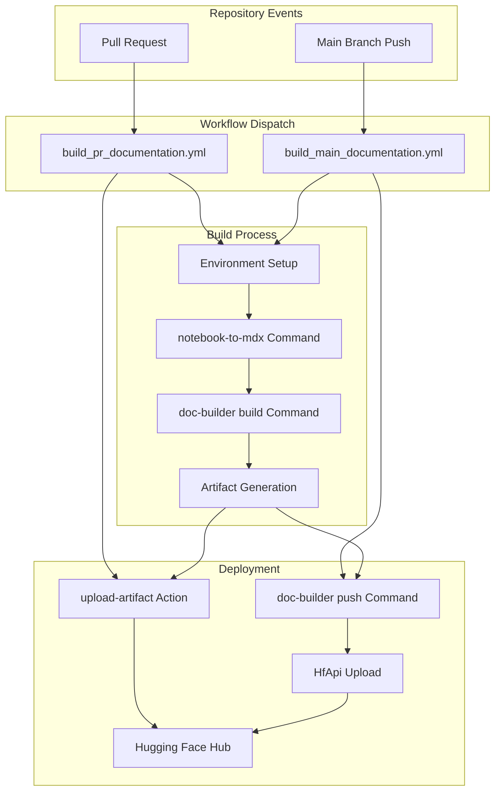
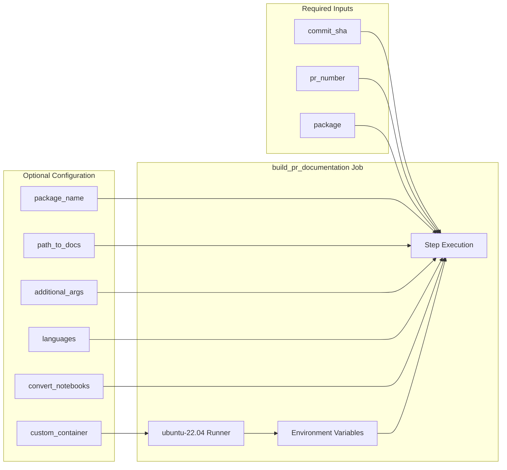
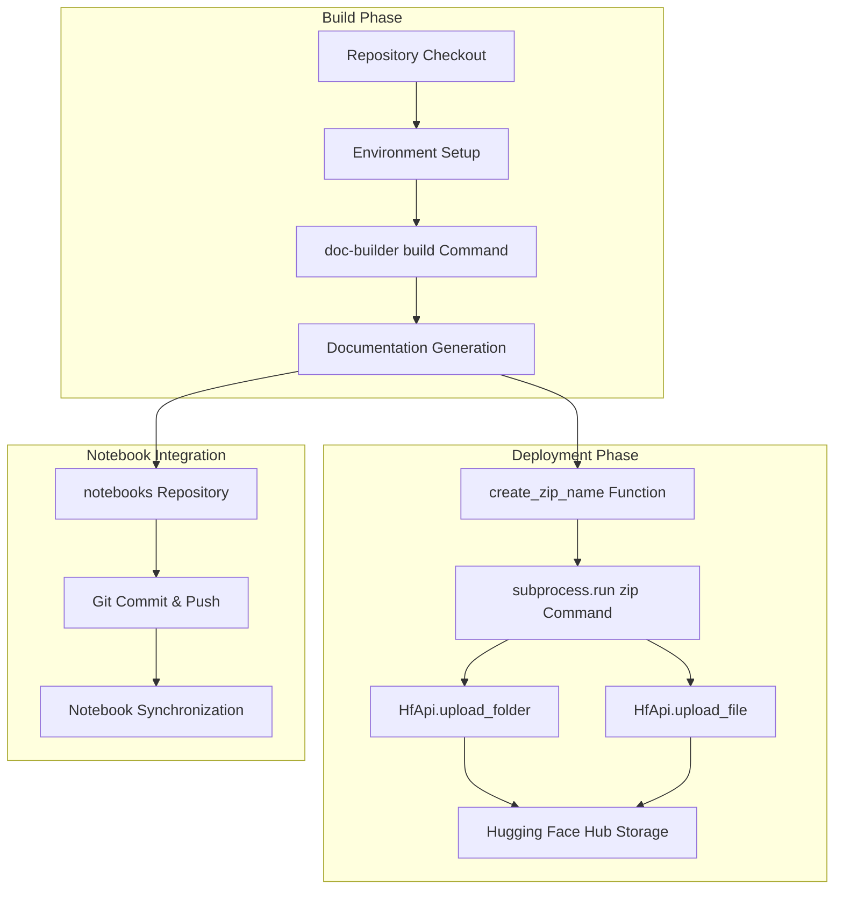
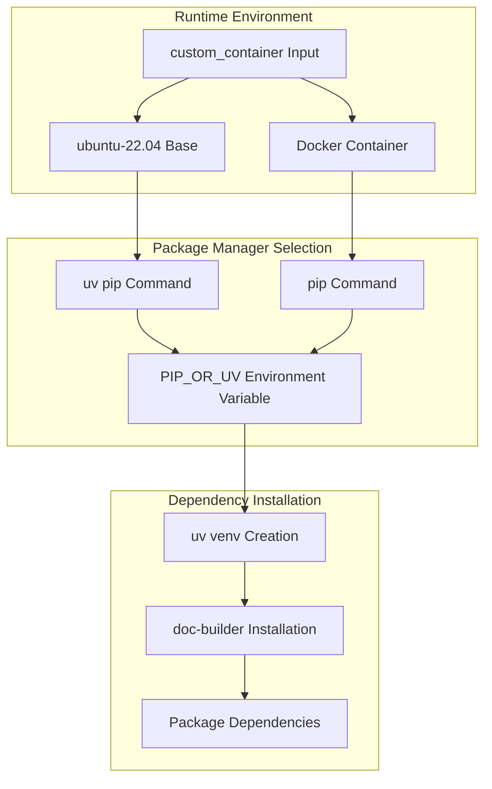
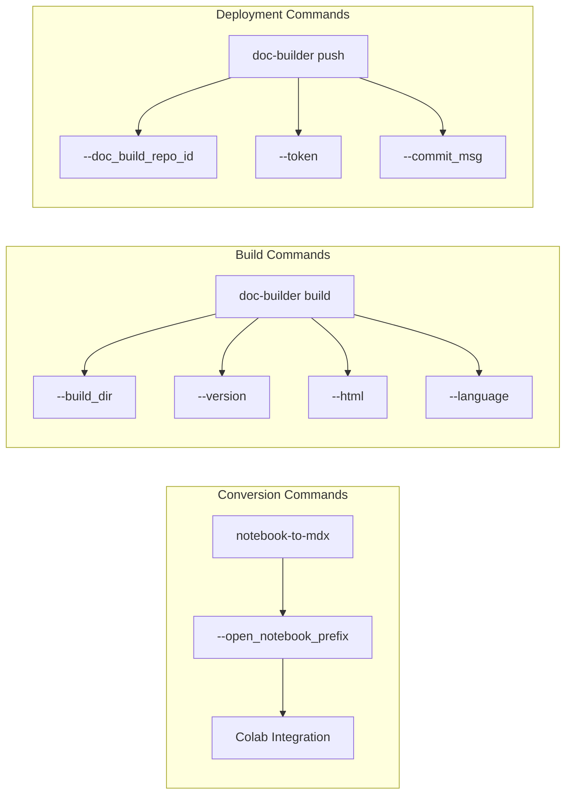

<!-- source: DeepWiki mcp.deepwiki.com · repo huggingface/doc-builder · page 3 GitHub Actions Integration · fetched 2026-10-26 -->

# GitHub Actions Integration

<details>
<summary>Relevant source files</summary>

The following files were used as context for generating this wiki page:

- [.github/workflows/build_main_documentation.yml](.github/workflows/build_main_documentation.yml)
- [.github/workflows/build_pr_documentation.yml](.github/workflows/build_pr_documentation.yml)
- [src/doc_builder/commands/doc_builder_cli.py](src/doc_builder/commands/doc_builder_cli.py)
- [src/doc_builder/commands/notebook_to_mdx.py](src/doc_builder/commands/notebook_to_mdx.py)
- [src/doc_builder/commands/push.py](src/doc_builder/commands/push.py)

</details>


The GitHub Actions integration provides automated CI/CD workflows for building, testing, and deploying documentation using the doc-builder system. This integration enables seamless documentation generation for both pull requests and main branch deployments across Hugging Face repositories.

For information about the CLI commands used within these workflows, see [Command Line Interface](#4). For details about the frontend build process, see [Frontend System Architecture](#5).

## Workflow Architecture

The doc-builder GitHub Actions integration consists of two primary reusable workflows that handle different deployment scenarios:

| Workflow | Purpose | Trigger | Output |
|----------|---------|---------|--------|
| `build_pr_documentation.yml` | Generate documentation previews for pull requests | `workflow_call` from PR events | Artifacts for preview deployment |
| `build_main_documentation.yml` | Build and deploy production documentation | `workflow_call` from main branch pushes | Live documentation on Hugging Face Hub |



Sources: [.github/workflows/build_pr_documentation.yml:1-224](), [.github/workflows/build_main_documentation.yml:1-264]()

## Pull Request Documentation Workflow

The `build_pr_documentation` workflow creates documentation previews for pull requests, enabling reviewers to see documentation changes before merging.

### Workflow Inputs and Configuration

The workflow accepts extensive configuration through inputs:



Sources: [.github/workflows/build_pr_documentation.yml:8-60]()

### Build Process Steps

The workflow executes a standardized build process:

1. **Repository Checkout**: Uses `actions/checkout@v4` to fetch both `huggingface/doc-builder` and the target package repository
2. **Environment Setup**: Configures Node.js, Python virtual environment, and package dependencies
3. **Notebook Conversion**: Optionally runs `doc-builder notebook-to-mdx` command when `convert_notebooks` is enabled
4. **Documentation Build**: Executes `doc-builder build` with PR-specific versioning
5. **Artifact Upload**: Uses `actions/upload-artifact@v4` to store build results

Sources: [.github/workflows/build_pr_documentation.yml:70-224]()

## Main Branch Documentation Workflow  

The `build_main_documentation` workflow handles production documentation builds and deployment to the Hugging Face Hub.

### Enhanced Deployment Pipeline

Unlike the PR workflow, the main branch workflow includes additional deployment capabilities:



Sources: [.github/workflows/build_main_documentation.yml:237-264](), [src/doc_builder/commands/push.py:50-110]()

### Push Command Integration

The main workflow integrates with the `push_command` function to deploy documentation:

| Component | Function | Implementation |
|-----------|----------|----------------|
| Zip Creation | `create_zip_name` | Generates standardized zip file names |
| File Compression | `subprocess.run` | Creates zip archives of documentation builds |
| Hub Upload | `HfApi.upload_folder` / `HfApi.upload_file` | Uploads documentation to `hf-doc-build/doc-build` repository |
| Retry Logic | `push_command_add` | Implements exponential backoff for failed uploads |

Sources: [src/doc_builder/commands/push.py:30-34](), [src/doc_builder/commands/push.py:66-70](), [src/doc_builder/commands/push.py:76-98]()

## Environment Configuration

Both workflows implement sophisticated environment configuration to handle different deployment scenarios:

### Container and Dependency Management



Sources: [.github/workflows/build_pr_documentation.yml:87-108](), [.github/workflows/build_main_documentation.yml:92-113]()

### Version and Path Configuration

The workflows dynamically configure documentation paths and versioning:

- **Documentation Folder**: Defaults to `{package}/docs/source` or uses `path_to_docs` input
- **Package Name**: Uses repository name or `package_name` input override  
- **Version Tagging**: Applies `version_tag_suffix` for documentation URL structure
- **Language Support**: Processes multiple languages when `languages` input is provided

Sources: [.github/workflows/build_pr_documentation.yml:110-133](), [.github/workflows/build_main_documentation.yml:115-131]()

## CLI Command Integration

The workflows orchestrate multiple CLI commands from the doc-builder system:

### Command Execution Flow



Sources: [.github/workflows/build_pr_documentation.yml:180-213](), [.github/workflows/build_main_documentation.yml:196-242](), [src/doc_builder/commands/doc_builder_cli.py:27-47]()

### Notebook Conversion Process

When `convert_notebooks` is enabled, the workflow executes the `notebook_to_mdx_command`:

1. **Source Processing**: Converts `.ipynb` files to `.md` format using `nbformat.read`
2. **Content Transformation**: Applies `format_code_example` styling to code cells
3. **Integration Links**: Adds `DocNotebookDropdown` components with Google Colab links
4. **Output Generation**: Creates MDX-compatible markdown files

Sources: [src/doc_builder/commands/notebook_to_mdx.py:86-106](), [.github/workflows/build_pr_documentation.yml:180-190]()

## Artifact Management and Deployment

### PR Documentation Artifacts

PR workflows generate artifacts containing:

- Built documentation files
- Commit SHA for traceability (`commit_sha` file)
- PR number for identification (`pr_number` file)

These artifacts are consumed by subsequent upload workflows for preview deployment.

Sources: [.github/workflows/build_pr_documentation.yml:215-224]()

### Production Deployment

Main branch deployments use the `push_command_add` function with retry logic:

| Feature | Implementation | Purpose |
|---------|----------------|---------|
| Zip Compression | `subprocess.run(["zip", "-r", zip_file_path, path_docs_built])` | Avoid file corruption issues |
| Upload Retry | `number_of_retries` with exponential backoff | Handle network failures |
| Version Management | `upload_version_yml` flag | Maintain documentation version history |
| Hub Integration | `HfApi.upload_folder` / `HfApi.upload_file` | Deploy to Hugging Face infrastructure |

Sources: [src/doc_builder/commands/push.py:66-110]()

## Error Handling and Reliability

Both workflows implement comprehensive error handling:

### Retry Mechanisms

The push command includes configurable retry logic with exponential backoff:

```python
while number_of_retries:
    try:
        # Upload operation
        break
    except Exception as e:
        number_of_retries -= 1
        if number_of_retries:
            sleep(n_seconds_sleep)
        else:
            raise RuntimeError("push_command_add failed") from e
```

Sources: [src/doc_builder/commands/push.py:76-106]()

### Environment Validation

The workflows validate environment configuration and provide fallbacks:

- Container detection for package manager selection
- Path validation with default fallbacks  
- Dependency resolution with multiple installation strategies

Sources: [.github/workflows/build_pr_documentation.yml:87-133](), [.github/workflows/build_main_documentation.yml:92-131]()

---

