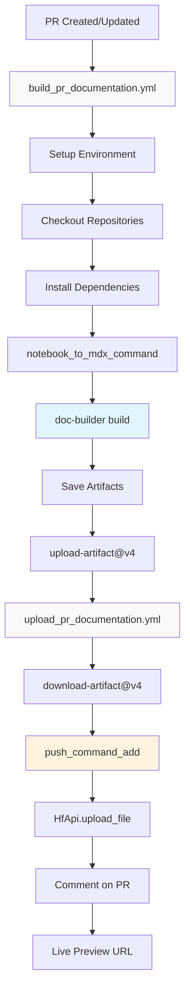
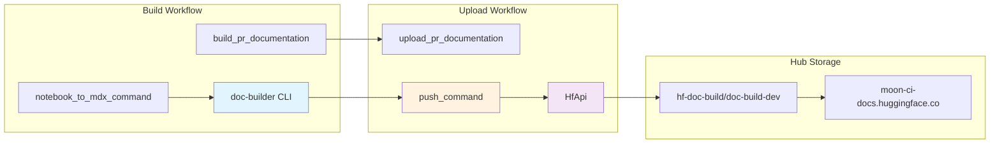
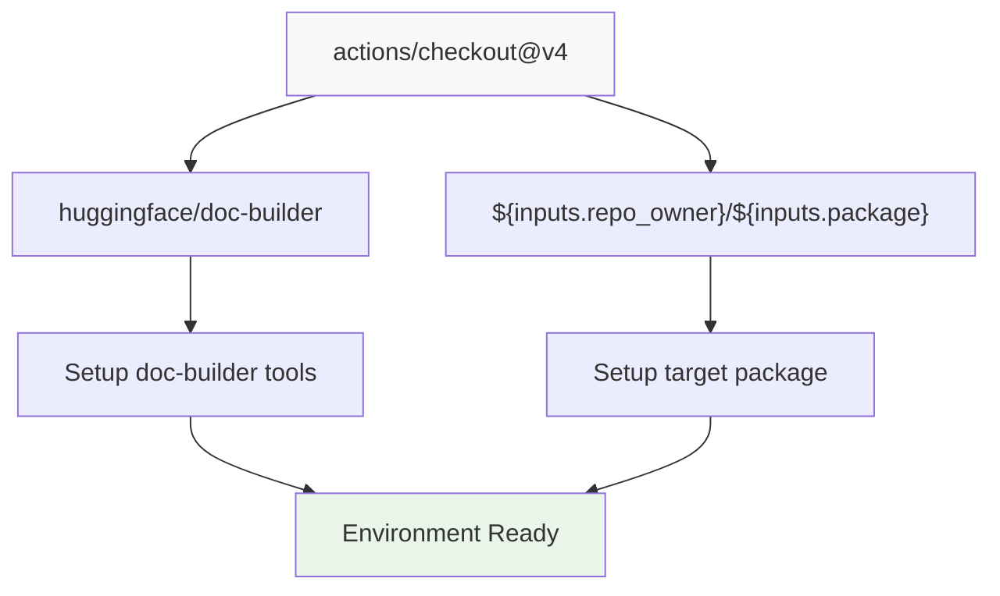
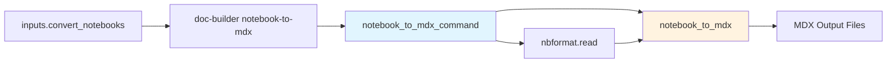
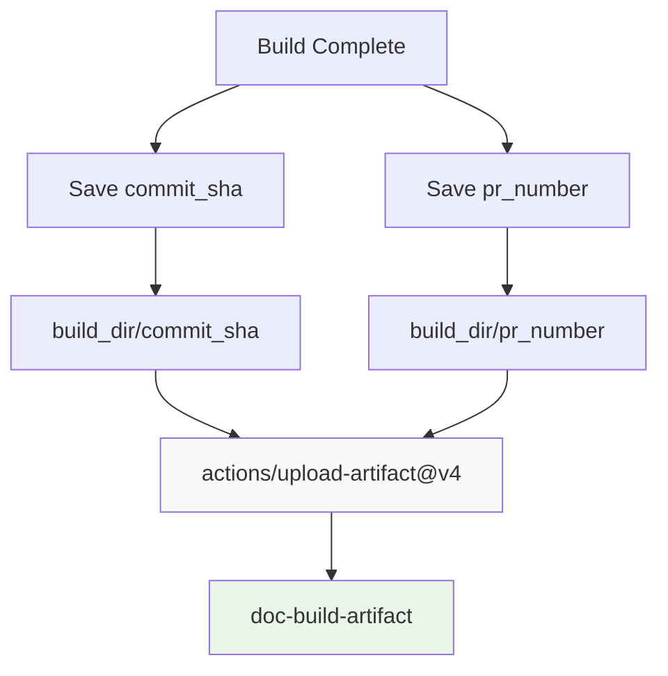
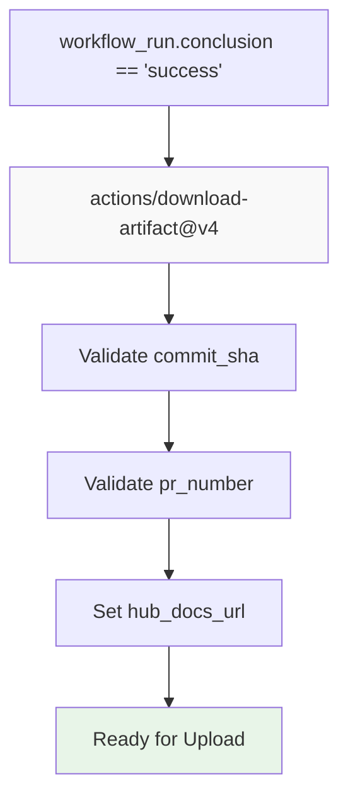
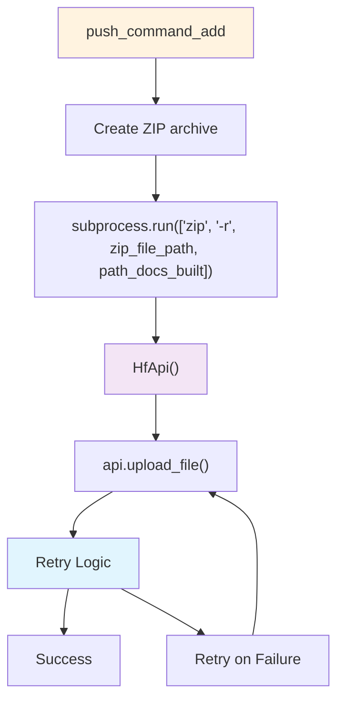
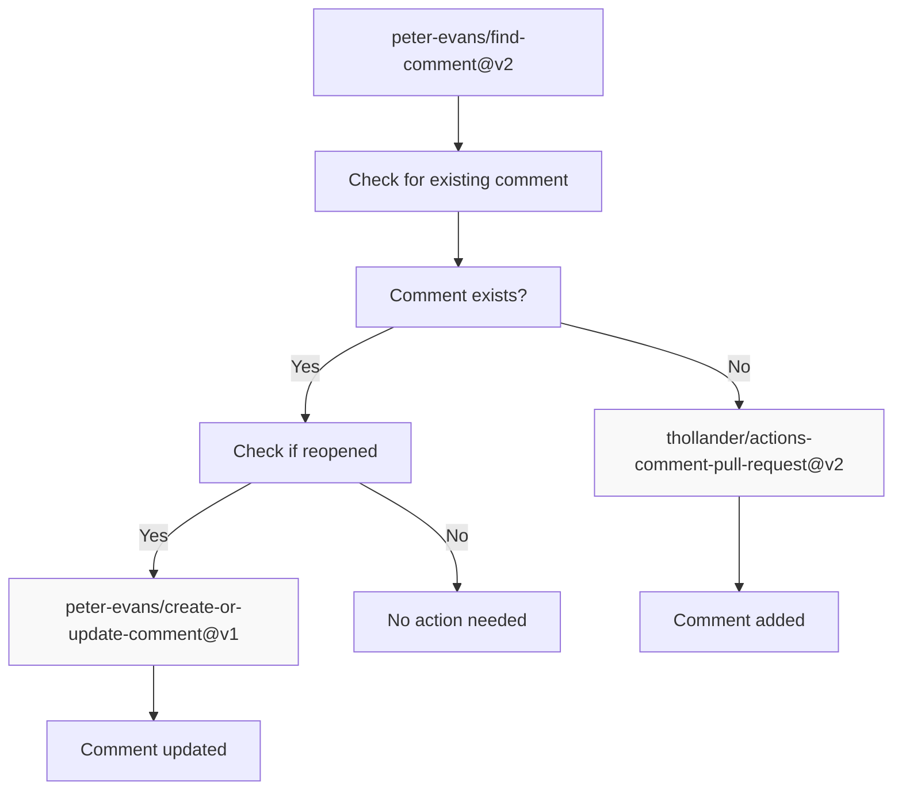

<!-- source: DeepWiki mcp.deepwiki.com · repo huggingface/doc-builder · page 3.1 Pull Request Documentation Workflow · fetched 2026-10-26 -->

# Pull Request Documentation Workflow

<details>
<summary>Relevant source files</summary>

The following files were used as context for generating this wiki page:

- [.github/workflows/accelerate_doc.yml](.github/workflows/accelerate_doc.yml)
- [.github/workflows/build_main_documentation.yml](.github/workflows/build_main_documentation.yml)
- [.github/workflows/build_pr_documentation.yml](.github/workflows/build_pr_documentation.yml)
- [.github/workflows/lint-svelte-kit.yml](.github/workflows/lint-svelte-kit.yml)
- [.github/workflows/quality.yml](.github/workflows/quality.yml)
- [.github/workflows/test.yml](.github/workflows/test.yml)
- [.github/workflows/upload_pr_documentation.yml](.github/workflows/upload_pr_documentation.yml)
- [src/doc_builder/commands/doc_builder_cli.py](src/doc_builder/commands/doc_builder_cli.py)
- [src/doc_builder/commands/notebook_to_mdx.py](src/doc_builder/commands/notebook_to_mdx.py)
- [src/doc_builder/commands/push.py](src/doc_builder/commands/push.py)

</details>


This document describes the automated system that builds, uploads, and provides preview access to documentation changes in pull requests. The workflow ensures that documentation changes can be reviewed in a live environment before being merged to the main branch.

For information about main branch documentation deployment, see [GitHub Actions Integration](#3). For details about the CLI commands used in these workflows, see [Command Line Interface](#4).

## Overview

The Pull Request Documentation Workflow is a two-stage GitHub Actions system that processes documentation changes in pull requests and makes them available for review through temporary preview URLs. The workflow handles multiple input formats, converts them to the appropriate output format, and deploys the results to a staging environment accessible via Hugging Face Hub.

## Workflow Architecture

The PR documentation system consists of two main GitHub Actions workflows that work in sequence:

### PR Documentation Build and Upload Flow



Sources: [.github/workflows/build_pr_documentation.yml:1-224](), [.github/workflows/upload_pr_documentation.yml:1-122]()

### Key Components and Code Integration



Sources: [src/doc_builder/commands/push.py:37-48](), [src/doc_builder/commands/notebook_to_mdx.py:86-106]()

## Build Phase Implementation

The `build_pr_documentation.yml` workflow handles the initial processing of documentation changes. It runs when a pull request is created or updated and processes all documentation source files.

### Environment Setup and Dependencies

The workflow supports both containerized and direct runner execution:

| Configuration | Purpose | Implementation |
|---|---|---|
| `custom_container` | Docker environment for complex builds | [.github/workflows/build_pr_documentation.yml:65-66]() |
| `ROOT_APT_GET` | Package manager selection | [.github/workflows/build_pr_documentation.yml:87-96]() |
| `PIP_OR_UV` | Python package installer selection | [.github/workflows/build_pr_documentation.yml:98-108]() |

### Multi-Repository Checkout Process

The workflow checks out multiple repositories as needed:



Sources: [.github/workflows/build_pr_documentation.yml:71-81]()

### Notebook Conversion Integration  

When `convert_notebooks` is enabled, the workflow uses the `notebook-to-mdx` command:



The conversion process includes:
- PNG to JPEG conversion via `png_to_jpeg()` function
- Code formatting through `format_code_example()` 
- Colab link integration when `open_notebook_prefix` is provided

Sources: [.github/workflows/build_pr_documentation.yml:180-190](), [src/doc_builder/commands/notebook_to_mdx.py:28-36](), [src/doc_builder/commands/notebook_to_mdx.py:98-102]()

### Documentation Build Process

The core build process executes the `doc-builder build` command with PR-specific parameters:

```bash
doc-builder build ${package_name} ../${doc_folder} --build_dir ../build_dir --clean --version pr_${pr_number} --html ${additional_args} --repo_owner ${repo_owner} --repo_name ${package} --version_tag_suffix=${version_tag_suffix}
```

Key parameters:
- `--version pr_${pr_number}`: Creates PR-specific versioning
- `--build_dir ../build_dir`: Output directory for built documentation
- `--clean`: Removes existing build artifacts
- `--html`: Generates HTML output format

Sources: [.github/workflows/build_pr_documentation.yml:191-214]()

### Artifact Storage

The workflow saves build outputs and metadata for the upload phase:



Sources: [.github/workflows/build_pr_documentation.yml:215-224]()

## Upload Phase Implementation

The `upload_pr_documentation.yml` workflow handles artifact retrieval, processing, and deployment to the preview environment.

### Artifact Retrieval and Validation

The workflow downloads and validates the build artifacts:



The validation process uses regex patterns to ensure data integrity:
- `commit_sha`: Must match `^[0-9a-zA-Z]{40}$`
- `pr_number`: Must match `^[0-9]+$`

Sources: [.github/workflows/upload_pr_documentation.yml:48-78]()

### Hub Upload Process

The upload uses the `push_command` from the doc-builder CLI:

```bash
doc-builder push ${package_name} --doc_build_repo_id "hf-doc-build/doc-build-dev" --token "${hf_token}" --commit_msg "Updated with commit ${commit_sha}"
```

### Push Command Implementation

The `push_command_add` function handles the actual upload process:



Key implementation details:
- Uses `subprocess.run` instead of `shutil.make_archive` to avoid corrupted files
- Implements retry logic with configurable `n_retries` parameter
- Uploads to `hf-doc-build/doc-build-dev` repository for staging

Sources: [src/doc_builder/commands/push.py:50-110]()

### Preview URL Generation

The workflow generates preview URLs based on configuration:

| Parameter | Default | Result URL Pattern |
|---|---|---|
| `hub_base_path` | Not provided | `https://moon-ci-docs.huggingface.co/docs/${package_name}/pr_${pr_number}` |
| `hub_base_path` | Custom value | `${hub_base_path}/${package_name}/pr_${pr_number}` |

Sources: [.github/workflows/upload_pr_documentation.yml:81-89]()

### PR Comment Management

The workflow manages PR comments to provide preview links:



The comment template includes:
- Direct link to preview documentation
- Information about 30-day retention policy
- Automatic updates when PR is reopened

Sources: [.github/workflows/upload_pr_documentation.yml:97-122]()

## Integration Points

### CLI Command Integration

The workflow integrates with several doc-builder CLI commands:

| Command | Usage | Purpose |
|---|---|---|
| `doc-builder build` | Main documentation generation | [.github/workflows/build_pr_documentation.yml:204]() |
| `doc-builder notebook-to-mdx` | Notebook conversion | [.github/workflows/build_pr_documentation.yml:189]() |
| `doc-builder push` | Hub upload | [.github/workflows/upload_pr_documentation.yml:95]() |

### Hub Storage Architecture

Documentation artifacts are stored in a hierarchical structure:

```
hf-doc-build/doc-build-dev/
├── ${package_name}/
│   └── pr_${pr_number}.zip
└── _versions.yml
```

The ZIP files contain the complete documentation build with PR-specific versioning.

Sources: [src/doc_builder/commands/push.py:30-34](), [src/doc_builder/commands/push.py:66-70]()

### Error Handling and Retry Logic

The system implements robust error handling:

- **Upload retries**: Configurable retry count with exponential backoff
- **Validation checks**: Strict validation of commit SHA and PR numbers  
- **Artifact verification**: File existence and format validation
- **Hub authentication**: Token-based authentication with error reporting

Sources: [src/doc_builder/commands/push.py:76-106](), [.github/workflows/upload_pr_documentation.yml:62-78]()

---

