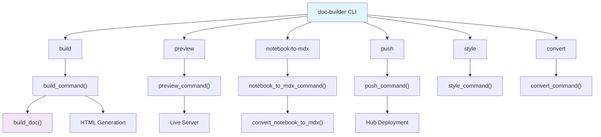
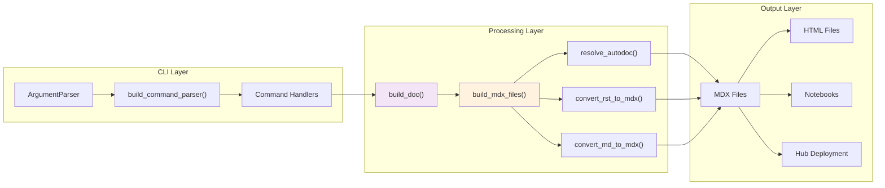
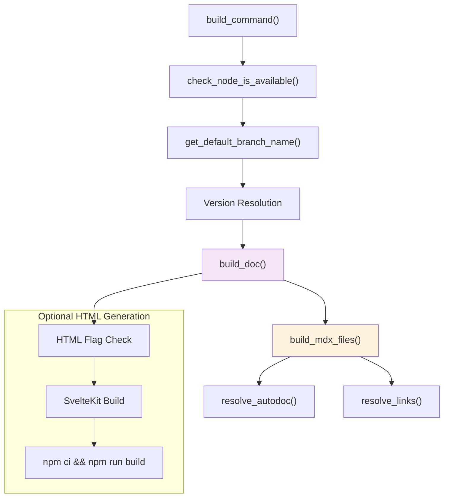
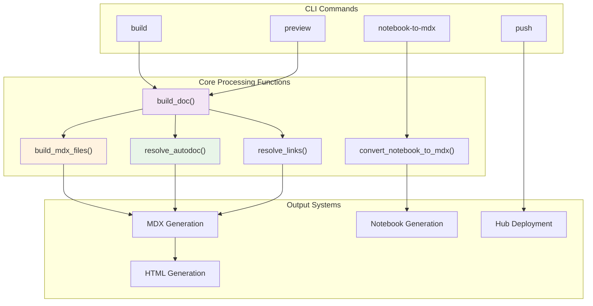

<!-- source: DeepWiki mcp.deepwiki.com · repo huggingface/doc-builder · page 4 Command Line Interface · fetched 2026-10-26 -->

# Command Line Interface

<details>
<summary>Relevant source files</summary>

The following files were used as context for generating this wiki page:

- [README.md](README.md)
- [src/doc_builder/build_doc.py](src/doc_builder/build_doc.py)
- [src/doc_builder/commands/build.py](src/doc_builder/commands/build.py)
- [tests/test_build_doc.py](tests/test_build_doc.py)

</details>


This document covers the complete command-line interface (CLI) for doc-builder, which serves as the primary entry point for all documentation building, conversion, and deployment operations. The CLI provides commands for building documentation, previewing changes, converting between formats, and deploying to various platforms.

For information about the underlying build processes that the CLI orchestrates, see [Core Processing Systems](#2). For details about GitHub Actions integration that uses these CLI commands, see [GitHub Actions Integration](#3).

## CLI Architecture Overview

The doc-builder CLI is implemented as a main command with multiple subcommands, each handling specific aspects of the documentation workflow:



**Sources:** [src/doc_builder/commands/build.py:1-237](), [README.md:55-111]()

## Command Execution Flow

This diagram shows how CLI commands flow through the system and interact with core processing functions:



**Sources:** [src/doc_builder/commands/build.py:58-185](), [src/doc_builder/build_doc.py:309-388]()

## Build Command

The `build` command is the primary command for generating documentation from source files. It orchestrates the entire documentation build pipeline.

### Basic Usage

```bash
doc-builder build {library_name} {path_to_docs} --build_dir {build_dir}
```

### Command Arguments

| Argument | Type | Required | Default | Description |
|----------|------|----------|---------|-------------|
| `library_name` | str | Yes | - | Name of the library being documented |
| `path_to_docs` | str | Yes | - | Local path to documentation source files |
| `--build_dir` | str | No | `./build/` | Output directory for built documentation |
| `--clean` | flag | No | False | Clean output directory before building |
| `--language` | str | No | `en` | Documentation language |
| `--version` | str | No | auto-detect | Version tag for the documentation |
| `--notebook_dir` | str | No | None | Directory for generated notebooks |
| `--html` | flag | No | False | Generate HTML files instead of MDX |
| `--not_python_module` | flag | No | False | For non-Python projects (e.g., courses) |
| `--version_tag_suffix` | str | No | `src/` | Suffix for GitHub links |
| `--repo_owner` | str | No | `huggingface` | GitHub repository owner |
| `--repo_name` | str | No | {library_name} | GitHub repository name |

### Build Process Flow



**Sources:** [src/doc_builder/commands/build.py:58-185](), [src/doc_builder/build_doc.py:309-388]()

## Preview Command

The `preview` command provides live preview functionality for documentation development, enabling real-time viewing of changes as they're made.

### Usage

```bash
doc-builder preview {package_name} {path_to_docs}
```

### Limitations and Requirements

- Only works with existing documentation files
- Requires restarting when new files are added to `_toctree.yml`
- Does not work on Windows systems
- Requires Node.js for HTML rendering

**Sources:** [README.md:55-70]()

## Notebook Conversion Command

The `notebook-to-mdx` command converts Jupyter notebooks to MDX format for inclusion in documentation.

### Usage

```bash
doc-builder notebook-to-mdx {path_to_notebook_or_folder}
```

### Functionality

- Converts individual `.ipynb` files or entire directories
- Preserves code cells, markdown cells, and outputs
- Integrates with the broader documentation build process
- Supports automated conversion in CI/CD workflows

**Sources:** [README.md:107-110]()

## Command Integration with Build Pipeline

This diagram shows how CLI commands integrate with the core build pipeline and processing systems:



**Sources:** [src/doc_builder/build_doc.py:159-251](), [src/doc_builder/commands/build.py:102-115]()

## HTML Generation Process

When the `--html` flag is used with the build command, the system generates static HTML files using SvelteKit:

### HTML Build Steps

1. **Node.js Validation**: Checks for Node.js v14+ availability via `check_node_is_available()`
2. **Kit Folder Location**: Locates the SvelteKit components using `locate_kit_folder()`
3. **Temporary Directory Setup**: Creates isolated build environment
4. **File Preparation**: Copies MDX files and applies SvelteKit routing with `sveltify_file_route()`
5. **Dependency Installation**: Runs `npm ci` to install packages
6. **Build Execution**: Runs `npm run build` with environment variables
7. **Output Collection**: Copies generated HTML files back to build directory

### Environment Variables

| Variable | Source | Purpose |
|----------|--------|---------|
| `DOCS_LIBRARY` | `args.library_name` | Library identifier for build |
| `DOCS_VERSION` | Computed version | Version string for assets |
| `DOCS_LANGUAGE` | `args.language` | Language for localization |

**Sources:** [src/doc_builder/commands/build.py:123-185]()

## Error Handling and Validation

The CLI implements several validation mechanisms:

### Pre-build Validation

- **Node.js Version Check**: Ensures Node.js v14+ for HTML builds
- **Kit Folder Validation**: Verifies SvelteKit components are available
- **Module Import Check**: Validates Python modules can be imported
- **Path Validation**: Confirms documentation paths exist

### Build-time Validation

- **TOC Integrity**: Validates all files are present in `_toctree.yml` via `check_toc_integrity()`
- **Link Resolution**: Ensures internal links resolve correctly
- **Autodoc Validation**: Verifies Python objects can be documented

**Sources:** [src/doc_builder/commands/build.py:35-56](), [src/doc_builder/build_doc.py:436-491]()

---

