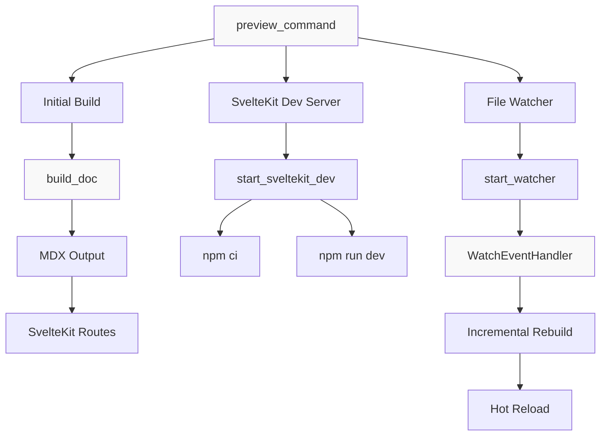
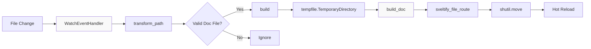
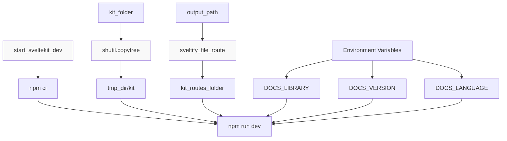
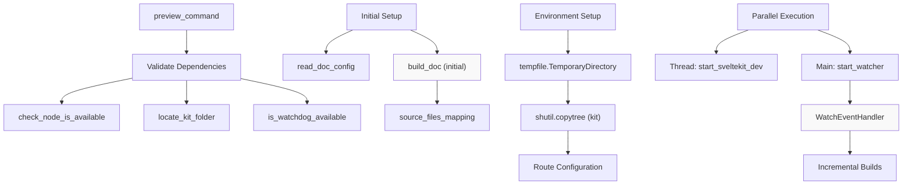
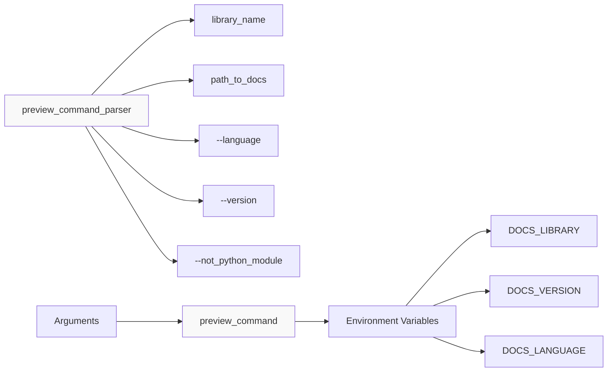

<!-- source: DeepWiki mcp.deepwiki.com · repo huggingface/doc-builder · page 4.1 Preview and Development Commands · fetched 2026-10-26 -->

# Preview and Development Commands

Relevant source files

The following files were used as context for generating this wiki page:

- [src/doc_builder/commands/preview.py](src/doc_builder/commands/preview.py)

This page documents the live preview functionality and development workflow tools provided by the doc-builder CLI. The preview system enables developers to see documentation changes in real-time during development by combining file watching, incremental rebuilds, and a SvelteKit development server.

For information about content conversion commands like `notebook-to-mdx` and format conversion utilities, see [Content Conversion Commands](#4.2). For details about the underlying build system that powers the preview functionality, see [Document Conversion System](#2.1).

## Preview Command Overview

The `preview` command provides a live development environment for documentation authors. It performs an initial build of all documentation files, starts a SvelteKit development server for real-time preview, and watches the source files for changes to trigger incremental rebuilds.

**Preview Command Architecture**

The preview command requires the `watchdog` Python package for file system monitoring and Node.js for running the SvelteKit development server. It creates temporary directories to isolate the development environment and manages the entire preview lifecycle.

Sources: [src/doc_builder/commands/preview.py:154-184]()

## File System Monitoring

The file watching system uses the `WatchEventHandler` class to monitor source files and trigger rebuilds when changes are detected. The handler responds to both file creation and modification events, filtering for relevant documentation files.

| Event Type | Handled Files | Action |
|------------|---------------|--------|
| `on_created` | `.mdx`, `.md`, `.py` (autodoc) | Incremental rebuild |
| `on_modified` | `.mdx`, `.md`, `.py` (autodoc) | Incremental rebuild |

**File Change Processing Pipeline**

The `transform_path` method identifies valid documentation files by checking file extensions and mapping Python source files to their corresponding MDX outputs through the `source_files_mapping` dictionary created during initial build.

Sources: [src/doc_builder/commands/preview.py:37-110]()

## SvelteKit Development Integration

The preview system integrates with SvelteKit's development server to provide hot reloading and real-time preview capabilities. It manages the entire SvelteKit setup process including dependency installation and route configuration.

**SvelteKit Integration Architecture**

The system creates a temporary copy of the SvelteKit application, installs dependencies, and configures environment variables to match the documentation being previewed. The `sveltify_file_route` function ensures MDX files are placed in the correct SvelteKit route structure.

Sources: [src/doc_builder/commands/preview.py:128-152](), [src/doc_builder/commands/preview.py:186-219]()

## Development Workflow Process

The complete development workflow orchestrates multiple components to provide a seamless preview experience. The process begins with validation, performs initial setup, and maintains continuous monitoring.

**Complete Preview Workflow**

The workflow validates all required dependencies at startup, creates isolated temporary directories for the preview environment, and runs the SvelteKit development server and file watcher in parallel threads to provide real-time updates.

Sources: [src/doc_builder/commands/preview.py:154-224]()

## Command Line Interface

The preview command accepts several arguments to configure the documentation being previewed and the preview environment settings.

| Argument | Type | Required | Default | Description |
|----------|------|----------|---------|-------------|
| `library_name` | string | Yes | - | Name of the library being documented |
| `path_to_docs` | string | Yes | - | Local path to documentation source files |
| `--language` | string | No | `"en"` | Documentation language |
| `--version` | string | No | `"main"` | Documentation version |
| `--not_python_module` | flag | No | `False` | Disable Python module processing |

**Command Line Argument Processing**

The argument parser creates a subcommand under the main doc-builder CLI and configures environment variables that are passed to the SvelteKit development server for proper documentation context.

Sources: [src/doc_builder/commands/preview.py:226-249]()

---

