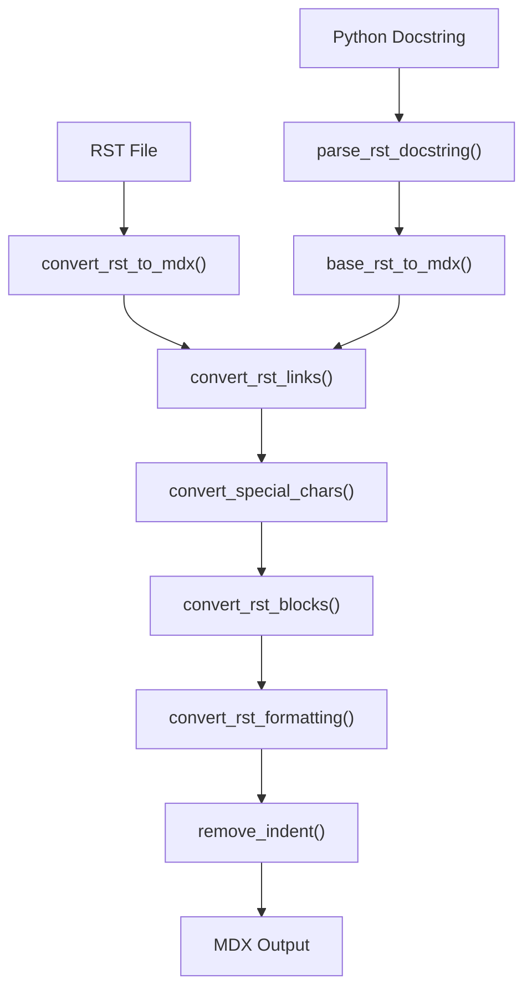
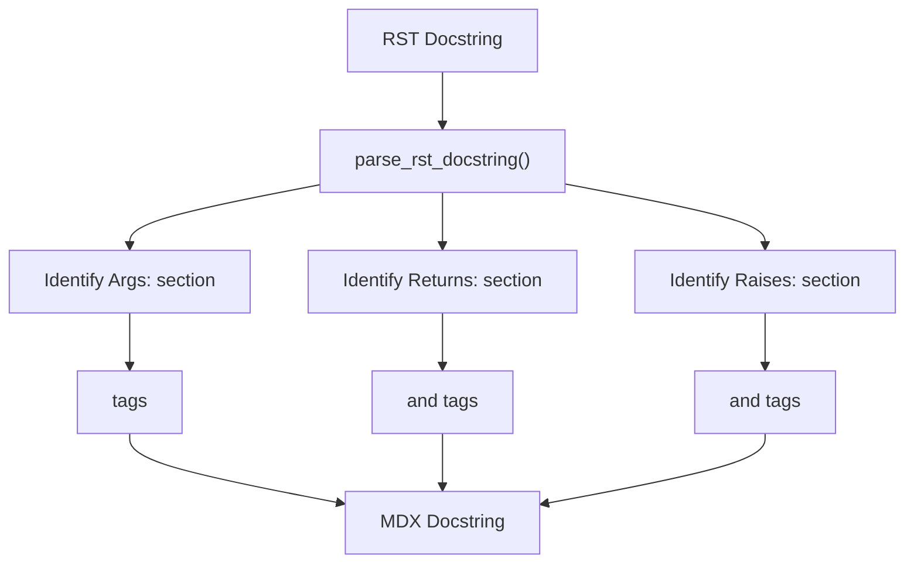
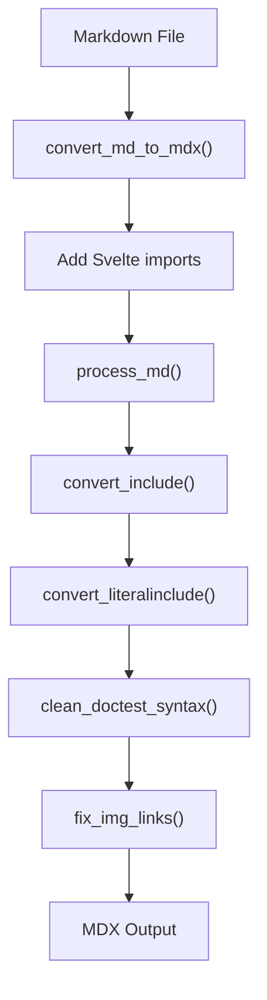
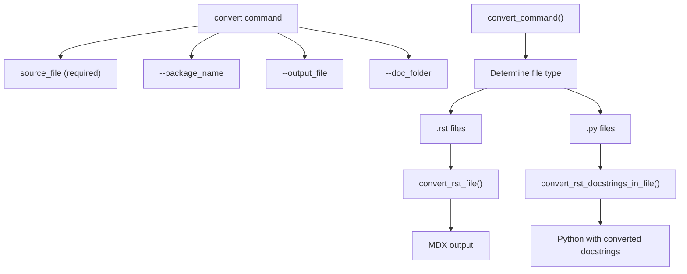
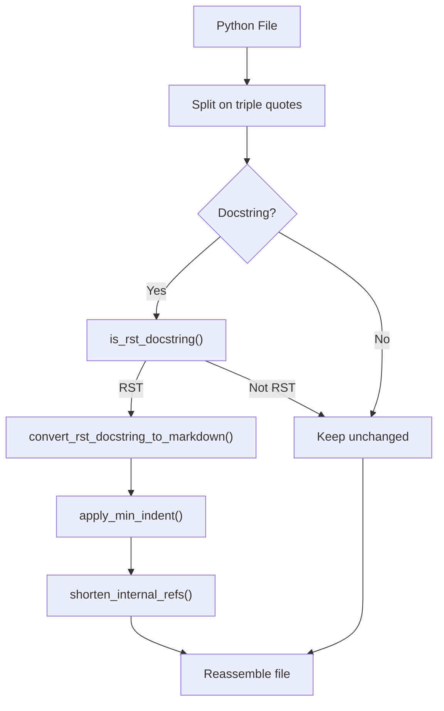
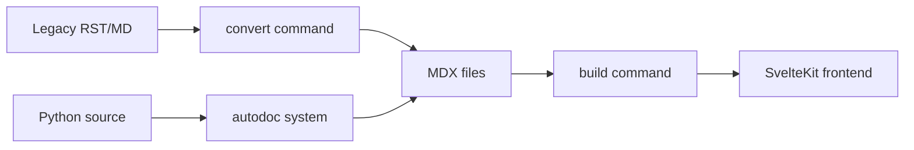

<!-- source: DeepWiki mcp.deepwiki.com · repo huggingface/doc-builder · page 4.2 Content Conversion Commands · fetched 2026-10-26 -->

# Content Conversion Commands

<details>
<summary>Relevant source files</summary>

The following files were used as context for generating this wiki page:

- [Makefile](Makefile)
- [src/doc_builder/commands/convert_doc_file.py](src/doc_builder/commands/convert_doc_file.py)
- [src/doc_builder/convert_md_to_mdx.py](src/doc_builder/convert_md_to_mdx.py)
- [src/doc_builder/convert_rst_to_mdx.py](src/doc_builder/convert_rst_to_mdx.py)
- [tests/test_convert_doc_file.py](tests/test_convert_doc_file.py)
- [tests/test_convert_md_to_mdx.py](tests/test_convert_md_to_mdx.py)
- [tests/test_convert_rst_to_mdx.py](tests/test_convert_rst_to_mdx.py)

</details>


This document covers the command-line interface for converting documentation files between different formats within the doc-builder system. The conversion commands handle transforming RST (reStructuredText) files, Markdown files, and Python docstrings into the MDX format used by the doc-builder frontend.

For information about the broader build system that orchestrates these conversions, see [Build Process and Deployment](#6.1). For details about the underlying conversion algorithms, see [Document Conversion System](#2.1).

## Overview

The doc-builder provides a `convert` command that can transform documentation files between formats. The primary purpose is to convert legacy RST documentation and Python docstrings into the MDX format required by the SvelteKit frontend.

```bash
doc-builder convert [source_file] [options]
```

The conversion system supports three main transformation paths:
- RST files (`.rst`) → MDX files (`.mdx`)
- Markdown files (`.md`) → MDX files (`.mdx`) 
- Python files (`.py`) → Python files with converted docstrings

## RST to MDX Conversion

### Conversion Process Flow



The RST conversion pipeline handles multiple aspects of reStructuredText syntax:

| RST Element | Conversion Target | Handler Function |
|-------------|------------------|------------------|
| `:obj:`content`` | `content` | `convert_rst_formatting()` |
| `:class:`MyClass`` | `[MyClass]` | `convert_rst_formatting()` |
| `:doc:`page`` | `[page](/docs/package/version/page)` | `convert_rst_links()` |
| `.. note::` | `<Tip>content</Tip>` | `convert_rst_blocks()` |
| `.. code-block::` | ```` code blocks | `convert_rst_blocks()` |
| `Example::` | `<example>` blocks | `convert_rst_blocks()` |

Sources: [src/doc_builder/convert_rst_to_mdx.py:32-71](), [src/doc_builder/convert_rst_to_mdx.py:88-127](), [src/doc_builder/convert_rst_to_mdx.py:216-323]()

### Docstring Parameter Parsing

The RST converter includes specialized handling for Python docstrings with parameter sections:



The parameter parsing converts RST docstring sections into structured MDX tags that the frontend can render with special styling.

Sources: [src/doc_builder/convert_rst_to_mdx.py:378-471]()

## Markdown to MDX Conversion

### MD Processing Pipeline



The Markdown conversion focuses on:
- Adding required Svelte component imports
- Processing include directives for embedding external content
- Cleaning up doctest artifacts
- Converting image paths to doc-builder URL structure

### Include Directive Processing

The system supports two types of content inclusion:

| Directive | Purpose | Output |
|-----------|---------|--------|
| `<include>` | Embed markdown content | Raw markdown text |
| `<literalinclude>` | Embed code examples | Markdown code blocks |

Both directives support JSON configuration for specifying file paths, start/end markers, and dedentation levels.

Sources: [src/doc_builder/convert_md_to_mdx.py:27-83](), [src/doc_builder/convert_md_to_mdx.py:204-217]()

## Command-Line Interface

### Convert Command Structure

The `convert` command is implemented through the `convert_command_parser()` function which creates an argument parser with the following options:



### Automatic Parameter Detection

The command includes intelligent defaults:

- **package_name**: Defaults to the root git repository name
- **output_file**: Defaults to source file with `.mdx` extension for RST files
- **doc_folder**: Defaults to `docs/source` relative to git root

Sources: [src/doc_builder/commands/convert_doc_file.py:111-156](), [src/doc_builder/commands/convert_doc_file.py:158-189]()

## Python Docstring Conversion

### In-Place Docstring Processing

For Python files, the converter processes docstrings without changing the overall file structure:



The system preserves original indentation and only converts docstrings that are detected as RST format.

### Internal Reference Shortening

The converter includes logic to shorten internal references:
- `[~transformers.Trainer]` becomes `[Trainer]`
- `[~transformers.PreTrainedModel.generate]` becomes `[~PreTrainedModel.generate]`

Sources: [src/doc_builder/commands/convert_doc_file.py:95-109](), [src/doc_builder/commands/convert_doc_file.py:52-64]()

## Integration with Build System

The conversion commands integrate with the broader doc-builder workflow:



The convert command serves as a migration tool for existing documentation, while the main build process handles automated conversion during documentation generation.

Sources: [src/doc_builder/commands/convert_doc_file.py:67-79](), [tests/test_convert_rst_to_mdx.py:347-437](), [tests/test_convert_md_to_mdx.py:124-133]()

---

