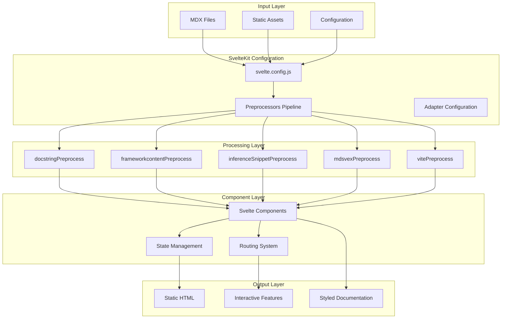
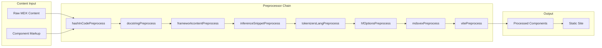
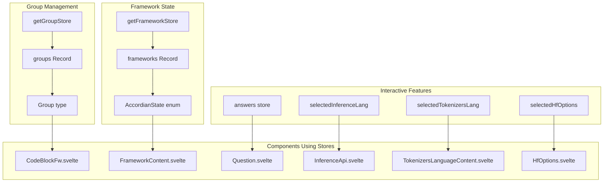
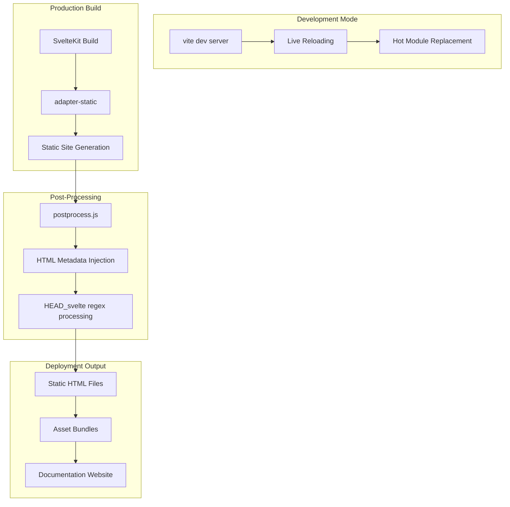
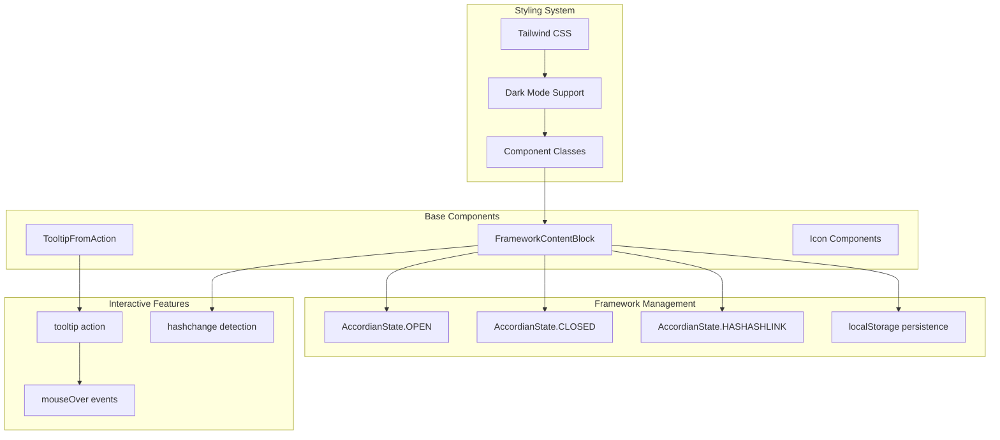

<!-- source: DeepWiki mcp.deepwiki.com · repo huggingface/doc-builder · page 5 Frontend System Architecture · fetched 2026-10-26 -->

# Frontend System Architecture

Relevant source files

The following files were used as context for generating this wiki page:

- [kit/.eslintrc.cjs](kit/.eslintrc.cjs)
- [kit/.prettierrc](kit/.prettierrc)
- [kit/postcss.config.cjs](kit/postcss.config.cjs)
- [kit/postprocess.js](kit/postprocess.js)
- [kit/src/app.css](kit/src/app.css)
- [kit/src/app.html](kit/src/app.html)
- [kit/src/lib/FrameworkContentBlock.svelte](kit/src/lib/FrameworkContentBlock.svelte)
- [kit/src/lib/pipeline.ts](kit/src/lib/pipeline.ts)
- [kit/src/lib/stores.ts](kit/src/lib/stores.ts)
- [kit/src/lib/tooltip.ts](kit/src/lib/tooltip.ts)
- [kit/src/lib/types.ts](kit/src/lib/types.ts)
- [kit/svelte.config.js](kit/svelte.config.js)
- [kit/vite.config.ts](kit/vite.config.ts)

This document covers the SvelteKit-based frontend system that transforms processed MDX content into interactive documentation websites. The frontend receives MDX files and static assets from the core processing systems and renders them as a fully-featured documentation experience with interactive components, syntax highlighting, and framework-specific content switching.

For information about the content preprocessing pipeline that prepares content for the frontend, see [Content Preprocessing Pipeline](#5.3). For details about specific UI components and interactive features, see [Core UI Components](#5.1) and [Interactive Documentation Features](#5.2).

## System Overview

The frontend system is a SvelteKit application that serves as the presentation layer for doc-builder. It receives processed MDX content from the build system and transforms it into interactive documentation websites with advanced features like framework switching, inference snippets, and educational components.

### Frontend Architecture Flow

Sources: [kit/svelte.config.js:1-64](), [kit/src/lib/stores.ts:1-36]()

## SvelteKit Configuration System

The frontend system is configured through `svelte.config.js`, which defines the preprocessor pipeline, adapter settings, and build behavior. The configuration orchestrates multiple preprocessors that transform content before it reaches Svelte components.

### Preprocessor Pipeline Architecture

The preprocessor pipeline processes content in a specific order defined in [kit/svelte.config.js:18-27]():

| Preprocessor | Purpose |
|--------------|---------|
| `hashInCodePreprocess` | Processes hash symbols in code blocks |
| `docstringPreprocess` | Transforms Python docstring markup |
| `frameworkcontentPreprocess` | Handles framework-specific content blocks |
| `inferenceSnippetPreprocess` | Processes inference API code snippets |
| `tokenizersLangPreprocess` | Handles tokenizer language switching |
| `hfOptionsPreprocess` | Processes Hugging Face option components |
| `mdsvexPreprocess` | Converts MDX to Svelte components |
| `vitePreprocess` | Final Vite transformations |

Sources: [kit/svelte.config.js:18-27](), [kit/preprocessors/index.js]()

## State Management Architecture

The frontend uses Svelte stores for state management across interactive components. The store system manages framework switching, language selection, quiz answers, and other interactive features.

### Store System Design

The state management system provides several key stores:

- **Group Stores**: Manage grouped content switching via `getGroupStore(key: string)`
- **Framework Stores**: Handle framework-specific content visibility with `AccordianState` enum
- **Language Selection**: Control inference snippet and tokenizer language preferences
- **Quiz System**: Track user answers and quiz state

Sources: [kit/src/lib/stores.ts:1-36](), [kit/src/lib/types.ts:1-19]()

## Build and Deployment Process

The frontend build process involves SvelteKit compilation, static site generation, and post-processing steps to prepare the final documentation website.

### Build Pipeline Flow

The build process includes several key phases:

1. **Development**: Uses Vite dev server with hot reloading and dynamic base paths
2. **Static Generation**: `adapter-static` converts SvelteKit app to static files with `crawl: false` for flexible routing
3. **Post-Processing**: `postprocess.js` script processes HTML files to inject metadata using regex pattern `REGEX_HF_METADATA`
4. **Path Resolution**: Dynamic base paths support multi-library, multi-version, multi-language documentation

Sources: [kit/svelte.config.js:29-50](), [kit/postprocess.js:1-39](), [kit/vite.config.ts:1-10]()

## Component Integration System

The frontend integrates various specialized components through a unified architecture that supports framework switching, interactive features, and educational content.

### Component Interaction Model

The component system provides:

- **Framework Switching**: `FrameworkContentBlock` component manages PyTorch/TensorFlow/JAX content visibility
- **Persistent State**: Framework preferences stored in `localStorage` with key pattern `hf_doc_framework_{framework}_is_hidden`
- **Hash Navigation**: Automatic content expansion when URL hash matches header IDs
- **Tooltip System**: Action-based tooltips using `tooltip(element, txt)` function
- **Responsive Design**: Tailwind CSS with comprehensive dark mode support

Sources: [kit/src/lib/FrameworkContentBlock.svelte:1-99](), [kit/src/lib/tooltip.ts:1-48](), [kit/src/app.css:1-409]()

## Configuration and Tooling

The frontend system includes comprehensive configuration for development tools, build optimization, and code quality.

### Development Environment Configuration

| Tool | Configuration File | Key Features |
|------|-------------------|--------------|
| Prettier | `.prettierrc` | Svelte formatting, Tailwind plugin, tab indentation |
| ESLint | `.eslintrc.cjs` | TypeScript + Svelte rules, strict type checking |
| PostCSS | `postcss.config.cjs` | Tailwind processing, CSS emptying for production |
| Vite | `vite.config.ts` | SvelteKit integration, sourcemap control |

The configuration system supports:

- **Code Quality**: Strict TypeScript rules with `no-explicit-any` and `no-unused-vars` enforcement
- **Build Optimization**: CSS removal during production builds to avoid conflicts with existing Hub styles
- **Development Experience**: Comprehensive formatting and linting with Svelte-specific rules

Sources: [kit/.prettierrc:1-8](), [kit/.eslintrc.cjs:1-44](), [kit/postcss.config.cjs:1-27](), [kit/vite.config.ts:1-10]()

---

