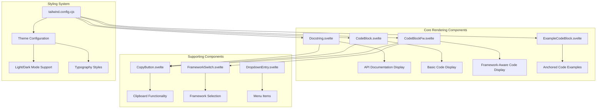
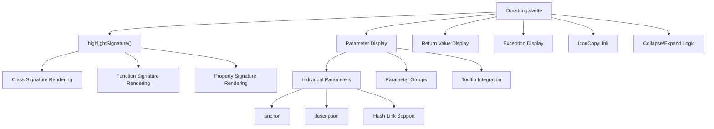
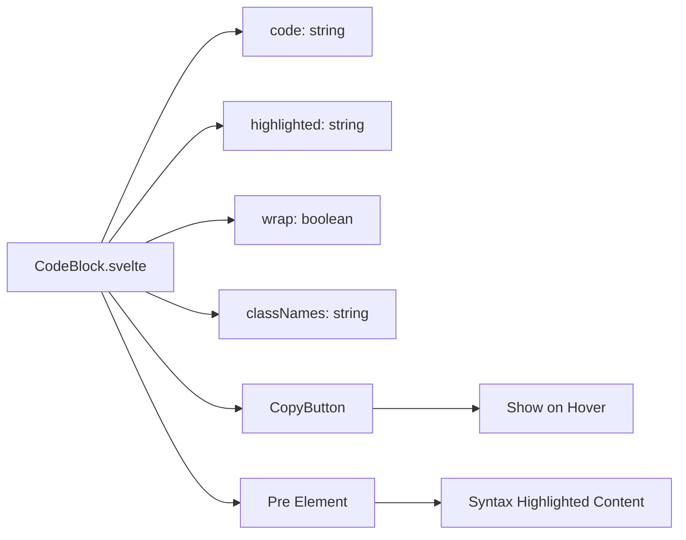
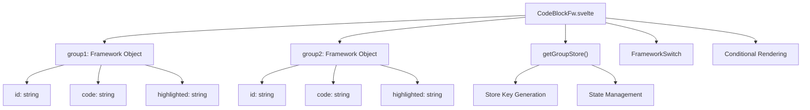
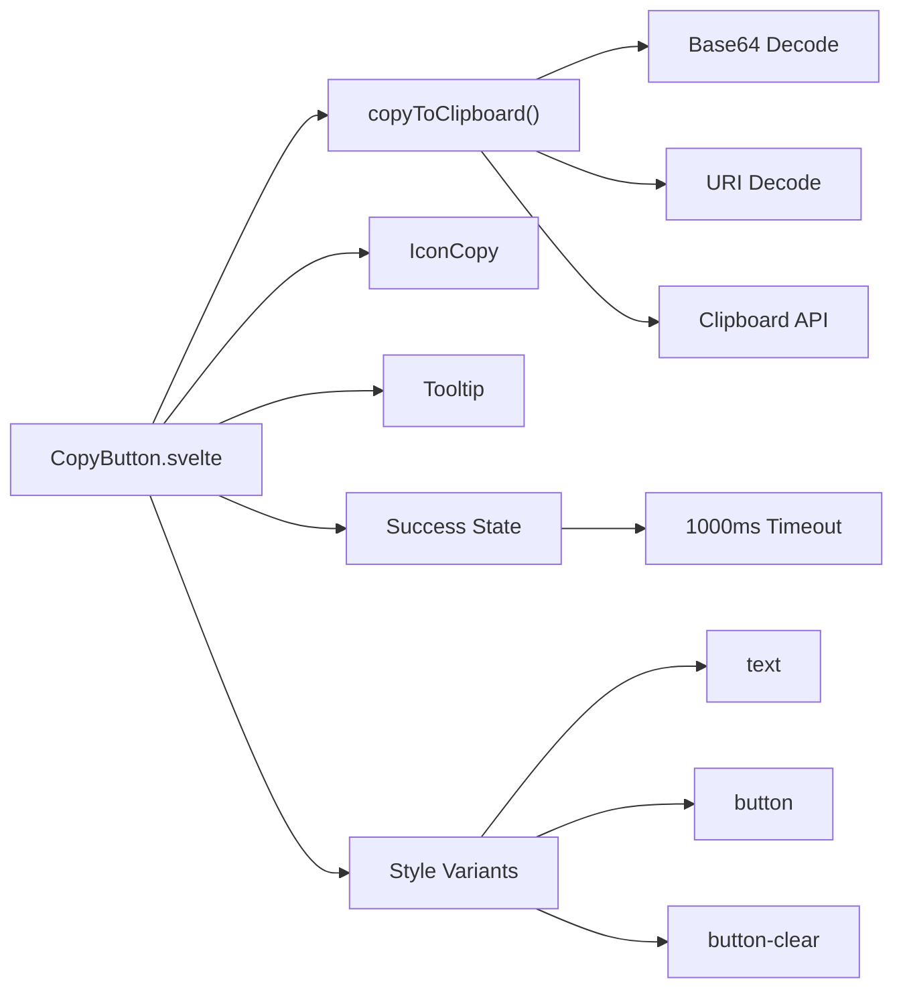
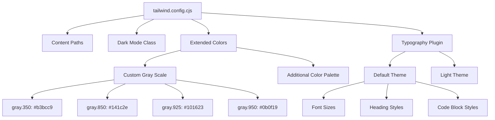

<!-- source: DeepWiki mcp.deepwiki.com · repo huggingface/doc-builder · page 5.1 Core UI Components · fetched 2026-10-26 -->

# Core UI Components

Relevant source files

The following files were used as context for generating this wiki page:

- [kit/src/lib/CodeBlock.svelte](kit/src/lib/CodeBlock.svelte)
- [kit/src/lib/CodeBlockFw.svelte](kit/src/lib/CodeBlockFw.svelte)
- [kit/src/lib/CopyButton.svelte](kit/src/lib/CopyButton.svelte)
- [kit/src/lib/Docstring.svelte](kit/src/lib/Docstring.svelte)
- [kit/src/lib/DropdownEntry.svelte](kit/src/lib/DropdownEntry.svelte)
- [kit/src/lib/ExampleCodeBlock.svelte](kit/src/lib/ExampleCodeBlock.svelte)
- [kit/src/lib/FrameworkSwitch.svelte](kit/src/lib/FrameworkSwitch.svelte)
- [kit/tailwind.config.cjs](kit/tailwind.config.cjs)
- [kit/tsconfig.json](kit/tsconfig.json)

This document covers the fundamental UI components that render documentation content in the doc-builder frontend system. These components handle the display of API documentation, code examples, and basic interactive elements that form the building blocks of the generated documentation sites.

For information about advanced interactive features like inference snippets and language selectors, see [Interactive Documentation Features](#5.2). For details on how content is preprocessed before reaching these components, see [Content Preprocessing Pipeline](#5.3).

## Component Architecture Overview

The core UI components form a layered architecture where basic rendering components are composed together to create documentation displays:

**Sources:** [kit/src/lib/Docstring.svelte:1-251](), [kit/src/lib/CodeBlock.svelte:1-33](), [kit/src/lib/CodeBlockFw.svelte:1-55](), [kit/src/lib/ExampleCodeBlock.svelte:1-40](), [kit/tailwind.config.cjs:1-165]()

## Docstring Component System

The `Docstring` component is the most complex core UI component, responsible for rendering Python API documentation extracted by the autodoc system. It handles function signatures, parameters, return values, and exceptions.

### Docstring Component Structure

**Sources:** [kit/src/lib/Docstring.svelte:60-74](), [kit/src/lib/Docstring.svelte:172-194](), [kit/src/lib/Docstring.svelte:195-219]()

### Key Docstring Properties

The `Docstring` component accepts these primary exports for rendering API documentation:

| Property | Type | Purpose |
|----------|------|---------|
| `anchor` | string | Unique identifier for hash linking |
| `name` | string | Function/class name to display |
| `parameters` | Array | Parameter names and default values |
| `parametersDescription` | Array | Detailed parameter documentation |
| `parameterGroups` | Array | Grouped parameter sections |
| `returnDescription` | string | Return value documentation |
| `returnType` | string | Return type annotation |
| `raiseDescription` | string | Exception documentation |
| `source` | string | Link to source code |
| `isGetSetDescriptor` | boolean | Whether this is a property |

**Sources:** [kit/src/lib/Docstring.svelte:12-27]()

### Signature Highlighting Logic

The `highlightSignature()` function [kit/src/lib/Docstring.svelte:60-74]() renders different signature types with distinct visual styling:

- **Class signatures**: Use indigo gradient background with cube icon
- **Property signatures**: Use green gradient background with property icon  
- **Function signatures**: Use blue gradient background with function icon

The function detects signature types by checking for `"class "` prefix or the `isGetSetDescriptor` flag.

**Sources:** [kit/src/lib/Docstring.svelte:60-74]()

## Code Block Components

The system provides three specialized code block components for different rendering scenarios:

### Basic Code Block

The `CodeBlock` component [kit/src/lib/CodeBlock.svelte:1-33]() provides fundamental code display with copy functionality:

**Sources:** [kit/src/lib/CodeBlock.svelte:4-7](), [kit/src/lib/CodeBlock.svelte:17-32]()

### Framework-Aware Code Block

The `CodeBlockFw` component [kit/src/lib/CodeBlockFw.svelte:1-55]() extends basic code blocks with framework switching capability:

**Sources:** [kit/src/lib/CodeBlockFw.svelte:6-12](), [kit/src/lib/CodeBlockFw.svelte:31-53]()

### Example Code Block

The `ExampleCodeBlock` component [kit/src/lib/ExampleCodeBlock.svelte:1-40]() wraps content with hash-linkable anchors and highlighting:

- Provides `anchor` property for URL fragment linking
- Implements hash change detection for scroll-to-element behavior
- Applies highlight styling when matching current URL hash

**Sources:** [kit/src/lib/ExampleCodeBlock.svelte:6](), [kit/src/lib/ExampleCodeBlock.svelte:11-25]()

## Supporting UI Elements

### Copy Button Component

The `CopyButton` component [kit/src/lib/CopyButton.svelte:1-51]() provides clipboard functionality across code blocks and documentation:

**Sources:** [kit/src/lib/CopyButton.svelte:23-31](), [kit/src/lib/CopyButton.svelte:10](), [kit/src/lib/CopyButton.svelte:35-50]()

### Framework Switch Component

The `FrameworkSwitch` component [kit/src/lib/FrameworkSwitch.svelte:1-66]() manages framework selection UI with predefined framework configurations:

| Framework ID | Name | Icon | Group |
|--------------|------|------|-------|
| `pt` | Pytorch | `IconPytorch` | group1 |
| `tf` | TensorFlow | `IconTensorflow` | group2 |
| `stringapi` | String API | None | group1 |
| `readinstruction` | ReadInstruction | None | group2 |

**Sources:** [kit/src/lib/FrameworkSwitch.svelte:11-38]()

## Styling and Theme System

The styling system is configured through Tailwind CSS with extensive customizations for documentation-specific needs.

### Theme Configuration Structure

**Sources:** [kit/tailwind.config.cjs:4-7](), [kit/tailwind.config.cjs:23-35](), [kit/tailwind.config.cjs:117-150]()

### Typography System

The typography configuration [kit/tailwind.config.cjs:55-150]() defines two main themes:

- **Default theme**: Light mode with gray-600 base text and custom heading sizes
- **Light theme**: Dark mode variant with adjusted color contrasts

The system uses Source Sans Pro for body text and IBM Plex Mono for code, with Charter for serif elements.

**Sources:** [kit/tailwind.config.cjs:47-50](), [kit/tailwind.config.cjs:117-150]()

### Responsive Design Features

The configuration includes custom screen breakpoints for hover interactions:

- `with-hover`: Targets devices that support hover states
- `no-hover`: Targets touch devices without hover capability

This enables progressive enhancement of interactive elements like copy buttons and tooltips.

**Sources:** [kit/tailwind.config.cjs:40-43]()

---

