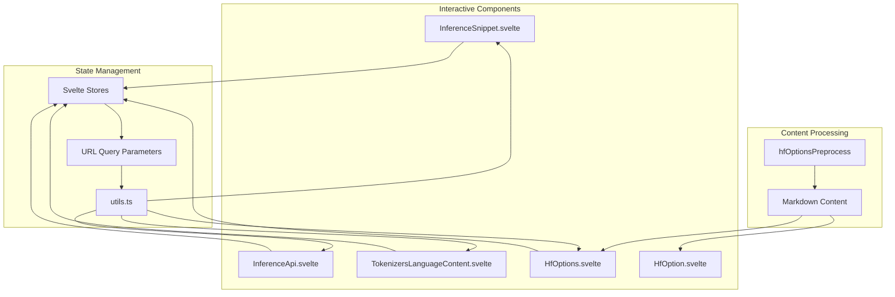
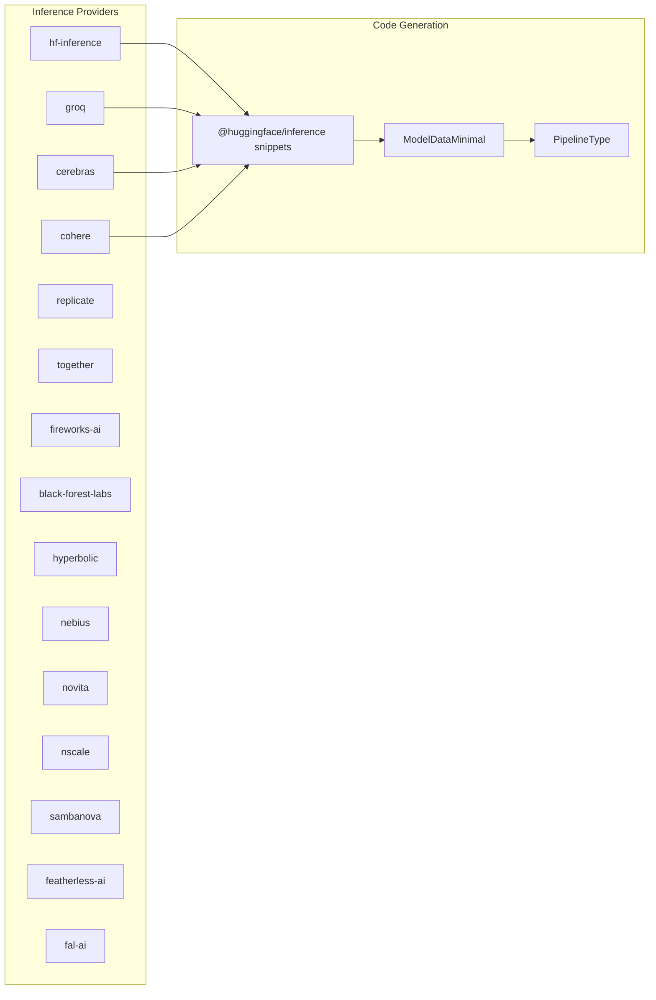
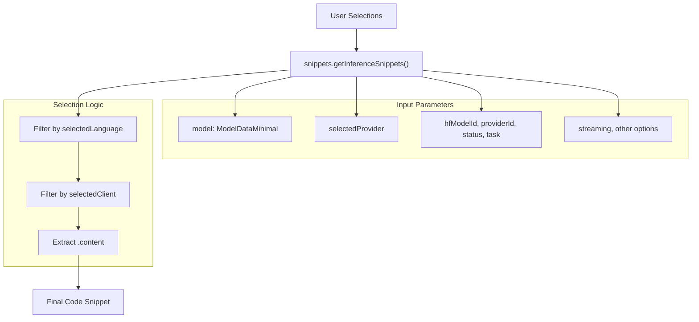
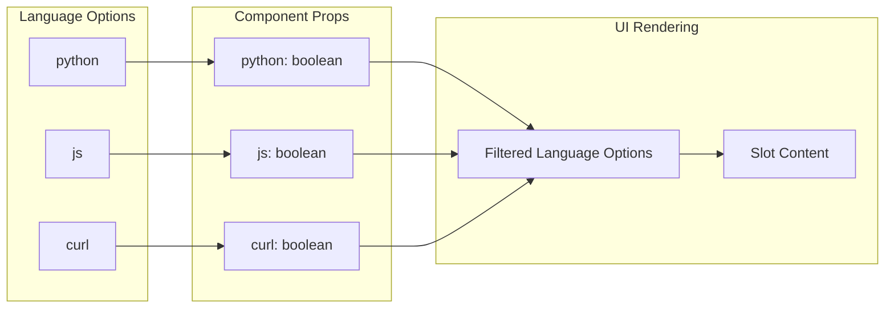
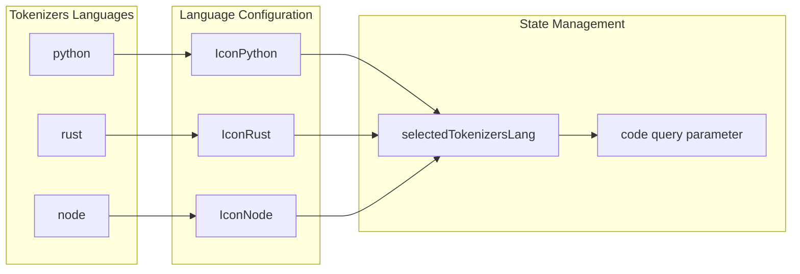
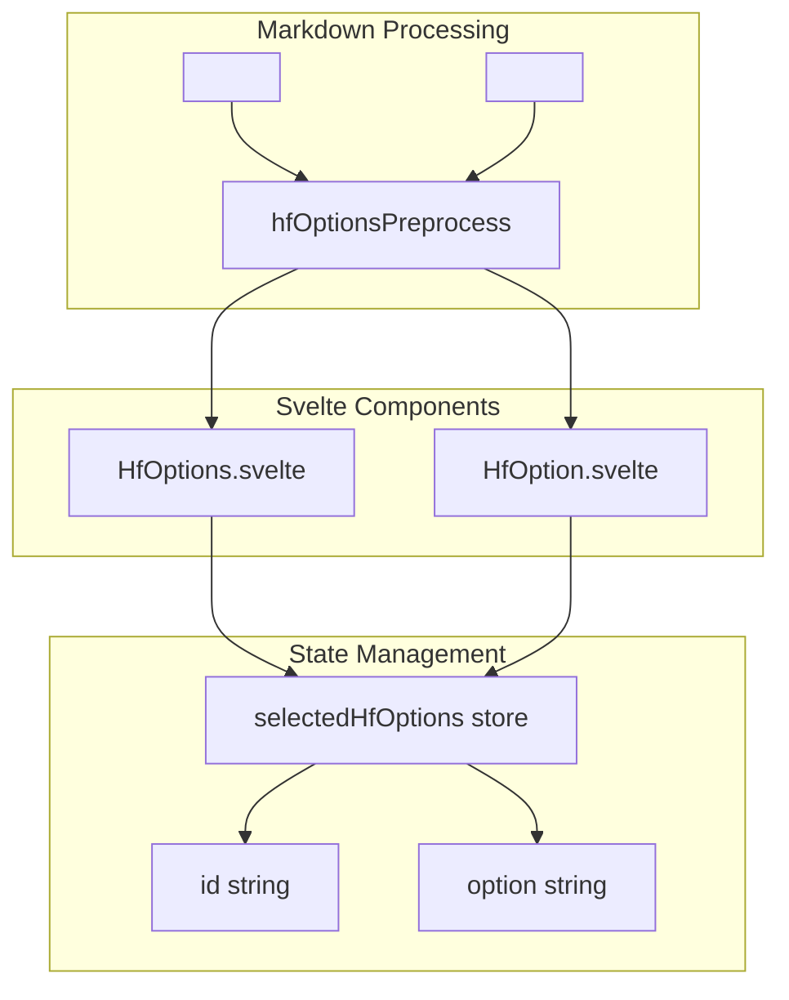
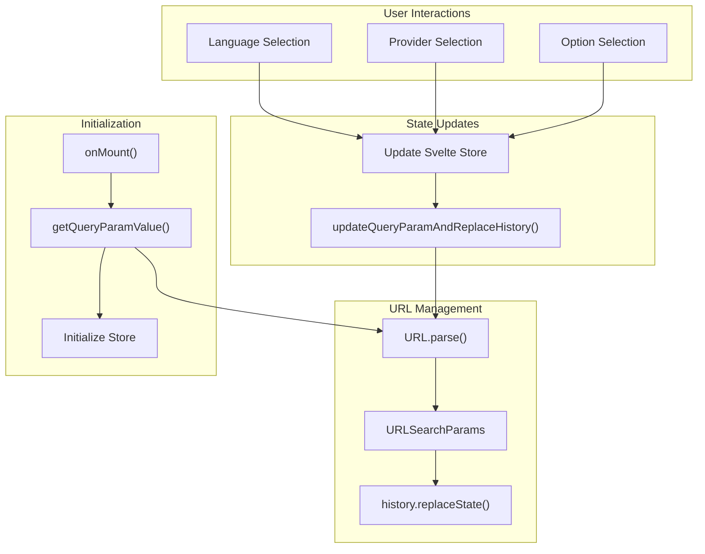
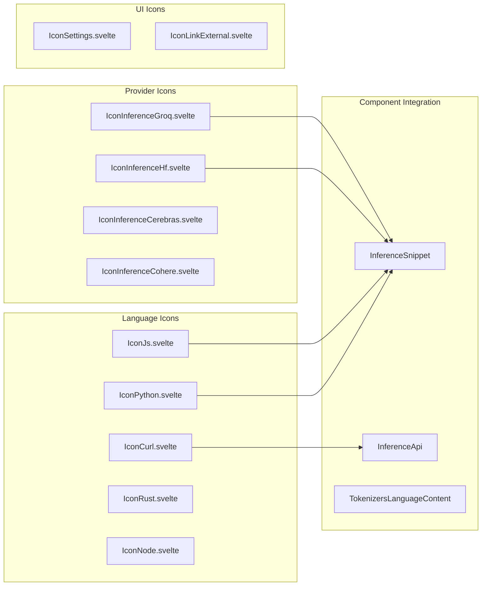

<!-- source: DeepWiki mcp.deepwiki.com · repo huggingface/doc-builder · page 5.2 Interactive Documentation Features · fetched 2026-10-26 -->

# Interactive Documentation Features

Relevant source files

The following files were used as context for generating this wiki page:

- [kit/package-lock.json](kit/package-lock.json)
- [kit/package.json](kit/package.json)
- [kit/preprocessors/hfOptions.js](kit/preprocessors/hfOptions.js)
- [kit/src/lib/HfOption.svelte](kit/src/lib/HfOption.svelte)
- [kit/src/lib/HfOptions.svelte](kit/src/lib/HfOptions.svelte)
- [kit/src/lib/InferenceApi.svelte](kit/src/lib/InferenceApi.svelte)
- [kit/src/lib/InferenceSnippet/IconInferenceFeatherless.svelte](kit/src/lib/InferenceSnippet/IconInferenceFeatherless.svelte)
- [kit/src/lib/InferenceSnippet/IconInferenceGroq.svelte](kit/src/lib/InferenceSnippet/IconInferenceGroq.svelte)
- [kit/src/lib/InferenceSnippet/IconInferenceNscale.svelte](kit/src/lib/InferenceSnippet/IconInferenceNscale.svelte)
- [kit/src/lib/InferenceSnippet/InferenceSnippet.svelte](kit/src/lib/InferenceSnippet/InferenceSnippet.svelte)
- [kit/src/lib/TokenizersLanguageContent.svelte](kit/src/lib/TokenizersLanguageContent.svelte)
- [kit/src/lib/utils.ts](kit/src/lib/utils.ts)

This document covers the interactive components and systems that enable dynamic, user-selectable content within the documentation frontend. These features allow users to customize code examples, switch between programming languages, select inference providers, and interact with documentation content rather than viewing static text.

For information about the underlying UI components and styling, see [Core UI Components](#5.1). For details about content preprocessing and MDX handling, see [Content Preprocessing Pipeline](#5.3).

## Core Interactive Component Architecture

The interactive documentation system is built around several key component types that work together to provide dynamic user experiences:

Sources: [kit/src/lib/InferenceSnippet/InferenceSnippet.svelte:1-380](), [kit/src/lib/InferenceApi.svelte:1-78](), [kit/src/lib/TokenizersLanguageContent.svelte:1-76](), [kit/src/lib/HfOptions.svelte:1-41](), [kit/src/lib/utils.ts:1-21]()

## Inference Snippet System

The `InferenceSnippet` component is the most sophisticated interactive feature, providing dynamically generated code snippets for various inference providers and programming languages.

### Provider and Language Selection

The component supports multiple dimensions of user choice:

| Selection Type | Options | Purpose |
|----------------|---------|---------|
| **Languages** | Python, JavaScript, cURL | Programming language for code examples |
| **Clients** | Various HTTP clients per language | Specific library or tool to use |
| **Providers** | 14+ inference providers | Which AI service to target |
| **Settings** | Streaming toggle, token management | Advanced configuration options |

### Provider Configuration

The system supports these inference providers with dedicated icons and configurations:

Sources: [kit/src/lib/InferenceSnippet/InferenceSnippet.svelte:97-151](), [kit/src/lib/InferenceSnippet/InferenceSnippet.svelte:36-48]()

### Dynamic Code Generation

The component generates code snippets dynamically using the Hugging Face inference library:

Sources: [kit/src/lib/InferenceSnippet/InferenceSnippet.svelte:60-95](), [kit/src/lib/InferenceSnippet/InferenceSnippet.svelte:81-95]()

## Language Selector Components

### Basic Inference API Selector

The `InferenceApi` component provides a simplified language selection interface for basic inference examples:

Sources: [kit/src/lib/InferenceApi.svelte:10-36](), [kit/src/lib/InferenceApi.svelte:53-77]()

### Tokenizers Language Selector

The `TokenizersLanguageContent` component handles language selection for tokenizer-related documentation:

Sources: [kit/src/lib/TokenizersLanguageContent.svelte:10-30](), [kit/src/lib/TokenizersLanguageContent.svelte:37-48]()

## Options System

The HfOptions system provides a flexible way to create interactive option selectors that can be embedded in documentation through markdown preprocessing.

### Component Structure

Sources: [kit/preprocessors/hfOptions.js:3-25](), [kit/src/lib/HfOptions.svelte:1-41](), [kit/src/lib/HfOption.svelte:1-11]()

### Preprocessing Pipeline

The preprocessor converts markdown syntax into interactive Svelte components:

| Input Markdown | Generated Svelte | Purpose |
|----------------|------------------|---------|
| `<hfoptions id="framework">` | `<HfOptions id="framework" options={["opt1","opt2"]}>` | Creates option selector |
| `<hfoption value="pytorch">` | `<HfOption id="framework" option="pytorch">` | Individual option content |
| Content within tags | Slot content | Content shown when option selected |

Sources: [kit/preprocessors/hfOptions.js:7-22]()

## State Management and URL Persistence

### Query Parameter Integration

All interactive components maintain their state through URL query parameters, ensuring user selections persist across page refreshes and can be shared via URLs.

Sources: [kit/src/lib/utils.ts:1-21](), [kit/src/lib/InferenceApi.svelte:44-50](), [kit/src/lib/HfOptions.svelte:16-21]()

### Store Architecture

The system uses multiple Svelte stores to manage different types of selections:

| Store | Purpose | Query Parameter |
|-------|---------|-----------------|
| `selectedInferenceLang` | Language for inference snippets | `code` |
| `selectedTokenizersLang` | Language for tokenizers examples | `code` |
| `selectedHfOptions` | Generic option selections | Custom per component |

Sources: [kit/src/lib/InferenceApi.svelte:4](), [kit/src/lib/TokenizersLanguageContent.svelte:4](), [kit/src/lib/HfOptions.svelte:3]()

## Integration with Documentation Build

### Component Usage Patterns

Interactive components are typically embedded in documentation through:

1. **Direct Svelte component usage** in `.svelte` files
2. **Markdown preprocessing** that converts special tags to components  
3. **MDX integration** where components can be used directly in markdown

### Icon System

The system includes a comprehensive icon library for visual consistency:

Sources: [kit/src/lib/InferenceSnippet/InferenceSnippet.svelte:12-34](), [kit/src/lib/InferenceSnippet/InferenceSnippet.svelte:123-150]()

---

