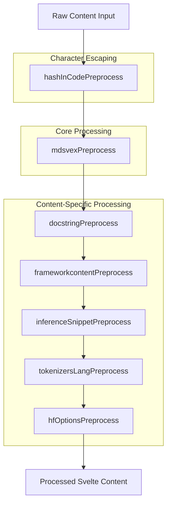
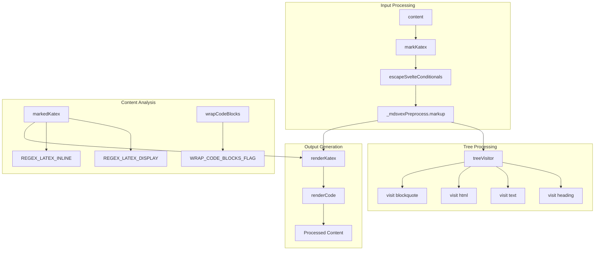
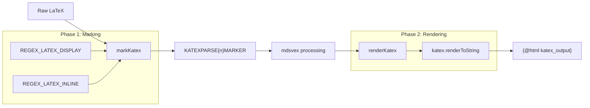
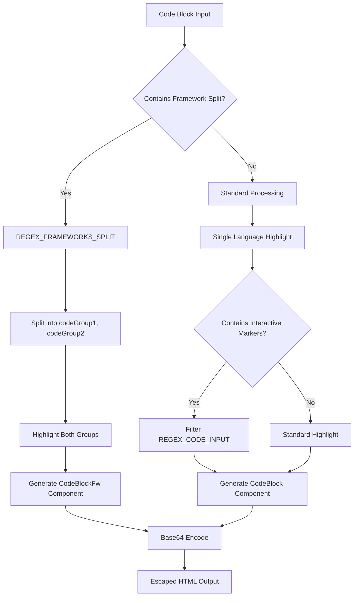
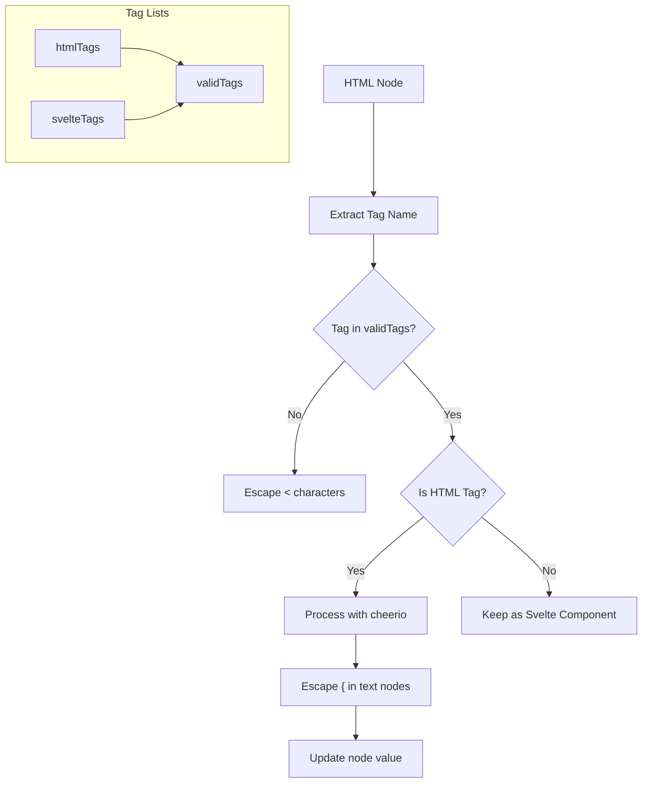

<!-- source: DeepWiki mcp.deepwiki.com · repo huggingface/doc-builder · page 5.3 Content Preprocessing Pipeline · fetched 2026-10-26 -->

# Content Preprocessing Pipeline

Relevant source files

The following files were used as context for generating this wiki page:

- [kit/preprocessors/hashInCode.js](kit/preprocessors/hashInCode.js)
- [kit/preprocessors/index.js](kit/preprocessors/index.js)
- [kit/preprocessors/mdsvex/index.js](kit/preprocessors/mdsvex/index.js)
- [kit/preprocessors/utils.js](kit/preprocessors/utils.js)

## Purpose and Scope

The Content Preprocessing Pipeline transforms raw content (MDX, Markdown, HTML) into Svelte-compatible format before rendering. This system handles syntax highlighting, mathematical expressions, character escaping, and custom component processing to ensure content displays correctly in the SvelteKit frontend.

For information about the core UI components that consume this preprocessed content, see [Core UI Components](#5.1). For details about interactive features that depend on this preprocessing, see [Interactive Documentation Features](#5.2).

## Pipeline Architecture

The preprocessing system consists of multiple specialized preprocessors that work together to transform content. Each preprocessor handles specific aspects of content transformation.

**Preprocessing Pipeline Flow**

Sources: [kit/preprocessors/index.js:1-8]()

## Core Preprocessor Components

### mdsvexPreprocess System

The `mdsvexPreprocess` is the central processing engine that handles MDX content transformation, mathematical expressions, and syntax highlighting.

**mdsvexPreprocess Internal Architecture**

Sources: [kit/preprocessors/mdsvex/index.js:28-45](), [kit/preprocessors/mdsvex/index.js:273-344]()

### Character Escaping and Code Processing

The system includes specialized handling for characters that require escaping in Svelte contexts and code blocks.

| Preprocessor | Function | Target Content |
|--------------|----------|----------------|
| `hashInCodePreprocess` | Converts `#` to `&amp;num;` | Code blocks and inline code |
| `renderSvelteChars` | Renders escaped `<`, `{`, `#` | All processed content |
| `renderCode` | Handles `&amp;` in `<code>` elements | HTML code elements |
| `escapeSvelteConditionals` | Escapes Svelte conditional syntax | MDX content |

Sources: [kit/preprocessors/hashInCode.js:5-22](), [kit/preprocessors/utils.js:31-36](), [kit/preprocessors/mdsvex/index.js:17-23](), [kit/preprocessors/mdsvex/index.js:346-354]()

## Mathematical Expression Processing

The system supports LaTeX mathematical expressions through KaTeX integration with a two-phase processing approach.

**KaTeX Processing Flow**

Sources: [kit/preprocessors/mdsvex/index.js:52-69](), [kit/preprocessors/mdsvex/index.js:71-85]()

## Syntax Highlighting System

Code highlighting is handled through `highlight.js` with support for framework-specific code blocks and interactive code filtering.

### Code Block Processing Logic

The highlighting system processes different code block types:

**Standard Code Blocks**: Single language highlighting with optional interactive code filtering
**Framework Split Blocks**: Dual-framework code blocks (PyTorch/TensorFlow or StringAPI/ReadInstruction)

Sources: [kit/preprocessors/mdsvex/index.js:276-344]()

## Content Tree Transformation

The `treeVisitor` function processes the markdown abstract syntax tree to transform content for Svelte compatibility.

### Tree Processing Functions

| Function | Node Type | Purpose |
|----------|-----------|---------|
| `onText` | text | Escape `{` and `<` characters within doc body |
| `onHtml` | html | Validate HTML tags, escape invalid tags |
| `onBlockquote` | blockquote | Convert GitHub-style tips/warnings |
| Heading processor | heading | Generate `<Heading>` components with anchors |

**HTML Tag Validation Process**

Sources: [kit/preprocessors/mdsvex/index.js:209-234](), [kit/preprocessors/mdsvex/index.js:87-109]()

## Utility Functions and Helpers

### Async String Processing

The `replaceAsync` function enables asynchronous string replacement operations, essential for complex content transformations.

### Regex Generation Utilities

The system provides utilities for generating regex patterns for custom tag processing:

- `generateTagRegex`: Creates patterns for simple tag matching
- `generateTagRegexWithId`: Creates patterns for tags with ID attributes

Sources: [kit/preprocessors/utils.js:8-24](), [kit/preprocessors/utils.js:46-64]()

## Integration Points

The preprocessing pipeline integrates with several system components:

**SvelteKit Integration**: Preprocessors are registered in the SvelteKit configuration and process content during the build phase.

**Component Generation**: Preprocessors generate Svelte component calls (`<CodeBlock>`, `<CodeBlockFw>`, `<Heading>`, `<Tip>`) that are resolved by the component system.

**Build-Time Processing**: All preprocessing occurs at build time, ensuring runtime performance is optimized by pre-processing all content transformations.

Sources: [kit/preprocessors/mdsvex/index.js:28-45](), [kit/preprocessors/index.js:1-8]()

---

