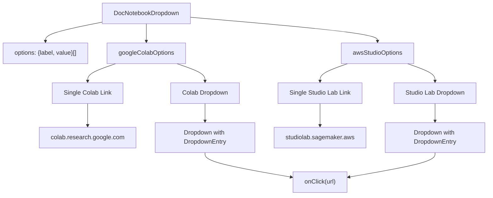
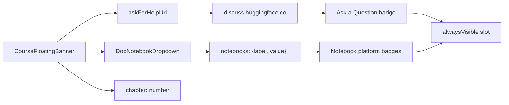
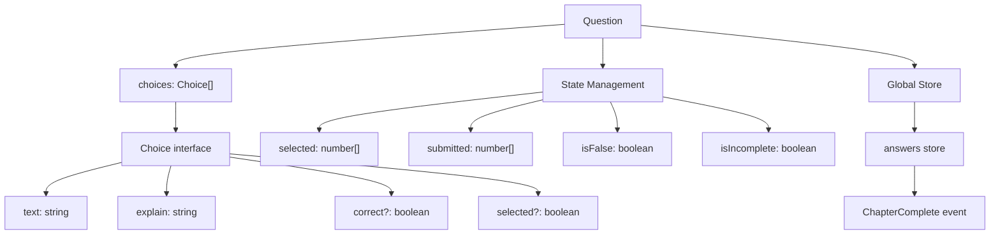
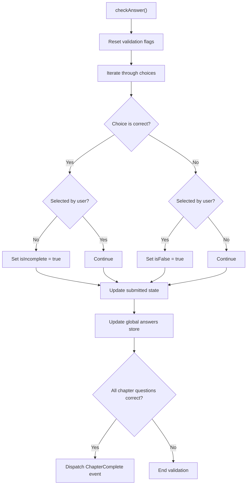
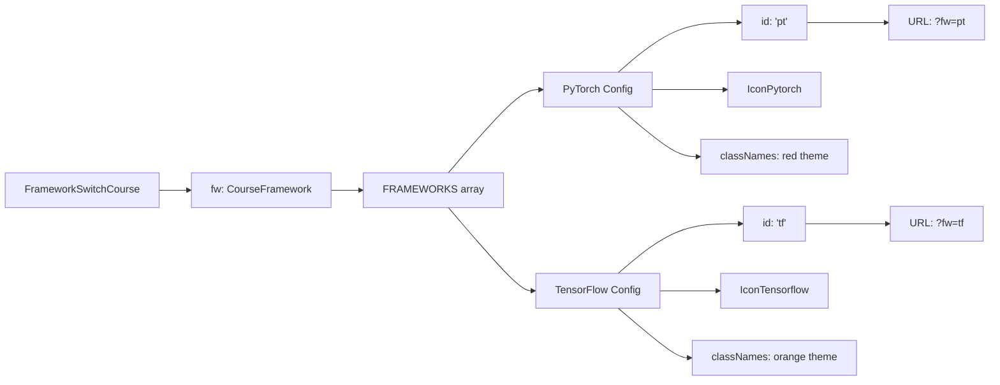
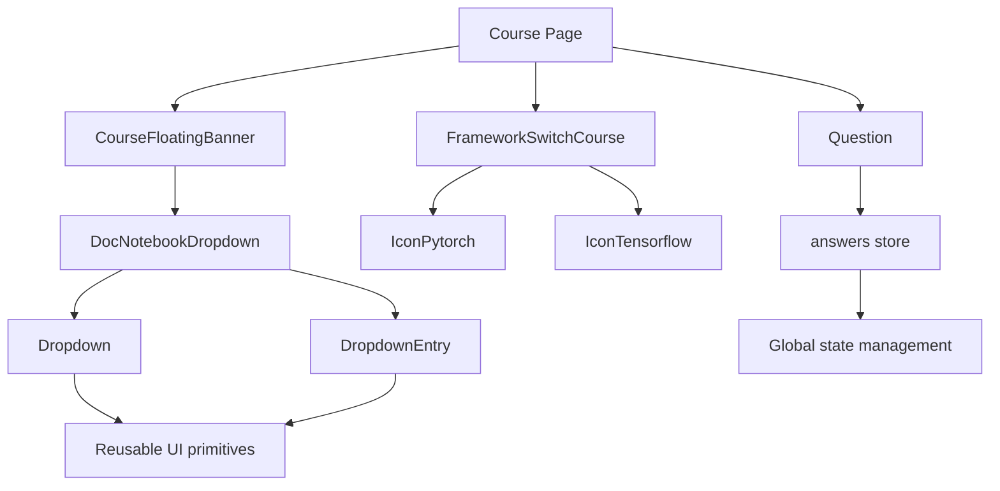

<!-- source: DeepWiki mcp.deepwiki.com · repo huggingface/doc-builder · page 5.4 Course and Educational Components · fetched 2026-10-26 -->

# Course and Educational Components

Relevant source files

The following files were used as context for generating this wiki page:

- [kit/src/lib/CourseFloatingBanner.svelte](kit/src/lib/CourseFloatingBanner.svelte)
- [kit/src/lib/DocNotebookDropdown.svelte](kit/src/lib/DocNotebookDropdown.svelte)
- [kit/src/lib/FrameworkSwitchCourse.svelte](kit/src/lib/FrameworkSwitchCourse.svelte)
- [kit/src/lib/Question.svelte](kit/src/lib/Question.svelte)

This document covers the specialized frontend components designed for educational content and course materials in the doc-builder system. These components provide interactive functionality for educational documentation, including notebook integration, quizzes, framework switching, and course-specific UI elements.

For general UI components and document rendering, see [Core UI Components](#5.1). For interactive features outside of educational content, see [Interactive Documentation Features](#5.2).

## Notebook Integration Components

The doc-builder system provides specialized components for integrating educational content with external notebook platforms like Google Colab and AWS Studio Lab.

### DocNotebookDropdown Component

The `DocNotebookDropdown` component handles the display and interaction logic for notebook platform integration buttons. It supports both single and multiple notebook options with dropdown functionality.

The component filters notebook options by platform and provides appropriate UI elements:

| Platform | Single Option | Multiple Options |
|----------|---------------|------------------|
| Google Colab | Direct link with badge | Dropdown with `Dropdown` and `DropdownEntry` |
| AWS Studio Lab | Direct link with badge | Dropdown with `Dropdown` and `DropdownEntry` |

The component includes responsive layout logic that adjusts positioning based on screen size to prevent overlap with document titles [kit/src/lib/DocNotebookDropdown.svelte:18-40]().

Sources: [kit/src/lib/DocNotebookDropdown.svelte:1-115]()

### CourseFloatingBanner Component

The `CourseFloatingBanner` extends notebook functionality specifically for course content by combining notebook integration with help forum links.

The component automatically generates help forum URLs based on chapter numbers and provides a consistent interface for course-specific actions.

Sources: [kit/src/lib/CourseFloatingBanner.svelte:1-21]()

## Interactive Question System

The `Question` component provides interactive quiz functionality for educational content with answer tracking and feedback mechanisms.

### Question Component Architecture

The component manages quiz state through several key mechanisms:

| State Variable | Purpose | Type |
|----------------|---------|------|
| `selected` | Currently selected answer indices | `number[]` |
| `submitted` | Previously submitted answer indices | `number[]` |
| `isFalse` | Whether any incorrect answers were selected | `boolean` |
| `isIncomplete` | Whether all correct answers were selected | `boolean` |

### Answer Validation Logic

The `checkAnswer()` function implements the validation logic [kit/src/lib/Question.svelte:26-45]():

Sources: [kit/src/lib/Question.svelte:1-102]()

## Framework Switching for Courses

The `FrameworkSwitchCourse` component provides course-specific framework selection between PyTorch and TensorFlow implementations.

### Framework Configuration

The component maintains framework state through URL parameters and provides visual indicators for the active framework:

| Framework | ID | Icon Component | Theme Classes |
|-----------|----|--------------|--------------| 
| PyTorch | `pt` | `IconPytorch` | `bg-red-50 text-red-600` |
| TensorFlow | `tf` | `IconTensorflow` | `bg-orange-50 text-yellow-600` |

Sources: [kit/src/lib/FrameworkSwitchCourse.svelte:1-38]()

## Course-Specific UI Elements

The course components integrate with the broader doc-builder system through several mechanisms:

### Component Integration Pattern

### State Management Integration

The course components integrate with Svelte's reactive state management:

| Component | State Mechanism | Global Impact |
|-----------|----------------|---------------|
| `Question` | `answers` store | Tracks chapter completion |
| `FrameworkSwitchCourse` | URL parameters | Affects content rendering |
| `DocNotebookDropdown` | Local component state | Responsive layout |
| `CourseFloatingBanner` | Props-based configuration | Chapter-specific URLs |

The `answers` store tracks question completion status across the entire course, enabling chapter-level completion tracking and progress indicators.

Sources: [kit/src/lib/Question.svelte:22-24](), [kit/src/lib/FrameworkSwitchCourse.svelte:7](), [kit/src/lib/DocNotebookDropdown.svelte:7-9](), [kit/src/lib/CourseFloatingBanner.svelte:4-7]()

---

