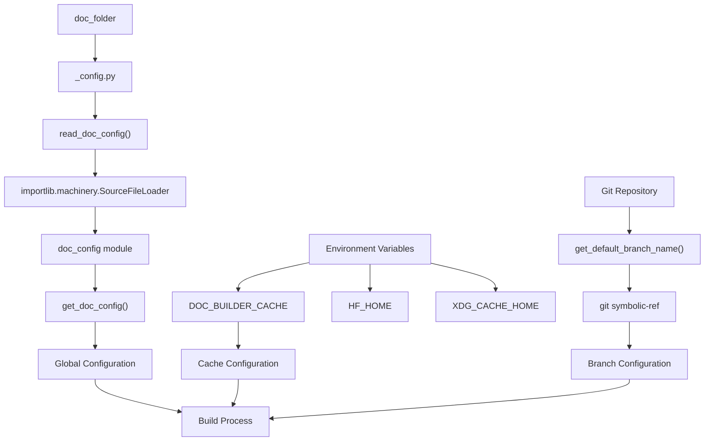
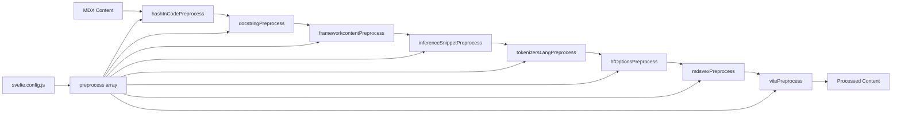
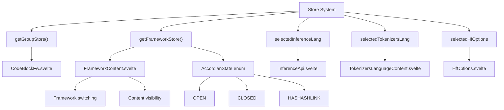
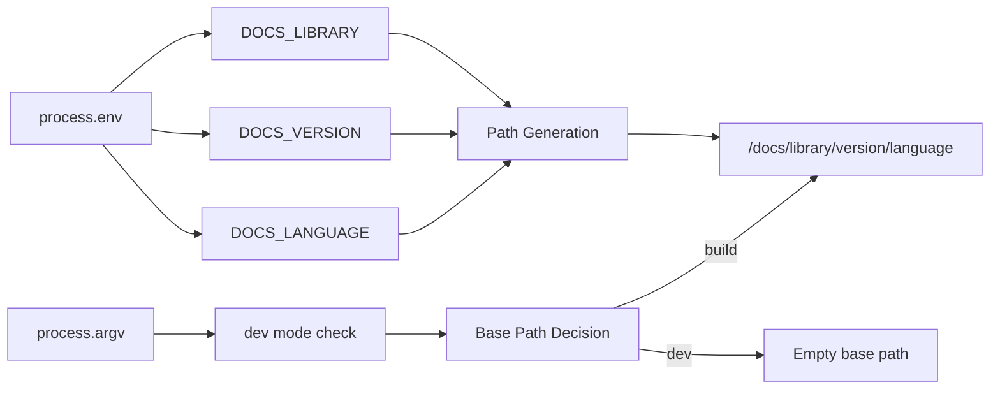
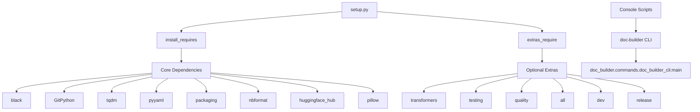
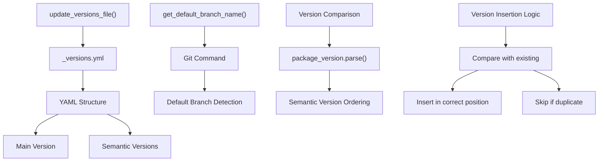
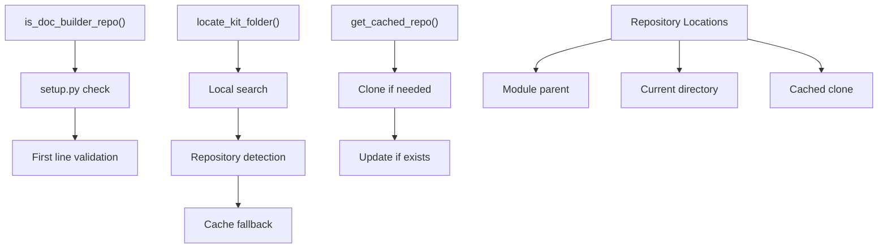
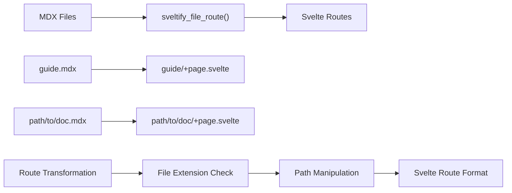

<!-- source: DeepWiki mcp.deepwiki.com · repo huggingface/doc-builder · page 6 Configuration and Customization · fetched 2026-10-26 -->

# Configuration and Customization

Relevant source files

The following files were used as context for generating this wiki page:

- [.gitignore](.gitignore)
- [MANIFEST.in](MANIFEST.in)
- [kit/src/lib/FrameworkContentBlock.svelte](kit/src/lib/FrameworkContentBlock.svelte)
- [kit/src/lib/stores.ts](kit/src/lib/stores.ts)
- [kit/src/lib/types.ts](kit/src/lib/types.ts)
- [kit/svelte.config.js](kit/svelte.config.js)
- [setup.py](setup.py)
- [src/doc_builder/__init__.py](src/doc_builder/__init__.py)
- [src/doc_builder/commands/__init__.py](src/doc_builder/commands/__init__.py)
- [src/doc_builder/utils.py](src/doc_builder/utils.py)
- [tests/test_utils.py](tests/test_utils.py)

This document covers how to configure and customize doc-builder for different projects and use cases. It explains the various configuration mechanisms, customization points, and extension options available in the system.

For information about building and deploying documentation, see the [Build Process and Deployment](#6.1) page. For details on extending doc-builder functionality, see the [Development and Extension Guide](#7) page.

## Configuration Architecture

Doc-builder provides multiple configuration layers that work together to customize the documentation generation process. The system follows a hierarchical configuration approach where project-specific settings can override default behaviors.

### Configuration Loading Mechanism

The configuration system loads project-specific settings from a `_config.py` file in the documentation source directory. This Python module is executed dynamically to provide flexible configuration options.

**Sources:** [src/doc_builder/utils.py:91-108]()

### Project Configuration File Structure

Doc-builder expects a `_config.py` file in the documentation source directory. This file is loaded as a Python module, allowing for dynamic configuration:

| Configuration Type | Purpose | Code Location |
|-------------------|---------|---------------|
| `default_branch_name` | Git branch configuration | [src/doc_builder/utils.py:36-38]() |
| Custom preprocessors | Content transformation | [kit/svelte.config.js:18-27]() |
| Framework settings | UI framework behavior | [kit/src/lib/types.ts:1-19]() |
| Cache settings | Build cache configuration | [src/doc_builder/utils.py:27-31]() |

**Sources:** [src/doc_builder/utils.py:91-108](), [kit/svelte.config.js:14-64]()

## Frontend Customization System

The SvelteKit frontend provides extensive customization options through preprocessors, stores, and component configuration.

### Preprocessor Configuration Pipeline

The preprocessing pipeline transforms content through a series of configurable processors. Each preprocessor handles specific content types and transformations.

**Sources:** [kit/svelte.config.js:18-27]()

### UI Component Configuration

The frontend uses a store-based system for managing UI state and customization:

The store system manages component state and user preferences, with persistent storage through `localStorage`.

**Sources:** [kit/src/lib/stores.ts:1-36](), [kit/src/lib/FrameworkContentBlock.svelte:34-42]()

## Environment Configuration

Doc-builder uses environment variables for system-wide configuration:

### Cache and Path Configuration

| Environment Variable | Purpose | Default Value | Code Reference |
|---------------------|---------|---------------|----------------|
| `HF_HOME` | Hugging Face cache home | `~/.cache/huggingface` | [src/doc_builder/utils.py:27-29]() |
| `XDG_CACHE_HOME` | XDG cache directory | `~/.cache` | [src/doc_builder/utils.py:28]() |
| `DOC_BUILDER_CACHE` | Doc-builder cache path | `$HF_HOME/doc_builder` | [src/doc_builder/utils.py:31]() |
| `DOCS_LIBRARY` | Documentation library name | `transformers` | [kit/svelte.config.js:43]() |
| `DOCS_VERSION` | Documentation version | `main` | [kit/svelte.config.js:45]() |
| `DOCS_LANGUAGE` | Documentation language | `en` | [kit/svelte.config.js:47]() |

### SvelteKit Path Configuration

The path configuration system dynamically generates URL paths based on environment variables and build mode.

**Sources:** [kit/svelte.config.js:39-49]()

## Package Configuration

### Installation and Dependencies

The package configuration defines installation options and dependencies:

**Sources:** [setup.py:6-37]()

## Version Management Configuration

Doc-builder includes a sophisticated version management system for documentation versions:

### Version File Management

The version management system maintains a `_versions.yml` file with proper semantic version ordering.

**Sources:** [src/doc_builder/utils.py:55-86](), [tests/test_utils.py:26-68]()

## Customization Extension Points

### Repository Detection and Caching

Doc-builder provides mechanisms for detecting and caching repository information:

**Sources:** [src/doc_builder/utils.py:118-183]()

### File Route Transformation

The system includes utilities for transforming file routes between different formats:

This transformation is essential for integrating generated MDX content with the SvelteKit routing system.

**Sources:** [src/doc_builder/utils.py:185-196](), [tests/test_utils.py:70-84]()

## Framework and UI Type Configuration

Doc-builder defines configurable types for different frameworks and UI components:

| Type | Values | Usage |
|------|--------|--------|
| `Framework` | `pytorch`, `tensorflow`, `jax` | Framework-specific content | 
| `Group` | `group1`, `group2` | Code block grouping |
| `TokenizersLanguage` | `python`, `rust`, `node` | Language-specific tokenizer docs |
| `InferenceSnippetLang` | `python`, `js`, `curl` | API example languages |
| `CourseFramework` | `pt`, `tf` | Course content frameworks |

These types are used throughout the UI components to provide consistent framework switching and content organization.

**Sources:** [kit/src/lib/types.ts:1-19](), [kit/src/lib/stores.ts:1-36]()

---

