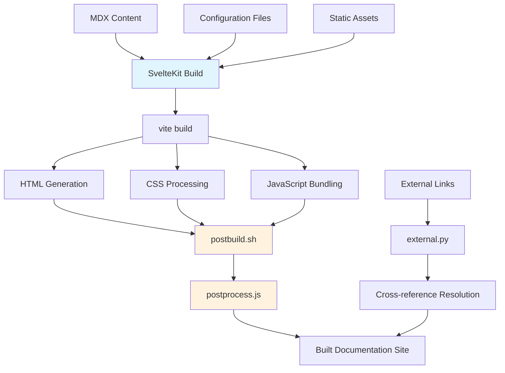
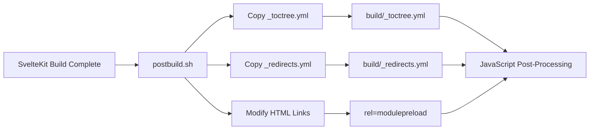
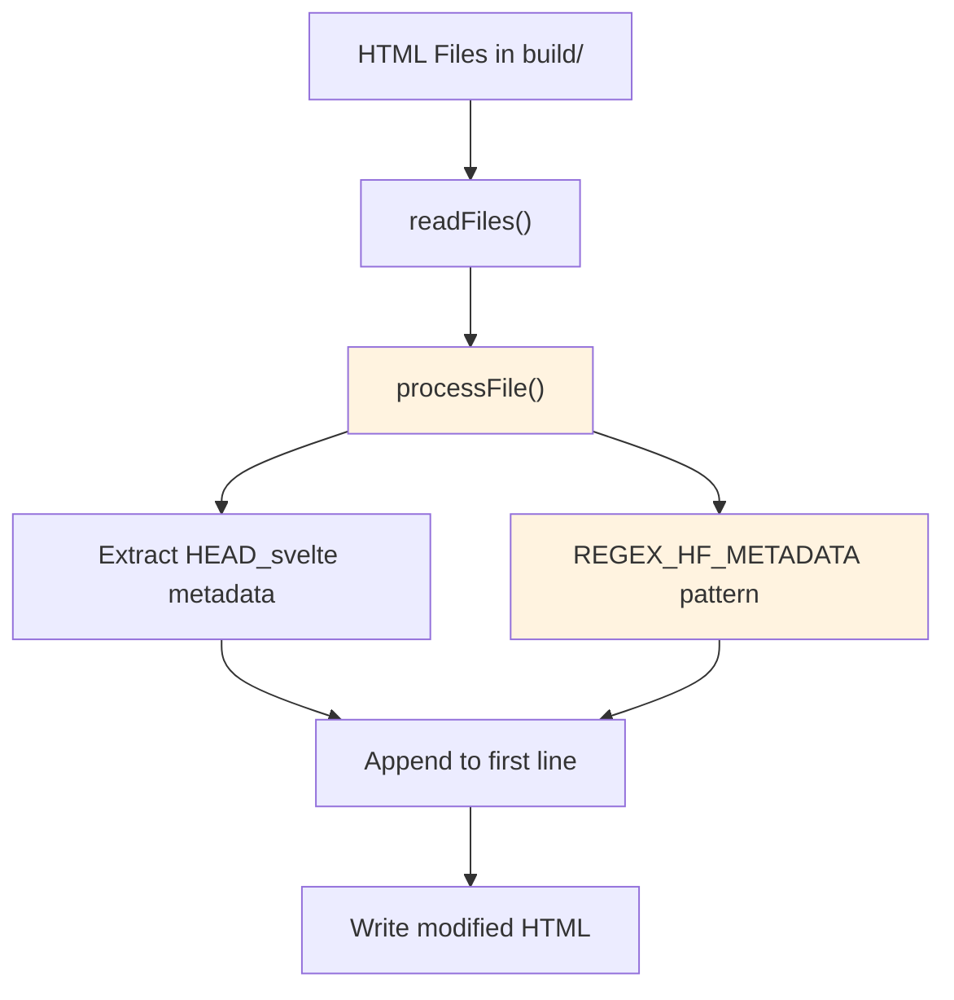
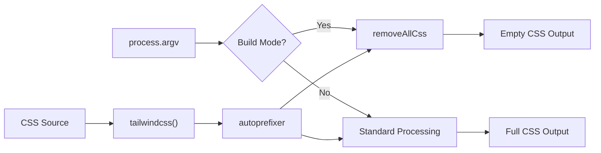
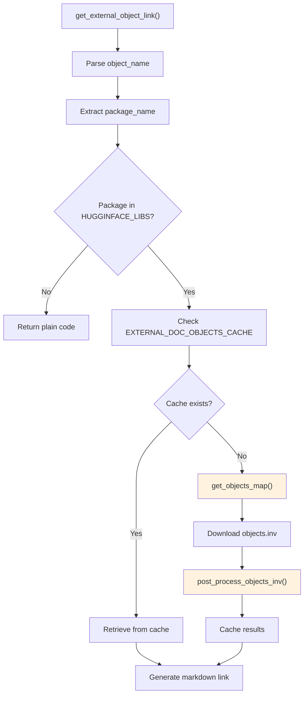
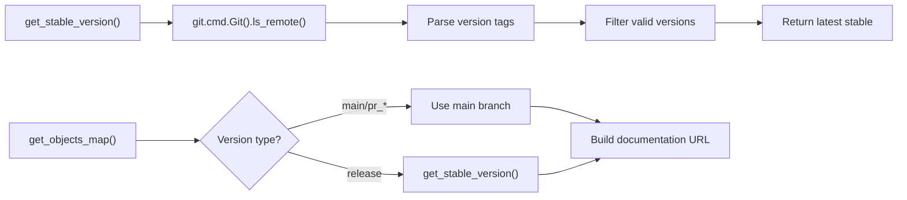

<!-- source: DeepWiki mcp.deepwiki.com · repo huggingface/doc-builder · page 6.1 Build Process and Deployment · fetched 2026-10-26 -->

# Build Process and Deployment

<details>
<summary>Relevant source files</summary>

The following files were used as context for generating this wiki page:

- [kit/.eslintrc.cjs](kit/.eslintrc.cjs)
- [kit/.prettierrc](kit/.prettierrc)
- [kit/postbuild.sh](kit/postbuild.sh)
- [kit/postcss.config.cjs](kit/postcss.config.cjs)
- [kit/postprocess.js](kit/postprocess.js)
- [kit/src/app.css](kit/src/app.css)
- [kit/src/app.html](kit/src/app.html)
- [kit/src/lib/pipeline.ts](kit/src/lib/pipeline.ts)
- [kit/src/lib/tooltip.ts](kit/src/lib/tooltip.ts)
- [kit/vite.config.ts](kit/vite.config.ts)
- [src/doc_builder/external.py](src/doc_builder/external.py)

</details>


This document covers the comprehensive build pipeline that transforms doc-builder's source content into deployable documentation websites. It details the multi-stage build process, post-processing steps, external linking mechanisms, and deployment configurations.

For information about the content conversion that feeds into this build process, see [Document Conversion System](#2.1). For details about the CLI commands that orchestrate builds, see [Command Line Interface](#4).

## Build Pipeline Overview

The doc-builder build process consists of several coordinated stages that transform MDX content and SvelteKit components into static HTML documentation sites.

### Build Architecture



Sources: [kit/vite.config.ts:1-9](), [kit/postbuild.sh:1-15](), [kit/postprocess.js:1-38]()

### Core Build Components

The build system integrates several key technologies:

| Component | Purpose | Configuration |
|-----------|---------|---------------|
| **SvelteKit** | Frontend framework and static site generator | `svelte.config.js` |
| **Vite** | Module bundler and development server | [kit/vite.config.ts:4-8]() |
| **PostCSS** | CSS processing with Tailwind integration | [kit/postcss.config.cjs:11-16]() |
| **ESLint** | JavaScript/TypeScript linting | [kit/.eslintrc.cjs:1-43]() |
| **Prettier** | Code formatting | [kit/.prettierrc:1-7]() |

Sources: [kit/vite.config.ts:1-9](), [kit/postcss.config.cjs:1-26](), [kit/.eslintrc.cjs:1-43](), [kit/.prettierrc:1-7]()

## Post-Build Processing Pipeline

After the initial SvelteKit build completes, a series of post-processing steps modify and enhance the generated files.

### Shell Script Post-Processing

The `postbuild.sh` script performs essential file operations:



The script executes these operations:
- Copies `src/routes/_toctree.yml` to `build/_toctree.yml` for navigation structure
- Conditionally copies `src/routes/_redirects.yml` to `build/_redirects.yml` for URL redirects  
- Modifies all HTML files to change `rel="stylesheet"` attributes to `rel="modulepreload"` for performance optimization

Sources: [kit/postbuild.sh:5-14]()

### JavaScript Metadata Processing

The `postprocess.js` script handles HTML metadata extraction and injection:



The processing workflow:
1. Recursively scans all HTML files in the `build/` directory
2. Uses regex pattern `REGEX_HF_METADATA` to extract Svelte head metadata from HTML comments
3. Appends extracted metadata to the first line of each HTML file
4. Writes the modified content back to the file

Sources: [kit/postprocess.js:7-36]()

## CSS Processing and Optimization

The build system includes sophisticated CSS processing tailored for documentation sites.

### PostCSS Configuration



The CSS processing pipeline includes:
- **Tailwind CSS**: Utility-first CSS framework processing
- **Autoprefixer**: Automatic vendor prefix addition
- **Conditional Empty CSS**: During build mode, CSS files are emptied to prevent conflicts with existing Hub Tailwind styles

Sources: [kit/postcss.config.cjs:11-22]()

### Application Styling

The main application styles in `app.css` provide:
- Dark mode support with custom scrollbar styling
- Component-based CSS classes for buttons, tags, and form elements
- Prose-specific styling for documentation content
- Course-specific styling for educational content

Sources: [kit/src/app.css:1-409]()

## External Documentation Linking

The build process includes dynamic resolution of external documentation links through the `external.py` module.

### External Link Resolution System



### Supported External Libraries

The system supports automatic linking to these Hugging Face libraries:

| Library | Repository | Documentation Base |
|---------|------------|-------------------|
| `accelerate` | huggingface/accelerate | `https://huggingface.co/docs/accelerate/` |
| `datasets` | huggingface/datasets | `https://huggingface.co/docs/datasets/` |
| `evaluate` | huggingface/evaluate | `https://huggingface.co/docs/evaluate/` |
| `huggingface_hub` | huggingface/huggingface_hub | `https://huggingface.co/docs/huggingface_hub/` |
| `optimum` | huggingface/optimum | `https://huggingface.co/docs/optimum/` |
| `tokenizers` | huggingface/tokenizers | `https://huggingface.co/docs/tokenizers/` |
| `transformers` | huggingface/transformers | `https://huggingface.co/docs/transformers/` |
| `trl` | huggingface/trl | `https://huggingface.co/docs/trl/` |

Sources: [src/doc_builder/external.py:27-36]()

### Version Resolution Process



The version resolution logic:
- For `main`, `master`, or `pr_*` versions: links to the main branch documentation
- For release versions: determines the latest stable release using Git remote tags
- Constructs documentation URLs following the pattern: `{HF_DOC_PREFIX}{package_name}/{version}/{language}`

Sources: [src/doc_builder/external.py:58-85](), [src/doc_builder/external.py:88-124]()

## Application Template and Structure

### HTML Template

The minimal HTML template provides the foundation for all generated pages:

```html
<meta charset="utf-8" />%sveltekit.head% %sveltekit.body%
```

This template uses SvelteKit's template variables:
- `%sveltekit.head%`: Injects page-specific head content including metadata, styles, and scripts
- `%sveltekit.body%`: Injects the application body and hydration scripts

Sources: [kit/src/app.html:1-2]()

### Development Configuration

The build system includes development-focused configuration:

#### Vite Configuration
- **Sourcemap Generation**: Controlled by `DOCS_SOURCEMAP` environment variable
- **SvelteKit Integration**: Uses `@sveltejs/kit/vite` plugin for seamless development

#### ESLint Rules
- **TypeScript Integration**: Full TypeScript support with strict rules
- **Svelte Support**: Custom parser configuration for `.svelte` files  
- **Code Quality**: Enforces no-shadow, explicit-any, and unused variable rules

#### Prettier Configuration
- **Svelte Formatting**: Includes `prettier-plugin-svelte` for component formatting
- **Tailwind Integration**: Uses `prettier-plugin-tailwindcss` for CSS class ordering
- **Consistent Styling**: Tab-based indentation with 100-character line width

Sources: [kit/vite.config.ts:6-8](), [kit/.eslintrc.cjs:26-36](), [kit/.prettierrc:2-6]()

## Deployment Considerations

The build output is optimized for static hosting with several deployment-specific features:

### File Structure
- **Navigation Metadata**: `_toctree.yml` provides site navigation structure
- **URL Redirects**: `_redirects.yml` handles legacy URL routing
- **Module Preloading**: HTML link modification improves loading performance

### Performance Optimizations
- **CSS Emptying**: Prevents style conflicts in Hub integration
- **Metadata Injection**: Improves SEO and social media sharing
- **External Link Caching**: Reduces build time through intelligent caching

### Cross-Reference Integration
- **Sphinx Compatibility**: Processes `objects.inv` files for API documentation linking
- **Multi-language Support**: Handles language-specific documentation versions
- **Automatic Fallbacks**: Graceful degradation when external links are unavailable

Sources: [kit/postbuild.sh:5-14](), [kit/postprocess.js:22-35](), [src/doc_builder/external.py:127-153]()

---

