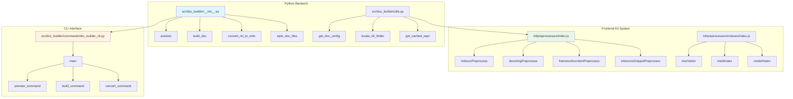
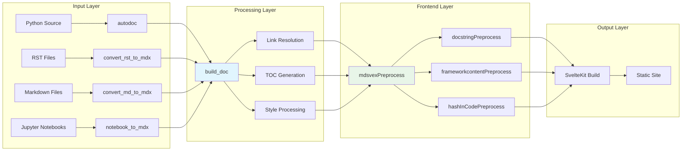
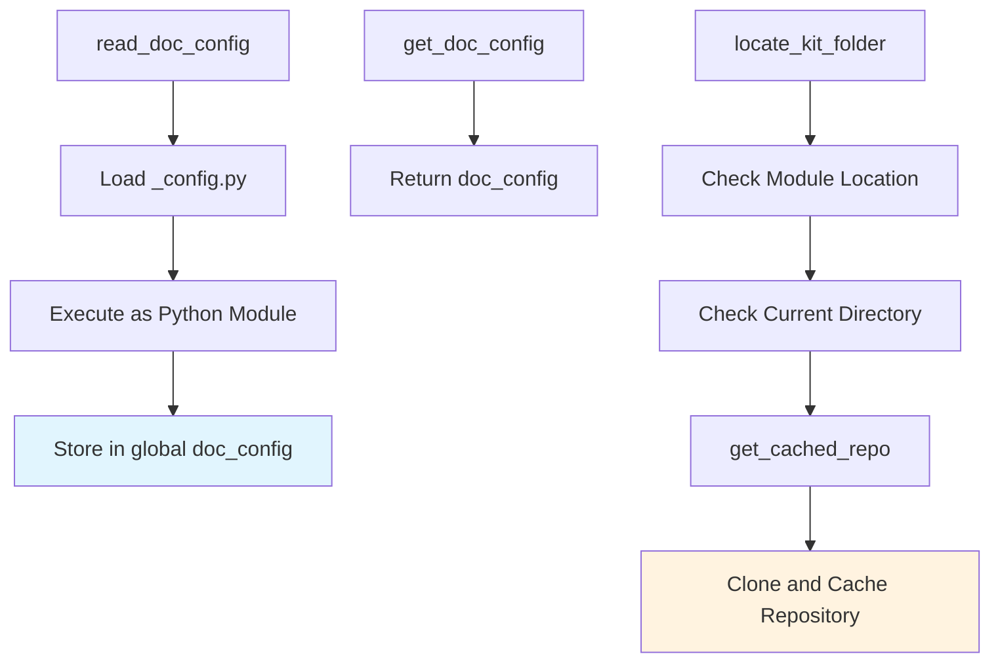
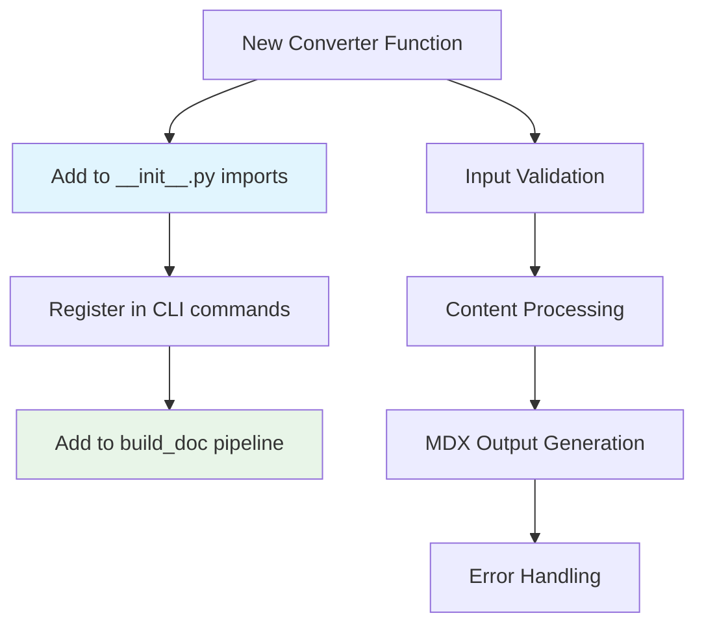
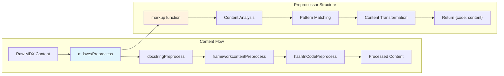
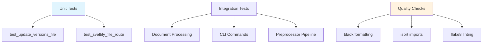
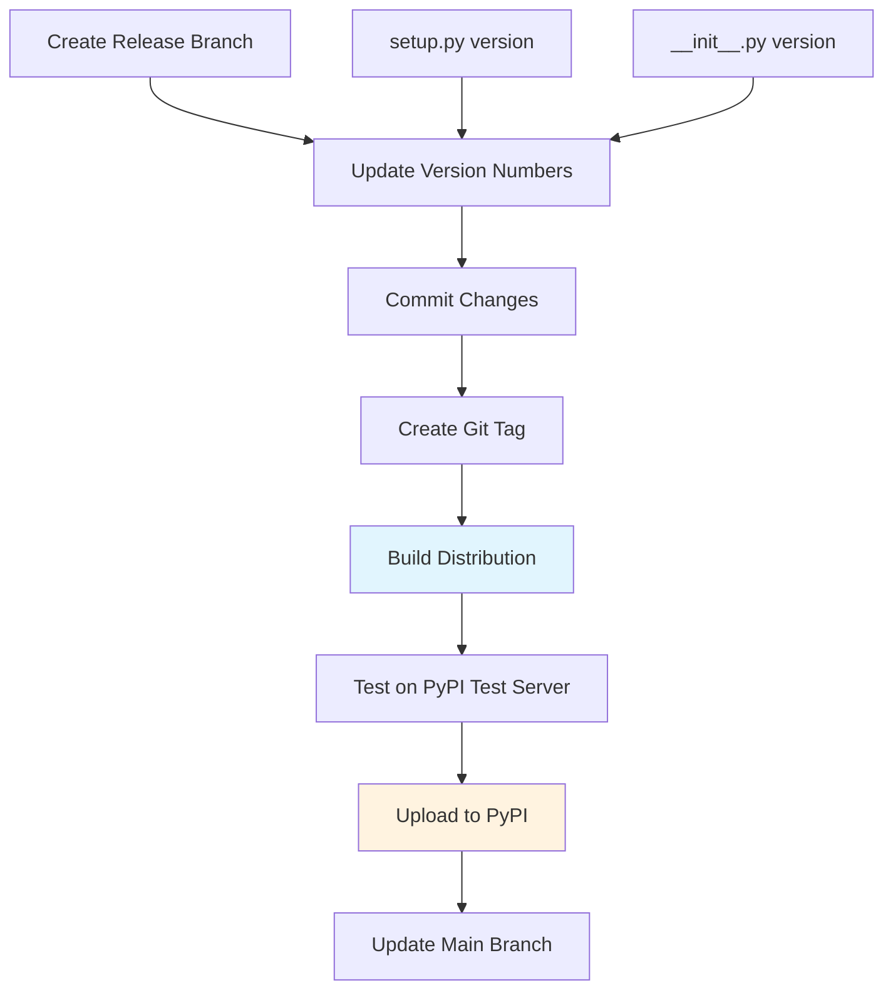

<!-- source: DeepWiki mcp.deepwiki.com · repo huggingface/doc-builder · page 7 Development and Extension Guide · fetched 2026-10-26 -->

# Development and Extension Guide

<details>
<summary>Relevant source files</summary>

The following files were used as context for generating this wiki page:

- [.gitignore](.gitignore)
- [MANIFEST.in](MANIFEST.in)
- [kit/preprocessors/hashInCode.js](kit/preprocessors/hashInCode.js)
- [kit/preprocessors/index.js](kit/preprocessors/index.js)
- [kit/preprocessors/mdsvex/index.js](kit/preprocessors/mdsvex/index.js)
- [kit/preprocessors/utils.js](kit/preprocessors/utils.js)
- [setup.py](setup.py)
- [src/doc_builder/__init__.py](src/doc_builder/__init__.py)
- [src/doc_builder/commands/__init__.py](src/doc_builder/commands/__init__.py)
- [src/doc_builder/utils.py](src/doc_builder/utils.py)
- [tests/test_utils.py](tests/test_utils.py)

</details>


This document provides comprehensive guidance for developers who want to contribute to or extend the doc-builder system. It covers development environment setup, architectural patterns, extension points, and contribution workflows.

For general usage information, see [Overview](#1). For configuration details, see [Configuration and Customization](#6). For understanding the build pipeline, see [Build Process and Deployment](#6.1).

## Development Environment Setup

### Prerequisites and Installation

The doc-builder system requires both Python and Node.js environments for development. The Python backend handles document processing, while the Node.js frontend manages the SvelteKit-based rendering system.

Install the development environment using the extras defined in [setup.py:14-15]():

```bash
pip install -e ".[dev]"
```

This installs all dependencies including testing tools (`pytest`, `pytest-xdist`), quality tools (`black`, `isort`, `flake8`), and optional integrations like `transformers` for API documentation generation.

**Development Dependencies**
| Category | Tools | Purpose |
|----------|--------|---------|
| Core | `black`, `GitPython`, `tqdm`, `pyyaml`, `packaging` | Document processing and utilities |
| Testing | `pytest`, `pytest-xdist`, `torch`, `transformers` | Test execution and validation |
| Quality | `black~=22.0`, `isort>=5.5.4`, `flake8>=3.8.3` | Code formatting and linting |
| Release | `twine` | Package publishing |

Sources: [setup.py:6-18]()

### Repository Structure for Development



Sources: [src/doc_builder/__init__.py:22-26](), [kit/preprocessors/index.js:1-8](), [setup.py:36]()

## Architecture Overview for Developers

### Core Processing Pipeline

The doc-builder system follows a layered architecture where content flows through distinct processing stages:



Sources: [src/doc_builder/__init__.py:22-26](), [kit/preprocessors/index.js:1-8]()

### Configuration and Cache Management

The system uses a centralized configuration approach through the `utils.py` module:

**Configuration Loading Process**


The `DOC_BUILDER_CACHE` environment variable controls where repositories are cached, defaulting to `~/.cache/huggingface/doc_builder` as defined in [src/doc_builder/utils.py:27-31]().

Sources: [src/doc_builder/utils.py:91-108](), [src/doc_builder/utils.py:130-183]()

## Core Extension Points

### Adding New Content Converters

New content converters should follow the pattern established by existing converters in [src/doc_builder/__init__.py:24-25](). Each converter function should:

1. Accept source content and target format parameters
2. Return processed content compatible with the MDX pipeline
3. Handle error cases gracefully
4. Support the doc-builder configuration system

**Converter Integration Pattern**


Sources: [src/doc_builder/__init__.py:22-26]()

### Extending Utility Functions

The `utils.py` module provides core infrastructure that can be extended:

| Function | Purpose | Extension Point |
|----------|---------|-----------------|
| `get_default_branch_name` | Git branch detection | Add new VCS support |
| `update_versions_file` | Version management | Add new version formats |
| `locate_kit_folder` | Asset location | Add new search strategies |
| `sveltify_file_route` | Path transformation | Add new route patterns |

Sources: [src/doc_builder/utils.py:34-196]()

## Adding New Preprocessors

### Preprocessor Architecture

The frontend preprocessing system in the `kit/preprocessors/` directory follows a modular pattern where each preprocessor handles specific content transformations:



### Creating a New Preprocessor

Each preprocessor should export an object with a `markup` function that follows the pattern in [kit/preprocessors/hashInCode.js:5-22]():

```javascript
export const newPreprocess = {
    markup: async ({ content, filename }) => {
        // Process content here
        return { code: processedContent };
    },
};
```

**Preprocessor Registration Process**
1. Create the preprocessor file in `kit/preprocessors/`
2. Export it in [kit/preprocessors/index.js:1-8]()
3. Add it to the SvelteKit configuration
4. Test with various content types

### Advanced Preprocessing Features

The `mdsvexPreprocess` system demonstrates advanced preprocessing capabilities:

**Key Processing Features**
| Feature | Implementation | Purpose |
|---------|---------------|---------|
| KaTeX Math | `markKatex`, `renderKatex` | LaTeX equation rendering |
| Code Highlighting | `hljs.highlight` | Syntax highlighting |
| Heading Processing | `treeVisitor` | Table of contents generation |
| Framework Switching | `REGEX_FRAMEWORKS_SPLIT` | Multi-framework code blocks |

Sources: [kit/preprocessors/mdsvex/index.js:28-354](), [kit/preprocessors/hashInCode.js:5-22]()

## Testing and Quality Assurance

### Test Structure

The testing system uses `pytest` with utilities tested in [tests/test_utils.py:25-85]():

**Test Coverage Areas**


### Running Tests

Execute the test suite using:
```bash
pytest tests/ -v
pytest-xdist  # For parallel execution
```

The test configuration supports various library integrations as defined in [setup.py:11]().

Sources: [tests/test_utils.py:25-85](), [setup.py:11-12]()

### Code Quality Standards

All contributions must pass quality checks:
- **Black**: Code formatting with `black~=22.0`
- **isort**: Import sorting with `isort>=5.5.4`  
- **flake8**: Linting with `flake8>=3.8.3`

Sources: [setup.py:12]()

## Release Process

### Version Management

The release process is documented in [setup.py:39-65]() and follows semantic versioning:

**Release Workflow**


### Version Locations

Version numbers must be updated in multiple locations:
- [setup.py:23]() - Package version
- [src/doc_builder/__init__.py:20]() - Module version

### Distribution Commands

```bash
# Clean previous builds
rm -rf dist build

# Create distributions
python setup.py bdist_wheel
python setup.py sdist

# Test upload
twine upload dist/* -r testpypi

# Production upload
twine upload dist/* -r pypi
```

Sources: [setup.py:39-65]()

## Contributing Guidelines

### Development Workflow

1. **Environment Setup**: Install with `pip install -e ".[dev]"`
2. **Feature Development**: Create feature branches from main
3. **Testing**: Run full test suite with `pytest`
4. **Quality Checks**: Ensure code passes `black`, `isort`, and `flake8`
5. **Documentation**: Update relevant wiki pages
6. **Pull Request**: Submit with comprehensive description

### Cache Management

The system uses [src/doc_builder/utils.py:27-31]() for cache management. During development, you may need to clear the cache at `$DOC_BUILDER_CACHE` or `~/.cache/huggingface/doc_builder`.

### Extension Guidelines

When extending the system:
- Follow existing patterns in core modules
- Maintain backward compatibility
- Add comprehensive tests
- Update documentation
- Consider performance implications

Sources: [src/doc_builder/utils.py:27-31](), [setup.py:14-15]()