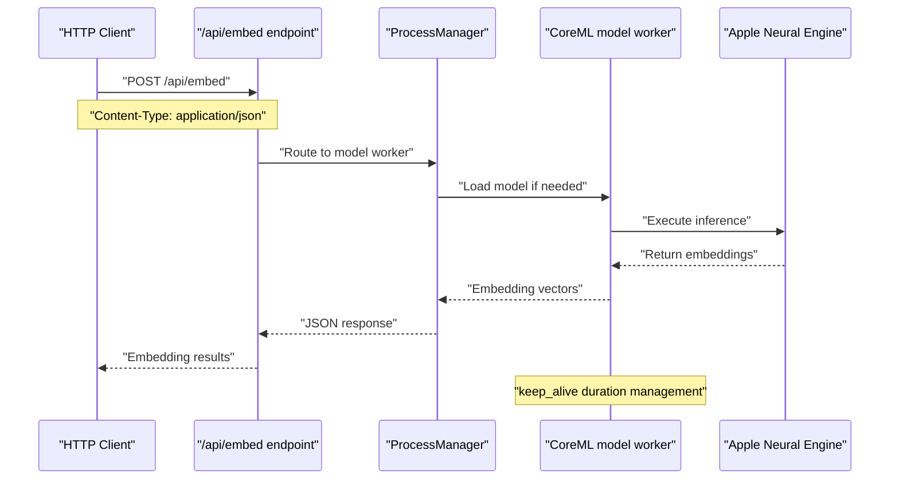
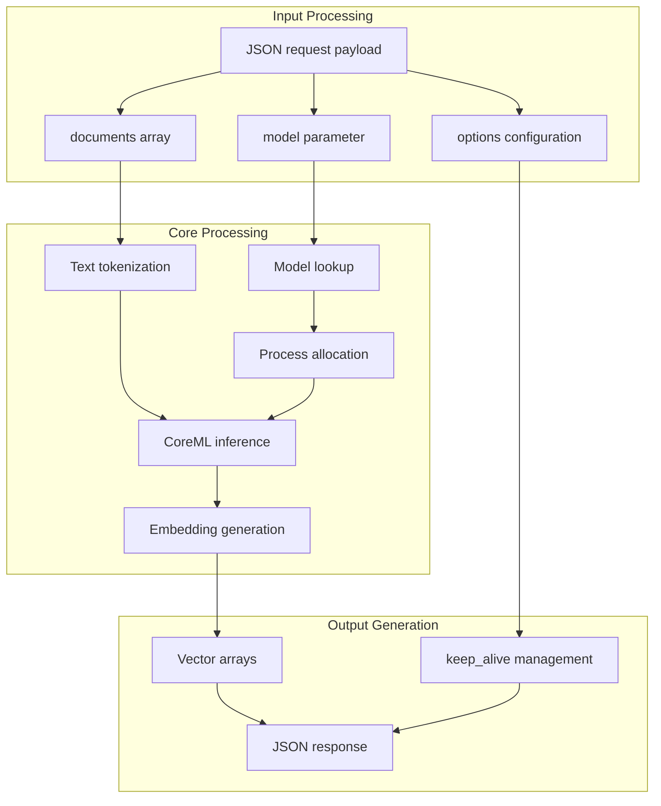
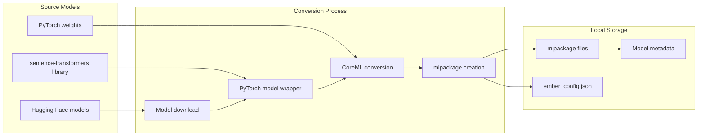

<!-- source: DeepWiki mcp.deepwiki.com · repo huggingface/ember · page 1 Overview · fetched 2026-10-26 -->

# Overview

<details>
<summary>Relevant source files</summary>

The following files were used as context for generating this wiki page:

- [README.md](README.md)

</details>


## Purpose and Scope

This document provides a comprehensive overview of the Ember system, which converts sentence-transformer models from Hugging Face to Apple CoreML format and serves them via a local HTTP API with Apple Neural Engine (ANE) acceleration. Ember enables efficient local embedding generation for semantic search, similarity computation, and document clustering applications.

For detailed installation instructions, see [Installation](#2.1). For hands-on usage examples, see [Usage Examples](#5). For performance optimization guidance, see [Performance Analysis](#6).

Sources: [README.md:1-49]()

## System Architecture

Ember operates through a two-phase architecture: model conversion and model serving. The system integrates Hugging Face's sentence-transformers ecosystem with Apple's CoreML runtime to provide hardware-accelerated local embedding services.

### High-Level Component Architecture

```mermaid
graph TB
    subgraph "CLI_Interface" ["CLI Interface"]
        ember_create["ember create"]
        ember_serve["ember serve"]
    end
    
    subgraph "Model_Creation" ["Model Creation Pipeline"]
        questionary_selector["questionary model selector"]
        sentence_transformers["sentence-transformers downloader"]
        coreml_converter["CoreML converter"]
        mlpackage_storage["mlpackage storage"]
    end
    
    subgraph "Model_Serving" ["Model Serving Infrastructure"] 
        fastapi_server["FastAPI server"]
        process_manager["ProcessManager"]
        coreml_runtime["CoreML runtime"]
        ane_engine["Apple Neural Engine"]
    end
    
    subgraph "External_Services" ["External Services"]
        huggingface_hub["Hugging Face Hub"]
        localhost_api["localhost:11434 API"]
    end
    
    ember_create --> questionary_selector
    questionary_selector --> sentence_transformers
    sentence_transformers --> huggingface_hub
    sentence_transformers --> coreml_converter
    coreml_converter --> mlpackage_storage
    
    ember_serve --> fastapi_server
    fastapi_server --> process_manager
    process_manager --> coreml_runtime
    coreml_runtime --> ane_engine
    mlpackage_storage --> process_manager
    
    localhost_api --> fastapi_server
```

Sources: [README.md:11-24]()

### API Endpoint and Processing Flow



Sources: [README.md:26-44]()

## Core Components

### Model Creation Workflow

The `ember create` command orchestrates the conversion of sentence-transformer models to CoreML format through an interactive selection process.

| Component | Code Entity | Purpose |
|-----------|-------------|---------|
| CLI Entry Point | `ember create` | Interactive model selection and conversion |
| Model Selector | `questionary` dropdown | Choose from recommended or custom models |
| Model Source | `sentence-transformers` | Download from Hugging Face Hub |
| Conversion Engine | CoreML converter | Transform PyTorch to `.mlpackage` format |
| Configuration | `ember_config.json` | Store model metadata and settings |

Sources: [README.md:11-18]()

### Model Serving Infrastructure

The `ember serve` command launches a FastAPI-based HTTP server that manages CoreML model workers for embedding generation.

| Component | Code Entity | Purpose |
|-----------|-------------|---------|
| HTTP Server | `FastAPI` + `uvicorn` | REST API for embedding requests |
| API Endpoint | `/api/embed` | Primary embedding generation endpoint |
| Process Management | `ProcessManager` | Isolate and manage model workers |
| Model Runtime | CoreML runtime | Execute models on ANE/GPU/CPU |
| Lifecycle Control | `keep_alive` parameter | Manage worker process duration |

Sources: [README.md:20-44]()

## Data Processing Pipeline

### Request Processing Flow



Sources: [README.md:29-40]()

### Model Conversion Pipeline



Sources: [README.md:15-18]()

## Technology Stack

### External Dependencies

Ember integrates with several key external systems:

- **Hugging Face Hub**: Source for pre-trained sentence-transformer models
- **sentence-transformers**: Python library for semantic embeddings
- **CoreML**: Apple's machine learning framework for local inference
- **FastAPI**: Modern Python web framework for API development
- **Apple Neural Engine**: Hardware acceleration for ML inference

### Hardware Optimization

The system targets Apple Silicon devices and leverages:

- **Apple Neural Engine (ANE)**: Primary acceleration target
- **Metal GPU**: Secondary acceleration option  
- **Apple Silicon CPU**: Fallback processing unit

### API Interface

The HTTP API follows RESTful conventions:

- **Base URL**: `http://localhost:11434`
- **Primary Endpoint**: `/api/embed`
- **Request Format**: JSON with `model`, `documents`, and `options` fields
- **Response Format**: JSON with embedding vectors

Sources: [README.md:1-49]()

## Usage Pattern

The typical Ember workflow involves two distinct phases:

1. **Model Creation**: Use `ember create` to select and convert models offline
2. **Model Serving**: Use `ember serve` to launch the embedding API server

This separation enables efficient model preparation and high-performance serving with process isolation and hardware acceleration.

For practical implementation examples, see [Usage Examples](#5). For performance benchmarking and optimization, see [Performance Analysis](#6).

Sources: [README.md:11-49]()

---

