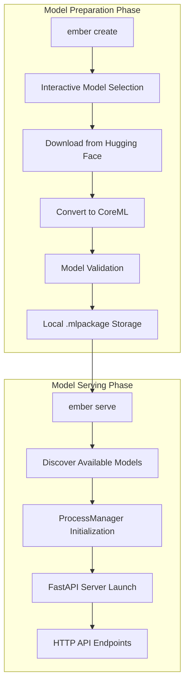
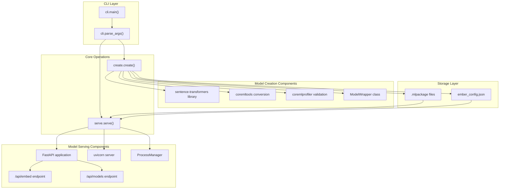

<!-- source: DeepWiki mcp.deepwiki.com · repo huggingface/ember · page 2 Getting Started · fetched 2026-10-26 -->

# Getting Started

<details>
<summary>Relevant source files</summary>

The following files were used as context for generating this wiki page:

- [README.md](README.md)
- [ember/cli.py](ember/cli.py)
- [pyproject.toml](pyproject.toml)

</details>


This document provides an overview of the Ember system workflow and guides you through the basic process of converting sentence-transformer models to CoreML format and serving them as a local API. Ember is designed to accelerate embedding generation on Apple hardware using the Apple Neural Engine (ANE) and GPU acceleration.

For detailed installation instructions, see [Installation](#2.1). For step-by-step usage examples, see [Quick Start Guide](#2.2). For comprehensive model creation options, see [Model Creation](#3). For API reference and serving configuration, see [Model Serving](#4).

## System Overview

Ember operates through a two-phase workflow: model conversion and model serving. The system converts Hugging Face sentence-transformer models to Apple's CoreML format, then serves them through a FastAPI-based HTTP server with process-based model isolation.

### Core Workflow

The Ember workflow consists of two main commands provided by the CLI interface:



Sources: [README.md:9-24](), [ember/cli.py:23-126]()

### System Architecture

The following diagram shows how the major code components interact within the Ember system:



Sources: [ember/cli.py:103-126](), [pyproject.toml:7-16](), [README.md:1-49]()

## Component Responsibilities

| Component | File Location | Primary Function |
|-----------|---------------|------------------|
| `cli.main()` | [ember/cli.py:103-126]() | Entry point for ember command |
| `create.create()` | Referenced in [ember/cli.py:6]() | Converts sentence-transformer to CoreML |
| `serve.serve()` | Referenced in [ember/cli.py:5]() | Launches FastAPI embedding server |
| `questionary` | [pyproject.toml:12]() | Interactive model selection interface |
| `coremltools` | [pyproject.toml:9]() | PyTorch to CoreML conversion |
| `coremlprofiler` | [pyproject.toml:8]() | Model validation and ANE compatibility |
| `fastapi` | [pyproject.toml:10]() | HTTP API framework |
| `uvicorn` | [pyproject.toml:16]() | ASGI server for FastAPI |

Sources: [ember/cli.py:1-127](), [pyproject.toml:7-16]()

## Model Lifecycle Flow

The following diagram illustrates the complete lifecycle from model selection to API response:

```mermaid
sequenceDiagram
    participant User
    participant CLI as "ember CLI"
    participant Create as "create.create()"
    participant HF as "Hugging Face Hub"
    participant CoreML as "coremltools"
    participant Storage as "Local Storage"
    participant Serve as "serve.serve()"
    participant API as "FastAPI Server"
    participant Client as "HTTP Client"
    
    Note over User,Storage: Model Creation Phase
    User->>CLI: ember create
    CLI->>Create: create() with args
    Create->>User: questionary model selection
    Create->>HF: Download sentence-transformer
    Create->>CoreML: Convert to .mlpackage
    Create->>Storage: Save model + ember_config.json
    
    Note over User,Client: Model Serving Phase
    User->>CLI: ember serve
    CLI->>Serve: serve()
    Serve->>Storage: Discover available models
    Serve->>API: Initialize FastAPI app
    API-->>User: Server ready on localhost:11434
    
    Note over Client,API: API Usage
    Client->>API: POST /api/embed
    API->>API: ProcessManager handles request
    API-->>Client: JSON embeddings response
```

Sources: [README.md:11-44](), [ember/cli.py:110-126]()

## Configuration and Options

Ember provides extensive configuration options through CLI arguments for both model creation and serving phases:

### Creation Configuration
- `--batch-size`: Inference batch size (default: 64)
- `--min-deployment-target`: CoreML deployment target (default: iOS17)
- `--compute-units`: Target compute units (default: ALL)
- `--precision`: Computation precision (default: FLOAT16)
- `--validate`: Enable model validation (default: True)
- `--force-ane`: Require full ANE compatibility (default: False)

### Serving Configuration
The serve command automatically discovers available models and launches the FastAPI server on the default port 11434.

Sources: [ember/cli.py:27-94](), [ember/cli.py:96-98]()

## Next Steps

1. **Installation**: Follow [Installation](#2.1) to set up dependencies and install Ember
2. **Quick Start**: Use [Quick Start Guide](#2.2) for your first model conversion and server setup
3. **Model Creation**: Explore advanced conversion options in [Model Creation](#3)
4. **API Usage**: Learn about embedding endpoints in [Model Serving](#4)
5. **Examples**: See practical implementations in [Usage Examples](#5)

Sources: [README.md:1-49]()

---

