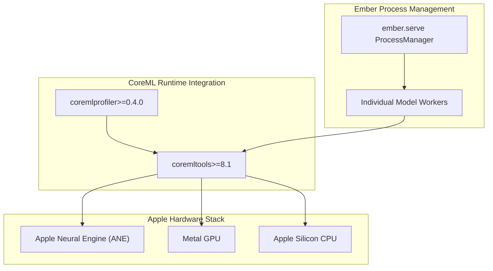
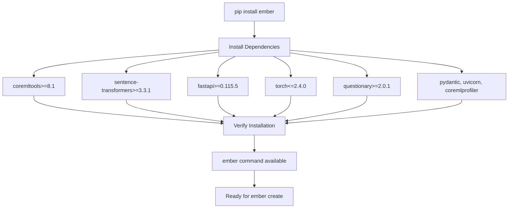
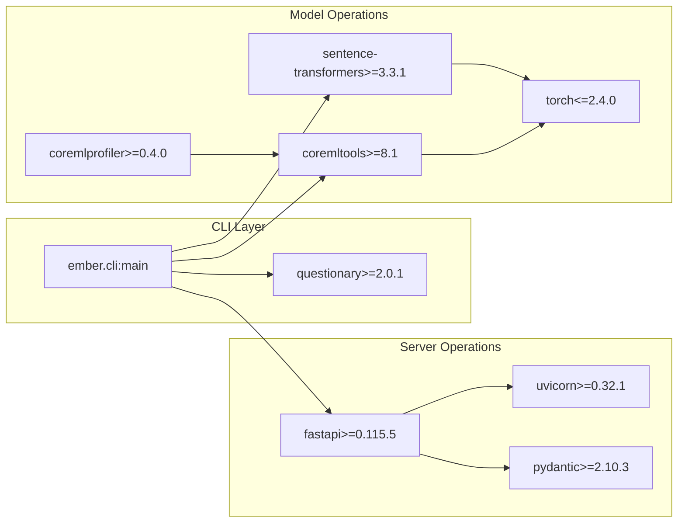

<!-- source: DeepWiki mcp.deepwiki.com · repo huggingface/ember · page 2.1 Installation · fetched 2026-10-26 -->

# Installation

<details>
<summary>Relevant source files</summary>

The following files were used as context for generating this wiki page:

- [README.md](README.md)
- [pyproject.toml](pyproject.toml)

</details>


This document covers the installation requirements, dependencies, and setup procedures for Ember. It focuses on getting the Ember system installed and ready for use. For information about creating and serving models after installation, see [Quick Start Guide](#2.2).

## System Requirements

Ember is designed specifically for macOS systems with Apple Silicon or Intel processors that support CoreML and the Apple Neural Engine (ANE). The following requirements must be met:

| Component | Requirement | Notes |
|-----------|-------------|-------|
| Operating System | macOS 12.0 or later | Required for CoreML 8.1+ support |
| Python Version | 3.9 - 3.12 | As specified in [pyproject.toml:6]() |
| Hardware | Apple Silicon recommended | ANE acceleration available on M-series chips |
| Memory | 8GB RAM minimum | Model conversion and serving can be memory-intensive |
| Storage | 2GB+ free space | For model files and dependencies |

### Hardware Acceleration Support



**Hardware Acceleration Priority Order**
The CoreML runtime automatically selects the optimal compute unit based on availability and model compatibility, following this priority:

*Sources: [pyproject.toml:8-9]()*

## Installation Methods

### Method 1: Direct Installation from Source

Clone the repository and install using pip:

```bash
git clone https://github.com/huggingface/ember
cd ember
pip install -e .
```

### Method 2: Package Installation (Future)

When Ember is published to PyPI, it will be installable via:

```bash
pip install ember
```

### Installation Flow



**CLI Entry Point Setup**
The installation process configures the `ember` command as defined in [pyproject.toml:23](), which maps to `ember.cli:main`.

*Sources: [pyproject.toml:1-24]()*

## Core Dependencies

The following table details Ember's core dependencies and their roles:

| Dependency | Version | Purpose |
|------------|---------|---------|
| `coremltools` | >=8.1 | Model conversion from PyTorch to CoreML format |
| `coremlprofiler` | >=0.4.0 | Performance profiling and optimization of CoreML models |
| `sentence-transformers` | >=3.3.1 | Source model loading from Hugging Face Hub |
| `torch` | <=2.4.0 | PyTorch model operations during conversion |
| `fastapi` | >=0.115.5 | HTTP API server framework |
| `uvicorn` | >=0.32.1 | ASGI server for FastAPI application |
| `pydantic` | >=2.10.3 | Data validation and serialization |
| `questionary` | >=2.0.1 | Interactive CLI prompts for model selection |

### Dependency Relationship Map



*Sources: [pyproject.toml:7-16]()*

## Installation Verification

After installation, verify that Ember is correctly installed and can access required system components:

### 1. Command Availability Test
```bash
ember --help
```

### 2. Python Environment Test
```bash
python -c "import coremltools; import sentence_transformers; print('Dependencies OK')"
```

### 3. CoreML System Test
```bash
python -c "import coremltools as ct; print(f'CoreML version: {ct.__version__}')"
```

### 4. Apple Neural Engine Detection
The system will automatically detect ANE availability during model serving. No manual verification is required, as CoreML handles compute unit selection transparently.

## Common Installation Issues

### Python Version Compatibility
Ember requires Python 3.9-3.12 as specified in [pyproject.toml:6](). If you encounter version conflicts:

```bash
python --version  # Should show 3.9.x - 3.12.x
```

### CoreML Dependencies on Older macOS
CoreML 8.1+ requires macOS 12.0 or later. On older systems, you may see import errors related to `coremltools`.

### PyTorch Version Constraints
The PyTorch version is capped at 2.4.0 in [pyproject.toml:14]() to ensure compatibility with the CoreML conversion pipeline.

*Sources: [pyproject.toml:6](), [pyproject.toml:14]()*

## Next Steps

Once installation is complete, proceed to [Quick Start Guide](#2.2) to learn how to create and serve your first embedding model using `ember create` and `ember serve`.

*Sources: [README.md:11-24](), [pyproject.toml:1-24]()*

---

