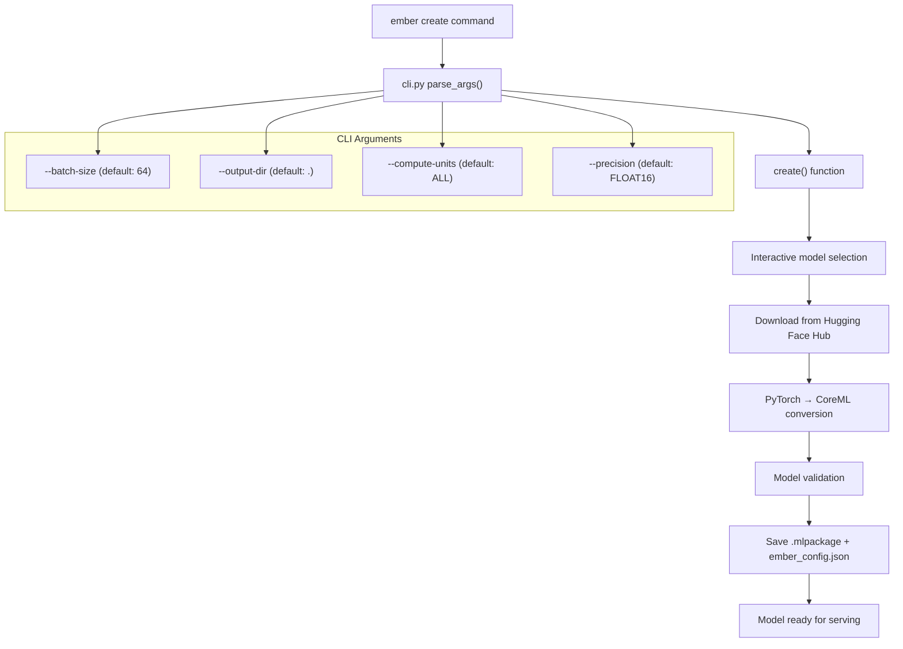
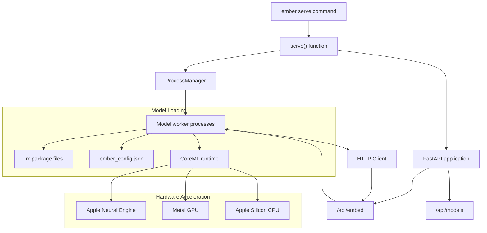

<!-- source: DeepWiki mcp.deepwiki.com · repo huggingface/ember · page 2.2 Quick Start Guide · fetched 2026-10-26 -->

# Quick Start Guide

<details>
<summary>Relevant source files</summary>

The following files were used as context for generating this wiki page:

- [README.md](README.md)
- [ember/cli.py](ember/cli.py)

</details>


## Purpose and Scope

This guide provides a streamlined walkthrough of the basic Ember workflow: converting sentence-transformer models to CoreML format and serving them via a local HTTP API. This covers the essential `ember create` and `ember serve` commands with a simple end-to-end example.

For detailed installation instructions, see [Installation](#2.1). For comprehensive model creation options, see [Model Creation](#3). For complete server configuration and API documentation, see [Model Serving](#4) and [API Reference](#8).

## Workflow Overview

Ember operates in two distinct phases: model preparation and model serving. The following diagram shows the complete workflow from model selection to API queries:

### Ember Workflow Pipeline

```mermaid
sequenceDiagram
    participant User
    participant CLI["ember CLI"]
    participant Create["create()"]
    participant HF["Hugging Face Hub"]
    participant CoreML["CoreML Conversion"]
    participant Storage["Local .mlpackage"]
    participant Serve["serve()"]
    participant API["/api/embed endpoint"]
    participant Client["HTTP Client"]
    
    User->>CLI: "ember create"
    CLI->>Create: "Execute create command"
    Create->>User: "Display model selection menu"
    User->>Create: "Select model (e.g., intfloat/multilingual-e5-small)"
    Create->>HF: "Download sentence-transformer"
    Create->>CoreML: "Convert to .mlpackage format"
    Create->>Storage: "Save model + ember_config.json"
    
    Note over Storage: "Model ready for serving"
    
    User->>CLI: "ember serve"
    CLI->>Serve: "Execute serve command"
    Serve->>Storage: "Load available models"
    Serve->>API: "Start FastAPI server on port 11434"
    
    Client->>API: "POST /api/embed with documents"
    API->>CoreML: "Process embeddings via ANE/GPU"
    CoreML-->>API: "Return embedding vectors"
    API-->>Client: "JSON response with embeddings"
```

Sources: [README.md:11-44](), [ember/cli.py:110-126]()

## Step 1: Model Creation

The `ember create` command launches an interactive model selection interface and converts the chosen model to CoreML format.

### Running Model Creation

```bash
ember create
```

This command executes the `create()` function which presents a dropdown menu with popular sentence-transformer models. You can select from recommended models or choose "Custom Model" to specify any sentence-transformers model from Hugging Face.

### Model Creation Process



Sources: [ember/cli.py:23-95](), [README.md:11-18]()

### Key Configuration Options

The `create` command supports several important parameters:

| Parameter | Default | Purpose |
|-----------|---------|---------|
| `--batch-size` | 64 | Inference batch size |
| `--output-dir` | `.` | Model output directory |
| `--compute-units` | `ALL` | Target ANE/GPU/CPU |
| `--precision` | `FLOAT16` | Model precision |
| `--validate` | `True` | Validate PyTorch vs CoreML outputs |

Sources: [ember/cli.py:27-94]()

## Step 2: Model Serving

The `ember serve` command starts a FastAPI server that loads all available CoreML models and exposes them via HTTP endpoints.

### Starting the Server

```bash
ember serve
```

This launches the `serve()` function, which starts a local server on port `11434` with the `/api/embed` endpoint.

### Server Architecture



Sources: [ember/cli.py:125-126](), [README.md:20-24]()

## Step 3: Querying the API

Once the server is running, you can send HTTP POST requests to generate embeddings for your documents.

### API Request Format

The `/api/embed` endpoint accepts JSON requests with the following structure:

```bash
curl http://localhost:11434/api/embed \
  -H "Content-Type: application/json" \
  -d '{
    "model": "intfloat/multilingual-e5-small",
    "documents": [
      { "content": "Hello, world!" },
      { "content": "Open source for the win 🤗!" }
    ],
    "options": {
      "keep_alive": 1
    }
  }'
```

### Request Parameters

| Field | Type | Description |
|-------|------|-------------|
| `model` | string | Model name (matches created model) |
| `documents` | array | List of documents with `content` field |
| `options.keep_alive` | integer | Minutes to keep model process alive |

Sources: [README.md:28-44]()

## Complete Example Walkthrough

Here's a complete example demonstrating the full Ember workflow:

### 1. Create a Model

```bash
# Start interactive model creation
ember create

# Select "intfloat/multilingual-e5-small" from the menu
# Model will be downloaded and converted to CoreML
```

### 2. Start the Server

```bash
# Launch the embedding server
ember serve
```

### 3. Generate Embeddings

```bash
# Query the API for embeddings
curl http://localhost:11434/api/embed \
  -H "Content-Type: application/json" \
  -d '{
    "model": "intfloat/multilingual-e5-small",
    "documents": [
      { "content": "Machine learning is fascinating" },
      { "content": "Natural language processing rocks" }
    ],
    "options": {
      "keep_alive": 5
    }
  }'
```

The server will return a JSON response containing embedding vectors for each document, optimized for Apple Neural Engine acceleration.

Sources: [README.md:11-44]()

## Next Steps

- **Advanced Model Creation**: See [Model Creation](#3) for detailed conversion options, custom models, and performance tuning
- **Server Configuration**: See [Model Serving](#4) for process management, concurrent serving, and production deployment
- **Client Examples**: See [Usage Examples](#5) for practical applications like similarity search and document clustering
- **Performance Analysis**: See [Performance Analysis](#6) for benchmarking tools and hardware optimization
- **Complete API Reference**: See [API Reference](#8) for all endpoints, error handling, and response formats
- **CLI Options**: See [CLI Reference](#9) for comprehensive command-line documentation

Sources: Table of contents structure

---

