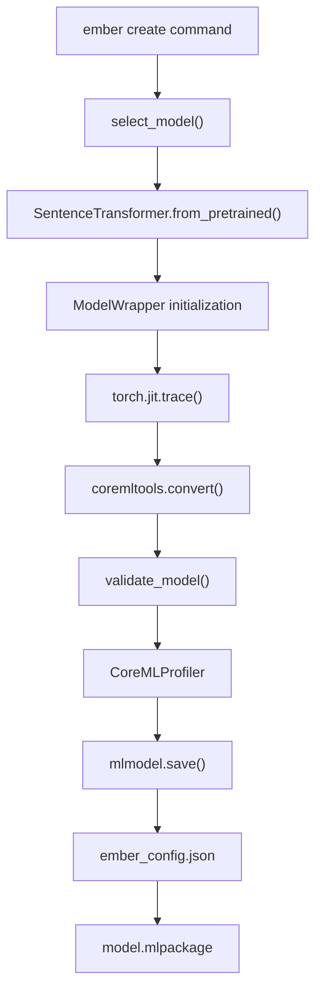
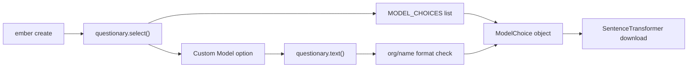
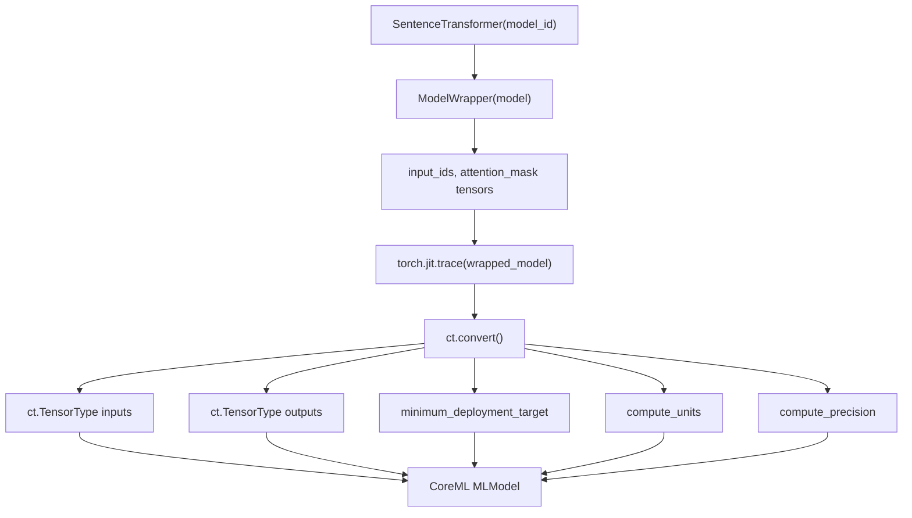
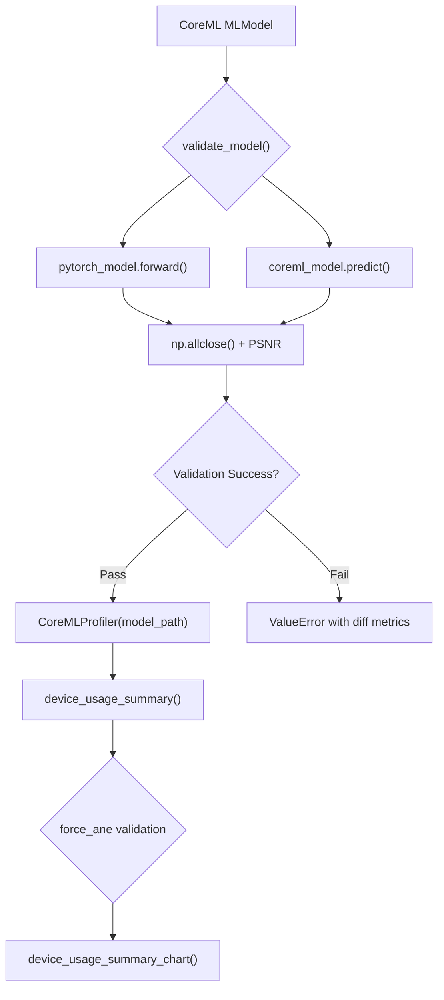
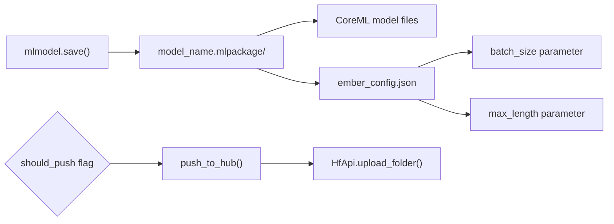

<!-- source: DeepWiki mcp.deepwiki.com · repo huggingface/ember · page 3 Model Creation · fetched 2026-10-26 -->

# Model Creation

<details>
<summary>Relevant source files</summary>

The following files were used as context for generating this wiki page:

- [README.md](README.md)
- [ember/create.py](ember/create.py)

</details>


This document covers the model creation process in Ember, which converts sentence-transformer models from PyTorch to CoreML format for Apple Neural Engine (ANE) acceleration. The `ember create` command provides an interactive interface for selecting, downloading, converting, and validating embedding models.

For information about serving the converted models, see [Model Serving](#4). For API usage examples with the created models, see [Usage Examples](#5).

## Overview

The model creation process transforms Hugging Face sentence-transformer models into Apple-optimized CoreML packages that can leverage the Apple Neural Engine for accelerated inference. This conversion enables local, high-performance embedding generation on Apple Silicon hardware.

**Model Creation Workflow**


Sources: [ember/create.py:235-323]()

## Model Selection Interface

The model creation process begins with an interactive selection interface that presents users with curated model options or allows custom model specification.

**Interactive Model Selection Process**


### Predefined Model Options

Ember provides a curated list of popular sentence-transformer models organized by size and use case:

| Organization | Model Name | Parameters | Description |
|--------------|------------|------------|-------------|
| sentence-transformers | all-mpnet-base-v2 | 100M | General purpose encoder |
| sentence-transformers | all-MiniLM-L12-v2 | 50M | Balanced size/performance |
| sentence-transformers | all-MiniLM-L6-v2 | 22M | Lightweight encoder |
| BAAI | bge-small/base/large-en-v1.5 | 33M/110M/330M | BGE series models |
| intfloat | multilingual-e5-small/base/large | 118M/275M/560M | Multilingual support |

The selection interface is implemented through the `select_model()` function, which uses the `questionary` library to provide an interactive command-line menu. Custom models can be specified using the Hugging Face model identifier format (org/name).

Sources: [ember/create.py:63-129](), [ember/create.py:132-158]()

## Conversion Pipeline

The conversion process transforms PyTorch sentence-transformer models into CoreML format through several key steps:

**PyTorch to CoreML Conversion Pipeline**


### Model Wrapping

The `ModelWrapper` class serves as an adapter between the sentence-transformer interface and CoreML conversion requirements:

```python
class ModelWrapper(torch.nn.Module):
    def forward(self, input_ids, attention_mask):
        outputs = self.model.forward(
            {"input_ids": input_ids, "attention_mask": attention_mask}
        )
        return outputs["sentence_embedding"]
```

This wrapper extracts the sentence embedding output from the model's dictionary response and presents it as a direct tensor output suitable for CoreML conversion.

### Tensor Configuration

The conversion process requires specific tensor type definitions for CoreML compatibility:

- **Input tensors**: `input_ids` and `attention_mask` as int32 arrays with shape `(batch_size, max_length)`
- **Output tensor**: `sentence_embeddings` as float32 array with model-specific embedding dimensions
- **Batch size**: Configurable during conversion (default varies by model)
- **Sequence length**: Determined by the source model's `get_max_seq_length()` method

Sources: [ember/create.py:35-45](), [ember/create.py:268-293]()

## Validation and Profiling

After conversion, Ember validates the CoreML model against the original PyTorch implementation and profiles its hardware compatibility.

**Model Validation and Profiling Workflow**


### Numerical Validation

The validation process compares outputs between PyTorch and CoreML versions using multiple metrics:

- **Absolute tolerance**: Element-wise difference threshold using `np.allclose()`
- **Peak Signal-to-Noise Ratio (PSNR)**: Computed using the formula `20 * log10(max_b / sqrt(mse))`
- **Difference statistics**: Maximum and average absolute differences between outputs

The `compute_psnr()` function provides a robust measure of conversion fidelity, ensuring the CoreML model maintains numerical accuracy.

### Hardware Profiling

The `CoreMLProfiler` analyzes the converted model's hardware compatibility:

- **Device usage distribution**: Percentage of operations running on ANE, GPU, and CPU
- **ANE compatibility verification**: Optional strict validation with `--force-ane` flag
- **Performance optimization insights**: Visual chart showing computational load distribution

Sources: [ember/create.py:160-204](), [ember/create.py:305-316]()

## Configuration and Output

The model creation process generates both the CoreML model package and associated configuration metadata.

**Output Generation Process**


### Model Package Structure

Each converted model produces a `.mlpackage` directory containing:

- **CoreML model artifacts**: Binary model weights and computational graph
- **ember_config.json**: Runtime configuration parameters
  - `batch_size`: Maximum batch size for inference
  - `max_length`: Maximum token sequence length

### Configuration Parameters

The configuration file stores essential parameters for model serving:

```json
{
  "batch_size": 1,
  "max_length": 512
}
```

These parameters are determined during conversion and used by the serving process to configure model workers appropriately.

Sources: [ember/create.py:318-320](), [ember/create.py:303]()

## Advanced Options

The `create()` function supports multiple configuration options for specialized use cases:

### Deployment and Precision Options

| Parameter | Type | Purpose |
|-----------|------|---------|
| `min_deployment_target` | AvailableTarget | Minimum iOS/macOS version compatibility |
| `compute_units` | ComputeUnit | Preferred hardware (ANE, GPU, CPU, ALL) |
| `precision` | ComputePrecision | Model precision (FLOAT32, FLOAT16) |
| `force_ane` | bool | Strict ANE-only operation requirement |

### Validation Parameters

| Parameter | Type | Default | Purpose |
|-----------|------|---------|---------|
| `tolerance` | float | 1e-3 | Numerical validation threshold |
| `psnr_threshold` | float | 30.0 | Minimum acceptable PSNR value |
| `validate` | bool | True | Enable validation step |

### Hugging Face Integration

The optional push functionality enables sharing converted models:

- **Repository creation**: Automatic private repository setup
- **Model upload**: Complete `.mlpackage` directory transfer
- **Access control**: Token-based authentication via `HF_TOKEN` environment variable

Sources: [ember/create.py:235-247](), [ember/create.py:206-224]()

---

