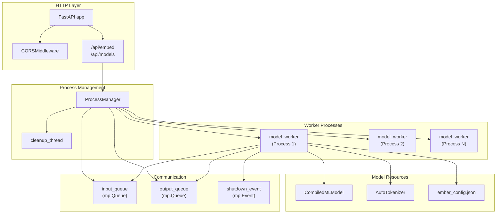
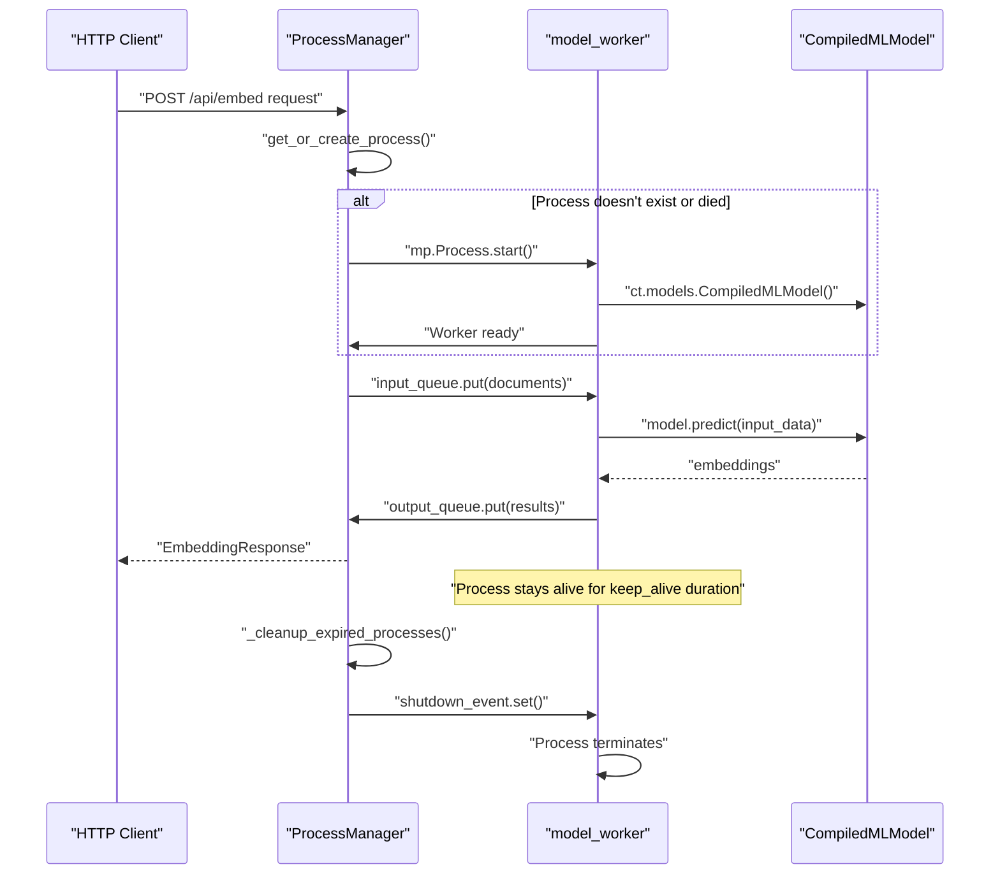
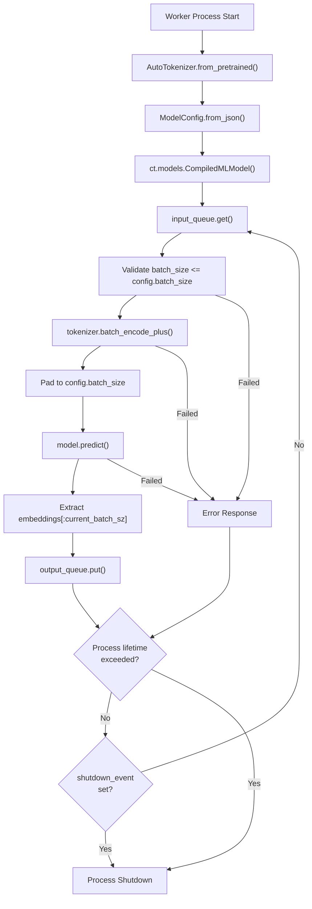

<!-- source: DeepWiki mcp.deepwiki.com · repo huggingface/ember · page 4 Model Serving · fetched 2026-10-26 -->

# Model Serving

Relevant source files

The following files were used as context for generating this wiki page:

- [README.md](README.md)
- [ember/serve.py](ember/serve.py)

This page documents the Ember embedding server, which provides HTTP API endpoints for generating embeddings using CoreML models. The server uses a multi-process architecture to handle concurrent requests and manage model lifecycles efficiently.

For information about converting models for serving, see [Model Creation](#3). For usage examples and client integration, see [Usage Examples](#5).

## Architecture Overview

The model serving system is built around a FastAPI application that manages multiple worker processes, each responsible for handling inference requests for specific models. The architecture separates HTTP request handling from model inference to provide isolation and concurrent processing capabilities.

### Core Components

**Sources:** [ember/serve.py:1-382]()

## API Endpoints

The server exposes two primary HTTP endpoints for interaction with the embedding service.

### POST /api/embed

The main endpoint for generating document embeddings. Accepts an `EmbeddingRequest` and returns an `EmbeddingResponse`.

| Field | Type | Description |
|-------|------|-------------|
| `model` | string | Model identifier (e.g., "intfloat/multilingual-e5-small") |
| `documents` | List[Document] | List of documents with content field |
| `options` | dict (optional) | Request options including keep_alive duration |

The endpoint validates batch sizes against model configuration and manages process lifecycle based on the `keep_alive` option.

### GET /api/models

Returns a list of currently active models in the process manager. This endpoint provides visibility into which models have running worker processes.

**Sources:** [ember/serve.py:326-367]()

## Process Management System

The `ProcessManager` class orchestrates worker processes and handles their lifecycle management through a sophisticated queuing and cleanup system.

### Process Lifecycle

### Process Configuration

Each worker process is configured with:

- `PROCESS_LIFETIME_MINUTES = 5`: Default process lifetime
- `QUEUE_TIMEOUT = 20`: Timeout for queue operations
- `keep_alive`: User-configurable process lifetime from request options

The `ProcessManager` maintains a background cleanup thread that periodically terminates expired processes to prevent resource leaks.

**Sources:** [ember/serve.py:233-301]()

## Request Processing Flow

The serving system processes embedding requests through a multi-stage pipeline involving tokenization, batch padding, and CoreML inference.

### Worker Process Flow

The worker process handles batch validation, tokenization with padding/truncation, batch size padding for CoreML requirements, and extraction of results for the actual batch size.

**Sources:** [ember/serve.py:98-232]()

## Error Handling

The server implements structured error handling through the `EmbeddingError` system with specific error codes and HTTP status mapping.

### Error Types

| Error Code | HTTP Status | Description |
|------------|-------------|-------------|
| `BATCH_SIZE_EXCEEDED` | 422 | Request batch size exceeds model configuration |
| `MODEL_LOAD_FAILED` | 500 | CoreML model or tokenizer loading failed |
| `TOKENIZATION_FAILED` | 400 | Text tokenization processing error |
| `INFERENCE_FAILED` | 500 | CoreML model prediction error |
| `TIMEOUT` | 408 | Queue operation timeout |

Each error includes structured details for debugging and client error handling. The `EmbeddingErrorResponse` model provides consistent error formatting across all endpoints.

**Sources:** [ember/serve.py:27-76]()

## Model Configuration

Worker processes load configuration from `ember_config.json` files created during the model conversion process. The `ModelConfig` class defines essential parameters:

- `max_length`: Maximum sequence length for tokenization
- `batch_size`: Maximum batch size for inference

These parameters are enforced at runtime to ensure compatibility with the converted CoreML model's input requirements.

**Sources:** [ember/serve.py:89-96](), [ember/serve.py:115]()

## Server Configuration

The server is configured with production-ready defaults:

- **Host**: `0.0.0.0` (all interfaces)
- **Port**: `11434` (default)
- **Workers**: `1` (single worker process)
- **CORS**: Enabled for all origins
- **Logging**: Uvicorn format with color support

The `serve()` function provides the entry point for starting the server with configurable host and port parameters.

**Sources:** [ember/serve.py:368-378]()

---

