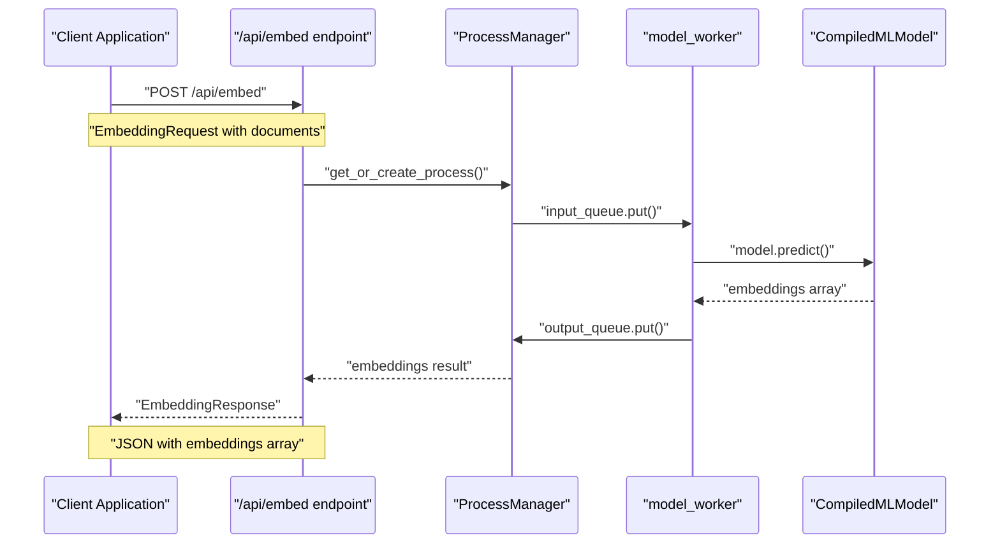
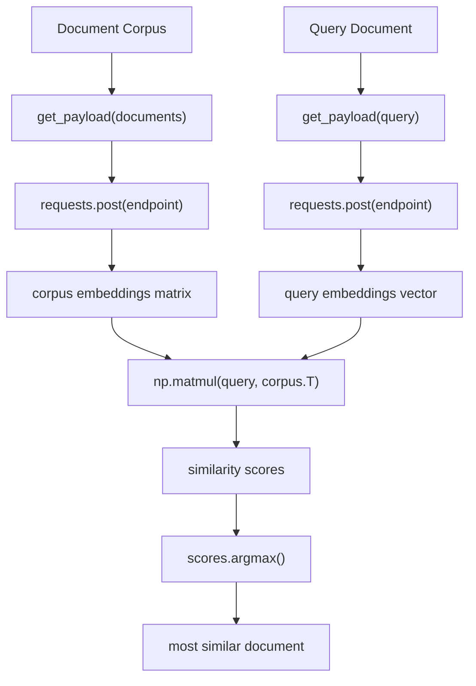
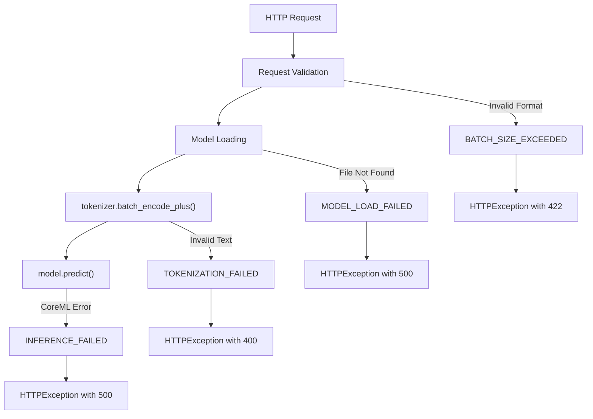
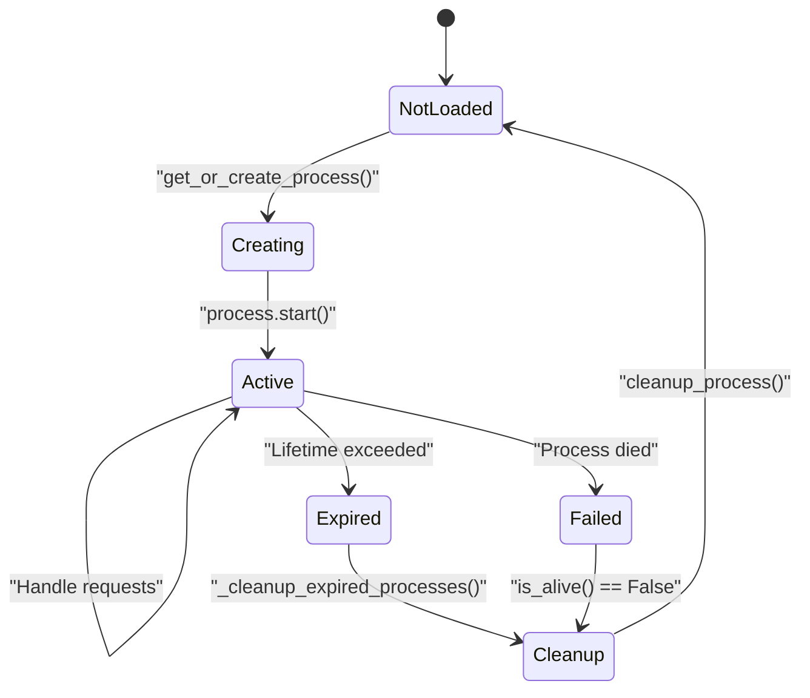

<!-- source: DeepWiki mcp.deepwiki.com · repo huggingface/ember · page 5 Usage Examples · fetched 2026-10-26 -->

# Usage Examples

Relevant source files

The following files were used as context for generating this wiki page:

- [ember/serve.py](ember/serve.py)
- [examples/similarity.py](examples/similarity.py)

This document provides practical examples demonstrating how to interact with the Ember embedding API for common use cases. The examples show real HTTP requests and responses using the endpoints defined in the FastAPI server, illustrating document similarity, batch processing, and error handling patterns.

For basic setup and installation, see [Getting Started](#2). For comprehensive API documentation, see [API Reference](#8). For server configuration details, see [Model Serving](#4).

## Overview of Client Interaction Patterns

The Ember API provides a RESTful interface for generating embeddings through the `/api/embed` endpoint. Client applications submit documents via HTTP POST requests and receive vector embeddings that can be used for similarity search, clustering, and other downstream tasks.

**Sources:** [ember/serve.py:326-353]()

## Basic Embedding Request

The fundamental operation involves sending text documents to the embedding endpoint and receiving vector representations. The request format follows the `EmbeddingRequest` model with a specified model identifier and document list.

The typical request structure requires three components: the model identifier matching the format used during model creation, a list of `Document` objects containing text content, and optional configuration parameters.

**Sources:** [ember/serve.py:77-87](), [ember/serve.py:326-353]()

## Document Similarity Search Example

The document similarity use case demonstrates practical embedding usage for finding semantically related content. This example shows the complete workflow from corpus embedding to similarity computation.

The similarity search pattern involves three phases: corpus embedding generation, query embedding generation, and similarity score computation using dot product operations.

The implementation in `similarity.py` demonstrates the standard pattern for embedding-based similarity search, including proper error handling with `raise_for_status()` and numpy array operations for efficient similarity computation.

**Sources:** [examples/similarity.py:23-56]()

## Batch Processing and Configuration

The embedding API supports batch processing through the `documents` array in the `EmbeddingRequest`. The batch size is constrained by the model configuration loaded from `ember_config.json`, which specifies `max_length` and `batch_size` parameters.

| Configuration Parameter | Purpose | Source Location |
|------------------------|---------|-----------------|
| `batch_size` | Maximum documents per request | `ModelConfig.batch_size` |
| `max_length` | Maximum token sequence length | `ModelConfig.max_length` |
| `keep_alive` | Process lifetime in minutes | `options.keep_alive` |

The `model_worker` function enforces batch size limits and returns `BATCH_SIZE_EXCEEDED` errors when requests exceed the configured maximum. Smaller batches are automatically padded to the configured batch size for optimal CoreML inference performance.

**Sources:** [ember/serve.py:89-96](), [ember/serve.py:143-155](), [ember/serve.py:179-187]()

## Error Handling Patterns

The API implements structured error handling through the `EmbeddingError` class hierarchy, providing specific error codes and detailed error information for different failure modes.

Each error type maps to specific HTTP status codes through the `_status_codes` mapping in the `EmbeddingError` class. The error responses include structured details for debugging, such as the actual batch size received versus the maximum allowed.

**Sources:** [ember/serve.py:27-76](), [ember/serve.py:143-155](), [ember/serve.py:164-173](), [ember/serve.py:194-202]()

## Model Management Operations

The `/api/models` endpoint provides visibility into currently loaded models managed by the `ProcessManager`. This endpoint returns the list of active model processes maintained in the `processes` dictionary.

The `ProcessManager` handles model lifecycle automatically, creating new worker processes on demand and cleaning up expired processes based on the `keep_alive` configuration. The cleanup mechanism runs in a background thread, checking process ages against the configured lifetime limits.

Process management follows this state machine:

The process lifetime is controlled by the `keep_alive` option in the embedding request, defaulting to `PROCESS_LIFETIME_MINUTES` when not specified.

**Sources:** [ember/serve.py:233-300](), [ember/serve.py:363-366](), [ember/serve.py:22]()

## Client Implementation Patterns

Successful client implementations follow the request patterns demonstrated in `similarity.py`, including proper payload construction, HTTP header configuration, and response handling. The `get_payload()` helper function shows the standard request format with model identification and document structuring.

Essential client components include:
- Endpoint configuration pointing to the Ember server
- Proper `Content-Type: application/json` headers 
- Document payload construction following the `EmbeddingRequest` schema
- Response parsing to extract the embeddings array
- Error handling for HTTP status codes and timeout conditions

The `keep_alive` option in the request options allows clients to control process lifecycle, optimizing for either memory efficiency (short lifetimes) or request latency (longer lifetimes).

**Sources:** [examples/similarity.py:23-39](), [ember/serve.py:80-83]()

---

