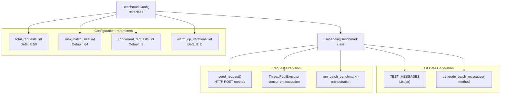
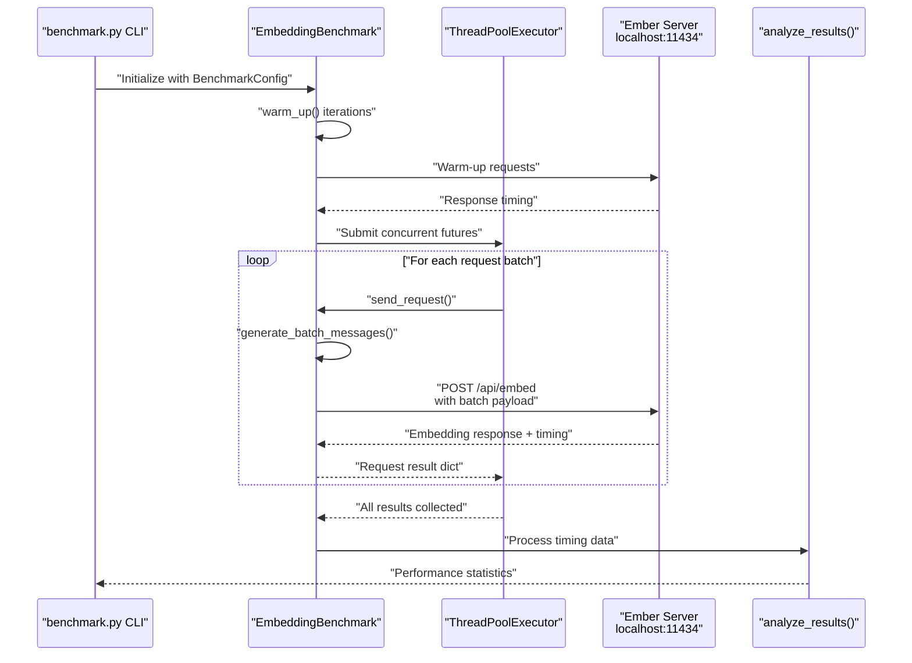
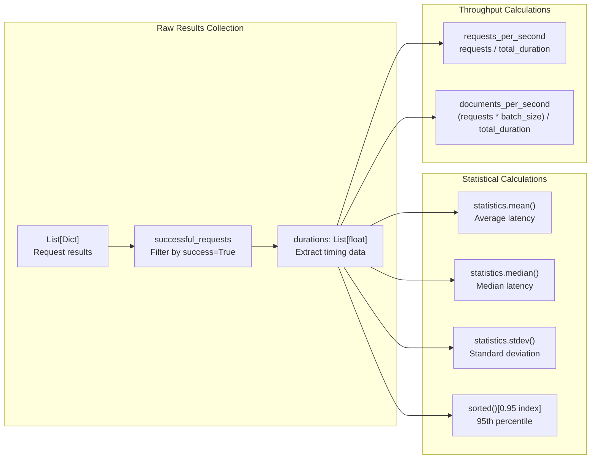
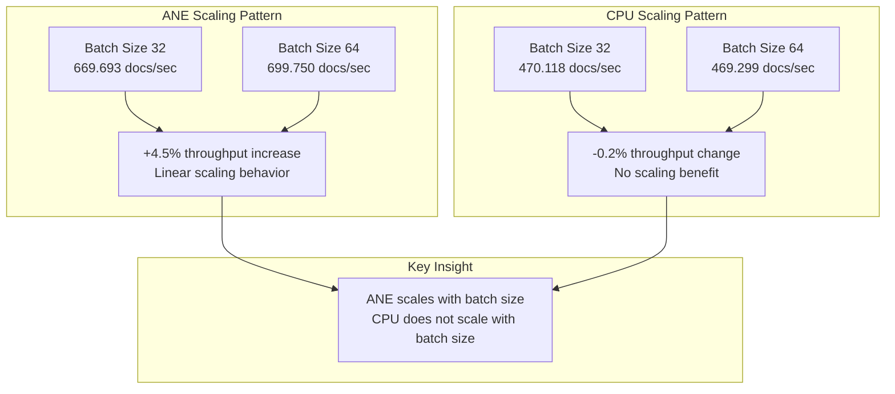
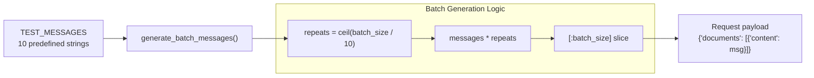

<!-- source: DeepWiki mcp.deepwiki.com · repo huggingface/ember · page 6 Performance Analysis · fetched 2026-10-26 -->

# Performance Analysis

<details>
<summary>Relevant source files</summary>

The following files were used as context for generating this wiki page:

- [benchmark_results.txt](benchmark_results.txt)
- [ember/benchmark.py](ember/benchmark.py)

</details>


This document covers the performance benchmarking tools, metrics analysis, and optimization guidance for the Ember embedding server. It focuses on the system's ability to efficiently process embedding requests across different hardware configurations and batch sizes.

For information about setting up and running the embedding server, see [Model Serving](#4). For development and testing procedures, see [Testing and Simulation](#7.2).

## Benchmarking Architecture

The Ember system includes a comprehensive benchmarking framework designed to measure real-world performance characteristics of the embedding service under various load conditions.

### Benchmark Configuration System



Sources: [ember/benchmark.py:10-16](), [ember/benchmark.py:30-35](), [ember/benchmark.py:69-92]()

### Request Processing Pipeline

The benchmarking system executes performance tests by sending concurrent batched requests to the `/api/embed` endpoint and measuring response characteristics.



Sources: [ember/benchmark.py:94-102](), [ember/benchmark.py:42-67](), [ember/benchmark.py:69-92]()

## Performance Metrics Framework

### Core Metrics Collection

The system tracks comprehensive performance metrics across multiple dimensions to provide insight into system behavior under load.

| Metric Category | Specific Measurements | Source Method |
|----------------|----------------------|---------------|
| **Request Metrics** | total_requests, successful_requests, failed_requests | [analyze_results():106-108]() |
| **Throughput** | requests_per_second, documents_per_second | [analyze_results():128-129]() |
| **Latency Distribution** | average_duration, median_duration, p95_duration | [analyze_results():121-123]() |
| **Latency Bounds** | min_duration, max_duration, std_dev | [analyze_results():124-126]() |
| **Batch Processing** | documents_per_request, total_documents_processed | [analyze_results():119-120]() |

### Statistical Analysis Implementation



Sources: [ember/benchmark.py:104-130]()

## Hardware Performance Comparison

### ANE vs CPU Performance Analysis

Based on empirical benchmarking results, the system demonstrates significant performance differences between Apple Neural Engine (ANE) and CPU-only execution modes.

#### Batch Size 32 Performance

| Hardware | Requests/sec | Documents/sec | Avg Latency (s) | P95 Latency (s) |
|----------|-------------|---------------|-----------------|-----------------|
| **CPU Only** | 14.691 | 470.118 | 3.154 | 3.395 |
| **ANE** | 20.928 | 669.693 | 2.343 | 2.388 |
| **Improvement** | +42.5% | +42.5% | -25.7% | -29.7% |

#### Batch Size 64 Performance

| Hardware | Requests/sec | Documents/sec | Avg Latency (s) | P95 Latency (s) |
|----------|-------------|---------------|-----------------|-----------------|
| **CPU Only** | 7.333 | 469.299 | 6.417 | 6.759 |
| **ANE** | 10.934 | 699.750 | 4.457 | 4.572 |
| **Improvement** | +49.1% | +49.1% | -30.5% | -32.4% |

Sources: [benchmark_results.txt:1-78]()

### Scaling Behavior Analysis



Sources: [benchmark_results.txt:77-78]()

## Benchmarking Tool Usage

### Command Line Interface

The `benchmark.py` script provides a flexible command-line interface for performance testing with configurable parameters.

```bash
# Basic benchmark with default settings
python ember/benchmark.py

# Custom configuration
python ember/benchmark.py --requests 100 --batch-size 32 --concurrent 10 --warm-up 5
```

### Configuration Parameters

| Parameter | Default | Description | Impact |
|-----------|---------|-------------|---------|
| `--requests` | 50 | Total number of requests to execute | Higher values provide more statistical confidence |
| `--batch-size` | 64 | Documents per request batch | Affects memory usage and ANE utilization |
| `--concurrent` | 5 | Parallel request threads | Tests server concurrency handling |
| `--warm-up` | 2 | Initial requests before measurement | Eliminates cold-start effects |

Sources: [ember/benchmark.py:142-159]()

### Test Data Generation

The benchmark uses a predefined set of diverse test messages that are automatically replicated to fill the requested batch size.



Sources: [ember/benchmark.py:17-28](), [ember/benchmark.py:36-48]()

## Performance Optimization Guidance

### Hardware Selection Recommendations

1. **Apple Neural Engine**: Preferred for production deployments due to 42-49% throughput improvements over CPU-only execution
2. **Batch Size Optimization**: Use larger batch sizes (64+) with ANE hardware to maximize throughput efficiency  
3. **Concurrent Request Handling**: The server efficiently handles concurrent requests; tune `concurrent_requests` parameter based on available system resources

### Monitoring and Analysis

Use the benchmark tool's statistical outputs to:

- **Latency Analysis**: Monitor P95 latency to understand worst-case performance
- **Throughput Tracking**: Track `documents_per_second` as the primary throughput metric
- **Scaling Validation**: Test different batch sizes to verify hardware scaling behavior
- **Regression Detection**: Compare benchmark results across model versions or configuration changes

Sources: [ember/benchmark.py:104-141]()

---

