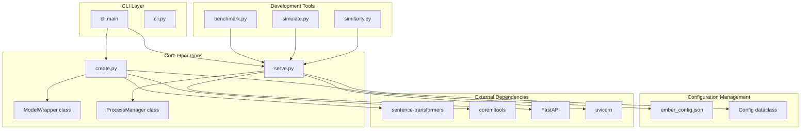
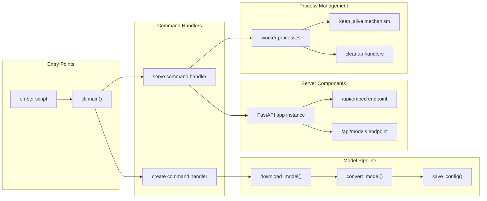

<!-- source: DeepWiki mcp.deepwiki.com · repo huggingface/ember · page 7 Development Guide · fetched 2026-10-26 -->

# Development Guide

Relevant source files

The following files were used as context for generating this wiki page:

- [pyproject.toml](pyproject.toml)
- [uv.lock](uv.lock)

This guide provides developers with essential information for contributing to, extending, or understanding the internal architecture of the Ember embedding server system. It covers the development workflow, code organization principles, and key architectural patterns used throughout the codebase.

For project structure details and module organization, see [Project Structure](#7.1). For testing procedures and simulation tools, see [Testing and Simulation](#7.2).

## Development Workflow Overview

Ember follows a two-phase development model that mirrors its runtime architecture: model preparation and model serving. Understanding this separation is crucial for effective development.

### Development Architecture Mapping

Sources: [pyproject.toml:22-23]()

### Core Development Components

The system architecture maps directly to specific code entities that developers need to understand:

Sources: [pyproject.toml:22-23]()

## Development Environment Setup

### Required Dependencies

The project uses a carefully curated set of dependencies optimized for Apple silicon and CoreML compatibility:

| Category | Package | Version Constraint | Purpose |
|----------|---------|-------------------|---------|
| ML Framework | `sentence-transformers` | `>=3.3.1` | Pre-trained model access |
| ML Framework | `torch` | `<=2.4.0` | PyTorch backend (version locked) |
| Apple Integration | `coremltools` | `>=8.1` | CoreML conversion |
| Apple Integration | `coremlprofiler` | `>=0.4.0` | Performance profiling |
| Web Framework | `fastapi` | `>=0.115.5` | HTTP API server |
| Web Framework | `uvicorn` | `>=0.32.1` | ASGI server |
| CLI | `questionary` | `>=2.0.1` | Interactive prompts |
| Validation | `pydantic` | `>=2.10.3` | Data validation |

### Python Version Requirements

The system requires Python `>=3.9,<3.13` to ensure compatibility with both modern language features and Apple's CoreML toolchain.

Sources: [pyproject.toml:6-16]()

## Code Organization Principles

### Single Responsibility Modules

Each module in the Ember codebase has a clearly defined responsibility:

- **cli.py**: Command-line interface and argument parsing
- **create.py**: Model conversion pipeline from sentence-transformers to CoreML
- **serve.py**: HTTP server implementation and process management
- **benchmark.py**: Performance measurement and analysis
- **simulate.py**: Load testing and stress testing utilities
- **similarity.py**: Client example and API usage demonstration

### Configuration-Driven Architecture

The system uses `ember_config.json` files to maintain separation between model metadata and runtime configuration. This allows for:

- Model-specific settings (batch size, maximum sequence length)
- Hardware optimization parameters
- Process lifecycle management settings

### Process Isolation Pattern

The serving component implements a multi-process architecture where:

- Each model runs in a dedicated worker process
- The main process handles HTTP routing and request distribution
- Process lifecycle management ensures resource cleanup
- Keep-alive mechanisms optimize for repeated inference

Sources: Based on architectural analysis from diagrams

## Extension Points

### Adding New Model Sources

To extend beyond sentence-transformers, developers can:

1. Implement new model wrapper classes following the `ModelWrapper` pattern
2. Add conversion logic in the create pipeline
3. Update configuration schema to support new model types

### Custom API Endpoints

The FastAPI application can be extended with additional endpoints by:

1. Adding new route handlers in the serving module
2. Implementing corresponding request/response models using Pydantic
3. Integrating with the existing process management system

### Performance Optimization

The system provides several extension points for performance optimization:

1. Custom batching strategies in the ProcessManager
2. Hardware-specific acceleration through CoreML configuration
3. Caching mechanisms for frequently requested embeddings

## Build and Distribution

The project uses setuptools as the build backend with a minimal configuration focused on the CLI entry point. The `ember` command is automatically installed and configured to invoke `ember.cli:main`.

Sources: [pyproject.toml:18-23]()

---

