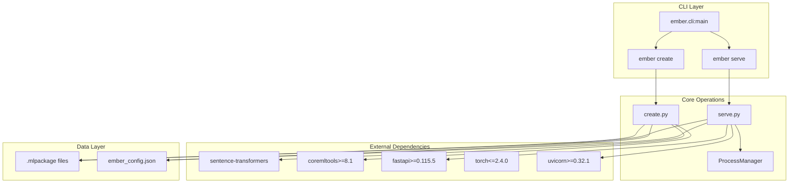
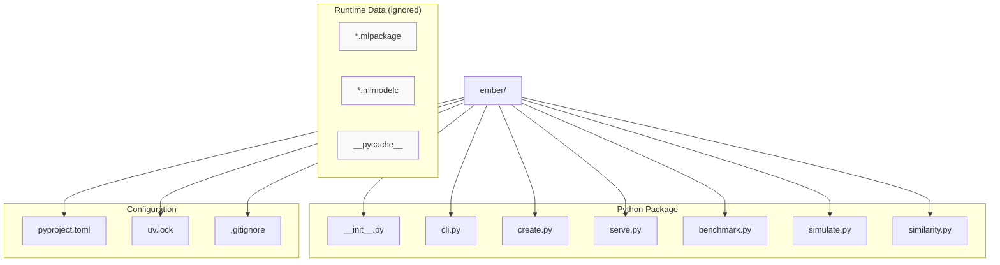
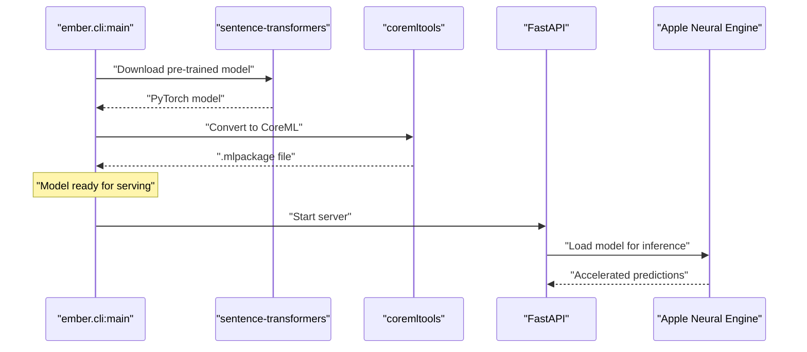
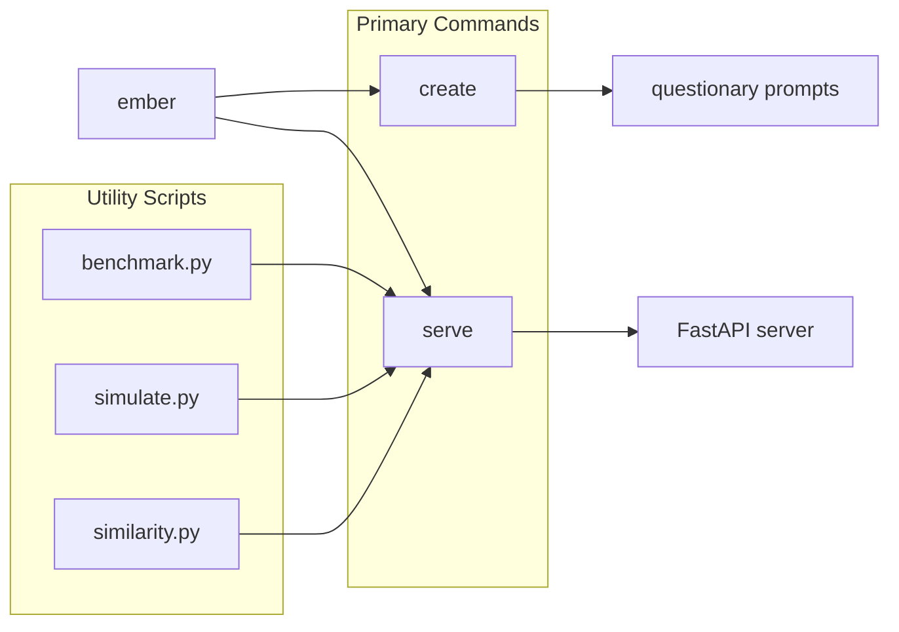
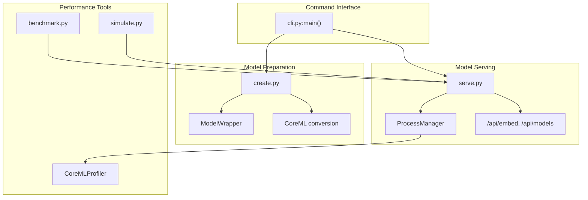
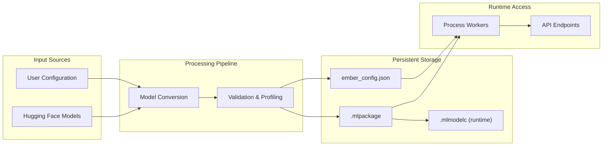

<!-- source: DeepWiki mcp.deepwiki.com · repo huggingface/ember · page 7.1 Project Structure · fetched 2026-10-26 -->

# Project Structure

<details>
<summary>Relevant source files</summary>

The following files were used as context for generating this wiki page:

- [.gitignore](.gitignore)
- [ember/__init__.py](ember/__init__.py)
- [pyproject.toml](pyproject.toml)
- [uv.lock](uv.lock)

</details>


This document provides a comprehensive overview of the Ember codebase organization, including its directory structure, dependencies, entry points, and key architectural components. This covers the technical foundation needed for developers working on or extending the Ember system.

For information about setting up the development environment and running tests, see [Testing and Simulation](#7.2). For details about the command-line interface usage, see [CLI Reference](#9).

## Architecture Overview

Ember is organized as a Python package with clear separation between model conversion and serving functionality. The system follows a modular design with distinct entry points for different operations.

### System Component Mapping



Sources: [pyproject.toml:1-24](), [uv.lock:211-236]()

## Directory Structure

The project follows standard Python packaging conventions with additional considerations for macOS-specific CoreML integration.

### Core Package Layout



Sources: [ember/__init__.py:1](), [.gitignore:1-6](), [pyproject.toml:1-24]()

## Technology Stack and Dependencies

Ember integrates multiple technology stacks to bridge the machine learning ecosystem with Apple's hardware acceleration platform.

### Dependency Categories

| Category | Dependencies | Purpose |
|----------|-------------|---------|
| **Core ML Framework** | `coremltools>=8.1`, `coremlprofiler>=0.4.0` | CoreML model conversion and profiling |
| **ML Ecosystem** | `sentence-transformers>=3.3.1`, `torch<=2.4.0` | Pre-trained model access and PyTorch backend |
| **Web Server** | `fastapi>=0.115.5`, `uvicorn>=0.32.1`, `pydantic>=2.10.3` | HTTP API server and data validation |
| **CLI Interface** | `questionary>=2.0.1` | Interactive command-line prompts |

Sources: [pyproject.toml:7-16]()

### External Integration Flow



Sources: [pyproject.toml:7-16](), [uv.lock:181-208]()

## Entry Points and CLI Structure

The system provides a unified command-line interface through the `ember` command, which is configured as a console script entry point.

### CLI Entry Point Configuration

The main entry point is defined in `pyproject.toml`:

```toml
[project.scripts]
ember = "ember.cli:main"
```

This maps the `ember` command to the `main` function in the `ember.cli` module, providing the primary interface for all system operations.

### Command Structure



Sources: [pyproject.toml:22-23]()

## Core Module Architecture

Based on the system architecture, Ember's core functionality is organized into specialized modules that handle distinct phases of the embedding pipeline.

### Module Responsibilities



Sources: [pyproject.toml:22-23]()

## Data and Configuration Management

Ember manages two primary types of persistent data: converted CoreML models and configuration metadata.

### File Type Organization

| File Type | Extension | Purpose | Storage Location |
|-----------|-----------|---------|------------------|
| **CoreML Models** | `.mlpackage` | Converted embedding models | Local directory |
| **Compiled Models** | `.mlmodelc` | CoreML runtime artifacts | Generated automatically |
| **Configuration** | `ember_config.json` | Model metadata and settings | Alongside `.mlpackage` |
| **Cache** | `__pycache__/` | Python bytecode cache | Generated automatically |

### Data Flow and Storage



Sources: [.gitignore:1-6]()

## Development Environment Setup

The project uses modern Python packaging and dependency management tools optimized for reproducible development environments.

### Package Management

Ember uses `uv` for fast, reliable dependency resolution and virtual environment management:

- **Primary dependencies**: Defined in `pyproject.toml` with version constraints
- **Lock file**: `uv.lock` ensures reproducible builds across environments  
- **Build system**: Uses `setuptools` as the build backend

### Excluded Files

The `.gitignore` configuration excludes runtime artifacts and generated files:

```
*.mlpackage      # Large CoreML model files
*.mlmodelc       # Compiled CoreML artifacts  
*.egg-info       # Package metadata
.DS_Store        # macOS filesystem metadata
__pycache__      # Python bytecode cache
```

This keeps the repository focused on source code while allowing local development with real model files.

Sources: [pyproject.toml:18-20](), [uv.lock:1-2](), [.gitignore:1-6]()

---

