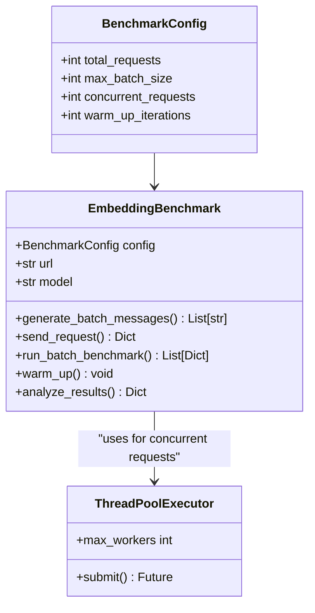
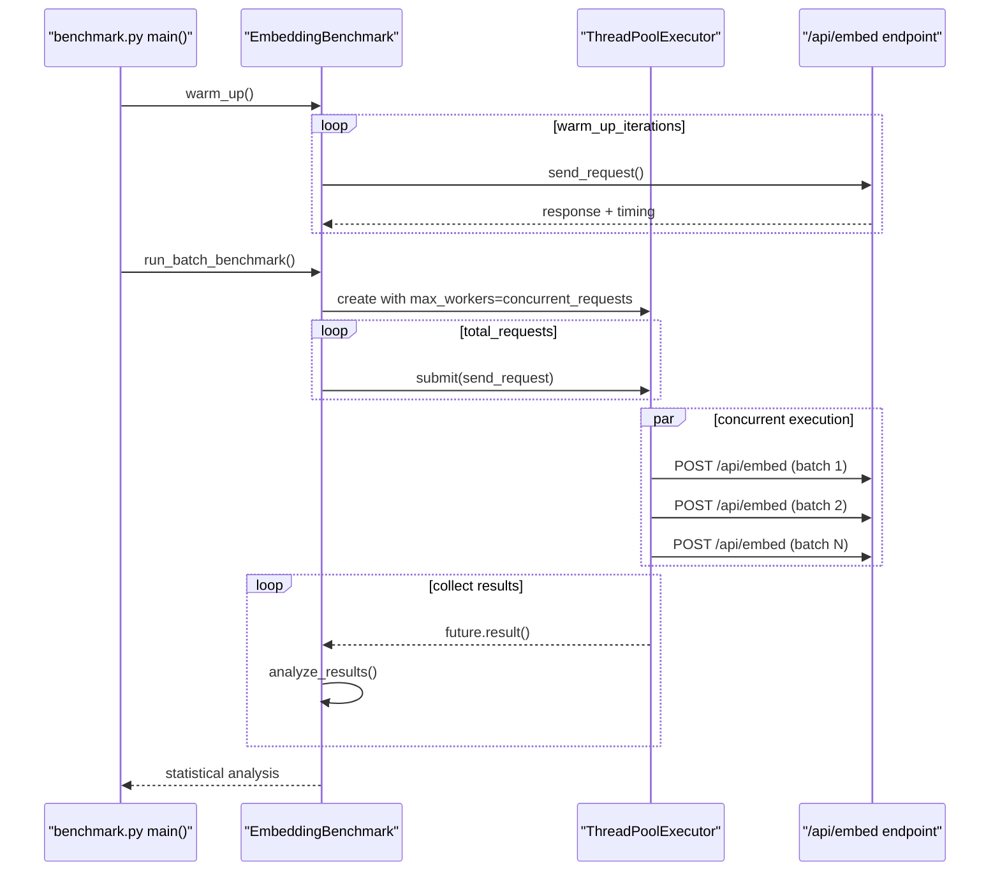
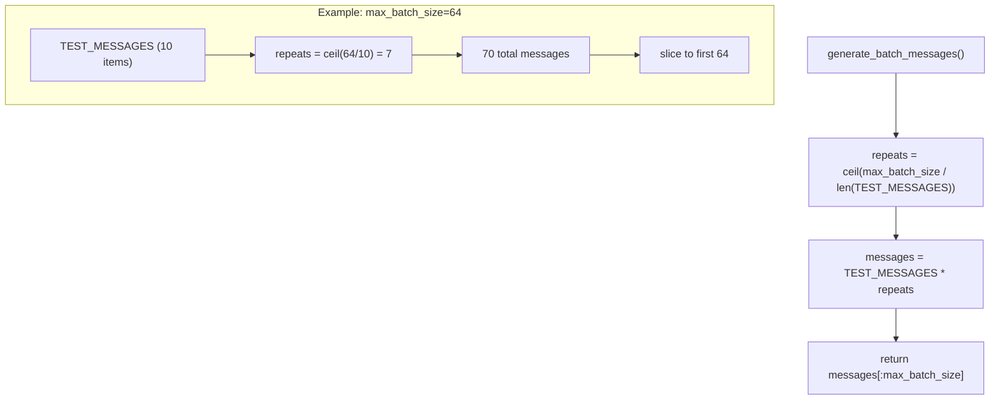
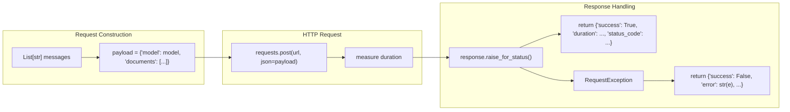
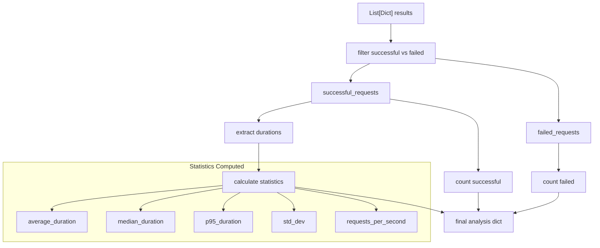
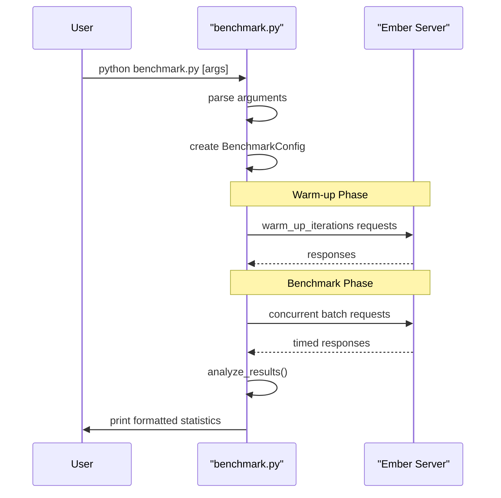
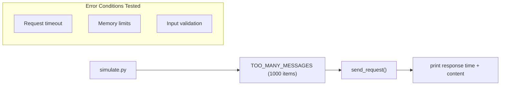

<!-- source: DeepWiki mcp.deepwiki.com · repo huggingface/ember · page 7.2 Testing and Simulation · fetched 2026-10-26 -->

# Testing and Simulation

<details>
<summary>Relevant source files</summary>

The following files were used as context for generating this wiki page:

- [ember/benchmark.py](ember/benchmark.py)
- [ember/simulate.py](ember/simulate.py)

</details>


This document covers the testing and simulation tools available in the Ember system for performance analysis, load testing, and validation of the embedding service. These tools are designed for developers who need to evaluate server performance, test edge cases, or benchmark different configurations.

For general performance analysis and optimization guidance, see [Performance Analysis](#6). For API usage examples in production scenarios, see [Usage Examples](#5).

## Overview

Ember provides two primary testing utilities for different validation scenarios:

| Tool | Purpose | Use Case |
|------|---------|----------|
| `benchmark.py` | Comprehensive performance benchmarking | Load testing, performance analysis, capacity planning |
| `simulate.py` | Simple simulation and edge case testing | Quick validation, error condition testing |

Both tools interact with the Ember API server running on `localhost:11434` and target the `/api/embed` endpoint.

## Benchmark Tool Architecture

The benchmarking system is built around the `EmbeddingBenchmark` class which provides systematic performance testing capabilities with configurable parameters and detailed statistical analysis.

### Benchmark Configuration



Sources: [ember/benchmark.py:10-16](), [ember/benchmark.py:30-35](), [ember/benchmark.py:77-78]()

### Request Flow and Concurrency

The benchmark tool implements concurrent request processing to simulate realistic load conditions:



Sources: [ember/benchmark.py:94-102](), [ember/benchmark.py:69-92](), [ember/benchmark.py:104-130]()

## Test Data and Message Generation

Both testing tools use predefined message sets to ensure consistent and reproducible test conditions:

### Message Sets

| Constant | Purpose | Size | Location |
|----------|---------|------|----------|
| `TEST_MESSAGES` | Standard test content | 10 messages | [benchmark.py:17-28](), [simulate.py:4-15]() |
| `TOO_MANY_MESSAGES` | Edge case testing | 1000 messages | [simulate.py:17]() |

The `generate_batch_messages()` method in `EmbeddingBenchmark` cycles through `TEST_MESSAGES` to create batches of the configured `max_batch_size`:



Sources: [ember/benchmark.py:36-40]()

## API Request Structure

Both tools construct requests following the Ember API specification:

### Request Payload Format

The request payload structure used by both testing tools:

```json
{
    "model": "intfloat/multilingual-e5-small",
    "documents": [
        {"content": "message1"},
        {"content": "message2"}
    ]
}
```

### Request Processing Flow



Sources: [ember/benchmark.py:42-67](), [ember/simulate.py:19-31]()

## Statistical Analysis

The benchmark tool provides comprehensive statistical analysis of request performance:

### Metrics Calculated

| Metric | Description | Calculation |
|--------|-------------|-------------|
| `average_duration` | Mean request time | `statistics.mean(durations)` |
| `median_duration` | Median request time | `statistics.median(durations)` |
| `p95_duration` | 95th percentile | `sorted(durations)[int(len(durations) * 0.95)]` |
| `requests_per_second` | Request throughput | `successful_requests / total_duration` |
| `documents_per_second` | Document throughput | `(successful_requests * batch_size) / total_duration` |

### Analysis Implementation



Sources: [ember/benchmark.py:104-130]()

## Command Line Interface

The benchmark tool provides a command-line interface for configuration:

### CLI Arguments

| Argument | Default | Description |
|----------|---------|-------------|
| `--requests` | 50 | Total number of requests to make |
| `--batch-size` | 64 | Maximum number of documents per request |
| `--concurrent` | 5 | Number of concurrent requests |
| `--warm-up` | 2 | Number of warm-up iterations |

### Usage Examples

```bash
# Default benchmark
python ember/benchmark.py

# High-load test
python ember/benchmark.py --requests 200 --batch-size 128 --concurrent 10

# Quick validation
python ember/benchmark.py --requests 10 --warm-up 1
```

Sources: [ember/benchmark.py:142-172]()

## Running Tests

### Prerequisites

1. Ember server must be running on `localhost:11434`
2. Model `intfloat/multilingual-e5-small` must be available
3. Required Python packages: `requests`, `statistics`, `concurrent.futures`

### Execution Workflow



### Output Interpretation

The benchmark tool outputs progress during execution and final statistics:

- **Progress tracking**: Shows completion percentage and request rate
- **Success/failure counts**: Number of successful vs failed requests  
- **Timing statistics**: Mean, median, P95, min, max response times
- **Throughput metrics**: Requests per second and documents per second

Sources: [ember/benchmark.py:85-90](), [ember/benchmark.py:132-140]()

## Edge Case Testing

The `simulate.py` tool provides simple edge case testing, particularly for request size limits:

### Large Request Testing

The `TOO_MANY_MESSAGES` constant creates a 1000-message request to test server behavior under extreme load conditions. This helps validate:

- Request size limits
- Memory handling
- Error response behavior
- Timeout handling



Sources: [ember/simulate.py:17](), [ember/simulate.py:33-37]()

---

