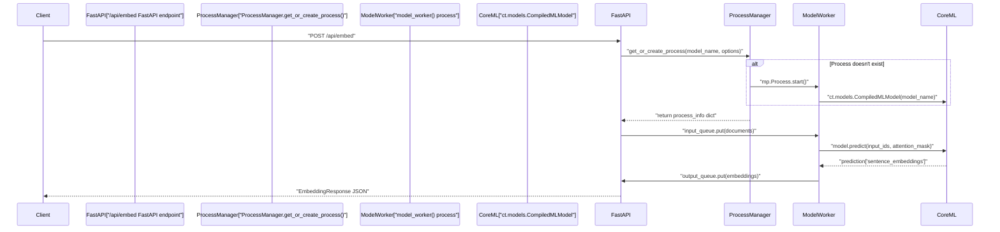
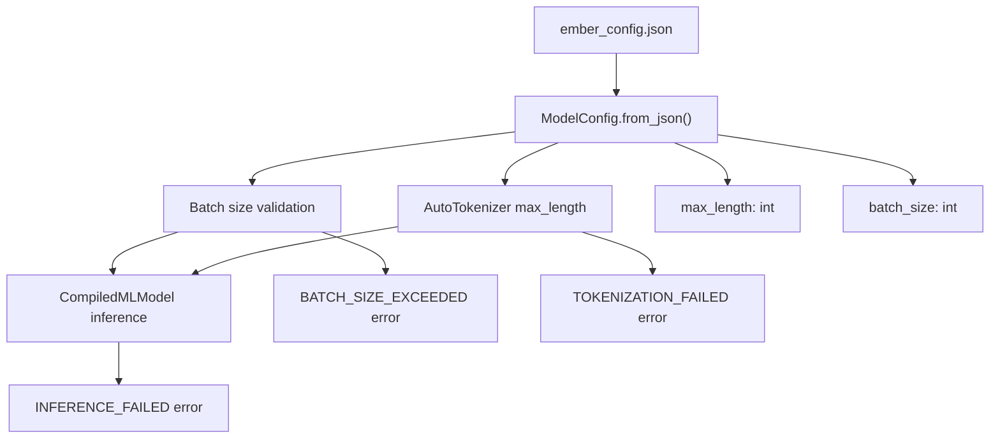
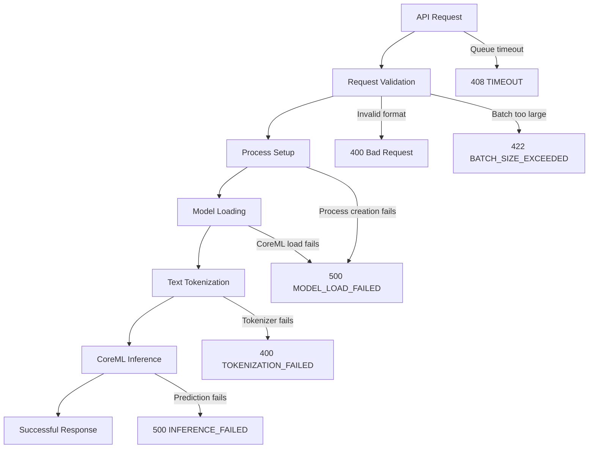
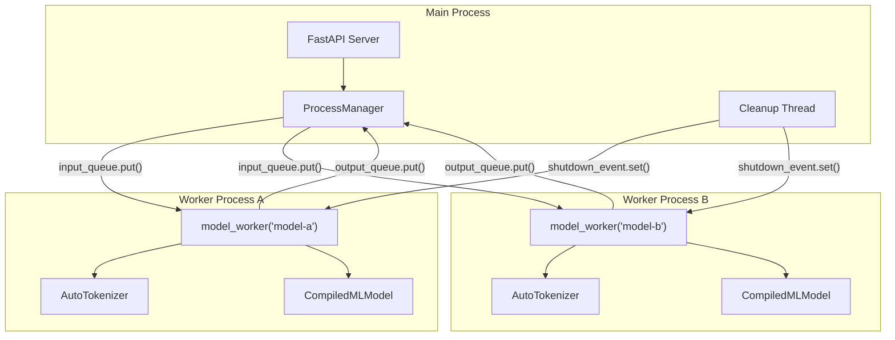

<!-- source: DeepWiki mcp.deepwiki.com · repo huggingface/ember · page 8 API Reference · fetched 2026-10-26 -->

# API Reference

<details>
<summary>Relevant source files</summary>

The following files were used as context for generating this wiki page:

- [README.md](README.md)
- [ember/serve.py](ember/serve.py)

</details>


This document provides a complete technical reference for the Ember HTTP API. It covers all available endpoints, request/response formats, error handling, and data models used by the embedding server. For information about starting the server and basic usage examples, see [Model Serving](#4). For command-line interface documentation, see [CLI Reference](#9).

## Server Configuration

The Ember API server runs on HTTP and serves embedding requests through RESTful endpoints. The default configuration uses:

- **Host**: `0.0.0.0` (all interfaces)
- **Port**: `11434`
- **Protocol**: HTTP
- **Framework**: FastAPI with Uvicorn ASGI server

The server is configured in [ember/serve.py:368-378]() using `uvicorn.Config` with single worker mode and asyncio event loop.

Sources: [ember/serve.py:368-378](), [README.md:22-24]()

## API Endpoints

### POST /api/embed

Creates embeddings for a batch of text documents using a specified model.

**Request Body**:
```json
{
  "model": "intfloat/multilingual-e5-small",
  "documents": [
    { "content": "Hello, world!" },
    { "content": "Open source for the win 🤗!" }
  ],
  "options": {
    "keep_alive": 1
  }
}
```

**Response Body**:
```json
{
  "model": "intfloat/multilingual-e5-small",
  "embeddings": [
    [0.1, 0.2, 0.3, ...],
    [0.4, 0.5, 0.6, ...]
  ]
}
```

**Parameters**:
- `model` (required): Model identifier in format `{organization}/{model_name}`
- `documents` (required): Array of documents, each containing a `content` field
- `options` (optional): Configuration object with optional `keep_alive` duration in minutes

**Process Behavior**:
- If the model process doesn't exist, it will be created automatically
- The `keep_alive` option controls how long the model process stays active after the request
- Default process lifetime is 5 minutes if no `keep_alive` is specified

Sources: [ember/serve.py:326-361](), [ember/serve.py:80-83](), [ember/serve.py:85-87](), [README.md:28-41]()

### GET /api/models

Returns a list of currently active model processes.

**Response Body**:
```json
{
  "models": ["intfloat/multilingual-e5-small", "sentence-transformers/all-MiniLM-L6-v2"]
}
```

This endpoint shows which model processes are currently running in the `ProcessManager`. Models appear in this list only after they have been used in an embedding request.

Sources: [ember/serve.py:363-366]()

## API Request Flow



Sources: [ember/serve.py:326-361](), [ember/serve.py:241-277](), [ember/serve.py:98-231]()

## Data Models

The API uses Pydantic models for request/response validation and serialization.

### EmbeddingRequest

| Field | Type | Required | Description |
|-------|------|----------|-------------|
| `model` | `str` | Yes | Model identifier in format `{org}/{name}` |
| `documents` | `List[Document]` | Yes | Array of documents to embed |
| `options` | `dict` | No | Configuration options including `keep_alive` |

### Document

| Field | Type | Required | Description |
|-------|------|----------|-------------|
| `content` | `str` | Yes | Text content to be embedded |

### EmbeddingResponse

| Field | Type | Description |
|-------|------|-------------|
| `model` | `str` | Model identifier that processed the request |
| `embeddings` | `List[List[float]]` | Array of embedding vectors, one per document |

### ModelConfig

Configuration loaded from `{model_name}.mlpackage/ember_config.json`:

| Field | Type | Description |
|-------|------|-------------|
| `max_length` | `int` | Maximum sequence length for tokenization |
| `batch_size` | `int` | Maximum batch size for inference |

Sources: [ember/serve.py:77-96]()

## Model Configuration and Constraints



Sources: [ember/serve.py:89-96](), [ember/serve.py:143-155](), [ember/serve.py:157-173]()

## Error Handling

The API uses structured error responses with specific error codes and HTTP status mappings.

### Error Codes

| Code | HTTP Status | Description |
|------|-------------|-------------|
| `BATCH_SIZE_EXCEEDED` | 422 | Request batch size exceeds model's maximum batch size |
| `MODEL_LOAD_FAILED` | 500 | Failed to load CoreML model or tokenizer |
| `TOKENIZATION_FAILED` | 400 | Text tokenization failed |
| `INFERENCE_FAILED` | 500 | CoreML model inference failed |
| `TIMEOUT` | 408 | Request timed out waiting for model response |

### Error Response Format

```json
{
  "detail": {
    "code": "BATCH_SIZE_EXCEEDED",
    "message": "Batch size 10 exceeds maximum allowed size of 8",
    "details": {
      "max_batch_size": 8,
      "received_size": 10
    }
  }
}
```

### Error Flow



Sources: [ember/serve.py:27-46](), [ember/serve.py:39-75](), [ember/serve.py:143-229]()

## Process Management

The Ember API manages model processes using a `ProcessManager` that handles lifecycle, cleanup, and isolation.

### Process Lifecycle

| Stage | Description | Implementation |
|-------|-------------|----------------|
| Creation | Process spawned on first request | `mp.Process(target=model_worker)` |
| Communication | Queue-based IPC | `mp.Queue` for input/output |
| Lifetime | Configurable keep-alive duration | Default 5 minutes, configurable via `options.keep_alive` |
| Cleanup | Automatic expiration and graceful shutdown | Background thread with `shutdown_event` |

### Process Architecture



### ProcessManager Methods

| Method | Purpose | Key Parameters |
|--------|---------|----------------|
| `get_or_create_process()` | Get existing or spawn new worker process | `model_name`, `options` dict |
| `cleanup_process()` | Gracefully terminate specific process | `model_name` |
| `_cleanup_expired_processes()` | Background cleanup of expired processes | Runs every 30 seconds |

Sources: [ember/serve.py:233-301](), [ember/serve.py:98-231]()

## Configuration Constants

| Constant | Value | Purpose | Location |
|----------|-------|---------|----------|
| `PROCESS_LIFETIME_MINUTES` | 5 | Default worker process lifetime | [ember/serve.py:22]() |
| `QUEUE_TIMEOUT` | 20 | IPC queue timeout in seconds | [ember/serve.py:23]() |
| Default port | 11434 | HTTP server port | [ember/serve.py:368]() |
| Cleanup interval | 30 seconds | Process cleanup check frequency | [ember/serve.py:300]() |

The server uses CORS middleware allowing all origins and supports all HTTP methods for cross-origin requests.

Sources: [ember/serve.py:22-23](), [ember/serve.py:316-322](), [ember/serve.py:368-378]()

---

