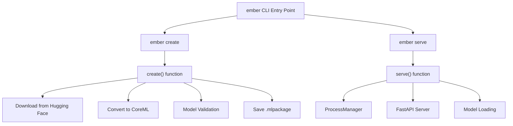
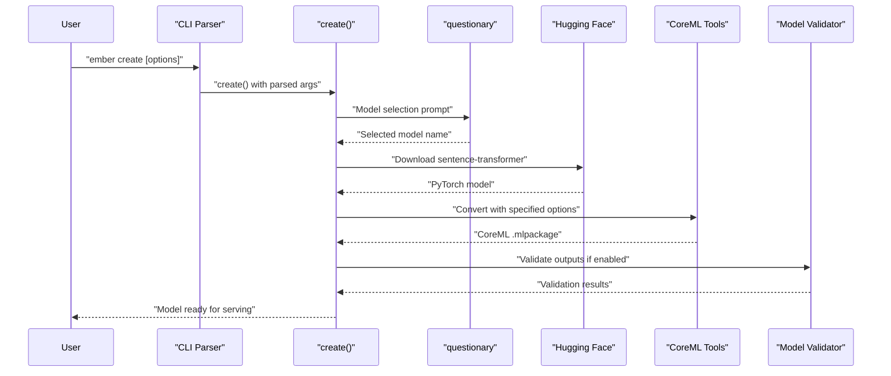
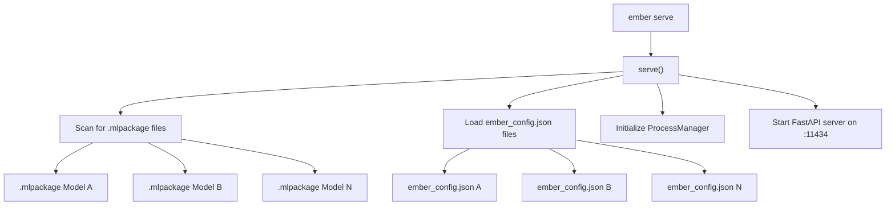
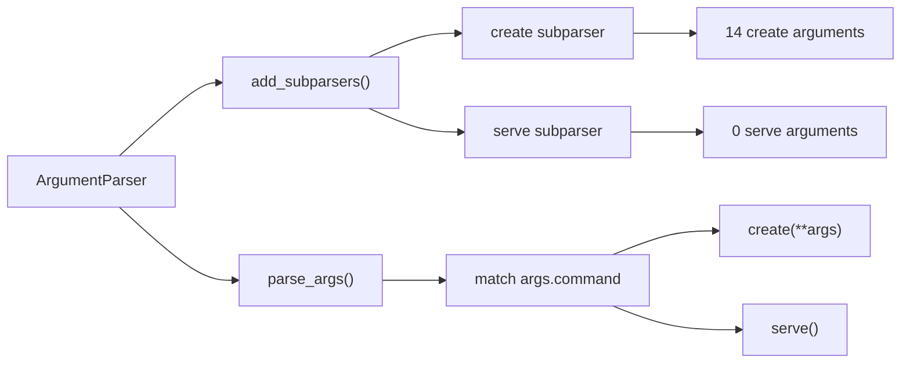

<!-- source: DeepWiki mcp.deepwiki.com · repo huggingface/ember · page 9 CLI Reference · fetched 2026-10-26 -->

# CLI Reference

<details>
<summary>Relevant source files</summary>

The following files were used as context for generating this wiki page:

- [README.md](README.md)
- [ember/cli.py](ember/cli.py)

</details>


This document provides comprehensive documentation for all command-line interface (CLI) options and commands available in the Ember system. The Ember CLI provides two primary commands for converting sentence-transformer models to CoreML format and serving them locally with Apple Neural Engine acceleration.

For information about using the API endpoints once the server is running, see [API Reference](#8). For practical usage examples and client code samples, see [Usage Examples](#5).

## CLI Architecture Overview

The Ember CLI is implemented as a Python package with two main subcommands that correspond to the core system phases: model preparation and model serving.



**Sources:** [ember/cli.py:103-127]()

## Command Structure

The Ember CLI follows a standard subcommand pattern where each command has specific options and arguments:

```
ember <command> [options]
```

| Command | Purpose | Function Called |
|---------|---------|-----------------|
| `create` | Convert sentence-transformer models to CoreML format | `create()` from [ember/create.py]() |
| `serve` | Start local embedding server for converted models | `serve()` from [ember/serve.py]() |

**Sources:** [ember/cli.py:110-126]()

## ember create

The `create` command downloads a sentence-transformer model from Hugging Face and converts it to Apple's CoreML format for accelerated inference.

### Basic Usage

```bash
# Interactive model selection
ember create

# With specific options
ember create --batch-size 32 --output-dir ./models --precision FLOAT16
```

### Command Options

#### Model Output Configuration

| Option | Type | Default | Description |
|--------|------|---------|-------------|
| `--output-dir` | string | `.` | Directory to save exported CoreML models |
| `--batch-size` | integer | `64` | Batch size for inference operations |

**Sources:** [ember/cli.py:27-37]()

#### CoreML Conversion Settings

| Option | Type | Default | Choices | Description |
|--------|------|---------|---------|-------------|
| `--min-deployment-target` | enum | `iOS17` | AvailableTarget values | Minimum iOS/macOS version for model compatibility |
| `--compute-units` | enum | `ALL` | ComputeUnit values | Target compute units (CPU/GPU/ANE) |
| `--precision` | enum | `FLOAT16` | ComputePrecision values | Numerical precision for model weights |

**Sources:** [ember/cli.py:40-58]()

#### Model Validation Options

| Option | Type | Default | Description |
|--------|------|---------|-------------|
| `--tolerance` | float | `5e-3` | Numerical tolerance for PyTorch vs CoreML output comparison |
| `--psnr-threshold` | float | `35` | Peak Signal-to-Noise Ratio threshold for validation |
| `--validate` | boolean | `True` | Enable validation of model outputs |
| `--force-ane` | boolean | `False` | Fail conversion if model cannot run entirely on ANE |

**Sources:** [ember/cli.py:60-94]()

#### Hugging Face Integration

| Option | Type | Default | Description |
|--------|------|---------|-------------|
| `--push-to-hub` | boolean | `False` | Upload converted model to Hugging Face Hub |
| `--hf-repo-id` | string | None | Repository ID for Hub upload (required with `--push-to-hub`) |

**Sources:** [ember/cli.py:72-82]()

### Model Creation Workflow



**Sources:** [ember/cli.py:111-124](), [README.md:11-18]()

## ember serve

The `serve` command starts a local FastAPI server that loads converted CoreML models and provides HTTP endpoints for generating embeddings.

### Basic Usage

```bash
ember serve
```

The serve command currently accepts no additional command-line arguments. All server configuration is handled through the model's embedded configuration and runtime detection of available models.

### Server Startup Process



**Sources:** [ember/cli.py:125-126](), [README.md:20-24]()

## CLI Implementation Details

### Argument Parsing Architecture

The CLI uses Python's `argparse` module with subparsers for command organization:



**Sources:** [ember/cli.py:20-100](), [ember/cli.py:103-127]()

### Enum Type Conversion

The CLI implements custom type converters for CoreML enumerations:

| Argument | Converter Function | Source Enum |
|----------|-------------------|-------------|
| `--min-deployment-target` | `lambda x: getattr(AvailableTarget, x)` | `coremltools.converters.mil._deployment_compatibility.AvailableTarget` |
| `--compute-units` | `lambda x: getattr(ComputeUnit, x)` | `coremltools.ComputeUnit` |
| `--precision` | `lambda x: getattr(ComputePrecision, x)` | `coremltools.converters.mil.mil.passes.defs.quantization.ComputePrecision` |

**Sources:** [ember/cli.py:2-4](), [ember/cli.py:41-58]()

## Exit Codes and Error Handling

The CLI relies on the underlying `create()` and `serve()` functions for error handling and will exit with appropriate codes based on:

- Model download failures from Hugging Face
- CoreML conversion errors
- Validation failures when `--validate` is enabled
- ANE compatibility failures when `--force-ane` is enabled
- Server startup issues for the serve command

**Sources:** [ember/cli.py:110-126]()