# Page: Overview

# Overview

<details>
<summary>Relevant source files</summary>

The following files were used as context for generating this wiki page:

- [README.md](README.md)

</details>


## Purpose and Scope

This document provides a comprehensive overview of the Ember system, which converts sentence-transformer models from Hugging Face to Apple CoreML format and serves them via a local HTTP API with Apple Neural Engine (ANE) acceleration. Ember enables efficient local embedding generation for semantic search, similarity computation, and document clustering applications.

For detailed installation instructions, see [Installation](#2.1). For hands-on usage examples, see [Usage Examples](#5). For performance optimization guidance, see [Performance Analysis](#6).

Sources: [README.md:1-49]()

## System Architecture

Ember operates through a two-phase architecture: model conversion and model serving. The system integrates Hugging Face's sentence-transformers ecosystem with Apple's CoreML runtime to provide hardware-accelerated local embedding services.

### High-Level Component Architecture

```mermaid
graph TB
    subgraph "CLI_Interface" ["CLI Interface"]
        ember_create["ember create"]
        ember_serve["ember serve"]
    end
    
    subgraph "Model_Creation" ["Model Creation Pipeline"]
        questionary_selector["questionary model selector"]
        sentence_transformers["sentence-transformers downloader"]
        coreml_converter["CoreML converter"]
        mlpackage_storage["mlpackage storage"]
    end
    
    subgraph "Model_Serving" ["Model Serving Infrastructure"] 
        fastapi_server["FastAPI server"]
        process_manager["ProcessManager"]
        coreml_runtime["CoreML runtime"]
        ane_engine["Apple Neural Engine"]
    end
    
    subgraph "External_Services" ["External Services"]
        huggingface_hub["Hugging Face Hub"]
        localhost_api["localhost:11434 API"]
    end
    
    ember_create --> questionary_selector
    questionary_selector --> sentence_transformers
    sentence_transformers --> huggingface_hub
    sentence_transformers --> coreml_converter
    coreml_converter --> mlpackage_storage
    
    ember_serve --> fastapi_server
    fastapi_server --> process_manager
    process_manager --> coreml_runtime
    coreml_runtime --> ane_engine
    mlpackage_storage --> process_manager
    
    localhost_api --> fastapi_server
```

Sources: [README.md:11-24]()

### API Endpoint and Processing Flow

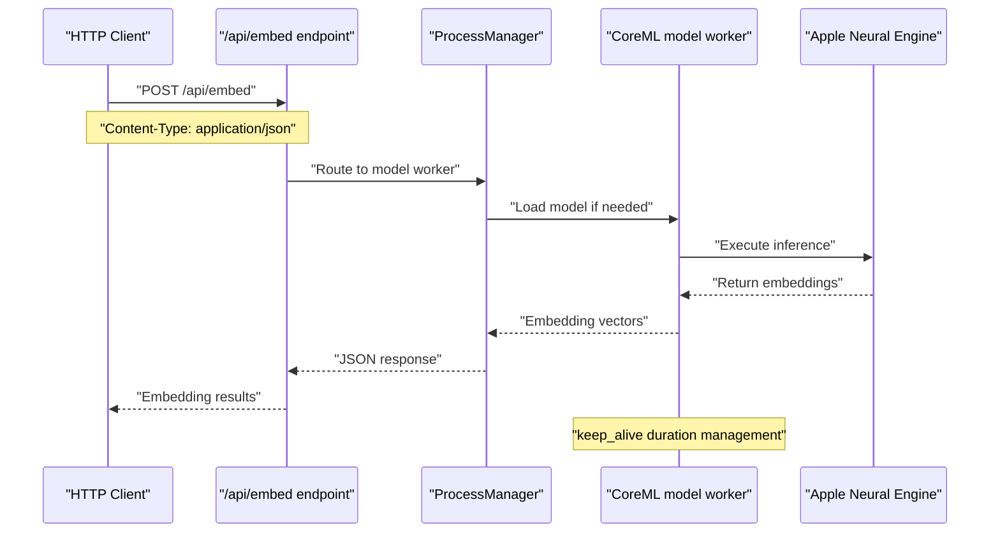

Sources: [README.md:26-44]()

## Core Components

### Model Creation Workflow

The `ember create` command orchestrates the conversion of sentence-transformer models to CoreML format through an interactive selection process.

| Component | Code Entity | Purpose |
|-----------|-------------|---------|
| CLI Entry Point | `ember create` | Interactive model selection and conversion |
| Model Selector | `questionary` dropdown | Choose from recommended or custom models |
| Model Source | `sentence-transformers` | Download from Hugging Face Hub |
| Conversion Engine | CoreML converter | Transform PyTorch to `.mlpackage` format |
| Configuration | `ember_config.json` | Store model metadata and settings |

Sources: [README.md:11-18]()

### Model Serving Infrastructure

The `ember serve` command launches a FastAPI-based HTTP server that manages CoreML model workers for embedding generation.

| Component | Code Entity | Purpose |
|-----------|-------------|---------|
| HTTP Server | `FastAPI` + `uvicorn` | REST API for embedding requests |
| API Endpoint | `/api/embed` | Primary embedding generation endpoint |
| Process Management | `ProcessManager` | Isolate and manage model workers |
| Model Runtime | CoreML runtime | Execute models on ANE/GPU/CPU |
| Lifecycle Control | `keep_alive` parameter | Manage worker process duration |

Sources: [README.md:20-44]()

## Data Processing Pipeline

### Request Processing Flow

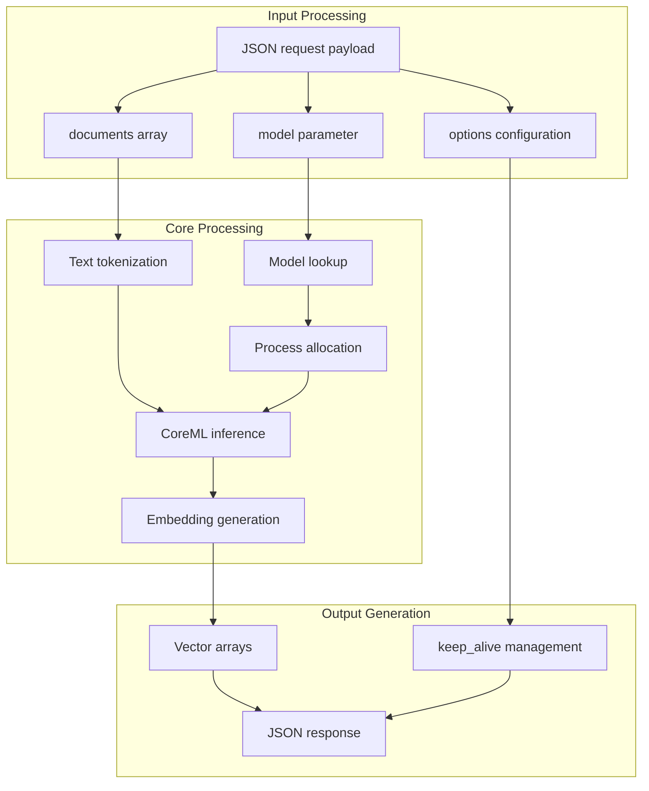

Sources: [README.md:29-40]()

### Model Conversion Pipeline

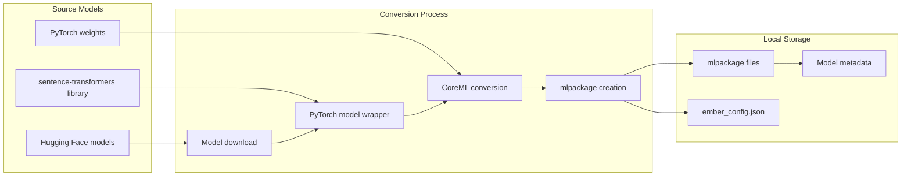

Sources: [README.md:15-18]()

## Technology Stack

### External Dependencies

Ember integrates with several key external systems:

- **Hugging Face Hub**: Source for pre-trained sentence-transformer models
- **sentence-transformers**: Python library for semantic embeddings
- **CoreML**: Apple's machine learning framework for local inference
- **FastAPI**: Modern Python web framework for API development
- **Apple Neural Engine**: Hardware acceleration for ML inference

### Hardware Optimization

The system targets Apple Silicon devices and leverages:

- **Apple Neural Engine (ANE)**: Primary acceleration target
- **Metal GPU**: Secondary acceleration option  
- **Apple Silicon CPU**: Fallback processing unit

### API Interface

The HTTP API follows RESTful conventions:

- **Base URL**: `http://localhost:11434`
- **Primary Endpoint**: `/api/embed`
- **Request Format**: JSON with `model`, `documents`, and `options` fields
- **Response Format**: JSON with embedding vectors

Sources: [README.md:1-49]()

## Usage Pattern

The typical Ember workflow involves two distinct phases:

1. **Model Creation**: Use `ember create` to select and convert models offline
2. **Model Serving**: Use `ember serve` to launch the embedding API server

This separation enables efficient model preparation and high-performance serving with process isolation and hardware acceleration.

For practical implementation examples, see [Usage Examples](#5). For performance benchmarking and optimization, see [Performance Analysis](#6).

Sources: [README.md:11-49]()

---

# Page: Getting Started

# Getting Started

<details>
<summary>Relevant source files</summary>

The following files were used as context for generating this wiki page:

- [README.md](README.md)
- [ember/cli.py](ember/cli.py)
- [pyproject.toml](pyproject.toml)

</details>


This document provides an overview of the Ember system workflow and guides you through the basic process of converting sentence-transformer models to CoreML format and serving them as a local API. Ember is designed to accelerate embedding generation on Apple hardware using the Apple Neural Engine (ANE) and GPU acceleration.

For detailed installation instructions, see [Installation](#2.1). For step-by-step usage examples, see [Quick Start Guide](#2.2). For comprehensive model creation options, see [Model Creation](#3). For API reference and serving configuration, see [Model Serving](#4).

## System Overview

Ember operates through a two-phase workflow: model conversion and model serving. The system converts Hugging Face sentence-transformer models to Apple's CoreML format, then serves them through a FastAPI-based HTTP server with process-based model isolation.

### Core Workflow

The Ember workflow consists of two main commands provided by the CLI interface:

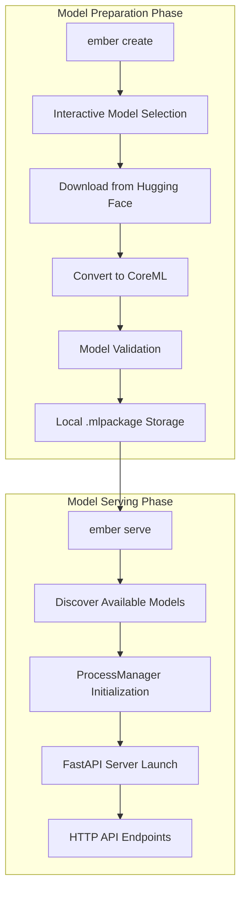

Sources: [README.md:9-24](), [ember/cli.py:23-126]()

### System Architecture

The following diagram shows how the major code components interact within the Ember system:

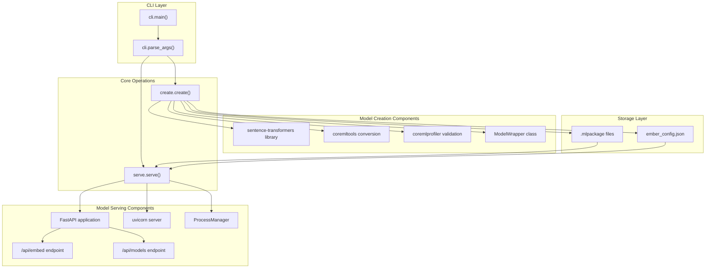

Sources: [ember/cli.py:103-126](), [pyproject.toml:7-16](), [README.md:1-49]()

## Component Responsibilities

| Component | File Location | Primary Function |
|-----------|---------------|------------------|
| `cli.main()` | [ember/cli.py:103-126]() | Entry point for ember command |
| `create.create()` | Referenced in [ember/cli.py:6]() | Converts sentence-transformer to CoreML |
| `serve.serve()` | Referenced in [ember/cli.py:5]() | Launches FastAPI embedding server |
| `questionary` | [pyproject.toml:12]() | Interactive model selection interface |
| `coremltools` | [pyproject.toml:9]() | PyTorch to CoreML conversion |
| `coremlprofiler` | [pyproject.toml:8]() | Model validation and ANE compatibility |
| `fastapi` | [pyproject.toml:10]() | HTTP API framework |
| `uvicorn` | [pyproject.toml:16]() | ASGI server for FastAPI |

Sources: [ember/cli.py:1-127](), [pyproject.toml:7-16]()

## Model Lifecycle Flow

The following diagram illustrates the complete lifecycle from model selection to API response:

```mermaid
sequenceDiagram
    participant User
    participant CLI as "ember CLI"
    participant Create as "create.create()"
    participant HF as "Hugging Face Hub"
    participant CoreML as "coremltools"
    participant Storage as "Local Storage"
    participant Serve as "serve.serve()"
    participant API as "FastAPI Server"
    participant Client as "HTTP Client"
    
    Note over User,Storage: Model Creation Phase
    User->>CLI: ember create
    CLI->>Create: create() with args
    Create->>User: questionary model selection
    Create->>HF: Download sentence-transformer
    Create->>CoreML: Convert to .mlpackage
    Create->>Storage: Save model + ember_config.json
    
    Note over User,Client: Model Serving Phase
    User->>CLI: ember serve
    CLI->>Serve: serve()
    Serve->>Storage: Discover available models
    Serve->>API: Initialize FastAPI app
    API-->>User: Server ready on localhost:11434
    
    Note over Client,API: API Usage
    Client->>API: POST /api/embed
    API->>API: ProcessManager handles request
    API-->>Client: JSON embeddings response
```

Sources: [README.md:11-44](), [ember/cli.py:110-126]()

## Configuration and Options

Ember provides extensive configuration options through CLI arguments for both model creation and serving phases:

### Creation Configuration
- `--batch-size`: Inference batch size (default: 64)
- `--min-deployment-target`: CoreML deployment target (default: iOS17)
- `--compute-units`: Target compute units (default: ALL)
- `--precision`: Computation precision (default: FLOAT16)
- `--validate`: Enable model validation (default: True)
- `--force-ane`: Require full ANE compatibility (default: False)

### Serving Configuration
The serve command automatically discovers available models and launches the FastAPI server on the default port 11434.

Sources: [ember/cli.py:27-94](), [ember/cli.py:96-98]()

## Next Steps

1. **Installation**: Follow [Installation](#2.1) to set up dependencies and install Ember
2. **Quick Start**: Use [Quick Start Guide](#2.2) for your first model conversion and server setup
3. **Model Creation**: Explore advanced conversion options in [Model Creation](#3)
4. **API Usage**: Learn about embedding endpoints in [Model Serving](#4)
5. **Examples**: See practical implementations in [Usage Examples](#5)

Sources: [README.md:1-49]()

---

# Page: Installation

# Installation

<details>
<summary>Relevant source files</summary>

The following files were used as context for generating this wiki page:

- [README.md](README.md)
- [pyproject.toml](pyproject.toml)

</details>


This document covers the installation requirements, dependencies, and setup procedures for Ember. It focuses on getting the Ember system installed and ready for use. For information about creating and serving models after installation, see [Quick Start Guide](#2.2).

## System Requirements

Ember is designed specifically for macOS systems with Apple Silicon or Intel processors that support CoreML and the Apple Neural Engine (ANE). The following requirements must be met:

| Component | Requirement | Notes |
|-----------|-------------|-------|
| Operating System | macOS 12.0 or later | Required for CoreML 8.1+ support |
| Python Version | 3.9 - 3.12 | As specified in [pyproject.toml:6]() |
| Hardware | Apple Silicon recommended | ANE acceleration available on M-series chips |
| Memory | 8GB RAM minimum | Model conversion and serving can be memory-intensive |
| Storage | 2GB+ free space | For model files and dependencies |

### Hardware Acceleration Support

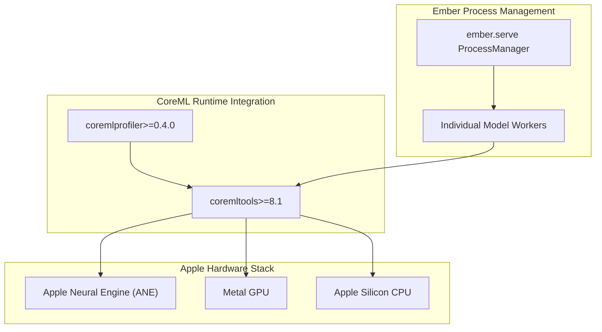

**Hardware Acceleration Priority Order**
The CoreML runtime automatically selects the optimal compute unit based on availability and model compatibility, following this priority:

*Sources: [pyproject.toml:8-9]()*

## Installation Methods

### Method 1: Direct Installation from Source

Clone the repository and install using pip:

```bash
git clone https://github.com/huggingface/ember
cd ember
pip install -e .
```

### Method 2: Package Installation (Future)

When Ember is published to PyPI, it will be installable via:

```bash
pip install ember
```

### Installation Flow

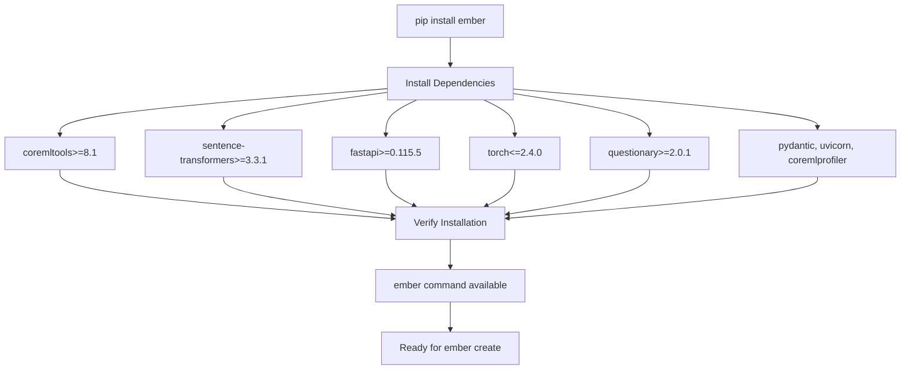

**CLI Entry Point Setup**
The installation process configures the `ember` command as defined in [pyproject.toml:23](), which maps to `ember.cli:main`.

*Sources: [pyproject.toml:1-24]()*

## Core Dependencies

The following table details Ember's core dependencies and their roles:

| Dependency | Version | Purpose |
|------------|---------|---------|
| `coremltools` | >=8.1 | Model conversion from PyTorch to CoreML format |
| `coremlprofiler` | >=0.4.0 | Performance profiling and optimization of CoreML models |
| `sentence-transformers` | >=3.3.1 | Source model loading from Hugging Face Hub |
| `torch` | <=2.4.0 | PyTorch model operations during conversion |
| `fastapi` | >=0.115.5 | HTTP API server framework |
| `uvicorn` | >=0.32.1 | ASGI server for FastAPI application |
| `pydantic` | >=2.10.3 | Data validation and serialization |
| `questionary` | >=2.0.1 | Interactive CLI prompts for model selection |

### Dependency Relationship Map

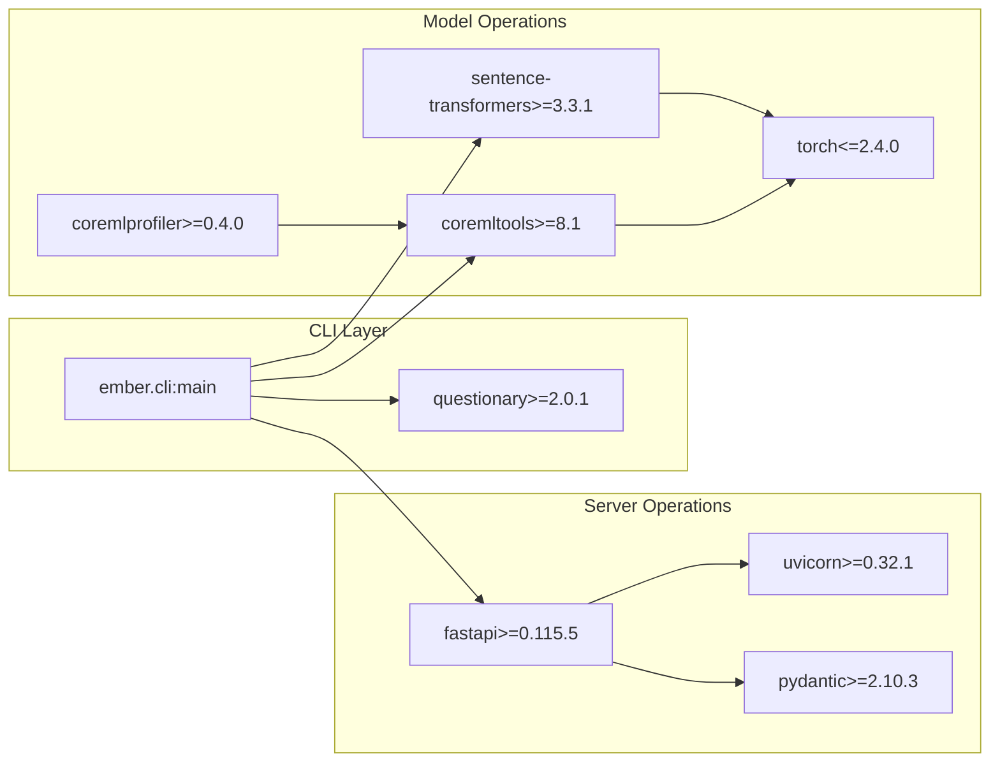

*Sources: [pyproject.toml:7-16]()*

## Installation Verification

After installation, verify that Ember is correctly installed and can access required system components:

### 1. Command Availability Test
```bash
ember --help
```

### 2. Python Environment Test
```bash
python -c "import coremltools; import sentence_transformers; print('Dependencies OK')"
```

### 3. CoreML System Test
```bash
python -c "import coremltools as ct; print(f'CoreML version: {ct.__version__}')"
```

### 4. Apple Neural Engine Detection
The system will automatically detect ANE availability during model serving. No manual verification is required, as CoreML handles compute unit selection transparently.

## Common Installation Issues

### Python Version Compatibility
Ember requires Python 3.9-3.12 as specified in [pyproject.toml:6](). If you encounter version conflicts:

```bash
python --version  # Should show 3.9.x - 3.12.x
```

### CoreML Dependencies on Older macOS
CoreML 8.1+ requires macOS 12.0 or later. On older systems, you may see import errors related to `coremltools`.

### PyTorch Version Constraints
The PyTorch version is capped at 2.4.0 in [pyproject.toml:14]() to ensure compatibility with the CoreML conversion pipeline.

*Sources: [pyproject.toml:6](), [pyproject.toml:14]()*

## Next Steps

Once installation is complete, proceed to [Quick Start Guide](#2.2) to learn how to create and serve your first embedding model using `ember create` and `ember serve`.

*Sources: [README.md:11-24](), [pyproject.toml:1-24]()*

---

# Page: Quick Start Guide

# Quick Start Guide

<details>
<summary>Relevant source files</summary>

The following files were used as context for generating this wiki page:

- [README.md](README.md)
- [ember/cli.py](ember/cli.py)

</details>


## Purpose and Scope

This guide provides a streamlined walkthrough of the basic Ember workflow: converting sentence-transformer models to CoreML format and serving them via a local HTTP API. This covers the essential `ember create` and `ember serve` commands with a simple end-to-end example.

For detailed installation instructions, see [Installation](#2.1). For comprehensive model creation options, see [Model Creation](#3). For complete server configuration and API documentation, see [Model Serving](#4) and [API Reference](#8).

## Workflow Overview

Ember operates in two distinct phases: model preparation and model serving. The following diagram shows the complete workflow from model selection to API queries:

### Ember Workflow Pipeline

```mermaid
sequenceDiagram
    participant User
    participant CLI["ember CLI"]
    participant Create["create()"]
    participant HF["Hugging Face Hub"]
    participant CoreML["CoreML Conversion"]
    participant Storage["Local .mlpackage"]
    participant Serve["serve()"]
    participant API["/api/embed endpoint"]
    participant Client["HTTP Client"]
    
    User->>CLI: "ember create"
    CLI->>Create: "Execute create command"
    Create->>User: "Display model selection menu"
    User->>Create: "Select model (e.g., intfloat/multilingual-e5-small)"
    Create->>HF: "Download sentence-transformer"
    Create->>CoreML: "Convert to .mlpackage format"
    Create->>Storage: "Save model + ember_config.json"
    
    Note over Storage: "Model ready for serving"
    
    User->>CLI: "ember serve"
    CLI->>Serve: "Execute serve command"
    Serve->>Storage: "Load available models"
    Serve->>API: "Start FastAPI server on port 11434"
    
    Client->>API: "POST /api/embed with documents"
    API->>CoreML: "Process embeddings via ANE/GPU"
    CoreML-->>API: "Return embedding vectors"
    API-->>Client: "JSON response with embeddings"
```

Sources: [README.md:11-44](), [ember/cli.py:110-126]()

## Step 1: Model Creation

The `ember create` command launches an interactive model selection interface and converts the chosen model to CoreML format.

### Running Model Creation

```bash
ember create
```

This command executes the `create()` function which presents a dropdown menu with popular sentence-transformer models. You can select from recommended models or choose "Custom Model" to specify any sentence-transformers model from Hugging Face.

### Model Creation Process

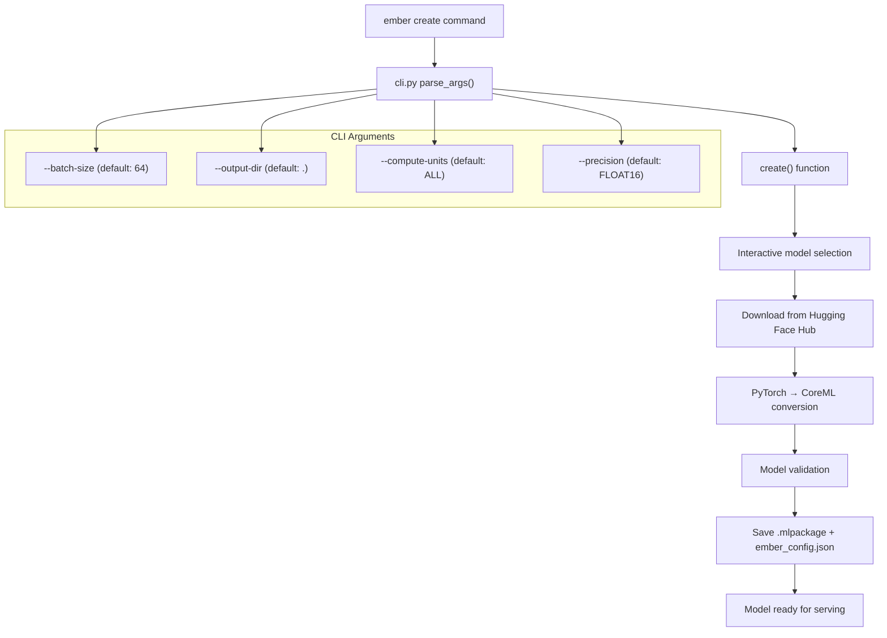

Sources: [ember/cli.py:23-95](), [README.md:11-18]()

### Key Configuration Options

The `create` command supports several important parameters:

| Parameter | Default | Purpose |
|-----------|---------|---------|
| `--batch-size` | 64 | Inference batch size |
| `--output-dir` | `.` | Model output directory |
| `--compute-units` | `ALL` | Target ANE/GPU/CPU |
| `--precision` | `FLOAT16` | Model precision |
| `--validate` | `True` | Validate PyTorch vs CoreML outputs |

Sources: [ember/cli.py:27-94]()

## Step 2: Model Serving

The `ember serve` command starts a FastAPI server that loads all available CoreML models and exposes them via HTTP endpoints.

### Starting the Server

```bash
ember serve
```

This launches the `serve()` function, which starts a local server on port `11434` with the `/api/embed` endpoint.

### Server Architecture

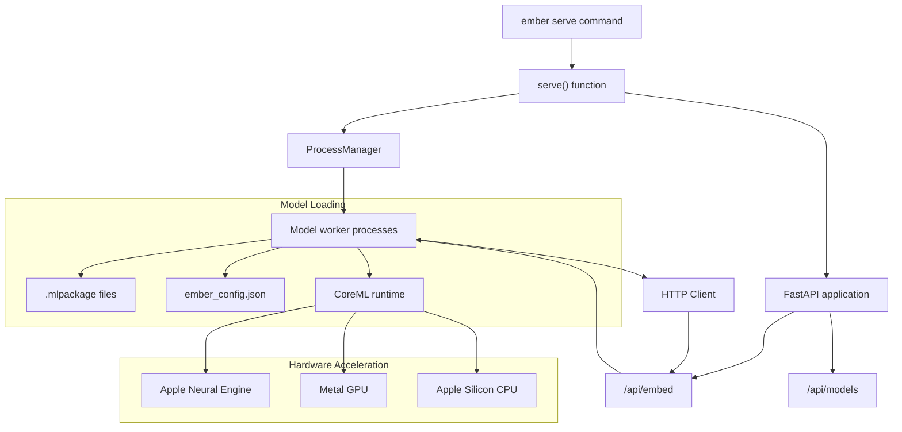

Sources: [ember/cli.py:125-126](), [README.md:20-24]()

## Step 3: Querying the API

Once the server is running, you can send HTTP POST requests to generate embeddings for your documents.

### API Request Format

The `/api/embed` endpoint accepts JSON requests with the following structure:

```bash
curl http://localhost:11434/api/embed \
  -H "Content-Type: application/json" \
  -d '{
    "model": "intfloat/multilingual-e5-small",
    "documents": [
      { "content": "Hello, world!" },
      { "content": "Open source for the win 🤗!" }
    ],
    "options": {
      "keep_alive": 1
    }
  }'
```

### Request Parameters

| Field | Type | Description |
|-------|------|-------------|
| `model` | string | Model name (matches created model) |
| `documents` | array | List of documents with `content` field |
| `options.keep_alive` | integer | Minutes to keep model process alive |

Sources: [README.md:28-44]()

## Complete Example Walkthrough

Here's a complete example demonstrating the full Ember workflow:

### 1. Create a Model

```bash
# Start interactive model creation
ember create

# Select "intfloat/multilingual-e5-small" from the menu
# Model will be downloaded and converted to CoreML
```

### 2. Start the Server

```bash
# Launch the embedding server
ember serve
```

### 3. Generate Embeddings

```bash
# Query the API for embeddings
curl http://localhost:11434/api/embed \
  -H "Content-Type: application/json" \
  -d '{
    "model": "intfloat/multilingual-e5-small",
    "documents": [
      { "content": "Machine learning is fascinating" },
      { "content": "Natural language processing rocks" }
    ],
    "options": {
      "keep_alive": 5
    }
  }'
```

The server will return a JSON response containing embedding vectors for each document, optimized for Apple Neural Engine acceleration.

Sources: [README.md:11-44]()

## Next Steps

- **Advanced Model Creation**: See [Model Creation](#3) for detailed conversion options, custom models, and performance tuning
- **Server Configuration**: See [Model Serving](#4) for process management, concurrent serving, and production deployment
- **Client Examples**: See [Usage Examples](#5) for practical applications like similarity search and document clustering
- **Performance Analysis**: See [Performance Analysis](#6) for benchmarking tools and hardware optimization
- **Complete API Reference**: See [API Reference](#8) for all endpoints, error handling, and response formats
- **CLI Options**: See [CLI Reference](#9) for comprehensive command-line documentation

Sources: Table of contents structure

---

# Page: Model Creation

# Model Creation

<details>
<summary>Relevant source files</summary>

The following files were used as context for generating this wiki page:

- [README.md](README.md)
- [ember/create.py](ember/create.py)

</details>


This document covers the model creation process in Ember, which converts sentence-transformer models from PyTorch to CoreML format for Apple Neural Engine (ANE) acceleration. The `ember create` command provides an interactive interface for selecting, downloading, converting, and validating embedding models.

For information about serving the converted models, see [Model Serving](#4). For API usage examples with the created models, see [Usage Examples](#5).

## Overview

The model creation process transforms Hugging Face sentence-transformer models into Apple-optimized CoreML packages that can leverage the Apple Neural Engine for accelerated inference. This conversion enables local, high-performance embedding generation on Apple Silicon hardware.

**Model Creation Workflow**
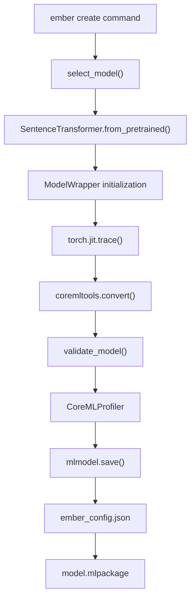

Sources: [ember/create.py:235-323]()

## Model Selection Interface

The model creation process begins with an interactive selection interface that presents users with curated model options or allows custom model specification.

**Interactive Model Selection Process**
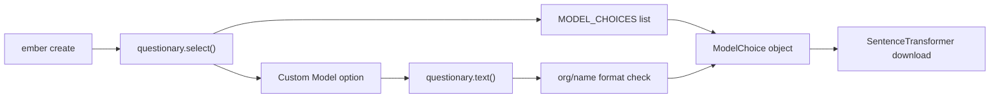

### Predefined Model Options

Ember provides a curated list of popular sentence-transformer models organized by size and use case:

| Organization | Model Name | Parameters | Description |
|--------------|------------|------------|-------------|
| sentence-transformers | all-mpnet-base-v2 | 100M | General purpose encoder |
| sentence-transformers | all-MiniLM-L12-v2 | 50M | Balanced size/performance |
| sentence-transformers | all-MiniLM-L6-v2 | 22M | Lightweight encoder |
| BAAI | bge-small/base/large-en-v1.5 | 33M/110M/330M | BGE series models |
| intfloat | multilingual-e5-small/base/large | 118M/275M/560M | Multilingual support |

The selection interface is implemented through the `select_model()` function, which uses the `questionary` library to provide an interactive command-line menu. Custom models can be specified using the Hugging Face model identifier format (org/name).

Sources: [ember/create.py:63-129](), [ember/create.py:132-158]()

## Conversion Pipeline

The conversion process transforms PyTorch sentence-transformer models into CoreML format through several key steps:

**PyTorch to CoreML Conversion Pipeline**
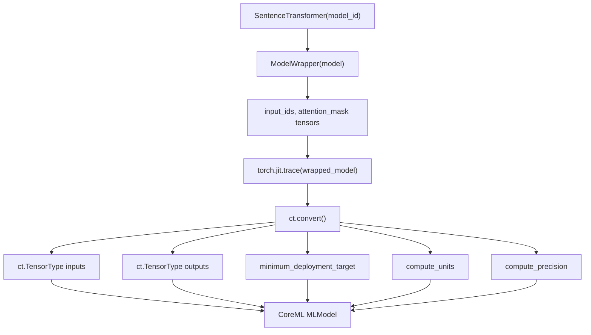

### Model Wrapping

The `ModelWrapper` class serves as an adapter between the sentence-transformer interface and CoreML conversion requirements:

```python
class ModelWrapper(torch.nn.Module):
    def forward(self, input_ids, attention_mask):
        outputs = self.model.forward(
            {"input_ids": input_ids, "attention_mask": attention_mask}
        )
        return outputs["sentence_embedding"]
```

This wrapper extracts the sentence embedding output from the model's dictionary response and presents it as a direct tensor output suitable for CoreML conversion.

### Tensor Configuration

The conversion process requires specific tensor type definitions for CoreML compatibility:

- **Input tensors**: `input_ids` and `attention_mask` as int32 arrays with shape `(batch_size, max_length)`
- **Output tensor**: `sentence_embeddings` as float32 array with model-specific embedding dimensions
- **Batch size**: Configurable during conversion (default varies by model)
- **Sequence length**: Determined by the source model's `get_max_seq_length()` method

Sources: [ember/create.py:35-45](), [ember/create.py:268-293]()

## Validation and Profiling

After conversion, Ember validates the CoreML model against the original PyTorch implementation and profiles its hardware compatibility.

**Model Validation and Profiling Workflow**
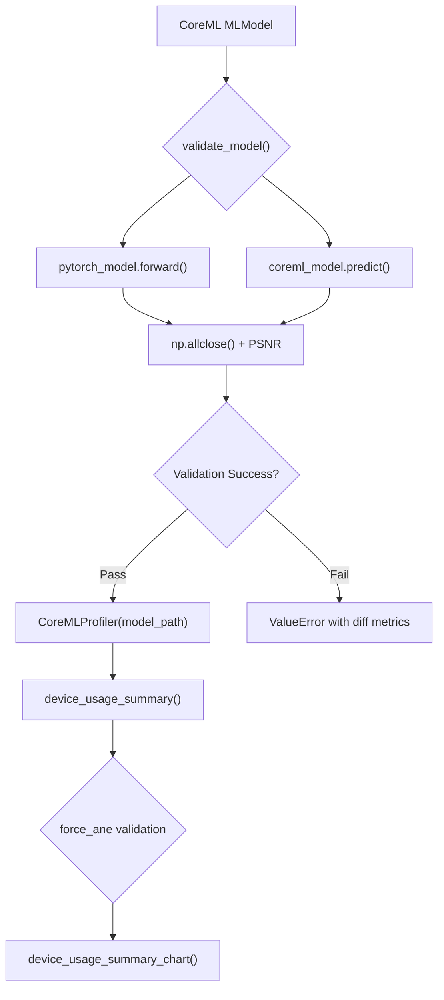

### Numerical Validation

The validation process compares outputs between PyTorch and CoreML versions using multiple metrics:

- **Absolute tolerance**: Element-wise difference threshold using `np.allclose()`
- **Peak Signal-to-Noise Ratio (PSNR)**: Computed using the formula `20 * log10(max_b / sqrt(mse))`
- **Difference statistics**: Maximum and average absolute differences between outputs

The `compute_psnr()` function provides a robust measure of conversion fidelity, ensuring the CoreML model maintains numerical accuracy.

### Hardware Profiling

The `CoreMLProfiler` analyzes the converted model's hardware compatibility:

- **Device usage distribution**: Percentage of operations running on ANE, GPU, and CPU
- **ANE compatibility verification**: Optional strict validation with `--force-ane` flag
- **Performance optimization insights**: Visual chart showing computational load distribution

Sources: [ember/create.py:160-204](), [ember/create.py:305-316]()

## Configuration and Output

The model creation process generates both the CoreML model package and associated configuration metadata.

**Output Generation Process**
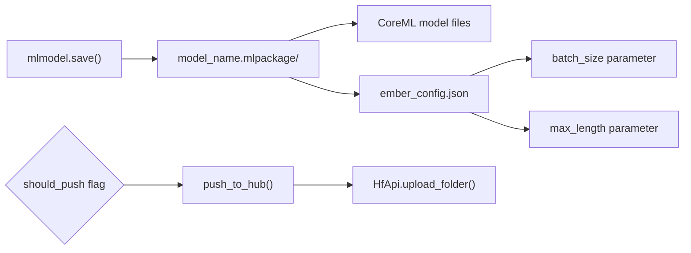

### Model Package Structure

Each converted model produces a `.mlpackage` directory containing:

- **CoreML model artifacts**: Binary model weights and computational graph
- **ember_config.json**: Runtime configuration parameters
  - `batch_size`: Maximum batch size for inference
  - `max_length`: Maximum token sequence length

### Configuration Parameters

The configuration file stores essential parameters for model serving:

```json
{
  "batch_size": 1,
  "max_length": 512
}
```

These parameters are determined during conversion and used by the serving process to configure model workers appropriately.

Sources: [ember/create.py:318-320](), [ember/create.py:303]()

## Advanced Options

The `create()` function supports multiple configuration options for specialized use cases:

### Deployment and Precision Options

| Parameter | Type | Purpose |
|-----------|------|---------|
| `min_deployment_target` | AvailableTarget | Minimum iOS/macOS version compatibility |
| `compute_units` | ComputeUnit | Preferred hardware (ANE, GPU, CPU, ALL) |
| `precision` | ComputePrecision | Model precision (FLOAT32, FLOAT16) |
| `force_ane` | bool | Strict ANE-only operation requirement |

### Validation Parameters

| Parameter | Type | Default | Purpose |
|-----------|------|---------|---------|
| `tolerance` | float | 1e-3 | Numerical validation threshold |
| `psnr_threshold` | float | 30.0 | Minimum acceptable PSNR value |
| `validate` | bool | True | Enable validation step |

### Hugging Face Integration

The optional push functionality enables sharing converted models:

- **Repository creation**: Automatic private repository setup
- **Model upload**: Complete `.mlpackage` directory transfer
- **Access control**: Token-based authentication via `HF_TOKEN` environment variable

Sources: [ember/create.py:235-247](), [ember/create.py:206-224]()

---

# Page: Model Serving

# Model Serving

<details>
<summary>Relevant source files</summary>

The following files were used as context for generating this wiki page:

- [README.md](README.md)
- [ember/serve.py](ember/serve.py)

</details>


This page documents the Ember embedding server, which provides HTTP API endpoints for generating embeddings using CoreML models. The server uses a multi-process architecture to handle concurrent requests and manage model lifecycles efficiently.

For information about converting models for serving, see [Model Creation](#3). For usage examples and client integration, see [Usage Examples](#5).

## Architecture Overview

The model serving system is built around a FastAPI application that manages multiple worker processes, each responsible for handling inference requests for specific models. The architecture separates HTTP request handling from model inference to provide isolation and concurrent processing capabilities.

### Core Components

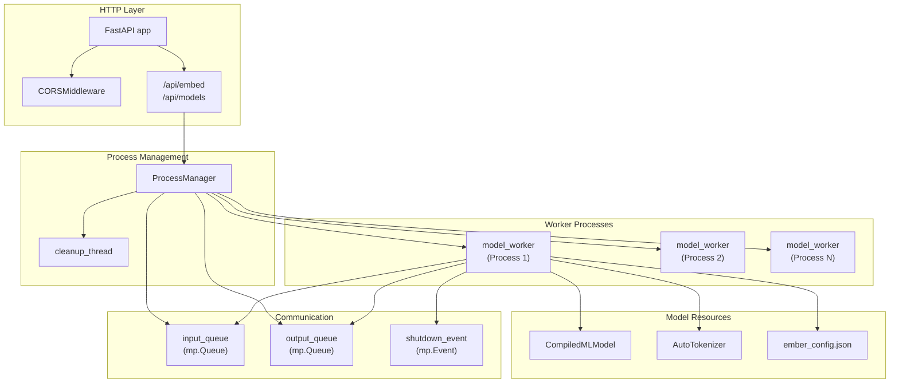

**Sources:** [ember/serve.py:1-382]()

## API Endpoints

The server exposes two primary HTTP endpoints for interaction with the embedding service.

### POST /api/embed

The main endpoint for generating document embeddings. Accepts an `EmbeddingRequest` and returns an `EmbeddingResponse`.

| Field | Type | Description |
|-------|------|-------------|
| `model` | string | Model identifier (e.g., "intfloat/multilingual-e5-small") |
| `documents` | List[Document] | List of documents with content field |
| `options` | dict (optional) | Request options including keep_alive duration |

The endpoint validates batch sizes against model configuration and manages process lifecycle based on the `keep_alive` option.

### GET /api/models

Returns a list of currently active models in the process manager. This endpoint provides visibility into which models have running worker processes.

**Sources:** [ember/serve.py:326-367]()

## Process Management System

The `ProcessManager` class orchestrates worker processes and handles their lifecycle management through a sophisticated queuing and cleanup system.

### Process Lifecycle

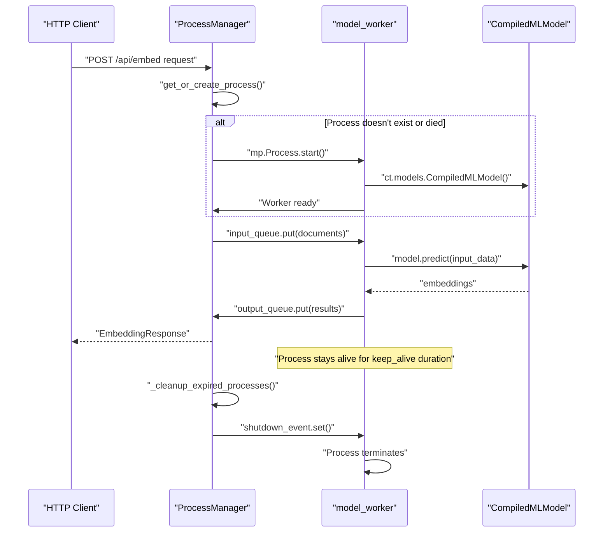

### Process Configuration

Each worker process is configured with:

- `PROCESS_LIFETIME_MINUTES = 5`: Default process lifetime
- `QUEUE_TIMEOUT = 20`: Timeout for queue operations
- `keep_alive`: User-configurable process lifetime from request options

The `ProcessManager` maintains a background cleanup thread that periodically terminates expired processes to prevent resource leaks.

**Sources:** [ember/serve.py:233-301]()

## Request Processing Flow

The serving system processes embedding requests through a multi-stage pipeline involving tokenization, batch padding, and CoreML inference.

### Worker Process Flow

```mermaid
flowchart TD
    Start["Worker Process Start"]
    LoadTokenizer["AutoTokenizer.from_pretrained()"]
    LoadConfig["ModelConfig.from_json()"]
    LoadModel["ct.models.CompiledMLModel()"]
    
    WaitRequest["input_queue.get()"]
    ValidateBatch["Validate batch_size <= config.batch_size"]
    Tokenize["tokenizer.batch_encode_plus()"]
    Pad["Pad to config.batch_size"]
    Predict["model.predict()"]
    Extract["Extract embeddings[:current_batch_sz]"]
    Respond["output_queue.put()"]
    
    CheckLifetime{"Process lifetime<br/>exceeded?"}
    CheckShutdown{"shutdown_event<br/>set?"}
    
    Start --> LoadTokenizer
    LoadTokenizer --> LoadConfig
    LoadConfig --> LoadModel
    LoadModel --> WaitRequest
    
    WaitRequest --> ValidateBatch
    ValidateBatch --> Tokenize
    Tokenize --> Pad
    Pad --> Predict
    Predict --> Extract
    Extract --> Respond
    
    Respond --> CheckLifetime
    CheckLifetime -->|No| CheckShutdown
    CheckShutdown -->|No| WaitRequest
    CheckLifetime -->|Yes| End["Process Shutdown"]
    CheckShutdown -->|Yes| End
    
    ValidateBatch -->|Failed| ErrorResponse["Error Response"]
    Tokenize -->|Failed| ErrorResponse
    Predict -->|Failed| ErrorResponse
    ErrorResponse --> CheckLifetime
```

The worker process handles batch validation, tokenization with padding/truncation, batch size padding for CoreML requirements, and extraction of results for the actual batch size.

**Sources:** [ember/serve.py:98-232]()

## Error Handling

The server implements structured error handling through the `EmbeddingError` system with specific error codes and HTTP status mapping.

### Error Types

| Error Code | HTTP Status | Description |
|------------|-------------|-------------|
| `BATCH_SIZE_EXCEEDED` | 422 | Request batch size exceeds model configuration |
| `MODEL_LOAD_FAILED` | 500 | CoreML model or tokenizer loading failed |
| `TOKENIZATION_FAILED` | 400 | Text tokenization processing error |
| `INFERENCE_FAILED` | 500 | CoreML model prediction error |
| `TIMEOUT` | 408 | Queue operation timeout |

Each error includes structured details for debugging and client error handling. The `EmbeddingErrorResponse` model provides consistent error formatting across all endpoints.

**Sources:** [ember/serve.py:27-76]()

## Model Configuration

Worker processes load configuration from `ember_config.json` files created during the model conversion process. The `ModelConfig` class defines essential parameters:

- `max_length`: Maximum sequence length for tokenization
- `batch_size`: Maximum batch size for inference

These parameters are enforced at runtime to ensure compatibility with the converted CoreML model's input requirements.

**Sources:** [ember/serve.py:89-96](), [ember/serve.py:115]()

## Server Configuration

The server is configured with production-ready defaults:

- **Host**: `0.0.0.0` (all interfaces)
- **Port**: `11434` (default)
- **Workers**: `1` (single worker process)
- **CORS**: Enabled for all origins
- **Logging**: Uvicorn format with color support

The `serve()` function provides the entry point for starting the server with configurable host and port parameters.

**Sources:** [ember/serve.py:368-378]()

---

# Page: Usage Examples

# Usage Examples

<details>
<summary>Relevant source files</summary>

The following files were used as context for generating this wiki page:

- [ember/serve.py](ember/serve.py)
- [examples/similarity.py](examples/similarity.py)

</details>


This document provides practical examples demonstrating how to interact with the Ember embedding API for common use cases. The examples show real HTTP requests and responses using the endpoints defined in the FastAPI server, illustrating document similarity, batch processing, and error handling patterns.

For basic setup and installation, see [Getting Started](#2). For comprehensive API documentation, see [API Reference](#8). For server configuration details, see [Model Serving](#4).

## Overview of Client Interaction Patterns

The Ember API provides a RESTful interface for generating embeddings through the `/api/embed` endpoint. Client applications submit documents via HTTP POST requests and receive vector embeddings that can be used for similarity search, clustering, and other downstream tasks.

```mermaid
sequenceDiagram
    participant Client as "Client Application"
    participant API as "/api/embed endpoint"
    participant ProcessManager as "ProcessManager"
    participant Worker as "model_worker"
    participant CoreML as "CompiledMLModel"
    
    Client->>API: "POST /api/embed"
    Note over Client,API: "EmbeddingRequest with documents"
    
    API->>ProcessManager: "get_or_create_process()"
    ProcessManager->>Worker: "input_queue.put()"
    
    Worker->>CoreML: "model.predict()"
    CoreML-->>Worker: "embeddings array"
    
    Worker->>ProcessManager: "output_queue.put()"
    ProcessManager-->>API: "embeddings result"
    
    API-->>Client: "EmbeddingResponse"
    Note over API,Client: "JSON with embeddings array"
```

**Sources:** [ember/serve.py:326-353]()

## Basic Embedding Request

The fundamental operation involves sending text documents to the embedding endpoint and receiving vector representations. The request format follows the `EmbeddingRequest` model with a specified model identifier and document list.

```mermaid
graph LR
    TextDocs["Text Documents"] --> EmbeddingRequest["EmbeddingRequest"]
    EmbeddingRequest --> APIEndpoint["/api/embed"]
    APIEndpoint --> ProcessInfo["process_info from ProcessManager"]
    ProcessInfo --> InputQueue["input_queue.put()"]
    InputQueue --> ModelWorker["model_worker function"]
    ModelWorker --> Tokenizer["AutoTokenizer.batch_encode_plus()"]
    ModelWorker --> CoreMLModel["CompiledMLModel.predict()"]
    CoreMLModel --> OutputQueue["output_queue.put()"]
    OutputQueue --> EmbeddingResponse["EmbeddingResponse"]
    EmbeddingResponse --> VectorArray["embeddings: List[List[float]]"]
```

The typical request structure requires three components: the model identifier matching the format used during model creation, a list of `Document` objects containing text content, and optional configuration parameters.

**Sources:** [ember/serve.py:77-87](), [ember/serve.py:326-353]()

## Document Similarity Search Example

The document similarity use case demonstrates practical embedding usage for finding semantically related content. This example shows the complete workflow from corpus embedding to similarity computation.

The similarity search pattern involves three phases: corpus embedding generation, query embedding generation, and similarity score computation using dot product operations.

```mermaid
flowchart TD
    Corpus["Document Corpus"] --> CorpusPayload["get_payload(documents)"]
    CorpusPayload --> CorpusRequest["requests.post(endpoint)"]
    CorpusRequest --> CorpusEmbeddings["corpus embeddings matrix"]
    
    Query["Query Document"] --> QueryPayload["get_payload(query)"]
    QueryPayload --> QueryRequest["requests.post(endpoint)"]
    QueryRequest --> QueryEmbeddings["query embeddings vector"]
    
    CorpusEmbeddings --> MatMul["np.matmul(query, corpus.T)"]
    QueryEmbeddings --> MatMul
    MatMul --> Scores["similarity scores"]
    Scores --> ArgMax["scores.argmax()"]
    ArgMax --> Result["most similar document"]
```

The implementation in `similarity.py` demonstrates the standard pattern for embedding-based similarity search, including proper error handling with `raise_for_status()` and numpy array operations for efficient similarity computation.

**Sources:** [examples/similarity.py:23-56]()

## Batch Processing and Configuration

The embedding API supports batch processing through the `documents` array in the `EmbeddingRequest`. The batch size is constrained by the model configuration loaded from `ember_config.json`, which specifies `max_length` and `batch_size` parameters.

| Configuration Parameter | Purpose | Source Location |
|------------------------|---------|-----------------|
| `batch_size` | Maximum documents per request | `ModelConfig.batch_size` |
| `max_length` | Maximum token sequence length | `ModelConfig.max_length` |
| `keep_alive` | Process lifetime in minutes | `options.keep_alive` |

The `model_worker` function enforces batch size limits and returns `BATCH_SIZE_EXCEEDED` errors when requests exceed the configured maximum. Smaller batches are automatically padded to the configured batch size for optimal CoreML inference performance.

**Sources:** [ember/serve.py:89-96](), [ember/serve.py:143-155](), [ember/serve.py:179-187]()

## Error Handling Patterns

The API implements structured error handling through the `EmbeddingError` class hierarchy, providing specific error codes and detailed error information for different failure modes.

```mermaid
graph TB
    Request["HTTP Request"] --> Validation["Request Validation"]
    Validation --> ModelLoad["Model Loading"]
    ModelLoad --> Tokenization["tokenizer.batch_encode_plus()"]
    Tokenization --> Inference["model.predict()"]
    
    Validation -->|"Invalid Format"| BatchSizeError["BATCH_SIZE_EXCEEDED"]
    ModelLoad -->|"File Not Found"| ModelError["MODEL_LOAD_FAILED"]
    Tokenization -->|"Invalid Text"| TokenError["TOKENIZATION_FAILED"]
    Inference -->|"CoreML Error"| InferenceError["INFERENCE_FAILED"]
    
    BatchSizeError --> HTTPException["HTTPException with 422"]
    ModelError --> HTTPException2["HTTPException with 500"]
    TokenError --> HTTPException3["HTTPException with 400"]
    InferenceError --> HTTPException4["HTTPException with 500"]
```

Each error type maps to specific HTTP status codes through the `_status_codes` mapping in the `EmbeddingError` class. The error responses include structured details for debugging, such as the actual batch size received versus the maximum allowed.

**Sources:** [ember/serve.py:27-76](), [ember/serve.py:143-155](), [ember/serve.py:164-173](), [ember/serve.py:194-202]()

## Model Management Operations

The `/api/models` endpoint provides visibility into currently loaded models managed by the `ProcessManager`. This endpoint returns the list of active model processes maintained in the `processes` dictionary.

The `ProcessManager` handles model lifecycle automatically, creating new worker processes on demand and cleaning up expired processes based on the `keep_alive` configuration. The cleanup mechanism runs in a background thread, checking process ages against the configured lifetime limits.

Process management follows this state machine:

```mermaid
stateDiagram-v2
    [*] --> NotLoaded
    NotLoaded --> Creating: "get_or_create_process()"
    Creating --> Active: "process.start()"
    Active --> Active: "Handle requests"
    Active --> Expired: "Lifetime exceeded"
    Active --> Failed: "Process died"
    Expired --> Cleanup: "_cleanup_expired_processes()"
    Failed --> Cleanup: "is_alive() == False"
    Cleanup --> NotLoaded: "cleanup_process()"
```

The process lifetime is controlled by the `keep_alive` option in the embedding request, defaulting to `PROCESS_LIFETIME_MINUTES` when not specified.

**Sources:** [ember/serve.py:233-300](), [ember/serve.py:363-366](), [ember/serve.py:22]()

## Client Implementation Patterns

Successful client implementations follow the request patterns demonstrated in `similarity.py`, including proper payload construction, HTTP header configuration, and response handling. The `get_payload()` helper function shows the standard request format with model identification and document structuring.

Essential client components include:
- Endpoint configuration pointing to the Ember server
- Proper `Content-Type: application/json` headers 
- Document payload construction following the `EmbeddingRequest` schema
- Response parsing to extract the embeddings array
- Error handling for HTTP status codes and timeout conditions

The `keep_alive` option in the request options allows clients to control process lifecycle, optimizing for either memory efficiency (short lifetimes) or request latency (longer lifetimes).

**Sources:** [examples/similarity.py:23-39](), [ember/serve.py:80-83]()

---

# Page: Performance Analysis

# Performance Analysis

<details>
<summary>Relevant source files</summary>

The following files were used as context for generating this wiki page:

- [benchmark_results.txt](benchmark_results.txt)
- [ember/benchmark.py](ember/benchmark.py)

</details>


This document covers the performance benchmarking tools, metrics analysis, and optimization guidance for the Ember embedding server. It focuses on the system's ability to efficiently process embedding requests across different hardware configurations and batch sizes.

For information about setting up and running the embedding server, see [Model Serving](#4). For development and testing procedures, see [Testing and Simulation](#7.2).

## Benchmarking Architecture

The Ember system includes a comprehensive benchmarking framework designed to measure real-world performance characteristics of the embedding service under various load conditions.

### Benchmark Configuration System

```mermaid
graph TB
    BenchmarkConfig["BenchmarkConfig<br/>dataclass"]
    EmbeddingBenchmark["EmbeddingBenchmark<br/>class"]
    
    BenchmarkConfig --> EmbeddingBenchmark
    
    subgraph "Configuration Parameters"
        total_requests["total_requests: int<br/>Default: 50"]
        max_batch_size["max_batch_size: int<br/>Default: 64"]
        concurrent_requests["concurrent_requests: int<br/>Default: 5"]
        warm_up_iterations["warm_up_iterations: int<br/>Default: 2"]
    end
    
    subgraph "Test Data Generation"
        TEST_MESSAGES["TEST_MESSAGES<br/>List[str]"]
        generate_batch_messages["generate_batch_messages()<br/>method"]
    end
    
    subgraph "Request Execution"
        send_request["send_request()<br/>HTTP POST method"]
        ThreadPoolExecutor["ThreadPoolExecutor<br/>concurrent execution"]
        run_batch_benchmark["run_batch_benchmark()<br/>orchestration"]
    end
    
    BenchmarkConfig --> total_requests
    BenchmarkConfig --> max_batch_size
    BenchmarkConfig --> concurrent_requests
    BenchmarkConfig --> warm_up_iterations
    
    EmbeddingBenchmark --> TEST_MESSAGES
    EmbeddingBenchmark --> generate_batch_messages
    EmbeddingBenchmark --> send_request
    EmbeddingBenchmark --> ThreadPoolExecutor
    EmbeddingBenchmark --> run_batch_benchmark
```

Sources: [ember/benchmark.py:10-16](), [ember/benchmark.py:30-35](), [ember/benchmark.py:69-92]()

### Request Processing Pipeline

The benchmarking system executes performance tests by sending concurrent batched requests to the `/api/embed` endpoint and measuring response characteristics.

```mermaid
sequenceDiagram
    participant CLI as "benchmark.py CLI"
    participant Benchmark as "EmbeddingBenchmark"
    participant ThreadPool as "ThreadPoolExecutor"
    participant Server as "Ember Server<br/>localhost:11434"
    participant Analyzer as "analyze_results()"
    
    CLI->>Benchmark: "Initialize with BenchmarkConfig"
    Benchmark->>Benchmark: "warm_up() iterations"
    Benchmark->>Server: "Warm-up requests"
    Server-->>Benchmark: "Response timing"
    
    Benchmark->>ThreadPool: "Submit concurrent futures"
    
    loop "For each request batch"
        ThreadPool->>Benchmark: "send_request()"
        Benchmark->>Benchmark: "generate_batch_messages()"
        Benchmark->>Server: "POST /api/embed<br/>with batch payload"
        Server-->>Benchmark: "Embedding response + timing"
        Benchmark-->>ThreadPool: "Request result dict"
    end
    
    ThreadPool-->>Benchmark: "All results collected"
    Benchmark->>Analyzer: "Process timing data"
    Analyzer-->>CLI: "Performance statistics"
```

Sources: [ember/benchmark.py:94-102](), [ember/benchmark.py:42-67](), [ember/benchmark.py:69-92]()

## Performance Metrics Framework

### Core Metrics Collection

The system tracks comprehensive performance metrics across multiple dimensions to provide insight into system behavior under load.

| Metric Category | Specific Measurements | Source Method |
|----------------|----------------------|---------------|
| **Request Metrics** | total_requests, successful_requests, failed_requests | [analyze_results():106-108]() |
| **Throughput** | requests_per_second, documents_per_second | [analyze_results():128-129]() |
| **Latency Distribution** | average_duration, median_duration, p95_duration | [analyze_results():121-123]() |
| **Latency Bounds** | min_duration, max_duration, std_dev | [analyze_results():124-126]() |
| **Batch Processing** | documents_per_request, total_documents_processed | [analyze_results():119-120]() |

### Statistical Analysis Implementation

```mermaid
graph LR
    subgraph "Raw Results Collection"
        results["List[Dict]<br/>Request results"]
        successful["successful_requests<br/>Filter by success=True"]
        durations["durations: List[float]<br/>Extract timing data"]
    end
    
    subgraph "Statistical Calculations"
        mean["statistics.mean()<br/>Average latency"]
        median["statistics.median()<br/>Median latency"]
        stdev["statistics.stdev()<br/>Standard deviation"]
        percentile["sorted()[0.95 index]<br/>95th percentile"]
    end
    
    subgraph "Throughput Calculations"
        rps["requests_per_second<br/>requests / total_duration"]
        dps["documents_per_second<br/>(requests * batch_size) / total_duration"]
    end
    
    results --> successful
    successful --> durations
    durations --> mean
    durations --> median
    durations --> stdev
    durations --> percentile
    durations --> rps
    durations --> dps
```

Sources: [ember/benchmark.py:104-130]()

## Hardware Performance Comparison

### ANE vs CPU Performance Analysis

Based on empirical benchmarking results, the system demonstrates significant performance differences between Apple Neural Engine (ANE) and CPU-only execution modes.

#### Batch Size 32 Performance

| Hardware | Requests/sec | Documents/sec | Avg Latency (s) | P95 Latency (s) |
|----------|-------------|---------------|-----------------|-----------------|
| **CPU Only** | 14.691 | 470.118 | 3.154 | 3.395 |
| **ANE** | 20.928 | 669.693 | 2.343 | 2.388 |
| **Improvement** | +42.5% | +42.5% | -25.7% | -29.7% |

#### Batch Size 64 Performance

| Hardware | Requests/sec | Documents/sec | Avg Latency (s) | P95 Latency (s) |
|----------|-------------|---------------|-----------------|-----------------|
| **CPU Only** | 7.333 | 469.299 | 6.417 | 6.759 |
| **ANE** | 10.934 | 699.750 | 4.457 | 4.572 |
| **Improvement** | +49.1% | +49.1% | -30.5% | -32.4% |

Sources: [benchmark_results.txt:1-78]()

### Scaling Behavior Analysis

```mermaid
graph TB
    subgraph "ANE Scaling Pattern"
        ane_bs32["Batch Size 32<br/>669.693 docs/sec"]
        ane_bs64["Batch Size 64<br/>699.750 docs/sec"]
        ane_scaling["+4.5% throughput increase<br/>Linear scaling behavior"]
        
        ane_bs32 --> ane_scaling
        ane_bs64 --> ane_scaling
    end
    
    subgraph "CPU Scaling Pattern"
        cpu_bs32["Batch Size 32<br/>470.118 docs/sec"]
        cpu_bs64["Batch Size 64<br/>469.299 docs/sec"]
        cpu_scaling["-0.2% throughput change<br/>No scaling benefit"]
        
        cpu_bs32 --> cpu_scaling
        cpu_bs64 --> cpu_scaling
    end
    
    subgraph "Key Insight"
        conclusion["ANE scales with batch size<br/>CPU does not scale with batch size"]
    end
    
    ane_scaling --> conclusion
    cpu_scaling --> conclusion
```

Sources: [benchmark_results.txt:77-78]()

## Benchmarking Tool Usage

### Command Line Interface

The `benchmark.py` script provides a flexible command-line interface for performance testing with configurable parameters.

```bash
# Basic benchmark with default settings
python ember/benchmark.py

# Custom configuration
python ember/benchmark.py --requests 100 --batch-size 32 --concurrent 10 --warm-up 5
```

### Configuration Parameters

| Parameter | Default | Description | Impact |
|-----------|---------|-------------|---------|
| `--requests` | 50 | Total number of requests to execute | Higher values provide more statistical confidence |
| `--batch-size` | 64 | Documents per request batch | Affects memory usage and ANE utilization |
| `--concurrent` | 5 | Parallel request threads | Tests server concurrency handling |
| `--warm-up` | 2 | Initial requests before measurement | Eliminates cold-start effects |

Sources: [ember/benchmark.py:142-159]()

### Test Data Generation

The benchmark uses a predefined set of diverse test messages that are automatically replicated to fill the requested batch size.

```mermaid
graph LR
    TEST_MESSAGES["TEST_MESSAGES<br/>10 predefined strings"] --> generate_batch_messages["generate_batch_messages()"]
    
    subgraph "Batch Generation Logic"
        repeats["repeats = ceil(batch_size / 10)"]
        multiply["messages * repeats"]
        slice["[:batch_size] slice"]
    end
    
    generate_batch_messages --> repeats
    repeats --> multiply
    multiply --> slice
    slice --> payload["Request payload<br/>{'documents': [{'content': msg}]}"]
```

Sources: [ember/benchmark.py:17-28](), [ember/benchmark.py:36-48]()

## Performance Optimization Guidance

### Hardware Selection Recommendations

1. **Apple Neural Engine**: Preferred for production deployments due to 42-49% throughput improvements over CPU-only execution
2. **Batch Size Optimization**: Use larger batch sizes (64+) with ANE hardware to maximize throughput efficiency  
3. **Concurrent Request Handling**: The server efficiently handles concurrent requests; tune `concurrent_requests` parameter based on available system resources

### Monitoring and Analysis

Use the benchmark tool's statistical outputs to:

- **Latency Analysis**: Monitor P95 latency to understand worst-case performance
- **Throughput Tracking**: Track `documents_per_second` as the primary throughput metric
- **Scaling Validation**: Test different batch sizes to verify hardware scaling behavior
- **Regression Detection**: Compare benchmark results across model versions or configuration changes

Sources: [ember/benchmark.py:104-141]()

---

# Page: Development Guide

# Development Guide

<details>
<summary>Relevant source files</summary>

The following files were used as context for generating this wiki page:

- [pyproject.toml](pyproject.toml)
- [uv.lock](uv.lock)

</details>


This guide provides developers with essential information for contributing to, extending, or understanding the internal architecture of the Ember embedding server system. It covers the development workflow, code organization principles, and key architectural patterns used throughout the codebase.

For project structure details and module organization, see [Project Structure](#7.1). For testing procedures and simulation tools, see [Testing and Simulation](#7.2).

## Development Workflow Overview

Ember follows a two-phase development model that mirrors its runtime architecture: model preparation and model serving. Understanding this separation is crucial for effective development.

### Development Architecture Mapping

```mermaid
graph TB
    subgraph "CLI Layer"
        cli_main[cli.main]
        cli_py["cli.py"]
    end
    
    subgraph "Core Operations"
        create_py["create.py"]
        serve_py["serve.py"]
        ModelWrapper["ModelWrapper class"]
        ProcessManager["ProcessManager class"]
    end
    
    subgraph "Configuration Management"
        ember_config["ember_config.json"]
        Config["Config dataclass"]
    end
    
    subgraph "External Dependencies"
        sentence_transformers["sentence-transformers"]
        coremltools["coremltools"]
        fastapi["FastAPI"]
        uvicorn["uvicorn"]
    end
    
    subgraph "Development Tools"
        benchmark_py["benchmark.py"]
        simulate_py["simulate.py"]
        similarity_py["similarity.py"]
    end
    
    cli_main --> create_py
    cli_main --> serve_py
    
    create_py --> ModelWrapper
    create_py --> sentence_transformers
    create_py --> coremltools
    create_py --> ember_config
    
    serve_py --> ProcessManager
    serve_py --> fastapi
    serve_py --> uvicorn
    serve_py --> Config
    
    benchmark_py --> serve_py
    simulate_py --> serve_py
    similarity_py --> serve_py
```

Sources: [pyproject.toml:22-23]()

### Core Development Components

The system architecture maps directly to specific code entities that developers need to understand:

```mermaid
flowchart LR
    subgraph "Entry Points"
        main_func["cli.main()"]
        ember_script["ember script"]
    end
    
    subgraph "Command Handlers"
        create_command["create command handler"]
        serve_command["serve command handler"]
    end
    
    subgraph "Model Pipeline"
        download_model["download_model()"]
        convert_model["convert_model()"]
        save_config["save_config()"]
    end
    
    subgraph "Server Components"
        FastAPIApp["FastAPI app instance"]
        embed_endpoint["/api/embed endpoint"]
        models_endpoint["/api/models endpoint"]
    end
    
    subgraph "Process Management"
        worker_processes["worker processes"]
        keep_alive["keep_alive mechanism"]
        cleanup_handlers["cleanup handlers"]
    end
    
    ember_script --> main_func
    main_func --> create_command
    main_func --> serve_command
    
    create_command --> download_model
    download_model --> convert_model
    convert_model --> save_config
    
    serve_command --> FastAPIApp
    FastAPIApp --> embed_endpoint
    FastAPIApp --> models_endpoint
    
    serve_command --> worker_processes
    worker_processes --> keep_alive
    worker_processes --> cleanup_handlers
```

Sources: [pyproject.toml:22-23]()

## Development Environment Setup

### Required Dependencies

The project uses a carefully curated set of dependencies optimized for Apple silicon and CoreML compatibility:

| Category | Package | Version Constraint | Purpose |
|----------|---------|-------------------|---------|
| ML Framework | `sentence-transformers` | `>=3.3.1` | Pre-trained model access |
| ML Framework | `torch` | `<=2.4.0` | PyTorch backend (version locked) |
| Apple Integration | `coremltools` | `>=8.1` | CoreML conversion |
| Apple Integration | `coremlprofiler` | `>=0.4.0` | Performance profiling |
| Web Framework | `fastapi` | `>=0.115.5` | HTTP API server |
| Web Framework | `uvicorn` | `>=0.32.1` | ASGI server |
| CLI | `questionary` | `>=2.0.1` | Interactive prompts |
| Validation | `pydantic` | `>=2.10.3` | Data validation |

### Python Version Requirements

The system requires Python `>=3.9,<3.13` to ensure compatibility with both modern language features and Apple's CoreML toolchain.

Sources: [pyproject.toml:6-16]()

## Code Organization Principles

### Single Responsibility Modules

Each module in the Ember codebase has a clearly defined responsibility:

- **cli.py**: Command-line interface and argument parsing
- **create.py**: Model conversion pipeline from sentence-transformers to CoreML
- **serve.py**: HTTP server implementation and process management
- **benchmark.py**: Performance measurement and analysis
- **simulate.py**: Load testing and stress testing utilities
- **similarity.py**: Client example and API usage demonstration

### Configuration-Driven Architecture

The system uses `ember_config.json` files to maintain separation between model metadata and runtime configuration. This allows for:

- Model-specific settings (batch size, maximum sequence length)
- Hardware optimization parameters
- Process lifecycle management settings

### Process Isolation Pattern

The serving component implements a multi-process architecture where:

- Each model runs in a dedicated worker process
- The main process handles HTTP routing and request distribution
- Process lifecycle management ensures resource cleanup
- Keep-alive mechanisms optimize for repeated inference

Sources: Based on architectural analysis from diagrams

## Extension Points

### Adding New Model Sources

To extend beyond sentence-transformers, developers can:

1. Implement new model wrapper classes following the `ModelWrapper` pattern
2. Add conversion logic in the create pipeline
3. Update configuration schema to support new model types

### Custom API Endpoints

The FastAPI application can be extended with additional endpoints by:

1. Adding new route handlers in the serving module
2. Implementing corresponding request/response models using Pydantic
3. Integrating with the existing process management system

### Performance Optimization

The system provides several extension points for performance optimization:

1. Custom batching strategies in the ProcessManager
2. Hardware-specific acceleration through CoreML configuration
3. Caching mechanisms for frequently requested embeddings

## Build and Distribution

The project uses setuptools as the build backend with a minimal configuration focused on the CLI entry point. The `ember` command is automatically installed and configured to invoke `ember.cli:main`.

Sources: [pyproject.toml:18-23]()

---

# Page: Project Structure

# Project Structure

<details>
<summary>Relevant source files</summary>

The following files were used as context for generating this wiki page:

- [.gitignore](.gitignore)
- [ember/__init__.py](ember/__init__.py)
- [pyproject.toml](pyproject.toml)
- [uv.lock](uv.lock)

</details>


This document provides a comprehensive overview of the Ember codebase organization, including its directory structure, dependencies, entry points, and key architectural components. This covers the technical foundation needed for developers working on or extending the Ember system.

For information about setting up the development environment and running tests, see [Testing and Simulation](#7.2). For details about the command-line interface usage, see [CLI Reference](#9).

## Architecture Overview

Ember is organized as a Python package with clear separation between model conversion and serving functionality. The system follows a modular design with distinct entry points for different operations.

### System Component Mapping

```mermaid
graph TB
    subgraph "CLI Layer"
        main["ember.cli:main"]
        create_cmd["ember create"]
        serve_cmd["ember serve"]
    end
    
    subgraph "Core Operations"
        create_module["create.py"]
        serve_module["serve.py"]
        process_manager["ProcessManager"]
    end
    
    subgraph "External Dependencies"
        sentence_transformers["sentence-transformers"]
        coremltools["coremltools>=8.1"]
        fastapi["fastapi>=0.115.5"]
        torch["torch<=2.4.0"]
        uvicorn["uvicorn>=0.32.1"]
    end
    
    subgraph "Data Layer"
        mlpackage[".mlpackage files"]
        config["ember_config.json"]
    end
    
    main --> create_cmd
    main --> serve_cmd
    create_cmd --> create_module
    serve_cmd --> serve_module
    
    create_module --> sentence_transformers
    create_module --> coremltools
    create_module --> mlpackage
    create_module --> config
    
    serve_module --> fastapi
    serve_module --> uvicorn
    serve_module --> process_manager
    serve_module --> mlpackage
    serve_module --> config
```

Sources: [pyproject.toml:1-24](), [uv.lock:211-236]()

## Directory Structure

The project follows standard Python packaging conventions with additional considerations for macOS-specific CoreML integration.

### Core Package Layout

```mermaid
graph TD
    root["ember/"]
    
    subgraph "Python Package"
        init["__init__.py"]
        cli["cli.py"]
        create["create.py"] 
        serve["serve.py"]
        benchmark["benchmark.py"]
        simulate["simulate.py"]
        similarity["similarity.py"]
    end
    
    subgraph "Configuration"
        pyproject["pyproject.toml"]
        uv_lock["uv.lock"]
        gitignore[".gitignore"]
    end
    
    subgraph "Runtime Data (ignored)"
        mlpackage_files["*.mlpackage"]
        mlmodelc_files["*.mlmodelc"]
        pycache["__pycache__"]
    end
    
    root --> init
    root --> cli
    root --> create
    root --> serve
    root --> benchmark
    root --> simulate  
    root --> similarity
    
    root --> pyproject
    root --> uv_lock
    root --> gitignore
    
    style mlpackage_files fill:#f9f9f9
    style mlmodelc_files fill:#f9f9f9
    style pycache fill:#f9f9f9
```

Sources: [ember/__init__.py:1](), [.gitignore:1-6](), [pyproject.toml:1-24]()

## Technology Stack and Dependencies

Ember integrates multiple technology stacks to bridge the machine learning ecosystem with Apple's hardware acceleration platform.

### Dependency Categories

| Category | Dependencies | Purpose |
|----------|-------------|---------|
| **Core ML Framework** | `coremltools>=8.1`, `coremlprofiler>=0.4.0` | CoreML model conversion and profiling |
| **ML Ecosystem** | `sentence-transformers>=3.3.1`, `torch<=2.4.0` | Pre-trained model access and PyTorch backend |
| **Web Server** | `fastapi>=0.115.5`, `uvicorn>=0.32.1`, `pydantic>=2.10.3` | HTTP API server and data validation |
| **CLI Interface** | `questionary>=2.0.1` | Interactive command-line prompts |

Sources: [pyproject.toml:7-16]()

### External Integration Flow

```mermaid
sequenceDiagram
    participant cli as "ember.cli:main"
    participant hf as "sentence-transformers"
    participant coreml as "coremltools"
    participant fastapi as "FastAPI"
    participant ane as "Apple Neural Engine"
    
    cli->>hf: "Download pre-trained model"
    hf-->>cli: "PyTorch model"
    cli->>coreml: "Convert to CoreML"
    coreml-->>cli: ".mlpackage file"
    
    Note over cli: "Model ready for serving"
    
    cli->>fastapi: "Start server"
    fastapi->>ane: "Load model for inference"
    ane-->>fastapi: "Accelerated predictions"
```

Sources: [pyproject.toml:7-16](), [uv.lock:181-208]()

## Entry Points and CLI Structure

The system provides a unified command-line interface through the `ember` command, which is configured as a console script entry point.

### CLI Entry Point Configuration

The main entry point is defined in `pyproject.toml`:

```toml
[project.scripts]
ember = "ember.cli:main"
```

This maps the `ember` command to the `main` function in the `ember.cli` module, providing the primary interface for all system operations.

### Command Structure

```mermaid
graph LR
    ember["ember"]
    
    subgraph "Primary Commands"
        create["create"]
        serve["serve"]
    end
    
    subgraph "Utility Scripts"
        benchmark["benchmark.py"]
        simulate["simulate.py"]
        similarity["similarity.py"]
    end
    
    ember --> create
    ember --> serve
    
    create --> questionary["questionary prompts"]
    serve --> fastapi_server["FastAPI server"]
    
    benchmark --> serve
    simulate --> serve
    similarity --> serve
```

Sources: [pyproject.toml:22-23]()

## Core Module Architecture

Based on the system architecture, Ember's core functionality is organized into specialized modules that handle distinct phases of the embedding pipeline.

### Module Responsibilities

```mermaid
graph TB
    subgraph "Command Interface"
        cli_main["cli.py:main()"]
    end
    
    subgraph "Model Preparation"
        create_module["create.py"]
        model_wrapper["ModelWrapper"]
        coreml_conversion["CoreML conversion"]
    end
    
    subgraph "Model Serving"
        serve_module["serve.py"]
        process_manager["ProcessManager"]
        fastapi_endpoints["/api/embed, /api/models"]
    end
    
    subgraph "Performance Tools"
        benchmark_module["benchmark.py"]
        simulate_module["simulate.py"]
        profiling["CoreMLProfiler"]
    end
    
    cli_main --> create_module
    cli_main --> serve_module
    
    create_module --> model_wrapper
    create_module --> coreml_conversion
    
    serve_module --> process_manager
    serve_module --> fastapi_endpoints
    
    benchmark_module --> serve_module
    simulate_module --> serve_module
    
    process_manager --> profiling
```

Sources: [pyproject.toml:22-23]()

## Data and Configuration Management

Ember manages two primary types of persistent data: converted CoreML models and configuration metadata.

### File Type Organization

| File Type | Extension | Purpose | Storage Location |
|-----------|-----------|---------|------------------|
| **CoreML Models** | `.mlpackage` | Converted embedding models | Local directory |
| **Compiled Models** | `.mlmodelc` | CoreML runtime artifacts | Generated automatically |
| **Configuration** | `ember_config.json` | Model metadata and settings | Alongside `.mlpackage` |
| **Cache** | `__pycache__/` | Python bytecode cache | Generated automatically |

### Data Flow and Storage

```mermaid
graph LR
    subgraph "Input Sources"
        hf_models["Hugging Face Models"]
        user_config["User Configuration"]
    end
    
    subgraph "Processing Pipeline"
        conversion["Model Conversion"]
        validation["Validation & Profiling"]
    end
    
    subgraph "Persistent Storage"
        mlpackage[".mlpackage"]
        config_json["ember_config.json"]
        mlmodelc[".mlmodelc (runtime)"]
    end
    
    subgraph "Runtime Access"
        process_workers["Process Workers"]
        api_endpoints["API Endpoints"]
    end
    
    hf_models --> conversion
    user_config --> conversion
    conversion --> validation
    validation --> mlpackage
    validation --> config_json
    mlpackage --> mlmodelc
    
    mlpackage --> process_workers
    config_json --> process_workers
    process_workers --> api_endpoints
```

Sources: [.gitignore:1-6]()

## Development Environment Setup

The project uses modern Python packaging and dependency management tools optimized for reproducible development environments.

### Package Management

Ember uses `uv` for fast, reliable dependency resolution and virtual environment management:

- **Primary dependencies**: Defined in `pyproject.toml` with version constraints
- **Lock file**: `uv.lock` ensures reproducible builds across environments  
- **Build system**: Uses `setuptools` as the build backend

### Excluded Files

The `.gitignore` configuration excludes runtime artifacts and generated files:

```
*.mlpackage      # Large CoreML model files
*.mlmodelc       # Compiled CoreML artifacts  
*.egg-info       # Package metadata
.DS_Store        # macOS filesystem metadata
__pycache__      # Python bytecode cache
```

This keeps the repository focused on source code while allowing local development with real model files.

Sources: [pyproject.toml:18-20](), [uv.lock:1-2](), [.gitignore:1-6]()

---

# Page: Testing and Simulation

# Testing and Simulation

<details>
<summary>Relevant source files</summary>

The following files were used as context for generating this wiki page:

- [ember/benchmark.py](ember/benchmark.py)
- [ember/simulate.py](ember/simulate.py)

</details>


This document covers the testing and simulation tools available in the Ember system for performance analysis, load testing, and validation of the embedding service. These tools are designed for developers who need to evaluate server performance, test edge cases, or benchmark different configurations.

For general performance analysis and optimization guidance, see [Performance Analysis](#6). For API usage examples in production scenarios, see [Usage Examples](#5).

## Overview

Ember provides two primary testing utilities for different validation scenarios:

| Tool | Purpose | Use Case |
|------|---------|----------|
| `benchmark.py` | Comprehensive performance benchmarking | Load testing, performance analysis, capacity planning |
| `simulate.py` | Simple simulation and edge case testing | Quick validation, error condition testing |

Both tools interact with the Ember API server running on `localhost:11434` and target the `/api/embed` endpoint.

## Benchmark Tool Architecture

The benchmarking system is built around the `EmbeddingBenchmark` class which provides systematic performance testing capabilities with configurable parameters and detailed statistical analysis.

### Benchmark Configuration

```mermaid
classDiagram
    class BenchmarkConfig {
        +int total_requests
        +int max_batch_size
        +int concurrent_requests
        +int warm_up_iterations
    }
    
    class EmbeddingBenchmark {
        +BenchmarkConfig config
        +str url
        +str model
        +generate_batch_messages() List[str]
        +send_request() Dict
        +run_batch_benchmark() List[Dict]
        +warm_up() void
        +analyze_results() Dict
    }
    
    class ThreadPoolExecutor {
        +max_workers int
        +submit() Future
    }
    
    BenchmarkConfig --> EmbeddingBenchmark
    EmbeddingBenchmark --> ThreadPoolExecutor : "uses for concurrent requests"
```

Sources: [ember/benchmark.py:10-16](), [ember/benchmark.py:30-35](), [ember/benchmark.py:77-78]()

### Request Flow and Concurrency

The benchmark tool implements concurrent request processing to simulate realistic load conditions:

```mermaid
sequenceDiagram
    participant CLI as "benchmark.py main()"
    participant EB as "EmbeddingBenchmark"
    participant TPE as "ThreadPoolExecutor"
    participant API as "/api/embed endpoint"
    
    CLI->>EB: warm_up()
    loop warm_up_iterations
        EB->>API: send_request()
        API-->>EB: response + timing
    end
    
    CLI->>EB: run_batch_benchmark()
    EB->>TPE: create with max_workers=concurrent_requests
    
    loop total_requests
        EB->>TPE: submit(send_request)
    end
    
    par concurrent execution
        TPE->>API: POST /api/embed (batch 1)
        TPE->>API: POST /api/embed (batch 2)
        TPE->>API: POST /api/embed (batch N)
    end
    
    loop collect results
        TPE-->>EB: future.result()
        EB->>EB: analyze_results()
    end
    
    EB-->>CLI: statistical analysis
```

Sources: [ember/benchmark.py:94-102](), [ember/benchmark.py:69-92](), [ember/benchmark.py:104-130]()

## Test Data and Message Generation

Both testing tools use predefined message sets to ensure consistent and reproducible test conditions:

### Message Sets

| Constant | Purpose | Size | Location |
|----------|---------|------|----------|
| `TEST_MESSAGES` | Standard test content | 10 messages | [benchmark.py:17-28](), [simulate.py:4-15]() |
| `TOO_MANY_MESSAGES` | Edge case testing | 1000 messages | [simulate.py:17]() |

The `generate_batch_messages()` method in `EmbeddingBenchmark` cycles through `TEST_MESSAGES` to create batches of the configured `max_batch_size`:

```mermaid
flowchart TD
    Start["generate_batch_messages()"] --> Calc["repeats = ceil(max_batch_size / len(TEST_MESSAGES))"]
    Calc --> Multiply["messages = TEST_MESSAGES * repeats"]
    Multiply --> Slice["return messages[:max_batch_size]"]
    
    subgraph "Example: max_batch_size=64"
        Ex1["TEST_MESSAGES (10 items)"] --> Ex2["repeats = ceil(64/10) = 7"]
        Ex2 --> Ex3["70 total messages"]
        Ex3 --> Ex4["slice to first 64"]
    end
```

Sources: [ember/benchmark.py:36-40]()

## API Request Structure

Both tools construct requests following the Ember API specification:

### Request Payload Format

The request payload structure used by both testing tools:

```json
{
    "model": "intfloat/multilingual-e5-small",
    "documents": [
        {"content": "message1"},
        {"content": "message2"}
    ]
}
```

### Request Processing Flow

```mermaid
flowchart LR
    subgraph "Request Construction"
        Messages["List[str] messages"] --> Payload["payload = {'model': model, 'documents': [...]}"]
    end
    
    subgraph "HTTP Request"
        Payload --> Post["requests.post(url, json=payload)"]
        Post --> Timing["measure duration"]
    end
    
    subgraph "Response Handling"
        Timing --> Success["response.raise_for_status()"]
        Success --> Result["return {'success': True, 'duration': ..., 'status_code': ...}"]
        Success --> Error["RequestException"]
        Error --> ErrorResult["return {'success': False, 'error': str(e), ...}"]
    end
```

Sources: [ember/benchmark.py:42-67](), [ember/simulate.py:19-31]()

## Statistical Analysis

The benchmark tool provides comprehensive statistical analysis of request performance:

### Metrics Calculated

| Metric | Description | Calculation |
|--------|-------------|-------------|
| `average_duration` | Mean request time | `statistics.mean(durations)` |
| `median_duration` | Median request time | `statistics.median(durations)` |
| `p95_duration` | 95th percentile | `sorted(durations)[int(len(durations) * 0.95)]` |
| `requests_per_second` | Request throughput | `successful_requests / total_duration` |
| `documents_per_second` | Document throughput | `(successful_requests * batch_size) / total_duration` |

### Analysis Implementation

```mermaid
flowchart TD
    Results["List[Dict] results"] --> Filter["filter successful vs failed"]
    Filter --> Success["successful_requests"]
    Filter --> Failed["failed_requests"]
    
    Success --> Durations["extract durations"]
    Durations --> Stats["calculate statistics"]
    
    subgraph "Statistics Computed"
        Stats --> Mean["average_duration"]
        Stats --> Median["median_duration"]
        Stats --> P95["p95_duration"]
        Stats --> StdDev["std_dev"]
        Stats --> Throughput["requests_per_second"]
    end
    
    Success --> Count["count successful"]
    Failed --> FailCount["count failed"]
    Count --> Summary["final analysis dict"]
    FailCount --> Summary
    Stats --> Summary
```

Sources: [ember/benchmark.py:104-130]()

## Command Line Interface

The benchmark tool provides a command-line interface for configuration:

### CLI Arguments

| Argument | Default | Description |
|----------|---------|-------------|
| `--requests` | 50 | Total number of requests to make |
| `--batch-size` | 64 | Maximum number of documents per request |
| `--concurrent` | 5 | Number of concurrent requests |
| `--warm-up` | 2 | Number of warm-up iterations |

### Usage Examples

```bash
# Default benchmark
python ember/benchmark.py

# High-load test
python ember/benchmark.py --requests 200 --batch-size 128 --concurrent 10

# Quick validation
python ember/benchmark.py --requests 10 --warm-up 1
```

Sources: [ember/benchmark.py:142-172]()

## Running Tests

### Prerequisites

1. Ember server must be running on `localhost:11434`
2. Model `intfloat/multilingual-e5-small` must be available
3. Required Python packages: `requests`, `statistics`, `concurrent.futures`

### Execution Workflow

```mermaid
sequenceDiagram
    participant User
    participant CLI as "benchmark.py"
    participant Server as "Ember Server"
    
    User->>CLI: python benchmark.py [args]
    CLI->>CLI: parse arguments
    CLI->>CLI: create BenchmarkConfig
    
    Note over CLI,Server: Warm-up Phase
    CLI->>Server: warm_up_iterations requests
    Server-->>CLI: responses
    
    Note over CLI,Server: Benchmark Phase
    CLI->>Server: concurrent batch requests
    Server-->>CLI: timed responses
    
    CLI->>CLI: analyze_results()
    CLI->>User: print formatted statistics
```

### Output Interpretation

The benchmark tool outputs progress during execution and final statistics:

- **Progress tracking**: Shows completion percentage and request rate
- **Success/failure counts**: Number of successful vs failed requests  
- **Timing statistics**: Mean, median, P95, min, max response times
- **Throughput metrics**: Requests per second and documents per second

Sources: [ember/benchmark.py:85-90](), [ember/benchmark.py:132-140]()

## Edge Case Testing

The `simulate.py` tool provides simple edge case testing, particularly for request size limits:

### Large Request Testing

The `TOO_MANY_MESSAGES` constant creates a 1000-message request to test server behavior under extreme load conditions. This helps validate:

- Request size limits
- Memory handling
- Error response behavior
- Timeout handling

```mermaid
flowchart LR
    Start["simulate.py"] --> Create["TOO_MANY_MESSAGES (1000 items)"]
    Create --> Request["send_request()"]
    Request --> Response["print response time + content"]
    
    subgraph "Error Conditions Tested"
        Timeout["Request timeout"]
        Memory["Memory limits"]
        Validation["Input validation"]
    end
```

Sources: [ember/simulate.py:17](), [ember/simulate.py:33-37]()

---

# Page: API Reference

# API Reference

<details>
<summary>Relevant source files</summary>

The following files were used as context for generating this wiki page:

- [README.md](README.md)
- [ember/serve.py](ember/serve.py)

</details>


This document provides a complete technical reference for the Ember HTTP API. It covers all available endpoints, request/response formats, error handling, and data models used by the embedding server. For information about starting the server and basic usage examples, see [Model Serving](#4). For command-line interface documentation, see [CLI Reference](#9).

## Server Configuration

The Ember API server runs on HTTP and serves embedding requests through RESTful endpoints. The default configuration uses:

- **Host**: `0.0.0.0` (all interfaces)
- **Port**: `11434`
- **Protocol**: HTTP
- **Framework**: FastAPI with Uvicorn ASGI server

The server is configured in [ember/serve.py:368-378]() using `uvicorn.Config` with single worker mode and asyncio event loop.

Sources: [ember/serve.py:368-378](), [README.md:22-24]()

## API Endpoints

### POST /api/embed

Creates embeddings for a batch of text documents using a specified model.

**Request Body**:
```json
{
  "model": "intfloat/multilingual-e5-small",
  "documents": [
    { "content": "Hello, world!" },
    { "content": "Open source for the win 🤗!" }
  ],
  "options": {
    "keep_alive": 1
  }
}
```

**Response Body**:
```json
{
  "model": "intfloat/multilingual-e5-small",
  "embeddings": [
    [0.1, 0.2, 0.3, ...],
    [0.4, 0.5, 0.6, ...]
  ]
}
```

**Parameters**:
- `model` (required): Model identifier in format `{organization}/{model_name}`
- `documents` (required): Array of documents, each containing a `content` field
- `options` (optional): Configuration object with optional `keep_alive` duration in minutes

**Process Behavior**:
- If the model process doesn't exist, it will be created automatically
- The `keep_alive` option controls how long the model process stays active after the request
- Default process lifetime is 5 minutes if no `keep_alive` is specified

Sources: [ember/serve.py:326-361](), [ember/serve.py:80-83](), [ember/serve.py:85-87](), [README.md:28-41]()

### GET /api/models

Returns a list of currently active model processes.

**Response Body**:
```json
{
  "models": ["intfloat/multilingual-e5-small", "sentence-transformers/all-MiniLM-L6-v2"]
}
```

This endpoint shows which model processes are currently running in the `ProcessManager`. Models appear in this list only after they have been used in an embedding request.

Sources: [ember/serve.py:363-366]()

## API Request Flow

```mermaid
sequenceDiagram
    participant Client
    participant FastAPI["/api/embed FastAPI endpoint"]
    participant ProcessManager["ProcessManager.get_or_create_process()"]
    participant ModelWorker["model_worker() process"]
    participant CoreML["ct.models.CompiledMLModel"]
    
    Client->>FastAPI: "POST /api/embed"
    FastAPI->>ProcessManager: "get_or_create_process(model_name, options)"
    
    alt Process doesn't exist
        ProcessManager->>ModelWorker: "mp.Process.start()"
        ModelWorker->>CoreML: "ct.models.CompiledMLModel(model_name)"
    end
    
    ProcessManager-->>FastAPI: "return process_info dict"
    FastAPI->>ModelWorker: "input_queue.put(documents)"
    ModelWorker->>CoreML: "model.predict(input_ids, attention_mask)"
    CoreML-->>ModelWorker: "prediction['sentence_embeddings']"
    ModelWorker->>FastAPI: "output_queue.put(embeddings)"
    FastAPI-->>Client: "EmbeddingResponse JSON"
```

Sources: [ember/serve.py:326-361](), [ember/serve.py:241-277](), [ember/serve.py:98-231]()

## Data Models

The API uses Pydantic models for request/response validation and serialization.

### EmbeddingRequest

| Field | Type | Required | Description |
|-------|------|----------|-------------|
| `model` | `str` | Yes | Model identifier in format `{org}/{name}` |
| `documents` | `List[Document]` | Yes | Array of documents to embed |
| `options` | `dict` | No | Configuration options including `keep_alive` |

### Document

| Field | Type | Required | Description |
|-------|------|----------|-------------|
| `content` | `str` | Yes | Text content to be embedded |

### EmbeddingResponse

| Field | Type | Description |
|-------|------|-------------|
| `model` | `str` | Model identifier that processed the request |
| `embeddings` | `List[List[float]]` | Array of embedding vectors, one per document |

### ModelConfig

Configuration loaded from `{model_name}.mlpackage/ember_config.json`:

| Field | Type | Description |
|-------|------|-------------|
| `max_length` | `int` | Maximum sequence length for tokenization |
| `batch_size` | `int` | Maximum batch size for inference |

Sources: [ember/serve.py:77-96]()

## Model Configuration and Constraints

```mermaid
graph TB
    ConfigFile["ember_config.json"]
    ModelConfig["ModelConfig.from_json()"]
    BatchValidation["Batch size validation"]
    TokenizerConfig["AutoTokenizer max_length"]
    CoreMLModel["CompiledMLModel inference"]
    
    ConfigFile --> ModelConfig
    ModelConfig --> BatchValidation
    ModelConfig --> TokenizerConfig
    BatchValidation --> CoreMLModel
    TokenizerConfig --> CoreMLModel
    
    ModelConfig --> MaxLength["max_length: int"]
    ModelConfig --> BatchSize["batch_size: int"]
    
    BatchValidation --> BatchError["BATCH_SIZE_EXCEEDED error"]
    TokenizerConfig --> TokenError["TOKENIZATION_FAILED error"]
    CoreMLModel --> InferenceError["INFERENCE_FAILED error"]
```

Sources: [ember/serve.py:89-96](), [ember/serve.py:143-155](), [ember/serve.py:157-173]()

## Error Handling

The API uses structured error responses with specific error codes and HTTP status mappings.

### Error Codes

| Code | HTTP Status | Description |
|------|-------------|-------------|
| `BATCH_SIZE_EXCEEDED` | 422 | Request batch size exceeds model's maximum batch size |
| `MODEL_LOAD_FAILED` | 500 | Failed to load CoreML model or tokenizer |
| `TOKENIZATION_FAILED` | 400 | Text tokenization failed |
| `INFERENCE_FAILED` | 500 | CoreML model inference failed |
| `TIMEOUT` | 408 | Request timed out waiting for model response |

### Error Response Format

```json
{
  "detail": {
    "code": "BATCH_SIZE_EXCEEDED",
    "message": "Batch size 10 exceeds maximum allowed size of 8",
    "details": {
      "max_batch_size": 8,
      "received_size": 10
    }
  }
}
```

### Error Flow

```mermaid
flowchart TD
    Request["API Request"] --> Validation["Request Validation"]
    Validation --> ProcessSetup["Process Setup"]
    ProcessSetup --> ModelLoad["Model Loading"]
    ModelLoad --> Tokenization["Text Tokenization"]
    Tokenization --> Inference["CoreML Inference"]
    Inference --> Success["Successful Response"]
    
    Validation -->|"Invalid format"| ValidationError["400 Bad Request"]
    ProcessSetup -->|"Process creation fails"| ModelLoadError["500 MODEL_LOAD_FAILED"]
    ModelLoad -->|"CoreML load fails"| ModelLoadError
    Tokenization -->|"Tokenizer fails"| TokenError["400 TOKENIZATION_FAILED"]
    Inference -->|"Prediction fails"| InferenceError["500 INFERENCE_FAILED"]
    
    Request -->|"Queue timeout"| TimeoutError["408 TIMEOUT"]
    Validation -->|"Batch too large"| BatchError["422 BATCH_SIZE_EXCEEDED"]
```

Sources: [ember/serve.py:27-46](), [ember/serve.py:39-75](), [ember/serve.py:143-229]()

## Process Management

The Ember API manages model processes using a `ProcessManager` that handles lifecycle, cleanup, and isolation.

### Process Lifecycle

| Stage | Description | Implementation |
|-------|-------------|----------------|
| Creation | Process spawned on first request | `mp.Process(target=model_worker)` |
| Communication | Queue-based IPC | `mp.Queue` for input/output |
| Lifetime | Configurable keep-alive duration | Default 5 minutes, configurable via `options.keep_alive` |
| Cleanup | Automatic expiration and graceful shutdown | Background thread with `shutdown_event` |

### Process Architecture

```mermaid
graph TB
    subgraph "Main Process"
        FastAPI["FastAPI Server"]
        ProcessManager["ProcessManager"]
        CleanupThread["Cleanup Thread"]
    end
    
    subgraph "Worker Process A"
        ModelA["model_worker('model-a')"]
        TokenizerA["AutoTokenizer"]
        CoreMLA["CompiledMLModel"]
    end
    
    subgraph "Worker Process B" 
        ModelB["model_worker('model-b')"]
        TokenizerB["AutoTokenizer"]
        CoreMLB["CompiledMLModel"]
    end
    
    FastAPI --> ProcessManager
    ProcessManager -->|"input_queue.put()"| ModelA
    ProcessManager -->|"input_queue.put()"| ModelB
    ModelA -->|"output_queue.put()"| ProcessManager
    ModelB -->|"output_queue.put()"| ProcessManager
    
    ModelA --> TokenizerA
    ModelA --> CoreMLA
    ModelB --> TokenizerB
    ModelB --> CoreMLB
    
    CleanupThread -->|"shutdown_event.set()"| ModelA
    CleanupThread -->|"shutdown_event.set()"| ModelB
```

### ProcessManager Methods

| Method | Purpose | Key Parameters |
|--------|---------|----------------|
| `get_or_create_process()` | Get existing or spawn new worker process | `model_name`, `options` dict |
| `cleanup_process()` | Gracefully terminate specific process | `model_name` |
| `_cleanup_expired_processes()` | Background cleanup of expired processes | Runs every 30 seconds |

Sources: [ember/serve.py:233-301](), [ember/serve.py:98-231]()

## Configuration Constants

| Constant | Value | Purpose | Location |
|----------|-------|---------|----------|
| `PROCESS_LIFETIME_MINUTES` | 5 | Default worker process lifetime | [ember/serve.py:22]() |
| `QUEUE_TIMEOUT` | 20 | IPC queue timeout in seconds | [ember/serve.py:23]() |
| Default port | 11434 | HTTP server port | [ember/serve.py:368]() |
| Cleanup interval | 30 seconds | Process cleanup check frequency | [ember/serve.py:300]() |

The server uses CORS middleware allowing all origins and supports all HTTP methods for cross-origin requests.

Sources: [ember/serve.py:22-23](), [ember/serve.py:316-322](), [ember/serve.py:368-378]()

---

# Page: CLI Reference

# CLI Reference

<details>
<summary>Relevant source files</summary>

The following files were used as context for generating this wiki page:

- [README.md](README.md)
- [ember/cli.py](ember/cli.py)

</details>


This document provides comprehensive documentation for all command-line interface (CLI) options and commands available in the Ember system. The Ember CLI provides two primary commands for converting sentence-transformer models to CoreML format and serving them locally with Apple Neural Engine acceleration.

For information about using the API endpoints once the server is running, see [API Reference](#8). For practical usage examples and client code samples, see [Usage Examples](#5).

## CLI Architecture Overview

The Ember CLI is implemented as a Python package with two main subcommands that correspond to the core system phases: model preparation and model serving.

```mermaid
graph TD
    CLI["ember CLI Entry Point"] --> CreateCmd["ember create"]
    CLI --> ServeCmd["ember serve"]
    
    CreateCmd --> CreateFunc["create() function"]
    ServeCmd --> ServeFunc["serve() function"]
    
    CreateFunc --> HFDownload["Download from Hugging Face"]
    CreateFunc --> CoreMLConvert["Convert to CoreML"]
    CreateFunc --> Validation["Model Validation"]
    CreateFunc --> Storage["Save .mlpackage"]
    
    ServeFunc --> ProcessManager["ProcessManager"]
    ServeFunc --> FastAPI["FastAPI Server"]
    ServeFunc --> ModelLoader["Model Loading"]
```

**Sources:** [ember/cli.py:103-127]()

## Command Structure

The Ember CLI follows a standard subcommand pattern where each command has specific options and arguments:

```
ember <command> [options]
```

| Command | Purpose | Function Called |
|---------|---------|-----------------|
| `create` | Convert sentence-transformer models to CoreML format | `create()` from [ember/create.py]() |
| `serve` | Start local embedding server for converted models | `serve()` from [ember/serve.py]() |

**Sources:** [ember/cli.py:110-126]()

## ember create

The `create` command downloads a sentence-transformer model from Hugging Face and converts it to Apple's CoreML format for accelerated inference.

### Basic Usage

```bash
# Interactive model selection
ember create

# With specific options
ember create --batch-size 32 --output-dir ./models --precision FLOAT16
```

### Command Options

#### Model Output Configuration

| Option | Type | Default | Description |
|--------|------|---------|-------------|
| `--output-dir` | string | `.` | Directory to save exported CoreML models |
| `--batch-size` | integer | `64` | Batch size for inference operations |

**Sources:** [ember/cli.py:27-37]()

#### CoreML Conversion Settings

| Option | Type | Default | Choices | Description |
|--------|------|---------|---------|-------------|
| `--min-deployment-target` | enum | `iOS17` | AvailableTarget values | Minimum iOS/macOS version for model compatibility |
| `--compute-units` | enum | `ALL` | ComputeUnit values | Target compute units (CPU/GPU/ANE) |
| `--precision` | enum | `FLOAT16` | ComputePrecision values | Numerical precision for model weights |

**Sources:** [ember/cli.py:40-58]()

#### Model Validation Options

| Option | Type | Default | Description |
|--------|------|---------|-------------|
| `--tolerance` | float | `5e-3` | Numerical tolerance for PyTorch vs CoreML output comparison |
| `--psnr-threshold` | float | `35` | Peak Signal-to-Noise Ratio threshold for validation |
| `--validate` | boolean | `True` | Enable validation of model outputs |
| `--force-ane` | boolean | `False` | Fail conversion if model cannot run entirely on ANE |

**Sources:** [ember/cli.py:60-94]()

#### Hugging Face Integration

| Option | Type | Default | Description |
|--------|------|---------|-------------|
| `--push-to-hub` | boolean | `False` | Upload converted model to Hugging Face Hub |
| `--hf-repo-id` | string | None | Repository ID for Hub upload (required with `--push-to-hub`) |

**Sources:** [ember/cli.py:72-82]()

### Model Creation Workflow

```mermaid
sequenceDiagram
    participant User
    participant CLI as "CLI Parser"
    participant CreateFunc as "create()"
    participant Interactive as "questionary"
    participant HF as "Hugging Face"
    participant CoreML as "CoreML Tools"
    participant Validator as "Model Validator"
    
    User->>CLI: "ember create [options]"
    CLI->>CreateFunc: "create() with parsed args"
    CreateFunc->>Interactive: "Model selection prompt"
    Interactive-->>CreateFunc: "Selected model name"
    CreateFunc->>HF: "Download sentence-transformer"
    HF-->>CreateFunc: "PyTorch model"
    CreateFunc->>CoreML: "Convert with specified options"
    CoreML-->>CreateFunc: "CoreML .mlpackage"
    CreateFunc->>Validator: "Validate outputs if enabled"
    Validator-->>CreateFunc: "Validation results"
    CreateFunc-->>User: "Model ready for serving"
```

**Sources:** [ember/cli.py:111-124](), [README.md:11-18]()

## ember serve

The `serve` command starts a local FastAPI server that loads converted CoreML models and provides HTTP endpoints for generating embeddings.

### Basic Usage

```bash
ember serve
```

The serve command currently accepts no additional command-line arguments. All server configuration is handled through the model's embedded configuration and runtime detection of available models.

### Server Startup Process

```mermaid
graph TD
    ServeCmd["ember serve"] --> ServeFunc["serve()"]
    ServeFunc --> ScanModels["Scan for .mlpackage files"]
    ServeFunc --> LoadConfigs["Load ember_config.json files"]
    ServeFunc --> InitProcessManager["Initialize ProcessManager"]
    ServeFunc --> StartFastAPI["Start FastAPI server on :11434"]
    
    ScanModels --> ModelA[".mlpackage Model A"]
    ScanModels --> ModelB[".mlpackage Model B"]
    ScanModels --> ModelN[".mlpackage Model N"]
    
    LoadConfigs --> ConfigA["ember_config.json A"]
    LoadConfigs --> ConfigB["ember_config.json B"]
    LoadConfigs --> ConfigN["ember_config.json N"]
```

**Sources:** [ember/cli.py:125-126](), [README.md:20-24]()

## CLI Implementation Details

### Argument Parsing Architecture

The CLI uses Python's `argparse` module with subparsers for command organization:

```mermaid
graph LR
    ArgParser["ArgumentParser"] --> Subparsers["add_subparsers()"]
    Subparsers --> CreateParser["create subparser"]
    Subparsers --> ServeParser["serve subparser"]
    
    CreateParser --> CreateArgs["14 create arguments"]
    ServeParser --> ServeArgs["0 serve arguments"]
    
    ArgParser --> ParseArgs["parse_args()"]
    ParseArgs --> MatchStatement["match args.command"]
    MatchStatement --> CreateCall["create(**args)"]
    MatchStatement --> ServeCall["serve()"]
```

**Sources:** [ember/cli.py:20-100](), [ember/cli.py:103-127]()

### Enum Type Conversion

The CLI implements custom type converters for CoreML enumerations:

| Argument | Converter Function | Source Enum |
|----------|-------------------|-------------|
| `--min-deployment-target` | `lambda x: getattr(AvailableTarget, x)` | `coremltools.converters.mil._deployment_compatibility.AvailableTarget` |
| `--compute-units` | `lambda x: getattr(ComputeUnit, x)` | `coremltools.ComputeUnit` |
| `--precision` | `lambda x: getattr(ComputePrecision, x)` | `coremltools.converters.mil.mil.passes.defs.quantization.ComputePrecision` |

**Sources:** [ember/cli.py:2-4](), [ember/cli.py:41-58]()

## Exit Codes and Error Handling

The CLI relies on the underlying `create()` and `serve()` functions for error handling and will exit with appropriate codes based on:

- Model download failures from Hugging Face
- CoreML conversion errors
- Validation failures when `--validate` is enabled
- ANE compatibility failures when `--force-ane` is enabled
- Server startup issues for the serve command

**Sources:** [ember/cli.py:110-126]()